<!-- ```{r} -->

<!-- #| echo: false -->

<!-- #| warning: false -->

<!-- #| eval: true -->

<!-- if(fs::dir_exists("index_files/")) -->

<!--   fs::dir_delete("index_files/") -->

<!-- ``` -->

::: r-fit-text
Aprendizagem de Máquina

[Bacharelado em Estatística]{.flow}

UFPB
:::

#  {.title}

::: r-fit-text
[Apresentação]{.flow}
:::

##  {background-image="https://raw.githubusercontent.com/prdm0/imagens/main/eu.jpg" background-size="contain" background-position="left"}

::: columns
::: {.column width="60%"}
:::

::: {.column width="40%"}
## Sobre mim {.r-fit-text}

<br> <br>

-   Me chamo [Prof. Dr. Pedro Rafael D.
    Marinho](https://prdm.netlify.app/about_pt_br.html){preview-link="true"}.
    Meu currículo Lattes poderá ser acessado clicando
    [aqui](http://lattes.cnpq.br/7185368598935272){preview-link="true"}.

-   Sou docente do Departamento de Estatística da UFPB. 👨‍🏫

-   Toda minha formação acadêmica é na área de estatística (bacharelado
    ao doutorado).

-   Tenho entusiasmo por programação, ciência de dados e aprendizagem de
    máquina 💻📈.

-   `r fontawesome::fa("github", "black")` Me acompanhe no GitHub:
    <https://github.com/prdm0>.

-   `r fontawesome::fa("linkedin", "black")` Me acompanhe no Linkedin:
    <https://www.linkedin.com/in/prdm0/>.
:::
:::

# O Departamento {.title}

## Meu segundo lar {.r-fit-text background-color="black" background-image="https://raw.githubusercontent.com/prdm0/imagens/main/foto_aerea_ufpb.jpeg" background-size="1600px" background-repeat="repeat" background-opacity="0.35"}

```{r width = 100, height = 100, echo = FALSE, fig.cap="Departamento de Estatística da UFPB."}
library(leaflet)
leaflet() |>
  addMarkers(-34.846199, -7.140400) |>
  leaflet::addTiles() |>
  setView(
    -34.846199,
    -7.140400,
    zoom = 37,
    options = popupOptions(
      minWidth = 1600,
      maxWidth = 1500
    )
  )
```

# Projetos relacionados à linguagem R

<br>

:::: {.columns}
::: {.column width = "50%"}
 junto com programadores bastante conhecidos da comunidade R.](imgs/bookdown.jpg){fig-aling="center" height="700px"}
:::

:::{ .column width = "50%"}
 que implementa o método da aceitação e rejeição para geração de números pseudo-aleatórios.](imgs/accept_reject.png){fig-aling="center"  height="700px"}
:::
::::

# Projetos relacionados à linguagem R

<br>

:::: {.columns}
::: {.column width = "50%"}
 para avaliar a adequação de ajuste de modelos probabilíscos e implementação de mataheurística para otimização de função de verossmilhança.](imgs/adequacy_model.png){fig-aling="center" height="700px"}
:::

:::{ .column width = "50%"}
 para acelerar operações de álgebra linear em sistemas Unix e Linux.](imgs/ropenblas.png){fig-aling="center"  height="700px"}
:::
::::

# Projetos relacionados à linguagem R

<br>

:::: {.columns}
::: {.column width = "33%"}
, publicado em 2025. O artigo divulga estatégias para estimação intervalar em modelos lineares com heteroscedasticidade de forma desconhecida.](imgs/hcci_2.jpg){fig-aling="center" height="700px"}
:::

::: {.column width = "33%"}
.](imgs/book_01.jpg){fig-aling="center" height="700px"}
:::

:::{ .column width = "33%"}
.](imgs/book_2.png){fig-aling="center"  height="700px"}
:::
::::

#  {.title background-image="imgs/o_que_esperar.png" background-size="100% 100%"}


# O que esperar do tutorial?

<br>

::: columns
::: {.column width="40%"}
+ Darei uma introdução resumida de alguns conceitos como: **conjunto de treino**, **conjunto de validação** e **conjunto de teste**;

+ Comentarei muito brevemente a respeito dos modelos de aprendizagem que iremos utilizar. Muitos dos comentários virão durante a implementação de alguns exemplos. **Não é um tutorial sobre modelos e sim sobre a ferramenta tidymodels!**;

+ Terei como foco a demonstração do uso do framework [**tidymodels**](https://www.tidymodels.org/) para que você consiga treinar, avaliar e gerar uma API do workflow da modelagem.
:::

::: {.column width="60%"}
{fig-aling="rigth" width="400px"}
:::
:::


# Tidymodels + Api


#  {.title background-image="imgs/tidymodels_tunagem.png" background-size="100% 100%"}


#  {.title background-image="imgs/rawpixel/freight.jpg"}

::: r-fit-text
[Algumas explicações encessárias]{.flow}
:::

#  {.title background-image="imgs/what_is_ml.png" background-size="100% 100%"}

## O que é Machine Learning - ML?

<br>

É um ramo da inteligência artificial que estuda algoritmos e modelos computacionais capazes de **aprender padrões a partir de dados e fazer previsões ou tomar decisões sem serem explicitamente programados para isso.**
Em essência, o modelo é ajustado com base em um conjunto de dados de entrada (dados de treino) para que ele generalize e funcione bem em dados novos.

{width="900" height="550" fig-align="left"}

## O que é Aprender (no contexto de ML)?

<br>

**Aprender é o processo pelo qual um algoritmo de ML ajusta seus parâmetros internos com base em exemplos observados, de modo a minimizar um erro (função de perda) e melhorar sua capacidade de prever ou classificar dados futuros.**

Formalmente, é encontrar uma função $g:X \rightarrow Y$ que generalize bem de um conjunto de treinamento para dados não vistos.

<br>


## O que é treinar?

<br>

Treinar é o ato de executar um algoritmo de aprendizado sobre um conjunto de dados rotulado (supervisionado) ou não rotulado (não supervisionado), ajustando os parâmetros do modelo para que ele represente o melhor possível a estrutura dos dados.
Envolve geralmente:

<br>

:::: {.columns}
::: {.column width=60%}
::: {.nonincremental}
+ Definir um modelo;

+ Otimizar seus parâmetros e hiperparâmetros;

+ Avaliar o desempenho do modelo treinado em um conjunto de dados independente (conjunto de teste).
:::
:::
::: {.column width=40%}

:::
::::


## `r fontawesome::fa("robot", "black")` Tipos de Aprendizado

<br>

Muito embora nesse tutorial focaremos na abordagem de aprendizagem
**supervisionada**, os tipos de aprendizagem,
em geral, podem ser mais amplos:

<br>

::: {.nonincremental}
1.  **Aprendizagem supervisionada**;
2.  **Aprendizagem não-supervisionada**;
3.  Aprendizagem semi-supervisionada;
4.  Aprendizagem por reforço.
:::

## Aprendizagem supervisionada

<br>

Nesse tipo de aprendizagem, o algoritmo irá receber um conjunto de dados
em que conhecemos rótulos para a variável de interesse. É como se você
soubesse onde um bom modelo deve chegar, para assim ser reconhecido como
um bom modelo. Por exemplo,

<br>

::: {.nonincremental}
1.  [Classificação]{.red}: precisamos determinar a classe de uma
    instância de dados, o seu atributo, i.e.,
    $\hat{y} = \mathop{\arg\max}_{y} P(Y = y \mid X = \mathbf{x})$, em que
    y é um atributo que desejamos prever (cahorro, gato, sapo), e
    $\bf{x}$ é um vetor de características (peso, altura, comprimento,
    se tem rabo, etc).

<br>

2.  [Regressão]{.red}: precisamos estimar uma quantidade numérica, i.e.,
    o valor da variável alvo por meio de uma **instância de dados**, ou
    seja, precisamos estimar $Y = \mathbb{E}(Y|X = \bf{x})$, i.e.,
    devemos encontrar meios de obter $\widehat{Y}$.
:::

## Aprendizagem supervisionada

<br>

::: columns
::: {.column width="60%"}

:::

::: {.column width="40%"}
<br> Poderíamos estar interessados em classificar o tamanho de morangos:

<br>

::: {.nonincremental}
1.  S (**S**low): pequeno;

2.  M (**M**edium): médio;

3.  L (**L**arge): grande.
:::
:::
:::

## Aprendizagem supervisionada

<br>

Um outro exemplo seria a classificação de imagem/vídeo, utilizando um
algoritmo de rede neural, por exemplo, usando uma **C**onvolutional
**N**eural **N**etwork -
[CNN](https://en.wikipedia.org/wiki/Convolutional_neural_network). Foram
utilizados diversas imagens de pessoas "com" e "sem" máscara. Em que
"com" representa detecção da máscara na face da pessoa e "sem" a não
detecção.

<br>



## Aprendizagem não-supervisionada

<br>

Nesse tipo de aprendizagem, os algoritmos trabalham sobre dados não
rotulados, por exemplo, em uma trarefa de agrupamento.

<br>

Os algoritmos verificam se as instâncias observadas poderão ser
arranjadas de alguma maneira, por exemplo, usando alguma métrica de
distância, formando grupos (*clusters*).

<br>

A ideia é maximizar a distância entre os clusters e minimizar a
distância entre os elementos no interior do grupo. Em outras palavras, o
que se quer é tornar os grupos mais diferentes possíveis e tornar os
elementos dos grupos o mais parecido possível.

<br>

Aqui, por não haver rótulos, um problema comum é determinar a quantidade
de grupos ideal que muitas vezes são obtidos de forma subjetiva ou por
heurísticas. A quantidade de grupos é um dilema!


## Aprendizagem não-supervisionada

<br>

{fig-align="center" width="900"}

Após a detecção dos grupos, é preciso analisar o resultado de modo a
tentar extrair informações coerentes de modo a saber o que cada grupo
representa no problema em questão.

## Aprendizagem semi-supervisionada

<br>

A aprendizagem semi-supervisionada é uma abordagem na área de
aprendizagem de máquina, em que um algoritmo utiliza tanto dados
rotulados quanto não rotulados para treinamento. Por exemplo, algoritmos
que propagam rótulos, como o *Label Propagation*, em que rótulos
conhecidos são propagados para dados não rotulados com base em sua sua
proximidade no espaço de características.

<br>

Uma outra abordagem seria misturar modelos (*Model Blending*), em que
diferentes modelos são treinados em diferentes partes do conjunto de
dados, por exemplo, um modelo para a parte roturada e um para a parte
não rotulada.

<br>

{width="50%"}

## Aprendizagem por reforço

<br>

Nesse tipo de aprendizagem, não **há uma fonte externa de exemplos**. O
agente (modelo) aprende aprende com sua própria experiência, por
tentativas e erros, em que você deverá definir uma medida de sucesso, e
eventualmente recompensar os acertos. No vídeo abaixo, veja um joguinho
que criei em R, em que o carrinho aprendeu a desviar de obstáculos
aleatórios que aparecem em sua frente. Utilizou-se uma rede neural cuja
a saída poderia ser ("parado", "para cima" ou "para baixo"). Veja o
código clicando
[**aqui**](https://github.com/prdm0/desviando_obstaculos).

<br>



## `r fontawesome::fa("database", "black")` Dados: exploração e tratamento

A linguagem de programação R possue diversas ferramentas que permite
manipular e explorar bases de dados. Enumero algumas:

::: {.nonincremental}
1.  [dplyr](https://dplyr.tidyverse.org/): biblioteca que implementa é
    uma gramática de manipulação de dados, fornecendo um conjunto
    consistente de verbos que ajudam a resolver os desafios mais comuns
    de manipulação de dados;
2.  [tidyr](https://tidyr.tidyverse.org/): ferramentas para ajudar a
    criar dados organizados, em que cada coluna é uma variável, cada
    linha é uma observação e cada célula contém um único valor;
3.  [ggplot2](https://ggplot2-book.org/): um sistema para criar gráficos
    'declarativamente', baseado no livro [The Grammar of
    Graphics](https://www.amazon.com.br/Grammar-Graphics-Leland-Wilkinson/dp/0387245448),
    de [Leland
    Wilkinson](https://en.wikipedia.org/wiki/Leland_Wilkinson);
4.  [visdat](https://docs.ropensci.org/visdat/): uma biblioteca útil
    para um visualização exploratória preliminar de dados;
5.  [explore](https://github.com/rolkra/explore): biblioteca que
    apresenta algumas rotinas de análise para realizar uma análise
    exploratória nos dados.
:::

Todas essas bibliotecas estão muito bem documentadas. É importante que
vocês explorem as documentas dessas bibliotecas, pois eventualmente irei
utizar alguma delas.


# Focaremos em aprendizagem supervisionada {.title background-image="imgs/Clouds2.jpg"}

# Modelos de Regressão {.title background-image="imgs/Clouds.jpg"}


## Regressão

<br>

De forma geral, temos que o objetivo de um modelo de regressão é
determinar a relação entre uma variável aleatória (label)
$Y \in \mathbb{R}$ e um vetor de covariáveis (features)
$\mathbf{x} = (x_1, \cdots, x_d) \in \mathbb{R}^d$. Mais
especificamente, busaca-se estimar

$$r(\bf{x}) := \mathbb{E}(Y|\bf{X} = \bf{x}),$$

sendo esta chamada de [função de regressão]{.red}. Temos que:

<br>

::: {.nonincremental}
1.  Se $Y$ é uma variável quantitativa, então estamos sob um problema de
    [regressão]{.red};
2.  Se $Y$ é uma variável qualitativa, então teremos um problema de
    [classificação]{.red}.
:::

Em aprendizagem de máquina, assumimos que não temos meios de calcular
$r({\bf{x}})$, i.e., não conhecemos a distribuição condicional de
${\bf{Y}\,|\,X}$. Portanto, não temos meios de calcular

$$\mathbb{E}({\bf X}|Y = y) = \int x\,\mathrm{d}F_{\bf X}({\bf x} | Y = y).$$

## Regressão

Nossa ideia é construir uma boa estimativa $g$ da função de regressão
$r(\bf{x}) := \mathbb{E}(Y\,|\,\bf{X} = \bf{x})$, para novas
observações, i.e., queremos obter uma função $g$, tal que:

$$g: \mathbb{R}^d \rightarrow \mathbb{R},$$

de tal forma que $g$ possua um bom poder preditivo. Em aprendizagem de
máquina, só estaremos interessados em obter uma função $g$ que estime
bem um número real (em problemas de regressão), ou que classifique bem
(em um problema de classificação), utilizando as $d$ covariáveis. Ou
seja, para $m$ novas observações, desejamos obter $g$, que

$$g({\bf{x}}_{n + 1}) \approx y_{n + 1}, \cdots, g({\bf{x}}_{n + m}) \approx y_{n + m}.$$

## Função de risco

<br>

Para que possamos construir boas funções de predição, é preciso que
tenhamos um critério para medir o desempenho de uma dada função
$g:\mathbb{R}^d \rightarrow \mathbb{R}$. Em contexto de regressão,
usaremos o risco quadrático, muito embora esta não é a única opção.
Denotaremos a função de risco quadrático por:

$$R_{pred}(g) = \mathbb{E}\left[({\bf Y} - g({\bf X}))^2\right],$$ em
que $(\bf X, Y)$ são observações novas que não foram utilizadas para
treinar/estimar $g$. Lê-se $R_{pred}(g)$ como "risco preditivo de $g$".
Note que, como $\bf X$ são observações conhecidas e $g(\cdot)$ é um
modelo preditivo, portanto, $g$ é conhecido, então,
$\widehat{\bf Y} = g(\bf X)$ é um estimador dos *labels*, i.e., de
$\bf Y$.

<br>

Diremos que $L(g({\bf X}); {\bf Y}) = ({\bf Y} - g({\bf X}))^2$ é a
[função de perda quadrática]{.red}, as vezes chamado de perda $L_2$.
Outra funções como a [função de perda absoluta]{.red} denotada por
$L(g({\bf X}); {\bf Y}) = |{\bf Y} - g({\bf X})|$, as vezes chamada de
perda $L_1$ poderiam ser consideradas.

## Função de risco

<br>

Normalmente considera-se a perda $L_2$, uma vez que em modelos de
regressão, minimizar $R_{pred}(g)$, em $g$, equivale a encontrar
$r({\bf x}) = \mathbb{E}({\bf X}|{\bf Y})$, i.e., equivale a estimar a
função de regressão.

<br>

[Teorema]{.red}: Suponha que definimos o risco de uma função de predição
$g: \mathbb{R}^d \rightarrow \mathbb{R}$ via função perda quadrática,
i.e, $R_{pred}(g) = \mathbb{E}\left[({\bf Y} - g({\bf X}))^2\right]$, em
que $\bf (X, Y)$ são novas observações que não foram utilizadas para
estimar $g$. Suponha também que estimamos o risco de um estimador de
regressão $r({\bf X})$ via função perda quadrática
$R_{reg}(g) = \mathbb{E}\left[(r({\bf X}) - g({\bf X}))^2\right]$.
Então,

$$R_{pred}(g) = R_{reg}(g) + \mathbb{E}\left[\mathbb{V}[{\bf Y} | {\bf X}]\right],$$

em que $\mathbb{E}\left[\mathbb{V}[{\bf Y} | {\bf X}]\right]$ é a
variância média do modelo que não depende de $g$. Portanto, estimar bem
$r({\bf x})$ é de fundamental importância para criar uma boa função de
predição. Em especial, sob a ótica do risco quadrático, a melhor função
de predição para $\bf Y$ é a função de regressão $r({\bf x})$, de tal
modo que:

$$\argmin_g R_{pred}(g) = \argmin_g R_{reg}(g) = r({\bf x}).$$

## Função de risco

<br>

**Lembre-se**: $r({\bf x}) = \mathbb{E}(Y | \bf{X} = \bf{x})$ é a nossa
[função de regressão]{.red}.

<br>

A definição de risco preditivo $R_{pred}$, que também denotaremos
simplesmente por $R$, tem um apelo frequentista. Dessa forma, para um
novo conjunto com $m$ novas observaçõs,
$({\bf X}_{n+1}, Y_{n+1}), \cdots, ({\bf X}_{n+m}, Y_{n+m})$, temos que
essa nova amostra é i.i.d. à amostra observada (utilizada no treinamento
do modelo/na estimação). Então, pela Lei dos Grandes Números, temos que
um bom estimador para a função para o risco preditivo é dado por:

$$\frac{1}{m}\sum_{i = 1}^m (Y_{n + i} - g(X_{n + i}))^2 \approx R(g) := \mathbb{E}\left[(Y - g({\bf X}))^2\right].$$ {#eq-risco-correto}

Chamaremos a quantidade acima de [Erro Quadrático Médio -
EQM](https://pt.wikipedia.org/wiki/Erro_quadr%C3%A1tico_m%C3%A9dio). Em
aprendizagem de máquina, normalmente estaremos no contexto em que temos
muitas observações, e que portanto, poderemos fazer esse apelo
frequentista.

<br>

Desejamos encontrar $g$ (encontrar métodos) que minimize de forma
satisfatória $R$, i.e., métodos que nos conduzam à um risco baixo.

## Função de risco

<br>

Sendo assim, se $R(g)$ possui um valor baixo, então, temos que

$$g({\bf x}_{n+1}) \approx y_{n+1}, \cdots, g({\bf x}_{n+m}) \approx y_{n+m}.$$
<br> {width="25%"}

## Erro quadrático médio

<br>

Como exposto anteriormente, para avaliar o poder preditivo de uma
modelo, i.e., a aprendizagem de um modelo, devemos avaliar a função de
risco, i.e., devemos avaliar
$R(g) := \mathbb{E}\left[L(g({\bf X}); Y)\right]$. Em particular,
considere $L = L_2$ (função perda quadrática). Então, poderíamos ser
levados a acreditar que o melhor estimador de $R(g)$, utilizando a Lei
dos Grandes Números seria:

$$\frac{1}{n}\sum_{i = 1}^n(Y_{i} - g({\bf X_{i}}))^2 \approx R(g) := \mathbb{E}\left[L_2(g({\bf X}); Y)\right].$$

<br>

Essa quantidade é chamada, de **E**rro **Q**uadrático **M**édio -
**EQM**. Desejamos escolher o melhor mode, entre os modelos testados,
que minimiza o EQM.

<br>

O apelo frequentista em utilizar a Lei dos Grandes Números na forma
acima não é correto, uma vez que usamos as $n$ observações para
treinar/ajustar o modelo $g$.

## Erro quadrático médio

<br>

Por exemplo, no problema de PIB per Capita versus expectativa de vida,
em que consideramos uma aproximação linear, não poderíamos utilizar o
EQM da forma acima, com as $n$ observações utilizadas para treinar o
modelo. É um detalhe sutil, mas que muitas pessoas cometem esse erro.

<br>

Não podemos utilizar as $n$ observações para estimar o risco $R(g)$
através do EQM, uma vez que estamos utilizando o mesmo conjunto de dados
para ajustar e avaliar $g$.

<br>

**Qual o problema?**

<br>

::: {.nonincremental}
1.  Não vale a Lei dos Grandes Números;
2.  Usamos os mesmos valores de ${\bf x}$ e $y$ para treinar e avaliar o
    modelo.
:::

## Erro quadrático médio

<br>

O que diz a Lei dos Grandes Números, em particular, a Lei Forte de
Kolmogorov?

<br>

[Teorema]{.red} (**Lei Forte de Kolmogorov**): Sejam $X_1, \cdots, X_n$
uma sequência de veriáveis aleatórias - v.a. i.i.d. e integráveis, i.e.,
com valor esperado limitado, tal que
$\mathbb{E}(X) = \mu\,\, \forall i$. Então,

$$\frac{X_1 + X_2 + \cdots + X_n}{n} \rightarrow \mu,$$

quase certamente, i.e., com probabilidade 1.

<br>

Note que se desejamos comparar diversos modelos,
$g_1({\bf x}), g_2({\bf x}), \cdots,$ e se utilizarmos as mesmas $n$
obervações para calularmos $R(g_1({\bf x})), R(g_2({\bf x})), \cdots$,
os termos de cada uma das somas **não são independentes**. Lembre-se que
desejamos obter $\argmin_g R_{pred}(g)$.

## Erro quadrático médio

<br>

Portanto, nunca utilize as mesmas observações utilizadas para treinar o
modelo, como aquelas que serão utilizadas para se estimar $R(g)$. Nunca!
Isso é um pecado mortal! Ok?!

<br>

{width="20%"}

## Data Splitting / Hold-Out

<br>

Corrigir o problema de dependência que há ao estimarmos o risco usando o
EQM é fácil. Uma abordagem muito utilizada é utilizar [*data
splitting*]{.red}, também chamado de método [*hold-out*]{.red}. Algo
como a segunda linha da imagem abaixo:

<br>

{fig-aling="center" width="100%"}

## Data Splitting

<br>

O percentual de divisão dos dados normalmente é empírico. Usa-se
normalmente a proporção de $70\%$ para treinamento e $30\%$ para teste
$(70\%, 30\%)$. Outros esquemas de divisões são bastante utilizados, por
exemplo, $(80\%, 20\%)$, $(99\%, 1\%)$, a depender da quantidade de
observações (tamanho do conjunto de dados).

<br>

Portanto, utilizar o EQM sob o conjunto de dados de teste para avaliar
$g_1({\bf x}), g_2({\bf x}), \cdots,$, é uma boa estratégia, uma vez que
agora não teremos mais uma dependência no numerador do cálculo do EQM.
Em notação matemática, poderíamos escrever como já apresentado
anteriormente, em @eq-risco-correto, i.e.,

$$\frac{1}{m}\sum_{i = 1}^m (Y_{n + i} - g(X_{n + i}))^2 \approx R(g) := \mathbb{E}\left[(Y - g({\bf X}))^2\right].$$

<br>

Esse resultado valeria para qualquer outra função de perda.

## Data Splitting

Reescrevendo, suponha que o conjunto de dados total possua $n$
observações e que separamos aleatoriamente $s < n$ observações para o
conjunto de treinamento. Assim, temos, algo como:

<br>

$$\overbrace{(X_1, Y_1), (X_2, Y_2), \cdots, (X_s, Y_s)}^{70\%}, \,\,\, \overbrace{(X_{s + 1}, Y_{s + 1}), (X_{s + 2}, Y_{s + 2}), \cdots, (X_n, Y_n)}^{30\%}.$$

<br>

Então, temos que uma boa estimativa de $R(g)$ é dada pelo EQM calculado
sobre o conjunto de dados de teste, que nesse caso considerei o conjunto
com $30\%$, mas esse percentual poderia ser outro. Então, temos que um
bom estimador é:

$$\frac{1}{n - s}\sum_{i = s + 1}^n (Y_{i} - g(X_{i}))^2 \approx R(g) := \mathbb{E}\left[(Y - g({\bf X}))^2\right].$$

## Data Splitting

<br>

**Agora você entende por que dividimos os dados em treinamento e
teste?**

<br>

{width="25%"}

<br>

Dividimos para obermos um bom estimador do risco utilizando o
[EQM](https://en.wikipedia.org/wiki/Mean_squared_error). 🎁

## Leave-one-out cross-validation

<br>

Observe a animação abaixo que ilustra o procedimento de
**l**eave-**o**ne-**o**ut **c**ross-**v**alidation - LOOCV, em uma
amostra de tamanho $n = 8$. Ao fim, teremos $n$ modelos ajustados, em
que calculamos as suas respectivas performances, i.e., com o risco
observado, estimamos o risco de $R(g)$.

<br>


## Leave-one-out cross-validation

<br>

Vejo muitas pessoas que usam uma validação cruzada, por exemplo,
*leave-one-out cross-validation* - LOOCV comparando com o método
Jackknife e algumas inclusive dizendo ser a mesma coisa. Não, não são!

<br>

O algoritmo Jackknife é um procedimento de estimação, e que, por sua
vez, deve estar dentro do conjunto de treinamento. Para haver algum
Jackknife, a estimativa com $n-1$ observações deve estar dentro do
conjunto de treinamento, em que dentro do treinamento teria a remoção de
um observação por vez. **Consegue perceber a diferença sutil?**

<br>

{width="20%"}

## Leave-one-out cross-validation

<br>

O método LOOCV foi proposto por Stones (1974), no artigo intitulado
Cross-Validatory Choice and Assessment of Statistical Predictions, no
Royal Statistical Society, Série B. Clique
[aqui](https://www.jstor.org/stable/pdf/2984809.pdf?refreqid=excelsior%3A3071b86b3588905b095d44668025b005&ab_segments=&origin=&initiator=&acceptTC=1)
se tiver curiosidade em ler o artigo.

<br>

Escrevendo o estimador do risco em um procedimento de LOOCV, temos que:

$$\widehat{R}(g) = \frac{1}{n}\sum_{i = 1}^n (Y_i - g_{-i}({\bf X}_i))^2,$$
em que $g_{-i}(\bf{X}_i)$, representa o ajuste do modelo no conjunto de
dados sem a $i$-ésima observação.

<br>

Não é difícil perceber que a depender do valor de $n$, o método LOOCV é
**computacionalmente intensivo**. O método requer que ajustemos $n$
modelos. Em algumas situações isso não é um grande problema, porém, em
diversas outras pode ser impeditivo utilizar o LOOCV. 🤯

## Leave-one-out cross-validation

<br>

Essa relação entre o LOOCV e o *Akaike Information Criterion* - AIC foi
provada no paper Stone (1977) intitulado **An Asymptotic Equivalence of
Choice of Model by Cross-Validation and Akaike's Criterion** e publicado
no *Journal of the Royal Statistical Society, Series B*. Clique
[aqui](https://iri.columbia.edu/~tippett/cv_papers/Stone1977.pdf), se
quiser ler o artigo.

<br>

::: columns
::: {.column width="50%"}

:::

::: {.column width="50%"}
<br> <br> 
:::
:::

## $k$-fold cross-validation

<br>

Uma alternativa ao LOOCV é utilizar o método $k$-*fold
cross-validation*. Nessa abordagem, dividimos o conjunto de dados em
$k$-*folds* (lotes) disjuntos e com aproximadamente o mesmo tamanho.
Dessa forma, temos $L_1, \cdots, L_k \subset \{1, \cdots, n\}$ são, cada
um, um conjunto de índices aleatórios associados a cada um dos lotes. A
ideia aqui é construir $k$ estimadores da função de regressão, denotados
por $\widehat{g}_{-1}, \cdots, \widehat{g}_{-k}$, em que
$\widehat{g}_{-j}$ é criado usando todas as observações do banco de
dados, com exceção daquelas do lote $L_j$, utilizado para **validação**.
O estimador do risco é dado por:

$$\widehat{R}(g) = \frac{1}{n}\sum_{j=1}^k \sum_{i \in L_j}(Y_i - g_{-j}({\bf X}_i))^2.$$
Perceba que, que o LOOCV é um caso particular do $k$-*fold
cross-validation*, quando fazemos $k = n$. Em outras palavras,
$L_1, \cdots, L_k \subset \{1, \cdots, n\}$ representam os índices
aleatórios do conjunto de treinamento nos $k$ lotes.


## $k$-fold cross-validation

A animação abaixo, ilustra o procedimento de $3$-*fold cross-validation*
($k = 3$), para uma amostra de tamanho $n = 12$ observações. Note que os
valores que pertencem a cada um dos lotes são aleatórios. Portanto, o
procedimento LOOCV é deterministico, já o procedimento de $k$-*fold
cross-validation* é randomizado.

<br>


Perceba que teremos agora apenas $3$ modelos. Para cada um desses lotes,
calulamos o EQM com o conjunto de teste (parte [azul]{.trueblue}) e
treinamos o modelo com o conjunto de treinamento (parte
[vermelha]{.truered}).

## $k$-fold cross-validation

<br>

::: columns
::: {.column width="50%"}
O termo [validação]{.red} refere-se à parcela do conjunto de treinamento
incial que dividimos em validação e treinamento, dentro de uma validação
cruzada.

<br>

O conjunto [*Testing*]{.red} na segunda hierarquia da árvore ao lado, só
usamos no final para avaliar o desempenho do modelo nesse conjunto. Isto
é, usamos o [*Testing*]{.red} para o cálculo do **risco observado**.

<br>

Perceba que o conjunto de treinamento ([*Not Testing*]{.red}) é
particionado em treinamento e validação. Poderíamos fazer uma única
partição, mas o procedimento comumente utilizado é particionar entre
[*Training*]{.red} e [*Validation*]{.red} uzando algum procedimento de
validação cruzada.
:::

::: {.column width="50%"}
{fig-aling="center" width="64%"}
:::
:::

## $k$-fold cross-validation

<br>

Em alguns livros o conjunto de treinamento é denominado de *not-testing* (não-teste).
Isso, porquê eles querem enfatizar o fato de que o conjunto *not-testing* é utilizado
para treinar/ensinar o modelo e jamais deverá ser utilizado para avaliar o risco
preditivo $R(g)$.

<br>

Ao usar essa terminologia, os autores dos livros tentam enfatizar que o conjunto
de treinamento é usado exclusivamente para ensinar o modelo a aprender os padrões
nos dados, enquanto o conjunto de teste é usado para medir quão bem o modelo
generaliza esses padrões para dados não vistos anteriormente.

<br>


## $k$-fold cross-validation

A imagem abaixo ilustra o procedimento $k$-*fold cross-validation*, em
que uma $5$-*fold cross-validation* é realizada dentro do conjunto de
treinamento. Em cada *split*, o conjunto verde de observações (fold
[verde]{.green}) são utilizados para treinar/ajustar o modelo e o
conjunto [azul]{.trueblue}, em cada um dos *splits* é utilizado para
avaliar o risco preditivo $R(g)$ (através, por exemplo do EQM).

::: columns
::: {.column width="40%"}
{width="800"}

:::

::: {.column width="60%"}
Não confunda os folds azuis com o conjunto de teste ([Test
data]{.trueblue}), este último utilizado por fim, depois do modelo
pronto, para avaliar o desempenho do modelo treinado.

Note também que a validação cruzada também é utilizada para o ajuste de
hiperparâmetros, que são parâmetros de sintonização que não dependem dos
dados para serem equalizados. Por exemplo, em uma regressão lasso, que
veremos adiante, há o hiperparâmetro $\lambda$ que precisamos obter,
normalmente por meio de um [*grid search*]{.red} (sequência finita), por
exemplo, $\lambda \in [0.5, 1, 1.5, 2, 2.5]$ de possíveis valores. Cada
*split* pode ser utilizado para avaliar um valor de $\lambda$, dos
possíveis valores dispostos no grid. Aumentaríamos a quantidade de
splits para mais valores de $\lambda$ na sequência.
:::
:::

## Resumindo: data splitting, validação cruzada e conjunto de validação

::: columns
::: {.column width="50%"}
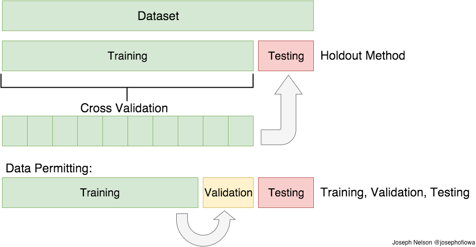
:::

::: {.column width="50%"}
O simples procedimento de dividir o conjunto de dados em dois, uma parte
para treinar o modelo e a outra parte (conjunto de teste) para estimar o
risco $R(g)$ é denominado de [*data splitting*]{.red} ou [*hold-out
method*]{.red}. É um procedimento mais simples, porém, pode não ser útil
em conjunto de dados não muito grandes.

A segunda linha da ilustração, demonstra o procedimento de
*cross-validation* (validação cruzada), procedimento mais utilizado nos
treinamentos de modelos de aprendizagem de máquina.

A terceira linha é uma abordagem também utilizada, porém não tão
interessante quanto a validação cruzada. Nessa abordagem o banco de
dados é dividido aleatoriamente em três partes. Treina-se o modelo com a
parte [verde]{.green}, estima-se o risco com o conjunto de validação
amarelo e testa-se o modelo com o conjunto de teste.
:::
:::

## Resumindo: data splitting, validação cruzada e conjunto de validação

<br> A abordagem do conjunto de validação envolve **dividir o conjunto de
treinamento em duas partes**: uma parte é usada para treinar o modelo e a
outra parte é usada para avaliar o desempenho do modelo para uma dada combinação.
de hiperparâmetros. O conjunto de validação é utilizado para avaliar os hiperparâmetros
do modelo, como a taxa de aprendizado, o número de camadas ocultas em uma rede neural,
entre outros. Após o ajuste dos hiperparâmetros, o modelo final é
treinado com o conjunto de treinamento completo e avaliado em um
conjunto separado chamado conjunto de teste. Essa abordagem é conhecida
como divisão simples de treinamento/validação/teste.

<br>

Por outro lado, a validação cruzada $k$-*fold* é uma abordagem que visa
obter uma estimativa mais robusta do desempenho do modelo. Nessa
abordagem, o conjunto de treinamento é dividido em $k$ subconjuntos
(*folds*) de tamanho aproximadamente igual. O modelo é treinado $k$
vezes, cada vez usando $k-1$ *folds* como conjunto de treinamento e $1$
*fold* como conjunto de validação. O desempenho do modelo é então
calculado como a média dos resultados obtidos em cada iteração. Isso
permite avaliar o modelo, em diferentes combinações dos hiperparâmetros, de forma
mais precisa, pois utiliza todos os dados para treinamento e validação, evitando
a dependência de uma única divisão do conjunto de treinamento.

## Resumindo: data splitting, validação cruzada e conjunto de validação

<br>

A validação cruzada $k$-*fold* é particularmente útil quando o conjunto
de dados é limitado, pois aproveita ao máximo os dados disponíveis. Além
disso, **ela permite verificar se o modelo é estável e se seu desempenho
varia significativamente com diferentes divisões dos dados**. É importante
ressaltar que a validação cruzada $k$-*fold* pode ser computacionalmente
mais cara do que a abordagem do conjunto de validação, uma vez que
envolve treinar e avaliar o modelo várias vezes.

<br>

{width="40%"}

## Resumindo: data splitting, validação cruzada e conjunto de validação

<br>

Um outro detalhe que muitas vezes não é falado é que apesar de temos
duas tarefas de estimação, uma envolvendo o conjunto de **treinamento**,
em que treinamos o modelo e outra envolvendo o conjunto de **teste**, em
que queremos estimar o risco $R(g)$, de modo a poder selecionar o melhor
modelo, a segunda tarefa é bem mais fácil. É por isso que o conjunto de
treinamento tende a ser menor que o conjunto de teste.

<br>


## 💻 Tidymodels

<br>

Diversas bibliotecas na linguagem R são preparadas para trabalharem na
área de aprendizagem de máquina. Várias dessas bibliotecas vem sendo
desenvolvidas há anos. Por exemplo,as bibliotecas
[glmnet](https://cran.r-project.org/web/packages/glmnet/index.html),
[ranger](https://cran.r-project.org/web/packages/ranger/index.html),
[kknn](https://cran.r-project.org/web/packages/kknn/index.html),
[xgboost](https://cran.r-project.org/web/packages/xgboost/index.html),
[keras](https://cran.r-project.org/web/packages/keras/index.html),
[rpart](https://cran.r-project.org/web/packages/rpart/index.html),
[randomForest](https://cran.r-project.org/web/packages/randomForest/index.html),
entre diversos outros.

<br>

```{r}
#| code-fold: true
#| eval: true
#| code-summary: O número de pacotes abaixo é o mais recente. Obtido automaticamente por webscraping.
library(xml2)
library(httr)
library(stringr)

numero_pacotes_r <- httr::GET(
  "https://cloud.r-project.org/web/packages/index.html"
) |>
  xml2::read_html() |>
  xml2::xml_find_all("//p[1]") |>
  xml2::xml_text() |>
  stringr::str_extract(pattern = "[0-9]+")
```

<br>

Atualmente, a linguagem R possui [`r numero_pacotes_r`]{.red}, em que
muitos deles são preparados para para trabalharem em tarefas de
aprendizagem de máquina, porém, cada com sua sintaxe específica. Muitos
implementam o mesmo modelo, uns com algumas variações, porém, o uso é
totalmente diferente, nomes de parâmetros distintos, saídas distintas,
etc.


## 💻 Tidymodels

<br>

Essas diferentes implementações torna confuso trabalhar e testar
diferentes modelos ao mesmo tempo.

<br>

::: columns
::: {.column width="50%"}
Uma das primeiras ideias mais conhecidas de unificação de sintaxe do
*workflow* de machine learning, na linguagem R, foi idealizada pelo
estatístico [Max Khun](https://www.linkedin.com/in/max-kuhn-864a9110/).

<br>

Ele criou a biblioteca
[caret](https://cran.r-project.org/web/packages/caret/index.html) -
**C**lassification **A**nd **RE**gression **T**raining de R que é muito
bem desenvolvida e abrangente. Você poderá estudar o
[caret](https://cran.r-project.org/web/packages/caret/index.html)
clicando [aqui](https://topepo.github.io/caret/).

<br>

Não foi um trabalho simples, veja uma tabela com a quantidade de modelos
que o [caret](https://cran.r-project.org/web/packages/caret/index.html)
suporta, clicando
[aqui](https://topepo.github.io/caret/available-models.html). Então,
"por baixo dos panos", a ideia era unificar a entrada e saída. A
biblioteca **caret** continua sendo mantida, apesar da existência do
[tidymodels](https://www.tidymodels.org/).
:::

::: {.column width="50%"}
{fig-aling="center"}
:::
:::

## 💻 Tidymodels

<br>

::: columns
::: {.column width="50%"}
{fig-aling="center"}
:::

::: {.column width="50%"}
Max Kuhn, atualmente, no momento de escrita desse mateiral, é
funcionário da [Posit Ltda](https://posit.co/) e foi contratado para
estar a frente do desenvolvimento de uma versão "arrumada" (*tidy*) do
[caret](https://cran.r-project.org/web/packages/caret/index.html), que é
o [tidymodels](https://www.tidymodels.org/).

<br>

{width="50%" fig-aling="center"}
:::
:::

## 💻 Tidymodels

<br>

. Todos os pacotes
(rsample, recipes, parsnip, tune, dails, yardstick) são gerenciados pelo
pacote [tidymodels](https://www.tidymodels.org/). Cada um desses pacotes
fornece um conjunto de funções úteis em tarefas específicas no workflow
de machine learning.](imgs/workflow_tidymodels.png){fig-aling="center"
width="70%"}

## 💻 Tidymodels

<br>

1.  [rsample](https://rsample.tidymodels.org/): responsável pela
    reamostragem dos dados, parte importante para que possamos treinar
    um modelo de aprendizagem de máquina. É nele que encontra-se funções
    para realizar reamostragem como bootstrap, $k$-folds
    cross-validation, nested cross-validation, entre outras.

{width="10%" fig-aling="center"}

2.  [recipes](https://recipes.tidymodels.org/): apresenta diversas
    funções para transformações de variáveis como criação de variáveis
    dummy, normalização de variáveis, inputação de dados pela média,
    mediana, $k$NN, entre outras formas de imputação, transformações de
    variáveis categórias em numéricas, entre outras funcionalidades. Ele
    permite que possamos criar uma receita de transformações nos dados
    para que esses, após transformados, possam entrar no modelo.

{width="10%" fig-aling="center"}

3.  [parsnip](https://parsnip.tidymodels.org/): é o pacote que unifica
    as entradas e saídas de diversos pacotes de aprendizagem de máquina
    de R. Ele possui os motores (engines) que são as comunicações com os
    algoritmos implementados em diversos pacotes de R que trabalham com
    tarefas de regressão e classificação, em aprendizagem de máquina.

## 💻 Tidymodels

<br>

::: columns
::: {.column width="50%"}
Os pacotes [tune](https://tune.tidymodels.org/),
[dails](https://dials.tidymodels.org/) e
[yardstick](https://yardstick.tidymodels.org/) tomará conta da parte de
treino do modelo. Os pacote [tune](https://tune.tidymodels.org/) e
[dails](https://dials.tidymodels.org/) são responsáveis pela "tunagem"
dos eventuais hiperparâmetros, já o
[yardstick](https://yardstick.tidymodels.org/) é responsável pelas
métricas de avaliação do modelo.

<br>

A biblioteca [dails](https://dials.tidymodels.org/) está mais
relacionada a criação dos *grids* para os eventuais hiperparâmetros do
modelo. Já o pacote [tune](https://tune.tidymodels.org/), utiliza-se da
validação cruzada criada pelo pacote
[rsample](https://rsample.tidymodels.org/) para varrer as combinações de
hiperparâmetros criadas pelo [dails](https://dials.tidymodels.org/),
i.e., o [tune](https://tune.tidymodels.org/) está mais relacionado com a
otimização dos hiperparâmetros.
:::

::: {.column width="25%"}
{fig-aling="right"}
:::

::: {.column width="25%"}
{fig-aling="right"}
{fig-aling="right"}
:::
:::

## 💻 Tidymodels

<br>

Todo o fluxo de trabalho é gerido pela biblioteca
[workflows](https://workflows.tidymodels.org/) de R. Em especial, as
etapas de *feature engineering* e especificação do modelo.

<br>

{fig-aling="center"}

## 💻 Tidymodels

<br>

 de R. Basicamente
gostaríamos de ter uma automação da faze do tratamento das *features*
realizada com o [recipes](https://recipes.tidymodels.org/) com a
modelagem.](imgs/MachineLearning_tidymodels.png){fig-aling="center"}

## 💻 Tidymodels

<br>

Não necessariamente iremos utilizar o
[tidymodels](https://www.tidymodels.org/) em todos os exemplos e
exercícios. Porém, iremos explorar bastante, até o fim do curso, o
treinamento de modelos usando o
[tidymodels](https://www.tidymodels.org/). Por tanto, aos poucos, a
medida em que exemplos são apresentados e exercícios forem passados, o
aprendizado do uso do [tidymodels](https://www.tidymodels.org/) se dará.

<br>

{width="25%"}
{width="25%"}

<br>

Sempre que possível, deveremos colocar as "mãos na massa" 🍝 para que
possamos dominar e compreender uma ferramenta computacional. A prática é
importante!

## Resumindo: data splitting, validação cruzada e conjunto de validação

<br>

No [tidymodels](https://www.tidymodels.org/), utilizamos a biblioteca [rsample](https://rsample.tidymodels.org/) para realizar procedimentos de validação
cruzada:

<br>

1. `initial_split()`: útil para uma divisão inicial dos dados, i.e., para aplicação do
*hold-out*;

2. `loo_cv()`: se desejar realizar um procedimento de *leave-one-out cross-validation*;

2. `vfold_cv()`: para um procedimento de $k$-*folds cross-validation*. Podemos inclusive
realizar várias repetições de validação cruzada o que poderá remelhorar ainda mais a seleção
da melhor combinação de hiperparâmetros. O número de repetições de validação cruzada poderá
ser especificado no argumento `repeats` que por padrão é `1L`;

3. `bootstraps()`: se for desejado utilizar um procedimento de *bootstrap* não-paramétrico
ao invés de uma validação cruzada. O papel do *bootstrap* é o mesmo da validação cruzada, porém,
a seleção das amostras de treinamento é de mesmo tamanho da amostra de treinamento original e o procedimento é feito com reposição, i.e., os mesmos dados podem aparecer nas amostras. O conjunto de avaliação é definido como as linhas dos dados originais que não foram incluídos na amostra bootstrap. Isso geralmente é chamado de amostra [*out-of-bag*]{.red} - OOB. Podemos alterar o número de amostras *bootstrap* modificando o argumento `times` que por padrão é `25L`.

<br>

**Lembre-se que qualquer procedimento de validação cruzada que você escolher deve ser realizado no conjunto
de treinamento**! 📌

## ⚖️ Balanço viés e variância

<br>

A ideia de precisão e exatidão estão ligadas ao viés e variância do
modelo $g$, em que precisão está ligado a ideia de variância pequena e
exatidão está ligada a ideia de baixo viés. A ideia é termos um
estimador próximo o que ilustra o item [d]{.red}. Muitas vezes temos um
estimador nas situações [b]{.red} e [c]{.red}. O ideal é o balanço de
viés e variância, que seria o estimador ilustrado pelo item [d]{.red}.

{fig-align="center" width="55%"}

## ⚖️ Balanço viés e variância

<br>

Um grande apelo para o uso do risco quadrático, i.e., risco que utiliza
a função de perda $L_2$ é sua interpretabilidade. Temos que o risco
quadrático $R(g)$ condicional a um novo ${\bf x}$ poderá ser decomposto
por:

$$\mathbb{E}\left[(Y - \widehat{g}({\bf X}))^2| {\bf X} = {\bf x}\right] = \underbrace{\mathbb{V}[Y | {\bf X = x}]}_{\mathrm{i - Variância\,\, intrínseca}} + \overbrace{(r({\bf x}) - \mathbb{E}[\widehat{g}({\bf x})])^2}^{\mathrm{ii - Viés\, ao\, quadrado\, do\, modelo}} + \underbrace{\mathbb{V}[\widehat{g}({\bf x})]}_{\mathrm{iii - Variância\, do\, modelo}}.$$ {#eq-decomposicao-risco-l2}
**Temos que**:

<br>

i - É a variância intrínseca da vairável resposta (*label*), que não
depende da função $\widehat{g}$ escolhida e, assim, não poderá ser
reduzida. Na verdade, poderemos reduzir $i$, se incluirmos mais
*features* (covariáveis/variáveis explicativas) ao nosso modelo;

ii - É o viés ao quadrado do estimador $\widehat{g}$ (viés ao quadrado
do modelo);

iii - É a variância do estimador $\widehat{g}$.

## ⚖️ Balanço viés e variância

<br>

Assim, lembre-se que uma escolha adequada de $\widehat{g}$ nos garante
que conseguiremos reduzir o risco preditivo $R(g)$, pois a escolha
apropriada implica em escolhermos um estimador de $\widehat{g}$ com
balanço entre víes e variância.

<br>

Modelos com muitos parâmetros possuem viés relativamente baixo, porém,
tendem a ter variância muito alta, em geral, uma vez que precisamos
estimar muitos parâmetros. Já modelos com poucos parâmetros, normalmente
tendem a ter variância baixa, acompanhados normalmente de um alto viés.

<br>

Geralmente, modelos com muitos parâmetros nos levam a termos
[*overffiting*]{.red} (super-ajuste), o que não é bom pois são
acompanhados de alta variância. Já modelos muito simplistas nos conduzem
à um ajuste muito ruim ([*underffiting*]{.red} ou sub-ajuste).
Entendeu!?


## ⚖️ Balanço viés e variância

<br>

```{r}
#| code-fold: true
#| code-summary: "Estude o código"
#| eval: false
library(ggplot2)
library(tibble)
library(ggplot2)
library(patchwork)

# Função de regressão verdadeira. Na prática é desconhecida.
regressao_verdadeira <- function(x)
  45 * tanh(x/1.9 - 7) + 57

observacoes_regressao_real <- function(n, desvio_padrao = 0.2) {
  # Permitindo que o mesmo x possa ter dois pontos de y, como ocorre na
  # pratica
  seq_x <- sample(seq(0, 17.5, length.out = n), size = n, replace = TRUE)

  step <- function(x)
    regressao_verdadeira(x) + rnorm(n = 1L, mean = 0, sd = desvio_padrao)

  tibble::tibble(y = purrr::map_vec(.x = seq_x, .f = step), x = seq_x)
}

# Usaremos uma regressão polinomial para tentar ajustar à regressão -------
regressao_polinomial <- function(n = 30L, desvio_padrao = 4, grau = 1L) {

  dados <- observacoes_regressao_real(n = n, desvio_padrao = desvio_padrao)

  iteracoes <- function(tibble_data, grau) {
      x <- tibble_data$x
      iteracoes <- lapply(X = 2L:grau, FUN = function(i) x^i)

      result <- cbind(tibble_data, do.call(cbind, iteracoes))
      colnames(result)[(ncol(tibble_data) + 1):ncol(result)] <- paste0("x", 2L:grau)

      as_tibble(result)
  }

  if(grau >= 2L)
    dados <- iteracoes(dados, grau = grau)

  ajuste <- lm(formula = y ~ ., data = dados)
  dados$y_chapeu <- predict(ajuste, new.data = dados)

  dados |>
    dplyr::relocate(y_chapeu, .before = x)
}

plotando <- function(dados){
  dados |>
    ggplot(aes(x = x, y = y_chapeu)) +
    geom_point()
}

mc_ajustes <- function(mc = 100L, n = 50L, desvio_padrao = 5, grau = 1L){

  p <-
    ggplot(data = NULL) +
      coord_cartesian(xlim = c(0, 17.5), ylim = c(0, 110)) +
      ylab("Valores estimados")

  df <- NULL
  for(i in 1L:mc){
    df <- regressao_polinomial(n = n, desvio_padrao = desvio_padrao, grau = grau)
    p <- p + geom_line(data = df, aes(x = x, y = y_chapeu))
  }
  p +
    stat_function(fun = regressao_verdadeira, col = "red", size= 1.4) +
    labs(
      title = "Regressão Polinomial",
      subtitle = paste("Grau: ", grau)
    ) +
    theme(
      plot.title = element_text(face = "bold"),
      axis.title = element_text(face = "bold")
    )
}

# Fixando uma semente
set.seed(0)

p1 <- mc_ajustes(grau = 1, n = 100, desvio_padrao = 10)
p2 <- mc_ajustes(grau = 7, n = 100, desvio_padrao = 10)
p3 <- mc_ajustes(grau = 70, n = 100, desvio_padrao = 10)
p4 <- mc_ajustes(grau = 200, n = 100, desvio_padrao = 10)

p <- ((p1 | p2) / (p3 | p4)) + plot_annotation(tag_levels = "A")

ggsave(p, file = "imgs/vies_variancia.png", device = "png", width = 40, height = 30, units = "cm")
```

{fig-align="center" width="60%"}

## ⚖️ Balanço viés e variância

<br>

Experimente de forma interativa altera a complefixade do modelo.

<br>

```{=html}
 <iframe id="example1" src="https://pedro-rafael.shinyapps.io/shiny_apps/" style="border: none; width: 100%; height: 90%" frameborder="0"></iframe>
```

<br>

Para ampliar a aplicação, clique [aqui](https://pedro-rafael.shinyapps.io/shiny_apps/).

## 🎛 Tuning Parameters

<br>

No exemplo anterior, note que os parâmetros dos modelos são os
coeficientes $\beta$'s que indexam a regressão polinomial. Porém,
perceba que á um **parâmetro de sintonização** ([*tuning
parameter*]{.red}) que é o valor de $p$, isto é, qual o grau do
polinômio que iremos utilizar.

<br>

Normalmente a escolha é feita realizando um [*grid search*]{.red} por
meio de um [*cross-validation*]{.red}.

<br>

No exemplo anterior, fizemos uma simulação e observamos que ao
considerar graus nem muito grandes nem muito pequenos, aparentemente
teremos escolhas razoáveis.

<br>


## 🎛 Tuning Parameters

<br>

[Exemplo]{.red}: Consedere os dados de expectativa de vida versus PIB
per Capita, disponíveis
[aqui](https://github.com/prdm0/dados/raw/main/dados_expectativa_renda.RData).
Selecione o melhor estimador $g$ da classe $\mathbb{G}$, em que

$$\mathbb{G} = \left\{g(x)\,\,:\,\, \beta_0 + \sum_{i = 1}^p \beta_i x^i\,\, \text{para } p \in \{1, 2, \cdots,11\} \right\}.$$
Note que selecionar o melhor polinômio é uma busca em $p$. Devemos
utilizar o erro quadrático médio - EQM sob o conjunto de validação, uma
vez que sabemos que apenas em um conjunto de validação ou em novas
observações o estimador do risco pelo EQM é consistente, pela Lei dos
Grandes Números.

<br>

Vamos utilizar a biblioteca
[rsample](https://rsample.tidymodels.org/index.html) para a tarefa de
validação cruzada. Leia a documentação da biblioteca, em especial, a da
função `vfold_cv`, responsável por construir a validação cruzada. Na
verdade ela faz a divisão da base de dados em $v$ *splits* de tamanho
aproximadamente iguais. Por padrão, $v = 10$. Esse é o procedimento de
$k$-*fold cross-validation* que apresentamos aqui, em que $v = k$.

## 🎛 Tuning Parameters

<br>

Algumas observações gerais a respetio da biblioteca
[rsample](https://rsample.tidymodels.org/index.html), que são úteis para
resolver esse problema:

{fig-align="center"}

1.  Para realizar uma **primeira divisão** do conjunto de dados (*data
    splitting/hold-out*), utiliza-se a função `initial_split`;
2.  Para acessar o conjunto de **treinamento** dos dados, usamos a
    função `training`;
3.  Para acessar o conjunto de **teste**, usamos a função `testing`;
4.  Para constuir todas as divisões da validação cruzada, entre
    treinamento e validação, no conjunto de treinamento inicial, usamos
    a função `vfold_cv` já mencionada;
5.  Para acessar o conjunto de **treinamento** de um *split* da
    validação cruzada, usamos a função `analysis`;
6.  Para acessar o conjunto de **validação**, utilizamos a função
    `assessment`.

## 🎛 Tuning Parameters

{fig-align="center" width="5%"}

<br> Note que realizar uma validação cruzada é importante para podemos
selecionar o melhor polinômio, i.e., o melhor valor de $p$. Caso
venhamos negligenciar esse aspecto da análise, iremos cair na falácia de
acreditarmos que quanto maior o grau do polinômio, maior será o poder
preditivo do modelo. Isso não é verdade e você deverá selecionar o
melhor modelo dentro de um esquema de validação cruzada.

<br>

No mundo de aprendizagem de máquina, muitos chamam o processo de
encontrar o melhor hiperparâmetro de ["tunagem"]{.red}. Em vários
modelos, podemos ter mais de um.

## 🎛 Tuning Parameters

<br>

As Figuras abaixo, mostram a avaliação dos polinômios da classe
$\mathbb{G}$, usando o risco estimado $\widehat{R}(g)$ pelo erro
quadrático médio - EQM. Porém, a Figura [A]{.red} aprenseta a avaliação
dos modelos, usando simplesmente o conjunto de treinamento e a Figura
[B]{.red} aprensenta a avaliação do grau do polinômio considerando uma
validação cruzada dentro do conjunto de treinamento.

<br> {fig-align="center"}

<br>

A mensagem equivocada passada pela Figura [A]{.red} é que supostamente
aumentar a complexidade do modelo seria uma uma boa alternativa e nos
conduziríamos à bons modelos preditivos. Mas sempre se lembre do
equilíbrio que temos que ter entre viés e variância. A Figura [B]{.red}
mostra que um polinômio com grau próximo à $p = 8$ é a melhor
alternativa.

## 🎛 Tuning Parameters

<br>

Observe o *dashboard* interativo! Sabemos que para que tenhamos uma boa
estimativa do risco preditivo, devemos utilizar novas observações. No
*dashboard*, é possível observar que a forma errada (usando o conjunto
de treinamento para avaliar o risco), sugere que sempre será bom
adicionar mais parâmetros ao modelo, levando a *overfitting*. Perceba
que usando a forma correta (usando validação cruzada), o EQM (risco
estimado) sugere que não podemos aumentar muito a quantidade de
parâmetros.

<br>

```{=html}
 <iframe id="example1" src="https://pedro-rafael.shinyapps.io/shiny_apps/#section-avalia%C3%A7%C3%A3o-do-risco-preditivo" style="border: none; width: 100%; height: 90%" frameborder="0"></iframe>
```
## 🎛 Tuning Parameters

<br>

Abaixo você poderá acessar o código que soluciona o problema. O
parâmetro `errado = FALSE` da função validação no código que segue,
conduz a solução correta (usando a validação cruzada), que sempre você
deverá considerar na prática.

<br>

```{r}
#| code-fold: true
#| code-summary: "Estude o código da solução de exemplo"
#| eval: false

library(rsample)
library(yardstick)
library(tibble)
library(purrr)
library(ggplot2)
library(patchwork)

# Lendo dados
url <- "https://github.com/prdm0/dados/raw/main/dados_expectativa_renda.RData"
arquivo_temp <- tempfile()
download.file(url = url, destfile = arquivo_temp)
load(arquivo_temp)

dados <-
  dados_expectativa_renda |>
  dplyr::select(-CountryName) |>
  dplyr::rename(y = LifeExpectancy, x = GDPercapita)

iteracoes <- function(tibble_data, grau) {
  x <- tibble_data$x
  iteracoes <- lapply(X = 2L:grau, FUN = function(i) x^i)

  result <- cbind(tibble_data, do.call(cbind, iteracoes))
  colnames(result)[(ncol(tibble_data) + 1):ncol(result)] <- paste0("x", 2L:grau)

  as_tibble(result)
}

regressao_polinomial <- function(dados, grau = 1L) {
  if(grau >= 2L)
    dados <- iteracoes(dados, grau = grau)

  lm(formula = y ~ ., data = dados)
}

# Divisão dos dados
divisao_inicial <- rsample::initial_split(dados)
treinamento <- rsample::training(divisao_inicial)
teste <- rsample::testing(divisao_inicial) # Teste final

# v-folds cross-validation
validacao <- function(dados, grau = 1L, errado = FALSE, ...){

  # Todas as divisões da validacao cruzada
  cv <- rsample::vfold_cv(dados, ...)

  hiper <- function(i){
    treino <- rsample::analysis(cv$splits[[i]]) # Treinamento
    validacao <- rsample::assessment(cv$splits[[i]]) # Validacação
    ajuste <- regressao_polinomial(dados = treino, grau = grau)

    if(errado){
      df_treino <- iteracoes(treino, grau = grau)
      df_treino <- df_treino |> dplyr::mutate(y_chapeu = predict(ajuste, newdata = df_treino))
      yardstick::rmse(data = df_treino, truth = y, estimate = y_chapeu)$.estimate
    } else {
      df_validacao <- iteracoes(validacao, grau = grau)
      df_validacao <- df_validacao |> dplyr::mutate(y_chapeu = predict(ajuste, newdata = df_validacao))
      yardstick::rmse(data = df_validacao, truth = y, estimate = y_chapeu)$.estimate
    }
  }
  purrr::map_dbl(.x = seq_along(cv$splits), .f = hiper) |>
    mean()
}

plot_avaliacao <- function(dados, errado = FALSE){
  # Testando iterativamente, vários valores de p:
  p <- seq(1L:11L)
  risco <- purrr::map_dbl(.x = p, .f = \(p) validacao(dados = dados, grau = p, errado = errado))
  df_risco <- tibble::tibble(p = p, risco = risco)

  # Plotando
  df_risco |>
    ggplot(aes(x = p, y = risco, color = risco)) +
    geom_point(size = 5) +
    scale_x_continuous(breaks = p) +
    scale_y_continuous(breaks = p) +
    labs(
      title = "Valiando o risco estimado para diversos graus do polinômio",
      subtitle = "EQM no conjunto de validação"
    ) +
    theme(
      plot.title = element_text(size = 18, face = "bold"),
      plot.subtitle = element_text(size = 16),
      axis.text = element_text(size = 10),
      axis.title = element_text(size = 14, face = "bold")
    )
}

# Avaliacão errada versus correta
set.seed(0)
grafico <-
  plot_avaliacao(dados, errado = TRUE) +
  plot_avaliacao(dados, errado = FALSE) +
  plot_annotation(tag_levels = c("A", "B"))

ggsave(grafico, file = "imgs/avaliacao_risco.png", device = "png", width = 50, height = 20, units = "cm", limitsize = F)

plot_bar <- function(grau){
  ruim <- validacao(dados, errado = TRUE, grau = grau)
  bom <- validacao(dados, errado = FALSE, grau = grau)
  df <- tibble::tibble(x = c("Errado", "Certo"), y = c(log(ruim), log(bom)))

  df |>
    ggplot(aes(x = x, y = y)) +
    geom_bar(stat = "identity") +
    geom_text(aes(label = y), vjust = 0)
}
```


## 📚 Exercícios

<br>

[Exercício]{.red}: Explique resumidamente o que é aprendizagem
supervisionada e não-supervisionada. Cite um problema de aprendizagem
supervisionada e um outro de aprendizagem não-supervisionada.

<br>

[Exercício]{.red}: Considere o conjunto de dados de Expectativa de vida
versus PIB per Capita, disponível
[aqui](https://github.com/prdm0/dados/raw/main/dados_expectativa_renda.RData).
Considere a função $g$, da seguinte forma:

$$g(x) = \beta_0 + \sum_{i = 1}^p \beta_i x^i,$$ com
$p \in \{1, 2, ..., 50\}$. Utilizando o erro quadrático médio observado,
sem fazer nenhuma estratégia de divisão dos dados, implemente um código
em R para checar qual o melhor modelo.

<br>

[Exercício]{.red}: Explique qual o motivo que faz com que o Erro
Quadrático Médio - EQM para avaliar o desempenho de um modelo é ruim
quando não adotamos nenhuma estratégia de divisão do conjunto de dados
em treinamento e teste.

## 📚 Exercícios

<br>

[Exercício]{.red}: Com suas palavras, explique o dilema de balanço entre
víes e variância.

<br>

[Exercício]{.red}: Refaça o exercício do polinômio, utilizando a
estratégia de [*data splitting*]{.red}, em que divide-se o conjunto de
dados em treinamento e teste. Utilize o conjunto de teste para calcular
a estimativa do risco, usando o EQM.

<br>

[Exercício]{.red}: Ainda considerando o exercício do polinômio,
implemente uma estratégia de [*leave-one-out cross-validation*]{.red} e
selecione o melhor modelo minimizando a função de risco.

<br>

[Exercício]{.red}: Por fim, considerando o exercício do polinômio,
rafaça-o utilizando um procedimento de [$k$-fold
cross-validation]{.red}. Considere $k = 5$. **Dica**: considere utiliza
a biblioteca [rsample](https://rsample.tidymodels.org/).


## Melhor subconjunto de covariáveis

<br>

O estimador de mínimos quadrados - EMQ, na presença de muitas *features*
(covariáveis), i.e., quando temos $d$ grande, possui um baixo poder
preditivo devido a possibilidade de *overfitting* (super-ajuste). Isso, porquê haverá
muitos parâmetros a serem estimados, e portanto, a função de regressão
estimada $\widehat{r}({\bf x})$ terá baixo poder preditivo.

<br>

Isso se deve ao fato do balanço de viés e variância. Havendo muitos
parâmetros, como já tinhamos visto, a variância do modelo poderá ser muito
alta.

<br>

**Portanto, deveremos buscar meios de encontrar o melhor (ao menos um
bom) conjunto de covariáveis. Queremos diminuir a variância do Estimador de Mínimos Quadrados!**

<br>

{width="20%"}

## Melhor subconjunto de covariáveis

<br>

A ideia para resolver esse problema é retirar algumas covariáveis do
modelo de regressão, com o objetivo de diminuir a variância de
$\widehat{g}$.

<br>

Você poderá entender que estamos em busca de um estimador $\widehat{g}$
de $g$ um **pouco** mais viesado. Trata-se de uma troca em que desejamos
reduzir substancialmente a variabilidade do estimador do modelo em troca
de um pouco mais de viés.

<br>


## Melhor subconjunto de covariáveis

<br>

Matematicamente, uma maneira de fazer isso, é buscar a estimativa para

$$\widehat{\beta}_{L_0} = \argmin_{\beta_0 \in \mathbb{R}, \beta \in \mathbb{R}^d}\sum_{k = 1}^n\overbrace{\left(y_k - \beta_0 - \sum_{i = 1}^d \beta_i x_{k,i}\right)^2}^{n \times EQM} + \lambda \,\,\underbrace{\sum_{i = 1}^d \mathbb{I}(\beta_i \neq 0)}_{\text{Penalização}}.$$ {#eq-risco-penalizacao}

Note que a penalização $\sum_{i = 1}^d \mathbb{I}(\beta_i \neq 0)$ nos
conduz na direção de modelos com poucas covariáveis, quando $\lambda$ é
um valor alto. Em particualr, quando $\lambda \to \infty$, forçamos a
retirada de todas as covariáveis $\beta_i$'s, i.e., a solução para o
problema seria $\widehat{\beta}_{L_0} \equiv (\overline{y}, {\bf 0})$.
Note que não há penalização para o intercepto $\beta_0$.

<br> No outro extremo, para $\lambda = 0$, temos o estimador de mínimos
quadrados, em que nenhuma penalização será considerada.

<br> [Não há uma forma fácil de minimizar
$\widehat{\beta}_{L_0}$.]{.red} 🤯

## Melhor subconjunto de covariáveis

<br>

Poderíamos, ingenuamente, pensar em ajustar todas as combinações
possíveis de parâmetros e utilizar algum critério, por exemplo, o EQM em
novas observações para escolher o melhor modelo entre todas as combinações
possíveis. Isto é, escolher o melhor modelo entre todas as $2^d$
combinações possíveis de modelos em $\mathbb{G}$.

<br>

Se $\widehat{\lambda} = \frac{2}{n}\widehat{\sigma}^2$, estimar
$\widehat{\beta}_{L_0}$ equivale uma busca entre $2^d$ modelos da classe
$\mathbb{G}$:

<br>

```{=tex}
\begin{align*}
\mathbb{G} = \{
&g({\bf x}) = \widehat{\beta}_0, \\
&g({\bf x}) = \widehat{\beta}_0 + \widehat{\beta}_1x_1,\\
&g({\bf x}) = \widehat{\beta}_0 + \widehat{\beta}_2x_2,\\
&\cdots\\
&g({\bf x}) = \widehat{\beta}_0 + \widehat{\beta}_dx_d,\\
&g({\bf x}) = \widehat{\beta}_0 + \widehat{\beta}_1x_1 + \widehat{\beta}_2x_2,\\
&g({\bf x}) = \widehat{\beta}_0 + \widehat{\beta}_1x_1 + \widehat{\beta}_3x_3,\\
&\cdots\\
&g({\bf x}) = \widehat{\beta}_0 + \widehat{\beta}_1x_1 + \widehat{\beta}_dx_d,\\
&g({\bf x}) = \widehat{\beta}_0 + \widehat{\beta}_1x_1 + \widehat{\beta}_2x_2 + \widehat{\beta}_3x_3,\\
&g({\bf x}) = \widehat{\beta}_0 + \widehat{\beta}_1x_1 + \widehat{\beta}_2x_2 + \widehat{\beta}_dx_d,\\
&\cdots\\
&g({\bf x}) = \widehat{\beta}_0 + \widehat{\beta}_1x_1 + \widehat{\beta}_2x_2 + \widehat{\beta}_3x_3 + \cdots + &\widehat{\beta}_dx_d
\}.
\end{align*}
```
## Melhor subconjunto de covariáveis

<br>

Utilizar $\lambda = \frac{2}{n}\widehat{\sigma}^2$ é o mesmo que
utilizar o critério AIC para determinar o melhor modelo, em que dado

$$\widehat{R}(g) = \frac{1}{m}\sum_{k = 1}^m \underbrace{(\widetilde{Y}_k - g({\bf \widetilde{X}}_k))^2}_{W_k},$$
em que
$(\widetilde{{\bf X}}_1, \widetilde{Y}_1), \cdots, (\widetilde{{\bf X}}_m, \widetilde{Y}_m)$,
representa o conjunto de teste, i.e., calculado com base em $m$
observações em um conjundo de dados não utilizados para treinar o
modelo, independentemente da estratégia de divisão utilizada, em que

$$\widehat{\sigma}^2 = \frac{1}{m}\sum_{k = 1}^m (W_k - \overline{W})^2,$$
com $\overline{W} = \frac{1}{m}\sum_{k=1}^m W_k$.

## Melhor subconjunto de covariáveis

<br>

Temos que $\widehat{R}(g)$, calculado em novas observações (observações
não utilizadas no treinamento), pode se valer do Teorema Central do
Limite, uma vez que $\widehat{R}(g)$ é calculado em uma sequência de
variáveis aleatórias i.i.d.'s. Então:

$$\widehat{R}(g) \sim \text{Normal}\left(R(g), \frac{1}{m}\mathbb{V}[W_1]\right).$$

Portanto, um intervalo aleatório de aproximadamente $95\%$ de confiança
para o erro preditivo $R(g)$ poderá ser calculado como:

$$\widehat{R}(g) \pm 1,645 \sqrt{\frac{1}{m}\widehat{\sigma}^2}.$$

O cálculo de um intervalo de confiança poderá ser útil para entendermos
como está variando o risco preditivo do nosso modelo. Gostamos de ter
modelos com intervalo de amplitude pequena. O intervalo poderá ser
utilizado para fornecer *insight* de como escolher a divisão de
treinamento e teste. **Por exemplo, pode-se escolher o menor valor de $m$
de modo que a amplitude seja a menor possível**. 💭💡

## Melhor subconjunto de covariáveis

<br>

Por que essa seria uma escolha ingênua? Pense na situação em que temos
$d = 30$, i.e., trinta covariáveis. Teríamos portanto $2^{30}$ modelos
para ajustar, ou seja, um bilhão e setenta e três milhões, setecentos e
quarenta e um mil, oitocentos e vinte e quatro modelos para ajustar. É
um a quantidade absurda de modelos para serem estimados!

<br>

Se $d = 100$, teríamos que estimar uma quantidade de modelos que a
quantidade estimada de estrelas no universo. A depender do número de covariáveis,
esqueça a ideia de estimar $2^d$ modelos! Não permita se frustrar facilmente. 😏

<br>


## Regressão *Stepwise*

<br> Devido a impossibilidade de experimentar uma grande quantidade de
modelos ($2^d$), existe uma série de algoritmos (heurísticas), que visam
reduzir a quantidade de modelos avaliados. Um dos mais conhecidos é o
[forward stepwise]{.red}. Trata-se de um algoritmo sequencial, que em
cada passo, apenas uma variável é adicionada:

<br>

1 - Para $j = 1, \cdots, d$, ajuste a regressão de $Y$ na $j$-ésima
variável $X_j$. Seja $\widehat{R}(g_j)$ o risco estimado desta função.
Então,

$$\widehat{j} = \argmin_j \widehat{R}(g_j)\,\,\,\,\,\, \text{e}\,\,\,\,\,\, S = \{\widehat{j}\}.$$
2 - Para cada $j \in S^c$, ajuste a regressão
$Y = \beta_jX_j + \sum_{s \in S}\beta_sX_S$, em que $\widehat{R}(g_j)$ é
o risco estimado desta função. Defina

$$\widehat{j} = \argmin_{j \in S^c} \widehat{R}(g_j)\,\,\,\,\,\, \text{e atualize}\,\,\,\,\,\, S \leftarrow \{S \cup \widehat{j}\}.$$

3 - Repita os passos anteriores até que todas as variáveis estejam em
$S$ ou até quando não seja mais possível ajustar o modelo de regressão.

4 - Selecione o modelo com menor risco estimado.

## Regressão *Stepwise*

<br>

Utilizar o algoritmo de seleção de variáveis [*foward stepwise*]{.red},
ao invés de buscarmos o melhor ajuste entre $2^d$ possíveis modelos, que
muitas vezes é impossível, precisaremos investigar apenas
$1 + d(d + 1)/2$ modelos. Reduzimos a complexidade da seleção que antes
era um problema exponencial. Melhor, não?!

<br>


## Penalização

<br>

Quando temos modelos que envolve $d$ parâmetros e que temos controle
sobre eles (conhecemos muito bem cada um deles), acrescentar algum tipo
de penalização à função objetivo poderá ser útil. A penalização é uma
[medida de complexidade]{.red}, em que é útil para equilibrar o modelo,
de modo a tentar buscar um equilibrio entre viés e variância, discutidos
anteriormente. Assim, sob novas observações, desejamos estimar o risco
$R(g)$, por

<br>

$$R(g) \approx EQM(g) + \mathcal{P}(g).$$

<br>

Desejamos minimiar $R(g)$, mas não a custa de muitos parâmetros, pois
assim teríamos [*overfitting*]{.red}. Portanto, para muitos parâmetros
temos que ter EQM baixo, porém, $\mathcal{P}(g)$ deve ser alto. Já em
modelos viesados, quando temos poucos parâmetros, o EQM normalmente é
alto, mas a complexidade $\mathcal{P}(g)$ deve ser baixo, pois temos um
modelo mais simplista.

## AIC e BIC

<br>

Existem diversas penalizações, em que o AIC (**A**kaike **I**nformation
**C**riterion) e BIC (**B**ayesian **I**nformation **C**riterion) são as
mais conhecidas. Com base nesses critérios, temos que

<br>

::: {columns}
::: {.column width="30%"}
1.  [AIC]{.red}: $$EQM + \frac{2}{n\,d\, \widehat{\sigma}^2}.$$
2.  [BIC]{.red}: $$EQM + \frac{\log(n)}{n\, d\, \widehat{\sigma}^2}.$$
:::

::: {.column width="70%"}
$$\widehat{\sigma}^2 = \frac{1}{m}\sum_{k = 1}^m (W_k - \overline{W})^2.$$
:::
:::

<br>

Aqui, $d$ é a quantidade de parâmetros no modelo e $\widehat{\sigma}^2$
é uma estimativa da variância do erro, que para um conjunto de teste
suficientemente grande, poderá ser considerado o estimador de
$\widehat{\sigma}^2$ conforme descrito anteriormente. Segundo [James,
Gareth, et al. An introduction to statistical learning. Ed. 2, p.
233](https://hastie.su.domains/ISLR2/ISLRv2_corrected_June_2023.pdf),
assume-se o modelo com todos os preditores para o cálculo de
$\widehat{\sigma}^2$.

## Lasso

<br>

::: columns
::: {.column width="50%"}
O lasso foi desenvolvido pelo Robert Tibshirani, em um artigo publicado
no artigo [Regression Shrinkage and Selection via the
Lasso](https://www.jstor.org/stable/2346178).


:::

::: {.column width="50%"}
{width="60%"}
:::
:::

## Lasso

<br>

O lasso tem como objetivo encontrar um estimador de uma regressão linear
que possui risco menor que o de mínimos quadrados, possuindo duas
grandes vantagens, em relação ao *stepwise*:

<br>

1.  Sua solução é mais rápida, ainda que *stepwise* seja
    consideravalmente mais rápido do que avaliar $2^d$ modelos;
2.  O lasso é capaz de selecionar automaticamente as variáveis mais
    relevantes para o modelo, reduzindo a dimensionalidade dos dados.

<br>

A segunda vantagem ocorre, uma vez que ele realiza uma penalização que
leva à estimativas de alguns coeficientes $\beta_i$ igual a zero,
eliminando as variáveis menos importantes. Normalmente o vetor $\beta$ é esparso!

<br>


## Lasso

<br>

No lasso, ao invés de reduzir a variância do estimador de mínimos
quadrados usando a complexidade
($L_0 = \sum_{i = 1}^d\mathbb{I}(\beta_i) \neq 0$) em
@eq-risco-penalizacao, usa-se a penalização
$L_1 = \sum_{i = 1}^d|\beta_i|$. No lasso, buscamos:

$$\widehat{\beta}_{L_1,\lambda} = \argmin_{\beta_0 \in \mathbb{R}, \beta \in \mathbb{R}^d}\sum_{k = 1}^n\overbrace{\left(y_k - \beta_0 - \sum_{i = 1}^d \beta_i x_{x,i}\right)^2}^{n \times EQM} + \overbrace{\lambda \,\,\underbrace{\sum_{j = 1}^d|\beta_j|}_{\text{Penalização}}}^{\text{A magnitude do coeficiente importa!}},$$
em que $\lambda$ é um *tuning parameter* 🎛. Perceba que quando
$\lambda = 0$, caímos no caso do modelo de regressão por mínimos
quadrados sem penalização. Já, quando $\lambda \rightarrow \infty$,
temos um modelo em que todas as variáveis são removidas, uma vez que a
primeira parte do modelo torna-se insignificante.

## Lasso

<br> <br>

Quando $\lambda$ é grande, temos que

$$\sum_{k = 1}^n \left(y_k - \beta_0 - \sum_{j = 1}^d \beta_j x_{k,j}\right)^2 + \lambda \sum_{j = 1}^d |\beta_j| \approx \lambda \sum_{j = 1}^d |\beta_j|,$$
e portanto, $\widehat{\beta}_1 = 0, \cdots, \widehat{\beta}_d = 0$.

<br>

A escolha de $\lambda$, em geral, é feita utilizado algum método de
validação cruzada. 🔍

<br>


## Lasso

<br>

O lasso é extremamente rápido, e nos últimos anos, diversos algoritmos
foram construídos para fazer essa taréfa de forma eficiente. O LARS foi
um dos primeiros algoritmos desenvolvidos em 2010. Para detalhes, ler
[Friedman, J. H. (2001). Greedy function approximation: a gradient
boosting machine. Annals of statistics,
1189--1232](https://www.jstor.org/stable/2699986).

<br>

No R, a regressão lasso poderá ser feita usando a biblioteca
[glmnet](https://cran.r-project.org/web/packages/glmnet/index.html),
assim:

<br>

```{r}
#| eval: false
library(glmnet)
ajuste <- cv.glmnet(x, y, alpha = 1)
```

<br>

{width="21%"}

## Ridge

<br>

Uma alternativa que surgiu antes do lasso é a [regressão ridge]{.red}.
Ela foi proposta no artigo [Hoerl, A. E. & Kennard, R. W. (1970). Ridge
regression: Biased estimation for nonorthogonal problems. Technometrics,
12(1), 55--67](https://www.jstor.org/stable/1267351). Aqui, utiliza-se
como medida de complexidade a norma $L_2$, em que, o estimador é dado
por:

$$\widehat{\beta}_{L_2,\lambda} = \argmin_{\beta_0 \in \mathbb{R}, \beta \in \mathbb{R}^d}\sum_{k = 1}^n\overbrace{\left(y_k - \beta_0 - \sum_{i = 1}^d \beta_i x_{x,i}\right)^2}^{n \times EQM} + \lambda \,\,\underbrace{\sum_{j = 1}^d\beta_j^2}_{\text{Penalização}}.$$
Diferentemente do lasso, a regressão ridge possui solução analítica,
dada por:

$$\widehat{\beta}_{L_2,\lambda} = ({\bf X}^{T}{\bf X} + \lambda\mathbb{\bf I}_0)^{-1}{\bf X}^{T}Y,$$
em que $\mathbb{\bf I}_0$ é a matriz identidade $(d + 1) \times (d + 1)$
com $\mathbb{\bf I}_0(1,1) = 0$.

<br>

## Ridge

<br>

A regressão ridge poderá ter uma variância menor que a regressão lasso,
porém seu viés poderá ser maior. Outra característica da regressão ridge
é que ela possue uma única solução, enquanto a regressão lasso poderá
ter multiplas soluções. Os autores também demonstram que a regressão
ridge lida melhor com multicolinearidade.

<br>

No R, também poderemos utilizar a biblioteca
[glmnet](https://cran.r-project.org/web/packages/glmnet/index.html):

<br>

```{r}
#| eval: false
library(glmnet)
ajuste <- cv.glmnet(x, y, alpha = 0)
```

<br>

{width="21%"}

## Elastic Net

<br>

Na documentação da função [`glmnet`](https://www.rdocumentation.org/packages/glmnet/versions/4.1-7/topics/glmnet), note que a função realiza o lasso mais o ridge, i.e.,

<br>

$$(1 - \alpha)/2 ||\beta_j||^2_2 + \alpha||\beta_j||_2.$$

<br>

Note que para $\alpha = 1$, temos uma regressão do tipo lasso, já para $\alpha = 0$ recaímos para uma penalização do tipo ridge. Para $\alpha$ diferente de zero e um, temos uma *elastic net*, ok?!

<br>


## Elastic Net

<br>

Nesse tipo de modelo de regressão, combina-se as penalizações da regressão
ridge com a utilizada na regressão lasso, herdando os benefícios do uso
de cada um dos métodos isoladamente, melhorando a estabilidade das
estimativas do lasso, em situações de multicolinearidade entre as
variáveis e também permitindo a seleção automática de variáveis.

$$(1-\alpha)\widehat{\beta}_{L_2,\lambda} + \alpha\widehat{\beta}_{L_1,\lambda},$$
em que $0 \leq \alpha \leq1$. Em R, basta especificar para a função
[`glmnet`](https://www.rdocumentation.org/packages/glmnet/versions/4.1-7/topics/glmnet) um valor de $\alpha$ diferente de 0 e 1. Esse valor normalmente é escolhido por um procedimento de validação cruzada.

<br>

{width="21%"}

## Exemplo: EMQ, Ridge, Lasso e Elastic Net

<br>

[Exemplo]{.red}: Considere uma base de dados simulada, com $n = 500$
observações, de tal forma que

$$Y = 3X_{1} - 2X_2 + X_3 + -3X_4 + X_5 + \sum_{i = 6}^{20}0X_i + \varepsilon,$$
em que $\varepsilon \sim \text{Normal}(0, 0.5^2)$ e
$X_i \sim \text{Normal}(0, 1)$, independentes, com $i = 1, \cdots, 20$.
Desejamos ajustar quatro modelos de regressão. Para o caso do Estimador
de Mínimos Quadrados - EMQ e do modelo Ridge, que não tem seleção
automática de variáveis, usaremos **todas** as variáveis. Desejamos
avaliar o risco estimado de cada uma das regressões.

{width="21%"}

## Exemplo: EMQ, Ridge, Lasso e Elastic Net

<br>

```{r}
#| code-fold: true
#| code-summary: "Solução utilizando o tidymodels"
#| eval: false
library(tidymodels)
library(tibble)
library(purrr)
library(ggplot2)
library(patchwork)

# Removendo possíveis conflitos de pacotes --------------------------------
tidymodels::tidymodels_prefer()

# Função para gerar os dados ----------------------------------------------
gerando_dados <- function(n = 300L){
  regressao <- function(i){
    x <- rnorm(n = 5L)
    y <- 3*x[1L] - 2*x[2L] + x[3L] - 3*x[4L] + x[5L] + rnorm(1L, 0, 0.5)
    tibble(
      y = y,
      x1 = x[1L],
      x2 = x[2L],
      x3 = x[3L],
      x4 = x[4L],
      x5 = x[5L]
    )
  }
  dados <- purrr::map(.x = 1L:n, .f = regressao) |>
    purrr::list_rbind()

  parte_esparsa <- matrix(0, n, 15)

  dados <- cbind(dados, parte_esparsa)
  colnames(dados) <- c("y", paste0("x", 2L:ncol(dados)))
  as_tibble(dados)
}

dados <- gerando_dados(n = 500)

# Divisão inicial da base -------------------------------------------------
hod_out <- initial_split(dados, prop = 0.7)
treinamento <- training(hod_out)
teste <- testing(hod_out)

# Setando o modelo (set engine) -------------------------------------------
modelo_eqm <-
  linear_reg(penalty = 0, mixture = 0) |>
  set_mode("regression") |>
  set_engine("glmnet")

modelo_ridge <-
  linear_reg(penalty = tune::tune(), mixture = 0) |>
  set_mode("regression") |>
  set_engine("glmnet")

modelo_lasso <-
  parsnip::linear_reg(penalty = tune::tune(), mixture = 1) |>
  set_mode("regression") |>
  parsnip::set_engine("glmnet")

modelo_elastic <-
  parsnip::linear_reg(penalty = tune::tune(), mixture = tune::tune()) |>
  set_mode("regression") |>
  parsnip::set_engine("glmnet")

# Criando workflows -------------------------------------------------------
all_wf <-
  workflow_set(
    preproc = list(y ~ . ),
    models = list(eqm = modelo_eqm, ridge = modelo_ridge, lasso = modelo_lasso, elastic = modelo_elastic),
    cross = TRUE
  )

# Validação cruzada -------------------------------------------------------
set.seed(0)
cv <- rsample::vfold_cv(treinamento, v = 5L)

# Setando a métrica -------------------------------------------------------
metrica <- yardstick::metric_set(rmse)

# Tunagem dos hiperparâmetros ---------------------------------------------
# A semente (seed = 0) faz com que dentro da validação cruzada para cada modelo
# a semente seja sempre a mesma.
tunagem <-
  all_wf |>
  workflow_map(
    seed = 0,
    verbose = TRUE,
    resamples = cv,
    grid = 50,
    metrics = metrica
  )

# Rank dos melhores modelos -----------------------------------------------
modelos_rank <- tunagem |> rank_results()

melhor_eqm <-
  tunagem |>
  extract_workflow_set_result("formula_eqm") |>
  select_best("rmse")

melhor_ridge <-
  tunagem |>
  extract_workflow_set_result("formula_ridge") |>
  select_best("rmse")

melhor_lasso <-
  tunagem |>
  extract_workflow_set_result("formula_lasso") |>
  select_best("rmse")

melhor_elastic <-
  tunagem |>
  extract_workflow_set_result("formula_elastic") |>
  select_best("rmse")

finalizando_eqm <-
  tunagem |>
  extract_workflow("formula_eqm") |>
  finalize_workflow(melhor_eqm) |>
  last_fit(split = hod_out)

finalizando_ridge <-
  tunagem |>
  extract_workflow("formula_ridge") |>
  finalize_workflow(melhor_ridge) |>
  last_fit(split = hod_out)

finalizando_lasso <-
  tunagem |>
  extract_workflow("formula_lasso") |>
  finalize_workflow(melhor_lasso) |>
  last_fit(split = hod_out)

finalizando_elastic <-
  tunagem |>
  extract_workflow("formula_elastic") |>
  finalize_workflow(melhor_elastic) |>
  last_fit(split = hod_out)

# Visualizando as métricas
finalizando_eqm |> collect_metrics()
finalizando_ridge |> collect_metrics()
finalizando_lasso |> collect_metrics()
finalizando_elastic |> collect_metrics()

# Visualizando predições:
finalizando_eqm |> collect_predictions()
finalizando_ridge |> collect_predictions()
finalizando_lasso |> collect_predictions()
finalizando_elastic |> collect_predictions()
```

## 📚 Exercícios

<br> [Exercício]{.red}: Utilizando os dados de vinho vermelho🍷,
disponíveis
[aqui](https://www.kaggle.com/datasets/uciml/red-wine-quality-cortez-et-al-2009),
faça uma pequena análise exploratória dos dados. No
[link](https://www.kaggle.com/datasets/uciml/red-wine-quality-cortez-et-al-2009)
do Kaggle você consegue uma explicação sobre o que significa cada uma
das variáveis.

{width="211"}

## 📚 Exercícios

<br>

[Exercício]{.red}: Utilizando os dados de vinho vermelho🍷, disponíveis
[aqui](https://www.kaggle.com/datasets/uciml/red-wine-quality-cortez-et-al-2009),
obtenha o melhor modelo de regressão linear para modelar a qualidade do
vinho, considerando:

<br>

1.  $g_1$ - Método dos mínimos quadrados;
2.  $g_2$ - Regressão ridge;
3.  $g_3$ - Regressao lasso;
4.  $g_4$ - Elastic Net.

<br>

Você deverá selecionar o melhor modelo de cada uma das classes de
modelos de regressão e construir uma tabela com o risco estimado
$\widehat{R}(g_i),\,\, i = 1, \cdots, 4$, em que aqui, $g_i$ representa o
modelo geral não estimado. Ao fim, construa quatro gráficos mostrando o
ajuste de cada um dos modelos.

<br>

[Exercício]{.red}: Se você utilizou o
[tidymodels](https://www.tidymodels.org/) para resolver o exercício
anterior, rafaça usando a biblioteca
[glmnet](https://cran.r-project.org/web/packages/glmnet/index.html).
Caso contrário, resolva-o utilizando o
[tidymodels](https://www.tidymodels.org/).

## 📚 Exercícios

<br>

[Exercício]{.red}: Considere agora o conjunto de dados de despesas
médicas, disponível
[aqui](https://www.kaggle.com/datasets/mirichoi0218/insurance). Refaça o
mesmo exercício dos dados de vinho vermelho, em que aqui, o objetivo é
prever a variável `charges`. Perceba que algumas variáveis são
qualitativas, e portanto, você deverá transformá-las em [*dummy*]{.red}.
Indique os melhores cenários dos quatro modelos e informe qual modelo
você utilizaria. Explique! **Dica**: usando a função `step_dummy()` da
biblioteca [recipes](https://recipes.tidymodels.org/), você poderá facilmente
transformar variáveis qualitativas em numéricas.

<br>


## Métodos não-paramétricos

<br>

Métodos paramétricos podem impor muitas limitações na solução de um
problema de regressão, i.e., em problemas que desejamos estimar a função
de regressão $r({\bf x})$. Por exemplo, nem sempre o melhor estimador
linear é um bom estimador para $r({\bf x})$.

<br>

Métodos paramétricos são muitas vezes simplistas e restritivos, em que
normalmente abrimos mãos para se ter um estimador um pouco mais viesado,
em detrimento da diminuição da variância do modelo. Por exemplo, nas
regressões penalizadas que vimos anteriormente (**ridge**, **lasso** e
**elastic-net**), penalizamos modelos com muitas covariáveis o que
naturalmente aumentará o viés, na maioria das vezes.

<br>


## Métodos não-paramétricos

<br>

Em situações em que temos muitos dados ($n$ grande), os modelos
não-paramétricos possuem, em geral, boa peformance, uma vez que apesar
de que nessa classe de modelos existir um aumento da variância,
seguida de uma redução de viés, a variância do modelo não aumenta muito.

<br>

De um lado, nos modelos de regressão que vimos até o momento,
introduzimos uma penalização para diminuir a variância do modelo frente
ao método dos mínimos quadrados (quando não usamos penalização) em troca
de um aumento no víes. Aqui, em modelos não paramétricos, desejamos
fazer a troca oposta, i.e., diminuir o viés, em troca de um ganho na
variância no modelo.

<br>

Qualquer abordagem paramétrica trás consigo a possibilidade de que a
forma funcional $g$ para estimar $f$ seja muito diferente da verdadeira,
claro, se o modelo resultante não se ajustar bem aos dados, isto é
$\widehat{g}$ não tem boa capacidade preditiva, muito embora, também é
possível que tenhamos $\widehat{g}$ com boa capacidade preditiva, mesmo que $g$
não represente a estrutura real de $f$ (sempre desconhecida).

## Métodos não-paramétricos

<br> <br>

Isso não é regra, porém ajuda a entender um pouco o dilema entre essas
classes de modelos (paramétricos e não-paramétricos).

<br>

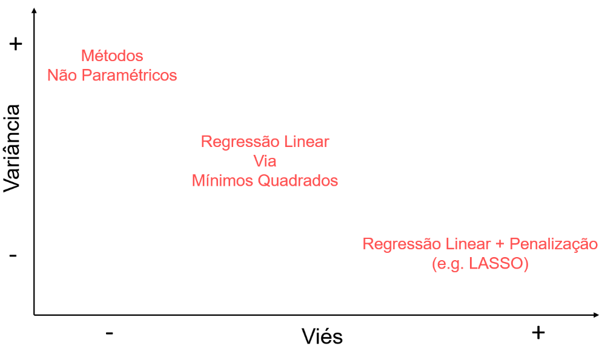{fig-aling="center"}

## $k$-vizinhos mais próximo próximos

<br>

Também chamado de [$k$-nearest neighbours - $k$NN]{.red}, o $k$NN é um
dos métodos mais populares na comunidade de aprendizagem de máquina. O
método foi formulado em uma sequência de dois artigos:

<br>

1 - Benedetti, J. K. (1977). **On the nonparametric estimation of
regression functions**. Journal of the Royal Statistical Society. Series
B (Methodological), 248--253;

<br>

2 - Stone, C. J. (1977). **Consistent nonparametric regression**. The
Annals of Statistics, 595-- 620.

<br>

A ideia do método é estimar a função de regressão $r({\bf x})$, para um
dado ${\bf x}$ com base nas respostas $Y$ dos $k$-vizinhos mais próximos
de ${\bf x}$.

## $k$-vizinhos mais próximo próximos

<br>

Formalmente, temos que

$$g({\bf x^*}) = \frac{1}{k}\sum_{i \in \mathcal{N}_{\bf x^*}}y_i,$$ em
que $\mathcal{N}_{\bf x^*}$ é o conjunto índices das $k$ observações mais
próximas de ${\bf x}$, i.e,

$$\mathcal{N}_{\bf x^*} = \{i \in \{1, \cdots, n\}\, : \, d({\bf x}_i, {\bf x^*}) \leq d_{\bf x^*}^k\},$$
em que $d_{\bf x^*}^k$ é a distância do $k$-ésimo vizinho mais próximo
de $\bf{x^*}$ em $\bf{x}$. Portanto, o valor da regressão no ponto
${\bf x^*},$ i.e., o valor de
$r({\bf x^*}) = \mathbb{E}(Y|{\bf X} = {\bf x^*})$ é estimado pela média
de $Y_{N_{\bf x^*}}$. Ou seja, estimamos por:

$$\overline{Y}_{N_{\bf x^*}} = \frac{1}{k} \sum_{i \in \mathcal{N}_{\bf x^*}}y_i.$$

## $k$-vizinhos mais próximo próximos

<br> <!-- http://leg.ufpr.br/~lucambio/MSM/MSM03.html --> Para
determinar $d_{\bf x^*}^k$, poderemos utilizar alguma métrica de
distância e assim mensurarmos a proximidade. Entre elas:

<br>

1.  [Distância Euclidiana]{.red} ou distância $L_2$:
    $d(x^a, x^b) = \sqrt{(x_1^a - x_1^b)^2 + \cdots + (x_d^a - x_d^b)^2}$;

<br>

2.  [Distância de Manhattan]{.red}, City Block ou distância $L_1$:
    $d(x^a, x^b) = \sqrt{|x_1^a - x_1^b| + \cdots + |x_d^a - x_d^b|}$;

<br>

2.  [Distância de Mahalanobis]{.red}:
    $d(x^a, x^b) = \sqrt{(x^a - x^b)^{T}S^{-1}(x^a - x^b)}$, em que $S$
    é a matriz de covariância, em que na diagonal princial temos as
    variâncias e fora dela as covariâncias entre os pontos. Lembre-se
    que se $x$ e $y$ são vetores de dados quaisquer, a interdependência
    linear entre eles poderá ser estimada como:

<br>

$$\mathrm{cov}(x, y) = \frac{1}{n-1}\sum_{i = 1}^n (x_i - \overline{x})(y_i - \overline{y}).$$

## $k$-vizinhos mais próximo próximos

<br>

Você poderá utilizar qualquer outra medida de distância além das que
foram citadas acima.

<br>

É importante perceber que **o método** $k$NN não faz uma "compressão"
dos dados como a regressão linear que estudamos. Lá, temos uma equação
que utilizamos para estimar o valor de $Y$, após as estimação dos
coeficientes do modelo de regressão, ou seja, não precisamos mais dos
dados para estimar novas observações. Já no $k$NN, precisamos sempre nos
recorrer aos dados para fazer novas predições, ou seja, sempre que
desejarmos calcular $r({\bf x}) = \mathbb{E}(Y|{\bf X} = {\bf x})$
deveremos sempre fazer uma nova consulta aos dados para calcular a média
dos vizinhos mais próximos. O $k$NN não possui coeficientes para
interpretar. Diferentemente da regressão linear, o $k$NN é um pouco mais
"*black box*".

<br>


## $k$-vizinhos mais próximo próximos

<br> O valor da constante $k$ é um hiperparâmetro do $k$NN e deverá ser
obtido por validação cruzada. Perceba que se $k = n$ temos um modelo
muito viesado, porém com variância pequena. Isso, porquê para $k = n$
basicamente iremos tirar uma média dos dados. Para $k = 1$, teremos um
*overfitting*, uma vez que o estimador irá interpolar os dados.

<br> [Exemplo]{.red}: Considere novamente o conjunto de dados de
expectativa de vida versus PIB per Capita disponíveis
[aqui](https://github.com/prdm0/dados/blob/main/dados_expectativa_renda.RData).
Utilizando o [tidymodels](https://www.tidymodels.org/), vamos construir
uma fução que retorne um gráfico com as estimativas do $k$NN. A função
receberá como argumentos o conjunto de dados e o valor de $k$. Você
também poderia utilizar outras bibliotecas, como por exemplo a
[FNN](https://cran.r-project.org/web/packages/FNN/index.html), ou a
[KKNN](https://github.com/KlausVigo/kknn), esta útlima é a que é
utilizada internamente na biblioteca
[parsnip](https://parsnip.tidymodels.org/) do
[tidymodels](https://www.tidymodels.org/).

<br>


## $k$-vizinhos mais próximo próximos

<br>

Abrindo apenas um parêntese, o [tidymodels](https://www.tidymodels.org/)
refere-se a um conjunto de pacotes que são úteis para o tratamento,
treinamento, tunagem e avaliação de modelos de aprendizagem de máquina,
em que o [parsnip](https://parsnip.tidymodels.org/) implementa as
*engines* (algoritmos/motores) que iremos utilizar para treinar um
modelo. Na verdade, os algoritmos estão implementados em pacotes de
terceiros e não precisamente no
[parsnip](https://parsnip.tidymodels.org/). Porém, o
[parsnip](https://parsnip.tidymodels.org/) unifica a sintaxe de diversos
algoritmos implementados em pacotes separados.

<br>


## $k$-vizinhos mais próximo próximos

<br>

Observe que na imagem abaixo, a Figura [A]{.red}, quando $k=1$,
percebemos initidamente que houve *overfitting*, i.e., há uma
interpolação dos dados. Já na Figura [D]{.red} temos um modelo com
variância menor, porém, este é muito simplista, o que sugere um alto
viés.

<br>

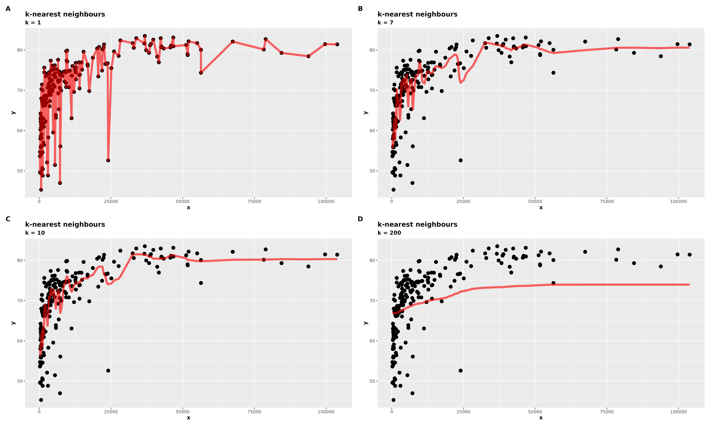{fig-aling="center"}

## $k$-vizinhos mais próximo próximos

<br>

Estude o código! Ele fornece a solução para o exemplo.

<br>

```{r}
#| eval: false
#| code-summary: "Solução pelo método knn do exemplo anterior"
#| code-fold: true

library(tidymodels)
library(glue)
library(dplyr)
library(ggplot2)
library(patchwork)

tidymodels::tidymodels_prefer()

# Lendo dados
url <- "https://github.com/prdm0/dados/raw/main/dados_expectativa_renda.RData"
arquivo_temp <- tempfile()
download.file(url = url, destfile = arquivo_temp)
load(arquivo_temp)

dados <-
  dados_expectativa_renda |>
  dplyr::select(-CountryName) |>
  dplyr::rename(y = LifeExpectancy, x = GDPercapita)

knn_exp_pip <- function(dados, k = 1L){
  # Criando receita
  receita <- recipe(y ~ x, data = dados)

  # Definindo o modelo
  modelo_knn <- nearest_neighbor(neighbors = k) |>
    set_mode("regression") |>
    set_engine("kknn")

  # Workflow
  ajuste_final <-
    workflow() |>
    add_model(modelo_knn) |>
    add_recipe(receita) |>
    fit(data = dados)

  # Retornando previsoes
  y_chapeu <- predict(ajuste_final, new_data = dados)

  dados <-
    dados |>
    mutate(y_chapeu = y_chapeu$.pred)

  dados |>
    ggplot() +
    geom_point(aes(x = x, y = y), size = 3) +
    geom_line(aes(x = x, y = y_chapeu), col = "red", alpha = 0.6, size = 2) +
    labs(title = "k-nearest neighbours", subtitle = glue("k = {k}")) +
    theme(
      title = element_text(face = "bold")
    )
}

p1 <- knn_exp_pip(dados, k = 1L)
p2 <- knn_exp_pip(dados, k = 7L)
p3 <- knn_exp_pip(dados, k = 10L)
p4 <- knn_exp_pip(dados, k = 200L)

p <- p1 + p2 + p3 + p4 + plot_annotation(tag_levels = "A")

ggsave(p, file = "imgs/knn_plot.png", width = 50, height = 30, units = "cm")
```

<br>

{width="25%"}

## $k$-vizinhos mais próximo próximos

<br>

**Algumas limitações do** $k$NN são:

<br>

1.  É totalmente dependente do conjunto de dados para fazer novas
    predições;

2.  Para novas observações que são fora dos limites dos dados de
    treinamento, as predições do $k$NN tendem a serem imprecisas;

3.  Pode ser custoso para uma grande base de dados;

4.  O cálculo de distâncias pode sofrer com a chamada "maldição da
    dimensionalidade", em que a depender da métrica de distância
    utilizada, tudo fica muito distante.

<br>

**Algumas vantagens são**:

<br>

1.  É um método simples de ser implementado;

2.  É muito utilizado para imputação de observações faltantes;

3.  É comumente utilizado, por conta de sua simplicidade, em explorações
    iniciais.

## 📚 Exercícios

<br>

[Exercício]{.red}: Considere o problema em que o objetivo é prever a
**pontuação** (*score*) / (item 2) do aluno com base em algumas
variáveis. São elas:

<br>

1.  **Horas estudadas**: o número total de horas gastas estudando por
    cada aluno;
2.  **Pontuação**: As notas obtidas pelos alunos em testes anteriores;
3.  **Atividades extracurriculares**: Se o aluno participa de atividades
    extracurriculares (Sim ou Não);
4.  **Horas de sono**: o número médio de horas de sono que o aluno teve
    por dia;
5.  **Amostras de perguntas praticadas**: O número de amostras de
    perguntas que o aluno praticou.

<br>

Você poderá baixar e ter uma descrição maior da base de dados clicando
[aqui](https://www.kaggle.com/datasets/nikhil7280/student-performance-multiple-linear-regression).
Avalie o poder preditivo do modelo lasso com o do $k$NN. Sua análise
deve conter uma análise exploratória dos dados, deverá utilizar um
esquema de $k$-*folds cross-validation*, com $k = 20$ e considerar um
esquema de *data splitting* na proporção $90\%$ para treino e $10\%$
para teste. Sua análise deverá estar em um notebook de
[quarto](https://quarto.org/), em que você deverá comentar cada passo da
análise.

## Nadaraya-Watson

<br>

Uma variação do método $k$NN que é bastante difundida na comunidade
estatística é o método de Nadaraya-Watson, propostos nos artigos:

<br>

1.  Nadaraya, E. A. (1964). **On estimating regression**. Theory of
    Probability & Its Applications, 9(1), 141--142;

2.  Watson, G. S. (1964). **Smooth regression analysis**. Sankhya: The
    Indian Journal of Statistics, Series A, 359--372.

<br>

Esse método também é chamado de estimador $k$-vizinhos ponderados ($k$NN
ponderado), uma vez que a estimação da função de regressão em um dado
ponto ${\bf x}$ utiliza de médias ponderadas das observações do conjunto
de treinamento:

$$g({\bf x}) = \sum_{i = 1}^n w_i({\bf x})y_i,$$ em que $w_i({\bf x})$ é
o peso atribuído à $i$-ésima observação, medindo a similaridade de
${\bf x}_i$ à ${\bf x}$.

## Nadaraya-Watson

<br>

Temos que $w_i({\bf x})$ é definido por:

$$w_i({\bf x}) = \frac{K({\bf x}, {\bf x}_i)}{\sum_{j = 1}^n K({\bf x}, {\bf x}_j)},$$
em que $K({\bf x}, {\bf x}_j)$ é um kernel de suavização usado para
medir a similaridade entre as observações. Escolhas que são populares
para $K({\bf x}, {\bf x}_j)$, são:

<br>

1.  [Kernel uniforme]{.red}:
    $K({\bf x}, {\bf x}_i) = \mathbb{I}(d({\bf x}, {\bf x}_i) \leq h)$;
2.  [Kernel gaussiano]{.red}:
    $K({\bf x}, {\bf x}_i) = (\sqrt{2\pi h^2})^{-1}\exp\left\{ -\frac{d^2({\bf x}, {\bf x}_i)}{2h^2}\right\}$;
3.  [Kernel triangular]{.red}:
    $K({\bf x}, {\bf x}_i) = (1 - d({\bf x}, {\bf x}_i)/h)\mathbb{I}(d({\bf x}, {\bf x}_i) \leq h)$;
4.  [Kernel de Epanechnikov]{.red}:
    $K({\bf x}, {\bf x}_i) = (1 - d^2({\bf x}, {\bf x}_i)/h^2)\mathbb{I}(d({\bf x}, {\bf x}_i) \leq h)$.

## Nadaraya-Watson

<br>

Enquanto no kernel uniforme, os pesos são iguais para as observações a
uma distância menor que $h$ de ${\bf x}$ e atribui peso zero para
observações maiores que $h$, os kernels triangular e de Epanechnikov
atribui pesos maiores para observações mais próximas de ${\bf x}$. A
quantidade $h$ é um [*tuning parameter*]{.red}, e na prática, deve ser
estimada por um procedimento de validação cruzada.

<br>

**Algumas propriedades de uma função kernel são**:

<br>

1.  **Simetria**: $K(x,y) = K(y,x)$, permitindo que a função de
    similaridade seja invariante em relação a ordem dos argumentos;
2.  **Positiva definida**: Para qualquer vetor $c$, em que seja possível
    fazer $c^{T}K(x,y)$, temos que $c^{T}K(x,y)c > 0$.

<br>

Você poderá encontrar outras funções kernel
[aqui](https://en.wikipedia.org/wiki/Kernel_(statistics)).

## Nadaraya-Watson

<br>

[Exemplo]{.red}: Novamente, considerando o conjunto de dados de
expectativa de vida versus PIB per Capita disponíveis
[aqui](https://github.com/prdm0/dados/blob/main/dados_expectativa_renda.RData).
Utilizando o [tidymodels](https://www.tidymodels.org/), vamos construir
uma fução que retorne um gráfico com as estimativas. A função receberá
como argumentos o conjunto de dados e o valor de $h$. Observe a
documentação da função `nearest_neighbor` do pacote
[parsnip](https://parsnip.tidymodels.org/). Perceba que o argumento
`weight_func` permite que possamos escolher entre algumas funções
kernel. Porém, como métrica de distâncias, apenas poderemos utilizar a
de Minkowski. Seja $x = (x_1, \cdots, x_n)$ e $y = (y_1, \cdots, y_n)$,
ambos vetores do $\mathbb{R}^n$. Então, a distância de Minkowski é dada
por:

$$d(x,y) = \left(\sum_{i = 1}^n |x_i - y_i|^p\right)^{\frac{1}{p}},$$
com $p \geq 1$. Note que se $p = 1$ temos a distância euclidiana
(distância $L_1$) e se $p = 2$ teremos a distancia de Manhattan
(distância $L_2$).

## Nadaraya-Watson

<br>

Portanto, com o argumento `dist_power` da função `nearest_neighbor`, do
pacote [parsnip](https://parsnip.tidymodels.org/), você poderá
especificar o valor de $p$, que inclusive poderá ser um hiperparâmetro,
podendo ser obtido por meio de uma validação cruzada.

<br>


<br>

No exemplo não iremos fazer a validação cruzada, pois apenas queremos
implementar uma função em que seja possível experimentar o método para
diferentes valores de $h$ e diferentes funções de kernel.

## Nadaraya-Watson

<br> A imagem abaixo utiliza o kernel gaussiano:

<br>

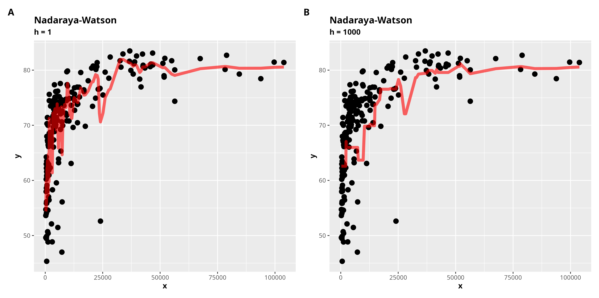{fig-aling="center"}

## Nadaraya-Watson

<br>

```{r}
#| code-fold: true
#| code-summary: "Solução do exempĺo de Nadaraya-Watson"

library(tidymodels)
library(glue)
library(dplyr)
library(ggplot2)
library(patchwork)

tidymodels::tidymodels_prefer()


# Lendo dados
url <- "https://github.com/prdm0/dados/raw/main/dados_expectativa_renda.RData"
arquivo_temp <- tempfile()
download.file(url = url, destfile = arquivo_temp)
load(arquivo_temp)

dados <-
  dados_expectativa_renda |>
  dplyr::select(-CountryName) |>
  dplyr::rename(y = LifeExpectancy, x = GDPercapita)

nadaraya_watson_exp_pip <- function(dados, h = 1, ...){
  # Criando receita
  receita <-
    recipe(y ~ x, data = dados) |>
    step_normalize()

  # Definindo o modelo
  modelo_knn <- nearest_neighbor(dist_power = h, ...) |>
    set_mode("regression") |>
    set_engine("kknn")

  # Workflow
  ajuste_final <-
    workflow() |>
    add_model(modelo_knn) |>
    add_recipe(receita) |>
    fit(data = dados)

  # Retornando previsoes
  y_chapeu <- predict(ajuste_final, new_data = dados)

  dados <-
    dados |>
    mutate(y_chapeu = y_chapeu$.pred)

  dados |>
    ggplot() +
    geom_point(aes(x = x, y = y), size = 3) +
    geom_line(aes(x = x, y = y_chapeu), col = "red", alpha = 0.6, size = 2) +
    labs(title = "Nadaraya-Watson", subtitle = glue("h = {h}")) +
    theme(
      title = element_text(face = "bold")
    )
}

p1 <- nadaraya_watson_exp_pip(dados, h = 1, weight_func = "gaussian")
p2 <- nadaraya_watson_exp_pip(dados, h = 1000, weight_func = "gaussian")

p <- p1 + p2 + plot_annotation(tag_levels = "A")

ggsave(p, file = "imgs/nadaraya_watson.png", width = 30, height = 15, units = "cm")
```

<br>


## Tidymodels $k$NN e Nadaraya-Watson

<br>

Para que possamos experimentar o
[tidymodels](https://www.tidymodels.org/) seguindo todo o fluxo de
"padrão" de aprendizagem de máquina, com divisão do conjunto de dados,
validação cruzada e busca pelos melhores hiperparâmetros ("tunagem").
Iremos reproduir dois exemplos com os dados de expectativa de vida e PIB
per Capita.

<br>

[Exemplo]{.red}: Nesse exemplo estamos realizando o $k$NN, em que
estamos obtendo um candidato para o valor de $k$, por meio de um
procedimento de *cross-validation* (10-*folds cross-validation*). Aqui,
a busca do hiperparâmetro $k$ fará uso de um *grid search*. Perceba, no
código que segue o exemplo, que no processo de "tunagem", alterei o grid
de valores usando a função `grid_max_entropy` do pacote
[dails](https://dials.tidymodels.org/reference/grid_max_entropy.html).
Uma observação é que você poderia criar uma tibble com valores do seu
interesse. O argumento `grid` da função `tune_grid` do pacote
[tune](https://tune.tidymodels.org/reference/tune_grid.html) deve ser um
data frame/tibble ou um número inteiro. Esse objeto conterá todas as
possíveis combinações de hiperparâmetros que serão testadas na validação
cruzada, no nosso caso, temos apenas um hiperparâmetro. Foi utilizado um
*grid* de tamanho 60. Foi utilizado uma divisão de $80\%$ para
treinamento e $20\%$ para teste.

## Tidymodels $k$NN e Nadaraya-Watson

<br>

```{r}
#| code-fold: true
#| code-summary: Workflow completo do treimanento de um modelo KNN.
#| eval: false
library(tidymodels)
library(dplyr)
library(ggplot2)
library(patchwork)

# Resolvendo eventuais conflitos entre tidymodels e outros pacotes eventualmente
# carregados:
tidymodels::tidymodels_prefer()

# Lendo a base de dados:
url <- "https://github.com/prdm0/dados/raw/main/dados_expectativa_renda.RData"
arquivo_temp <- tempfile()
download.file(url = url, destfile = arquivo_temp)
load(arquivo_temp)

dados_expectativa_renda <-
  dados_expectativa_renda |>
  dplyr::select(-CountryName)

# Setando uma semente
set.seed(0)

# Divisão da base de dados ------------------------------------------------
# Divisão inicial (treino e teste)
splits <-
  rsample::initial_split(
    dados_expectativa_renda,
    strata = "LifeExpectancy",
    prop = 0.8
  )

# O conjunto de dados de treinamento será utilizado para ajustar/treinar o
# modelo:
treinamento <- rsample::training(splits)

# O conjunto de teste será utilizado apenas no fim, para avaliar o desempenho
# preditivo final do modelo:
teste <- rsample::testing(splits)

# Criando uma receita para os dados ---------------------------------------

# Poderia ter passado o conjunto treinamento ou posso passar o conjunto "splits".
# O comando recipes já entende que deverá utilizar o conjunto de treinamento.
receita <-
  recipes::recipe(formula = LifeExpectancy ~ ., data = treinamento) |>
  step_YeoJohnson(all_predictors()) |> # Ajuda na normalização dos dados. Pode ser bom!
  step_normalize(all_predictors()) # Normalizando variáveis numéricas.

# Construindo modelo kNN --------------------------------------------------
modelo_knn <-
  parsnip::nearest_neighbor(neighbors = tune()) |>
  parsnip::set_mode("regression") |>
  parsnip::set_engine("kknn")

# Construindo um workflow (pipeline) --------------------------------------
wf_knn <-
  workflows::workflow() |>
  workflows::add_recipe(receita) |>
  workflows::add_model(modelo_knn)

# Cross-validation --------------------------------------------------------
cv <-
  treinamento |>
  rsample::vfold_cv(v = 10L, strata = "LifeExpectancy")

# Busca do hiperparâmetro k -----------------------------------------------
metrica <- metric_set(rmse)

# Extraindo e atualizando range do parâmetro ------------------------------
update_parametros <-
  wf_knn |>
  extract_parameter_set_dials() |>
  update("neighbors" = neighbors(c(1, 50)))

# Tunagem -----------------------------------------------------------------
meu_grid <- dials::grid_max_entropy(update_parametros, size = 60)

tunagem <-
  tune::tune_grid(
    wf_knn,
    resamples = cv,
    grid = meu_grid,
    metrics = metrica,
    control = control_grid(save_pred = TRUE, verbose = TRUE)
  )

p_hiper <- autoplot(tunagem) +
  labs(title = "KNN - Seleção do número k (vizinhos)", subtitle = "Sintonização do hiperparâmetro (valor de k)") +
  theme(
    title = element_text(face = "bold")
  )

# Atualizando workflow ----------------------------------------------------
wf_knn <-
  wf_knn |>
  finalize_workflow(select_best(tunagem))

# Ajustar o modelo ao conjunto de treinamento e avaliar no teste --------
ajuste_final <- last_fit(wf_knn, splits)

# Ajuste final com toda a base de dados -----------------------------------
modelo_final <- fit(wf_knn, data = dados_expectativa_renda)

# Visualizando as predições na base de treino
p_ajuste <- ajuste_final$.predictions[[1L]] |>
  ggplot(aes(x = LifeExpectancy, y = .pred)) +
  geom_point(size = 3, alpha = 0.7, col = "red") +
  labs(
    title = "Predições versus Real",
    subtitle = "Usando apenas os dados de teste"
  ) +
  xlab("LifeExpectancy") +
  xlab("LifeExpectancy predito") +
  theme(
    title = element_text(face = "bold")
  )

# Unindo os dois plots
p <- p_hiper + p_ajuste + plot_annotation(tag_levels = "A")

# Salvando gráficos
ggsave(p, file = "imgs/plot_hiper_ajuste_tidymodels_knn_whatson.png", width = 30,
       height = 15, units = "cm")
```

O pacote
[dials](https://dials.tidymodels.org/reference/grid_max_entropy.html)
fornece três funções o *grid* de parâmetros. São apenas funções que
criam *grids* para os hiperparâmetros, segundo algumas metodologias, mas
que na prática não há garantias de qual irá funcionar melhor. A ideia é
experimentar e, por meio de uma validação cruzada, decidir por qual
utilizar. Normalmente, a `grid_max_entropy`, utilizada no código acima,
funciona bem.

::: columns
::: {.column width="50%"}
1.  [`grid_max_entropy`](https://dials.tidymodels.org/reference/grid_max_entropy.html)
2.  [`grid_latin_hypercube`](https://dials.tidymodels.org/reference/grid_max_entropy.html)
3.  [`grid_regular`](https://dials.tidymodels.org/reference/grid_regular.html)
4.  [`grid_random`](https://dials.tidymodels.org/reference/grid_regular.html)
:::

::: {.column width="50%"}

:::
:::


## Tidymodels $k$NN e Nadaraya-Watson

<br>

Para demonstar que podemos realizar transformações (receitas) na base de
dados, entre do processo de treinamento, foi realizado duas
transformações na variável `GDPercapita`. A primeira foi a Yeo--Johnson
*transformation* e a segunda foi uma simples normalização dos dados
(subitrair da média e dividir pelo desvio padrão). A [transformação de
Yeo--Johnson](https://en.wikipedia.org/wiki/Power_transform#Yeo%E2%80%93Johnson_transformation)
é uma transformação semelhante a de
[Box-Cox](https://en.wikipedia.org/wiki/Power_transform#Box%E2%80%93Cox_transformation).
A transformação de
[Yeo--Johnson](https://en.wikipedia.org/wiki/Power_transform#Yeo%E2%80%93Johnson_transformation)
trata de situações que a transformação de
[Box-Cox](https://en.wikipedia.org/wiki/Power_transform#Box%E2%80%93Cox_transformation)
não trata. Por exemplo, ela trata de valores negativos e zero.

<br>

A ideia do *steps* utilizados na faze de pré-processamento dos dados, em
que utilizamos o pacote recipes do R, é que para novas observações,
depois do modelo ajustado, essas transformações serão automaticamente
aplicadas aos novos dados.

<br>


## Tidymodels $k$NN e Nadaraya-Watson

<br>

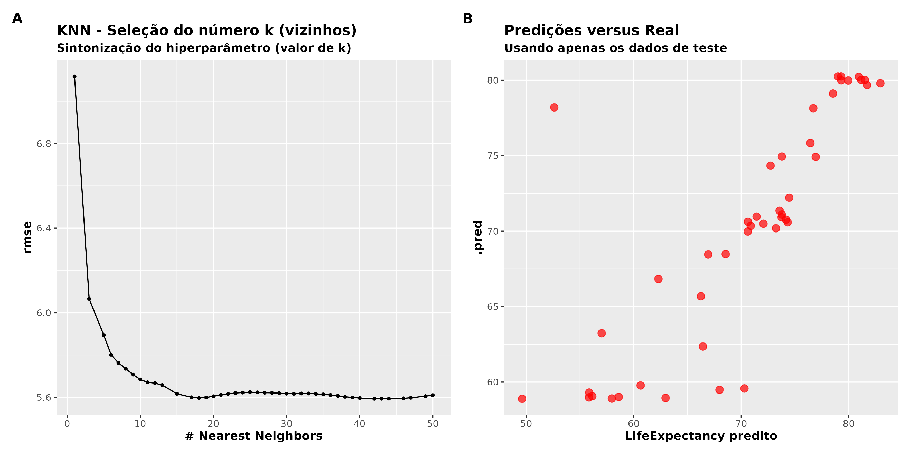{fig-aling="center"
width="50%"}

## Tidymodels $k$NN e Nadaraya-Watson

<br>

[Exemplo]{.red}: Vamos reproduzir todo o fluxo de treinamento que
fizemos com o método $k$NN no exemplo anterior, agora, utilizando o
modelo Nadaraya-Watson. Note que uma vez que entendemos o
[tidymodels](https://www.tidymodels.org/), fica fácil adaptar um código
já existente para o treinamento de um outro modelo. Na verdade, o método
de Nadaraya-Watson implementado no tidymodels é um pouco diferente.
Ainda utilizamos a informação de $k$, em que o valor de $h$ é
deverminado pela média dos vizinhos mais próximos de ${\bf x}_i$ à
${\bf x}$. Além de $k$, temos o valor de $p$ para a distância de
Minkowski como hiperparâmetro. Portanto, aqui, teremos dois
hiperparâmetros (parâmetros de sintonização).

<br>

```{r}
#| code-fold: true
#| code-summary: Workflow completo do treimanento de um modelo Nadaraya-Watson.
#| eval: false
library(tidymodels)
library(dplyr)
library(ggplot2)
library(patchwork)
library(doMC)

# Paralelizando o código em sistemas Unix
registerDoMC(cores = parallel::detectCores())

# Resolvendo eventuais conflitos entre tidymodels e outros pacotes eventualmente
# carregados:
tidymodels::tidymodels_prefer()

# Lendo a base de dados:
url <- "https://github.com/prdm0/dados/raw/main/dados_expectativa_renda.RData"
arquivo_temp <- tempfile()
download.file(url = url, destfile = arquivo_temp)
load(arquivo_temp)

dados_expectativa_renda <-
  dados_expectativa_renda |>
  dplyr::select(-CountryName)

# Setando uma semente
set.seed(0)

# Divisão da base de dados ------------------------------------------------
# Divisão inicial (treino e teste)
splits <-
  rsample::initial_split(
    dados_expectativa_renda,
    strata = "LifeExpectancy",
    prop = 0.8
  )

# O conjunto de dados de treinamento será utilizado para ajustar/treinar o
# modelo:
treinamento <- rsample::training(splits)

# O conjunto de teste será utilizado apenas no fim, para avaliar o desempenho
# preditivo final do modelo:
teste <- rsample::testing(splits)

# Criando uma receita para os dados ---------------------------------------

# Poderia ter passado o conjunto treinamento ou posso passar o conjunto "splits".
# O comando recipes já entende que deverá utilizar o conjunto de treinamento.
receita <-
  recipes::recipe(formula = LifeExpectancy ~ ., data = treinamento) |>
  step_YeoJohnson(all_predictors()) |> # Ajuda na normalização dos dados. Pode ser bom!
  step_normalize(all_predictors()) # Normalizando variáveis numéricas.

# Construindo modelo Nadaraya ---------------------------------------------
modelo_nadaraya <-
  parsnip::nearest_neighbor(dist_power = tune(), weight_func = "gaussian") |>
  parsnip::set_mode("regression") |>
  parsnip::set_engine("kknn")

# Construindo um workflow (pipeline) --------------------------------------
wf_nadaraya <-
  workflows::workflow() |>
  workflows::add_recipe(receita) |>
  workflows::add_model(modelo_nadaraya)

# Cross-validation --------------------------------------------------------
cv <-
  treinamento |>
  rsample::vfold_cv(v = 10L, strata = "LifeExpectancy")

# Busca do hiperparâmetro k -----------------------------------------------
metrica <- metric_set(rmse)

# Extraindo e atualizando range do parâmetro ------------------------------
update_parametros <-
  wf_nadaraya |>
  extract_parameter_set_dials() |>
  update("dist_power" = dist_power(c(2, 50)))

# Tunagem -----------------------------------------------------------------
meu_grid <- dials::grid_max_entropy(update_parametros, size = 100L)

tunagem <-
  tune::tune_grid(
    wf_knn,
    resamples = cv,
    grid = meu_grid,
    metrics = metrica,
    control = control_grid(save_pred = TRUE, verbose = TRUE)
  )

p_hiper <- autoplot(tunagem) +
  labs(title = "Nadaraya-Watson - Seleção do parâmetro p", subtitle = "Sintonização do hiperparâmetro (distância p)") +
  theme(
    title = element_text(face = "bold")
  )

# Atualizando workflow ----------------------------------------------------
wf_nadaraya <-
  wf_nadaraya |>
  finalize_workflow(select_best(tunagem))

# Ajustar o modelo ao conjunto de treinamento e avaliar no teste --------
ajuste_final <- last_fit(wf_nadaraya, splits)

# Ajuste final com toda a base de dados -----------------------------------
modelo_final <- fit(wf_nadaraya, data = dados_expectativa_renda)

# Visualizando as predições na base de treino
p_ajuste <- ajuste_final$.predictions[[1L]] |>
  ggplot(aes(x = LifeExpectancy, y = .pred)) +
  geom_point(size = 3, alpha = 0.7, col = "red") +
  labs(
    title = "Predições versus Real",
    subtitle = "Usando apenas os dados de teste"
  ) +
  xlab("LifeExpectancy") +
  xlab("LifeExpectancy predito") +
  theme(
    title = element_text(face = "bold")
  )

# Unindo os dois plots
p <- p_hiper + p_ajuste + plot_annotation(tag_levels = "A")

# Salvando gráficos
ggsave(p, file = "imgs/plot_hiper_ajuste_tidymodels_nadaraya.png", width = 30,
       height = 15, units = "cm")
```

## Tidymodels $k$NN e Nadaraya-Watson

<br>

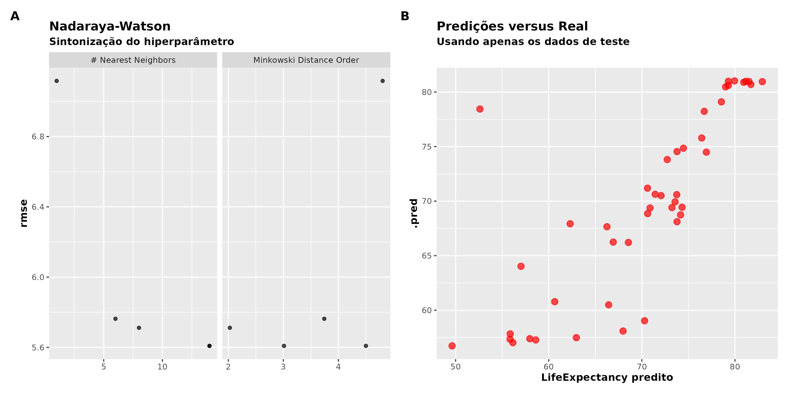{fig-aling="center"}
\## Tidymodels $k$NN e Nadaraya-Watson

<br>

Podemos visualizar a melhor combinação de hiperparâmetros, segundo
$\widehat{R}(g)$ usando fazendo:

```{r}
#| eval: false

# As cinco melhores combinações
tunagem |>
  show_best()
```


## Comparando dois ou mais modelos

<br>

**Você poderia perguntar**: "Certo, mais tenho como comparar dois ou
mais modelos de uma única vez?"

<br>

::: columns
::: {.column width="50%"}

:::

::: {.column width="50%"}
<br>

A resposta é **Sim**!

<br>


:::
:::

## Comparando dois ou mais modelos

<br>

Na verdade, é bem mais interessante comparar conjuntamente, visto que
para poder compararmos devemos garantir que as mesmas amostras de
treinamento e teste estão sendo utilizadas, i.e., para termos uma
comparação mais justa. Claro que dá para fazer de forma separada,
fixando a semente dos geradores de números pseudo-aleatórios, para que a
biblioteca rsample possa reproduzir a mesma divisão para ambos os
modelos. Porém, a estratégia do exemplo abaixo é mais consistente.

<br>

[Exemplo]{.red}: Estude o código que segue! Ele compara os modelos de
$k$NN com o método de Nadaraya-Watson.

<br>

```{r}
#| code-fold: true
#| code-summary: Workflow completo do treimanento e comparação de dois modelos (KNN e Nadaraya-Whatson).
#| eval: false

library(tidymodels)
library(dplyr)
library(ggplot2)
library(patchwork)

# Resolvendo eventuais conflitos entre tidymodels e outros pacotes eventualmente
# carregados:
tidymodels::tidymodels_prefer()

# Lendo a base de dados:
url <- "https://github.com/prdm0/dados/raw/main/dados_expectativa_renda.RData"
arquivo_temp <- tempfile()
download.file(url = url, destfile = arquivo_temp)
load(arquivo_temp)

dados_expectativa_renda <-
  dados_expectativa_renda |>
  dplyr::select(-CountryName)

# Setando uma semente
set.seed(0)

# Divisão da base de dados ------------------------------------------------
# Divisão inicial (treino e teste)
splits <-
  rsample::initial_split(
    dados_expectativa_renda,
    strata = "LifeExpectancy",
    prop = 0.8
  )

# O conjunto de dados de treinamento será utilizado para ajustar/treinar o
# modelo:
treinamento <- rsample::training(splits)

# O conjunto de teste será utilizado apenas no fim, para avaliar o desempenho
# preditivo final do modelo:
teste <- rsample::testing(splits)

# Criando uma receita para os dados ---------------------------------------

# Poderia ter passado o conjunto treinamento ou posso passar o conjunto "splits".
# O comando recipes já entende que deverá utilizar o conjunto de treinamento.
receita_knn <-
  recipes::recipe(formula = LifeExpectancy ~ ., data = treinamento) |>
  step_YeoJohnson(all_predictors()) |> # Ajuda na normalização dos dados. Pode ser bom!
  step_normalize(all_predictors()) # Normalizando variáveis numéricas.

receita_nadaraya <- receita_knn

# Construindo modelo kNN --------------------------------------------------
modelo_knn <-
  parsnip::nearest_neighbor(neighbors = tune()) |>
  parsnip::set_mode("regression") |>
  parsnip::set_engine("kknn")

# Construindo modelo Nadaraya ---------------------------------------------
modelo_nadaraya <-
  parsnip::nearest_neighbor(dist_power = tune(), neighbors = tune(),
                            weight_func = "gaussian") |>
  parsnip::set_mode("regression") |>
  parsnip::set_engine("kknn")

# Validação cruzada -------------------------------------------------------
set.seed(0)
cv <- rsample::vfold_cv(treinamento, v = 5L)

# Criando workflow conjunto -----------------------------------------------
all_wf <-
  workflow_set(
    preproc = list(receita_knn, receita_nadaraya),
    models = list(modelo_knn = modelo_knn, modelo_nadaraya = modelo_nadaraya)
  )

# Tunando ambos os modelos ------------------------------------------------
tunagem <-
  all_wf |>
  workflow_map(
    seed = 0,
    verbose = TRUE,
    resamples = cv,
    grid = 50,
    metrics = metric_set(rmse)
  )

# Selecionando o melhor de cada um dos modelos ----------------------------
melhor_knn <-
  tunagem |>
  extract_workflow_set_result("recipe_1_modelo_knn") |>
  select_best("rmse")

melhor_nadaraya <-
  tunagem |>
  extract_workflow_set_result("recipe_1_modelo_nadaraya") |>
  select_best("rmse")

# Avaliando o desempenho no conjunto de teste
teste_knn <-
  tunagem |>
  extract_workflow("recipe_1_modelo_knn") |>
  finalize_workflow(melhor_knn) |>
  last_fit(split = splits)

teste_nadaraya <-
  tunagem |>
  extract_workflow("recipe_1_modelo_nadaraya") |>
  finalize_workflow(melhor_nadaraya) |>
  last_fit(split = splits)

# Visualizando as métricas de cada um
collect_metrics(teste_knn)
collect_metrics(teste_nadaraya)

# Ajustando o modelo com todos os dados. Aqui escolhemos o Nadaraya-Watson
modelo_final <-
  teste_nadaraya |>
  extract_workflow("recipe_1_modelo_nadaraya") |>
  fit(data = dados_expectativa_renda)

# Fazendo previsões com novos dados. Aqui usarei os mesmos dados
predict(modelo_final, new_data = dados_expectativa_renda)

# Salvando o modelo em um arquivo. Aqui estou supondo que salvei em
# "~/Downloads/modelo_final.rds":
# saveRDS(modelo_final, file = "~/Downloads/modelo_final.rds")

# Lendo um modelo salvo para depois fazer predições. Aqui estou supondo que
# o modelo encontra-se salvo em "~/Downloads/modelo_final.rds":
# readRDS("~/Downloads/modelo_final.rds")

```

## Suport Vector Regression Machine

<br>

Métodos de estimação da função de regressão $r({\bf x})$ com base em
*Reproducing Kernel Hilbert Spaces* - RKHs são famílias de metodologias
bastante gerais. A ideia desses métodos envolvem definir uma função
objetivo para a quantificação da qualidade das predições e,
porteriormente, busca-se uma função que melhor se ajuste ao espaço de
funções $\mathcal{H}$. Busca-se uma solução para

$$\argmin_{g \in \mathcal{H}} \sum_{k = 1}^n L(g({\bf x}_k, y_k)) + \mathcal{P}(g),$$ {#eq-objetivo-geral-hilbert}
em que $L$ é uma função de perda arbitrária, $\mathcal{P}$ uma medida de
complexidade de $g$ e $\mathcal{H}$ um subespaço de funções.

<br>

::: columns
::: {.column width="50%"}
Ocorre que para um espaço de funções arbitrário, a solução para o
problema seria bastante difícil. A ideia é ter uma grande família de
espaços $\mathcal{H}$ (RKHs) de modo que a solução do problema seja
relativamente simples de ser implementada.
:::

::: {.column width="50%"}
{fig-aling="rigth"}
:::
:::

## Suport Vector Regression Machine

<br>

Métodos de regressão que se baseiam em panalização em RKHS são uma
generalização da @eq-objetivo-geral-hilbert, em que a função objetivo
nesse caso é dada por:

$$\argmin_{g \in \mathcal{H}_k} \sum_{k = 1}^n L(g({\bf x}_k, y_k)) + \lambda||g||_{\mathcal{H}_k}^2,$$ {#eq-funcao-objetivo-geral}
em que $\mathcal{H}_{k}$ é um RKHS e $L$ é uma função adequada para o
problema em questão. Calma que vai ser relativamente simples definir
$\mathcal{H}_{k}$, uma vez que isso é feito utilizando funções kernel,
em particular, o [kernel de
Mercer](https://en.wikipedia.org/wiki/Mercer%27s_theorem).


## Suport Vector Regression Machine

<br>

O termo $||g||_{\mathcal{H}_k}^2$ na @eq-funcao-objetivo-geral reflete a
suavidade das funções em $\mathcal{H}_k$ e cada espaço poderá conter uma
noção de suavidade diferente, a depender da função de kernel escolhida.
Sim, a função de kernel e função de perda $L$ são escolhidas pelo
usuário da metodologia.

<br>

É claro que para diferentes kernel (kernel de Mercer), poderemos ter
diferentes resultados que pode ser avaliado em um procedimento de
validação-cruzada (*cross-validation*). O parâmetro $\lambda$ é um
hiperparâmetro que podemos obter dentro de uma validação-cruzada,
testando, por exemplo, um *grid* de parâmetros, para selecionarmos um
$\lambda$ que forneça o melhor risco estimado $\widehat{R}(g)$.

<br>

A parcela $||g||_{\mathcal{H}_k}^2$ mensura a suavidade das funções em
$\mathcal{H}_k$. Assim como $g$, $||g||_{\mathcal{H}_k}^2$ será
definidas em termos da função de kernel, e essa é a grande sacada!

<br>


## Suport Vector Regression Machine

<br>

**Definição** ([Kernel de Mercer]{.red}): Seja $K({\bf x}_a, {\bf x}_b)$
uma função com domínio em $\mathcal{X} \times \mathcal{X}$ (domínio das
*features*/covariáveis/espaço de características) que poderá ser mais
geral que $\mathbb{R}^d$. Diremos que uma função $K$, tal que
$K:{\mathcal{X}\times\mathcal{X}}\longrightarrow \mathbb{R}$ é um
**Kernel de Mercer** se ele satisfaz às condições que seguem:

<br>

1.  [Simetria]{.red}:
    $K({\bf x}_a, {\bf x}_b) = K({\bf x}_b, {\bf x}_a)$, para todo
    ${\bf x}_a,{\bf x}_b \in \mathcal{X}$;

2.  [Positivo semi-definido]{.red}: a matriz
    $\big[K({\bf x}_a,{\bf x}_b)\big]_{i,j = 1}^n$ é positiva
    semi-definida para todo $n \in \mathbb{N}$ e para todo
    ${\bf x}_1,\cdots, {\bf x}_n \in \mathcal{X}$.

<br>

Ser positiva semi-definida, significa que para qualquer sequência
$c_r \in \mathbb{R}\,, \forall r = 1, \cdots, n$, temos que

$$\sum_{i = 1}^n\sum_{k = 1}^n c_i c_k K({\bf x}_i,{\bf x}_k)\geq 0,\, \forall n \geq 2.$$

## Suport Vector Regression Machine

<br>

Alguns kernels de Mercer comuns são:

<br>

1.  **Kernel Linear**: $K({\bf x}_i, {\bf x}_l) = {\bf x}_i^T{\bf x}_l$;
2.  **Kernel Polinomial de grau** $p$:
    $K({\bf x}_i, {\bf x}_l) = (1 + \langle{\bf x}_i, {\bf x}_l\rangle)^p, \gamma > 0, \theta \geq 0, p \in \mathbb{N}$;
3.  **Kernel Gaussiano**:
    $K({\bf x}_i, {\bf x}_l) = \exp\left\{-\frac{d^2({\bf x}_i, {\bf x}_l)}{2h^2}\right\},\, h > 0$;
4.  **Kernel Laplaciano**:
    $K({\bf x}_i, {\bf x}_l) = \mathrm{e}^{-\gamma d({\bf x}_i, {\bf x}_l)}\,, \gamma > 0$;
5.  **Kernel Sigmóide**:
    $K({\bf x}_i, {\bf x}_l) = \tanh(\gamma {\bf x}_i^T{\bf x}_l + \theta), \, \gamma>0, \theta>0$.

<br>

em que $\gamma, h, \theta$ e $p$, são parâmetros do kernel.

## Suport Vector Regression Machine

<br>

A ideia principal por trás dos métodos que fazem uso de kernel é fazer o
uso de um mapeamento não-linear arbitrário $\phi$ do espaço original dos
padrões de entrada para um espaço de mais alta dimensão,
$\mathcal{X} \times \mathcal{X}$ chamado de espaço de características.

<br>

Um conjunto de padrões que entrada, em um problema de classificação, por
exemplo, que não é linearmente separável poderá se tornar linearmente
separável através desse mapeamento não linear.

<br>

Em um espaço vetorial, o **produto interno**,
$\langle{\bf x}_i,{\bf x}_j\rangle = {\bf x}_i^{T}{\bf x}_j$,
normalmente é utilizado como medida de similaridade entre vetores.
Porém, como não conhecemos $\phi(\cdot)$, não é possível realizar
$\phi({\bf x}_i)^T\phi({\bf x}_j)$ em $\mathcal{X}\times\mathcal{X}.$
Aparentemente é bem complicado calcular
$\langle\phi({\bf x}_i),\phi({\bf x}_j)\rangle$, sem conhecer
$\phi(\cdot)$, não é verdade?!


## Suport Vector Regression Machine

<br>

A essência dos métodos métodos baseado em kernel, é que não precisamos
conhecer $\phi(\cdot)$. Os produtos internos no espaço de
características poderá ser calculado utilizando um kernel de Mercer.

<br>

[Teorema de Mercer]{.red}: Todo kernel de Mercer $K$ pode ser decomposto
como

$$K({\bf x}_a,{\bf x}_b) = \sum_{i \geq 0} \gamma_i \phi_i({\bf x}_a)\phi_i({\bf x}_b),$$ {#eq-mercer-decomposicao}
em que $\sum_{i \geq 0} \gamma_i^2 < \infty$ e $\phi_0, \phi_1, \cdots$
é uma sequência de funções. Essa propriedade em que o kernel de
Mercer poderá ser decomposto na forma acima e que não precisamos
conhecer $\phi(\cdot)$ para o cálculo de produtos internos no espaço de
características é comumente denominada de [*kernel trick*]{.red}/[truque
kernel]{.red}. Ver detalhes em
[aqui](https://royalsocietypublishing.org/doi/pdf/10.1098/rsta.1909.0016).

## Suport Vector Regression Machine

<br>

[Definição]{.red}: Seja $K$ um kernel de Mercer, e sejam $\phi_i$ e
$\gamma_i,\, i \geq 0$, da forma do teorema acima. Então,

<br>

$$\mathcal{H}_K = \left\{g \in L^2(\mathcal{X}):\,\, existem\,\, (c_i)_{i\geq0}\,\, com\,\,\sum_{i\geq1}\frac{c_i^2}{\gamma_i} < \infty\,\,,\, tais\,\, que\,\, g({\bf x}) = \sum_{i\geq1} c_i\phi_i({\bf x}) \right\}.$$

<br>

Diremos que $\mathcal{H}_k$ é o *Reproducing Kernel Hilbert Space* -
RKHS associado ao kernel $K$, em que a norma de uma função
$g({\bf x}) = \sum_{i\geq0}c_i\phi({\bf x})$ é definda por

$$||g||_{\mathcal{H}_k}^2 := \sum_{i \geq 0} c_i^2/\gamma_i.$$

<br>

Além disso, tem-se que $\mathcal{H}_K$ é **única** para um dado $K$,
muito embora a decomposição dada pela @eq-mercer-decomposicao não seja
única.

## Suport Vector Regression Machine

<br> O Teorema que segue, frequentemente atribuído a ao artigo
Kimeldorf, G. S. & Wahba, G. (1970). **A correspondence between Bayesian
estimation on stochastic processes and smoothing by splines**. The
Annals of Mathematical Statistics, 495--502, simplifica o problema de
otimizar a função objetivo dada na @eq-funcao-objetivo-geral.

<br>

[Teorema da Representação]{.red}: Seja $K$ um kernel de Mercer
correspondente ap RKHS $\mathcal{H}_K$. Considere o conjunto de
treinamento $({\bf x}_1, y_1), \cdots, ({\bf x}_n, y_n)$ e uma função de
perda arbitrária $L$. Então, a solução de

<br>

$$\argmin_{g \in \mathcal{H}_K} \sum_{k = 1}^n L(g({\bf x}_k), y_k) + \lambda||g||_{\mathcal{H}_K^2},$$ {#eq-teorema-representacao}
existe, e é única, em que

<br>

$$g({\bf x}) = \sum_{k=1}^n \alpha_k K({\bf x}_k, {\bf x}),$$ em que
$\alpha_1, \cdots, \alpha_n$ é uma sequência de valores reais.

## Suport Vector Regression Machine

<br>

É possível desmontrar que a otimização da @eq-teorema-representacao
poderá se dar pela otimização de

<br>

$$\argmin_{\alpha_1, \cdots, \alpha_n}\sum_{k = 1}^n L\left(\overbrace{\sum_{i=1}^n\alpha_iK({\bf x}_i, {\bf x})}^{g({\bf x})}, y_k \right) + \lambda\underbrace{\sum_{1 \leq j,k \leq n}\alpha_i\alpha_k K({\bf x}_j, {\bf x}_k)}_{||g||_{\mathcal{H}_K}^2}.$$

<br>

Portanto, o problema de otimizar a função objetivo dada na
@eq-funcao-objetivo-geral se reduz a encontrar os valores de
$\alpha_1, \cdots, \alpha_n$ que minimiza a @eq-teorema-representacao.
Portanto, o problema reduz a especificar o kernel $K$ e a função de perda $L$, em que
$\lambda$ é um parâmetro de sintonização (hiperparâmetro) que poderá ser
obtido por uma validação cruzada.

## Suport Vector Regression Machine

<br>

Em se tratando de estimadores de regressão, *Support Vector Regression
Machines*, utiliza-se uma função de perda diferente da quadrática, como
definido em Drucker, H., Burges, C. J., Kaufman, L., Smola, A. J. &
Vapnik, V. (1997). **Support vector regression machines** em Advances in
neural information processing systems.

<br>

Eles definem a seguinte função de perda
$L(g({\bf x}_k, y_k)) = (|y_k - g({\bf x}_k)| - \varepsilon)_{+}$, que
assume o valor 0 se $|y_k - g({\bf x}_k)| < \varepsilon$ e assumirá
$|y_k - g({\bf x}_k)| - \varepsilon$, caso contrário.

<br>


## Suport Vector Regression Machine

<br>

[Exemplo]{.red}: Vamos consirar a base de dados de vinho vermelho🍷,
disponíveis
[aqui](https://www.kaggle.com/datasets/uciml/red-wine-quality-cortez-et-al-2009),
faça uma pequena análise exploratória dos dados. No
[link](https://www.kaggle.com/datasets/uciml/red-wine-quality-cortez-et-al-2009)
do Kaggle você consegue uma explicação sobre o que significa cada uma
das variáveis.

<br>

```{=html}
 <iframe id="example1" src="reports_code/tufte_svm_regressao.html" style="border: none; width: 100%; height: 90%" frameborder="0"></iframe>
```
## 📚 Exercícios

<br>

[Exercício]{.red}: Considere o problema em que o objetivo é prever a
**pontuação** (*score*) / (item 2) do aluno com base em algumas
variáveis. São elas:

<br>

1.  **Horas estudadas**: o número total de horas gastas estudando por
    cada aluno;
2.  **Pontuação**: As notas obtidas pelos alunos em testes anteriores;
3.  **Atividades** Extracurriculares: Se o aluno participa de atividades
    extracurriculares (Sim ou Não);
4.  **Horas de sono**: o número médio de horas de sono que o aluno teve
    por dia;
5.  **Amostras de perguntas praticadas**: O número de amostras de
    perguntas que o aluno praticou.

<br>

Você poderá baixar e ter uma descrição maior da base de dados clicando
[aqui](https://www.kaggle.com/datasets/nikhil7280/student-performance-multiple-linear-regression).
Avalie o poder preditivo do modelo lasso com o do SVRM. Sua análise deve
conter uma análise exploratória dos dados, deverá utilizar um esquema de
$k$-*folds cross-validation*, com $k = 20$ e considerar um esquema de
*data splitting* na proporção $90\%$ para treino e $10\%$ para teste.
Sua análise deverá estar em um notebook de
[quarto](https://quarto.org/), em que você deverá comentar cada passo da
análise.

## 📚 Exercícios

<br>

[Exercício]{.red}: Refaça o exercício anterior considerando a base de
dados de dados pessoais de custos médicos disponível
[aqui](https://www.kaggle.com/datasets/mirichoi0218/insurance). As
informações contidas na base são:

<br>

1.  **Idade** (`age`): idade do beneficiário principal;
2.  **Sexo** (`sex`): sexo do beneficiário;
3.  **Índice de massa corporal - IMC** (`bmi`):
    $IMC = \frac{Peso}{altura^2}$, com peso em $Kg$ e altura em $m$
    (metro);
4.  **Número de filhos** (`children`): número de filhos cobertos pelo
    plano de saúde;
5.  **Fumante** (`smoker`): variável *dummy* que informa se o
    beneficiário é ou não fumante;
6.  **Região** (`region`): região dos EUA em que o beneficiário reside
    (*northeast*, *southeast*, *southwest* ou *northwest*);
7.  **Custo** (`charges`): custos médicos cobrados, em dólares.

<br>

O objetivo é prever o custo (`charges`) com base nas demais informações.
**Dica**: utilizando a biblioteca
[recipes](https://recipes.tidymodels.org/), utilize a função
`step_dummy` especificando o argumento `one_hot = TRUE` para realizar um
*one hot encoding* com a variável `region`. Dessa forma, `region`
deixará ser ser uma variável nominal e se tornará uma variável numérica.

## 🌳 Árvores de regressão

<br>

Em aprendizagem de máquina, uma arvore de regressão consiste em uma
metodologia não-paramétrica que nos leva a resultados que são facilmente
interpretáveis. A árvore é construirda por meio de particionamentos
recursivos no espaço das covariáveis. Cada partição recebe o nome de
[nó]{.red} e o resultado final (valor da regressão) é denominado de
[folha]{.red} 🍃.

<br>

[Exemplo]{.red}: Construindo uma árvore de regressão, usando a
biblioteca
[rpart](https://cran.r-project.org/web/packages/rpart/index.html) para
construção da árvore e a biblioteca
[rpart.plot](https://cran.r-project.org/web/packages/rpart.plot/index.html)
para a plotagem da árvore estimada.

```{r}
library(rpart)
library(rpart.plot)

dados <- readr::read_csv(file = "dados/winequality-red.csv", show_col_types = FALSE)
arvore <-  rpart::rpart(formula = quality ~ ., data = dados)
rpart.plot(arvore, type = 4, extra = 1)
```

Perceba que há um particionamento binário em cada nó da árvore 🌳 e que
poderemos sequir para a aresta da esquerda quando a condição no nó for
verdadeira e para direita caso contrário. Dada uma nova observação
${\bf x}_i$, poderemos seguir as condições da árvore até chegar a uma
folha 🍃 dessa árvore. Nesse caso, a folha 🍃 contém uma estimativa da
qualidade do vinho.

<br>

Por exemplo, na árvore acima podemos perceber que vinhos com teor
alcoólico inferior à 11 nos conduzem a vinhos 🍷 de qualidade inferior.
Temos que vinhos com teor alcoólico maior que 11 e com sulfato maior que
0.65 nos levam à ótimos vinhos, segundo o conjunto de dados utilizado.

<br>

Perceba que dado ${\bf x}_i$, poderemos percorrer a árvore a mão.

## 🌳 Árvores de regressão

<br>

Formalmente, temos que a metodologia de estimação de uma árvore de
regressão cria uma partição no espaço das covariáveis em regiões
distintas e disjuntas, que denotaremos de $R_1, R_2, \cdots, R_j$, com
$R_a \cap R_b$, $\forall a,b \in 1, \cdots, j$. A predição é dada por:

$$g({\bf x}) = \frac{1}{|\{i:{\bf x}_i \in R_k\}|}\sum_{i:{\bf x}_i \in R_k} y_i.$$

<br>

**A construção de uma árvore de regressão envolve dois passos
principais**:

<br>

1.  A criação de uma árvore complexa que nos leve a partições "puras",
    i.e., a partições nas observações do conjunto de covariáveis que nos
    leve a valores de $Y$, no conjunto de treinamento em cada uma das
    folhas sejam homogêneas;

2.  Podar a árvore, com a finalidade de evitarmos super-ajuste
    (*overffiting*), e portanto, termos uma alta variância do modelo.

## 🌳 Árvores de regressão

<br>

A ideia de uma árvore 🌳 pura é de que "todo mundo" que cai em uma dada
folha é muito homogêneo em relação a variável resposta (ao
rótulo/*label*).

<br>

Em uma árvore de regressão, a maneira mais simples de definir pureza é
utilizar o EQM.

<br>


## 🌳 Árvores de regressão

<br>

No passo 1, para avaliarmos o quão razoável é uma árvore $T$, utilizamos
o Erro Quadrático Médio - EQM, em que

$$\mathcal{P}(T) = \sum_{R}\sum_{i:{\bf x}_i \in R} \frac{(y_i - \widehat{y}_R)^2}{n},$$
em que $\widehat{y}_R$ é o valor predito de $y$ para a resposta de uma
observação pertencente à região $R$. No gráfico de uma árvore de
regressão, o $R$ é dado por todos os indivíduos na base de dados que
estão em uma dada folha 🍃.

<br>

Encontrar uma árvore $T$ que minimize $\mathcal{P}(T)$ é uma tarefa
computacionalmente cara. Por isso, que os algoritmos de estimação de $T$
normalmente utilizam partições binárias, como no exemplo anterior.

<br>

Existem diversos algoritmos utilizados para estimação de $T$, em que o
[*C*]{.red}*lassification [A]{.red}nd [R]{.red}egression [T]{.red}ree* -
[CART]{.red} é o mais conhecido. O algoritmo foi estabelecido no livro
Breiman L., Friedman J. H., Olshen R. A., and Stone, C. J. (1984)
**Classification and Regression Trees**. Wadsworth.

## 🌳 Árvores de regressão

<br>

O algoritmo particiona o espaço de covariáveis em duas regiões
disjuntas. Para a escolha dessa partição, busca-se, dentre todas as
covariáveis $x_i$ e cortes $t_1$, a combinação que conduz a uma partição
$(R_1, R_2)$ com menor predições de erro quadrático, i.e., dado um nó, a
partição é construída de modo a minimizar:

$$\overbrace{SSE}^{\text{sum of squares error}} = \sum_{i:{\bf x}_i \in R_1}^n (y_i - \widehat{y}_{R_1})^2 + \sum_{i:{\bf x}_i \in R_2}^n (y_i - \widehat{y}_{R_2})^2,$$ {#eq-sse-tree}
em que $\widehat{y}_{R_k}$ é a predição de $y$ fornecida pela região
$R_k$ e SSE é denominado [*S*]{.red}*um of [S]{.red}quares of
[E]{.red}rrors* - SSE.

<br>

Assim, tem-se que o algoritmo irá fornecer:

<br>

$$R_1 = \{{\bf x} : {\bf x}_i < t_1\}\, \mathrm{e}\, R_2 = \{{\bf x} : {\bf x}_i \geq t_1\},$$
em que $x_i$ é a variável escolhida e $t_1$ é o corte definido.

## 🌳 Árvores de regressão

<br>

Uma vez que estabelecemos um nó raiz, este é fixado. No passo seguinte,
o algoritmo irá particionar as regiões $R_1$ e $R_2$ em regiões menores,
seguindo o mesmo critério,tanto para $R_1$ quanto para $R_2$. O
algoritmo continua de forma recursiva até que tenhamos uma árvore com
poucas observações em uma das folhas 🍃.

<br>

Por exemplo, podemos decidir em parar de tornar a árvore profunda quando
em cada folha tivermos menos de 5 observações. Porém, essa árvore criada
irá produzir boas predições para o conjunto de treinamento, porém, não
irá performar bem em novas observações. Isso, por conta, do *trade off*
entre viés e variância. Em outras palavas, haverá *overfitting*.

<br> Na etapa do processo de poda, cada nó é retirado, um por vez, e
observa-se como o erro de predição varia no conjunto de validação. Com
base nisso, decide-se quais nós permanecem na árvore. O processo de poda
reduz o *overffiting* do modelo.

## 🌳 Árvores de regressão

<br>

Uma observação importante é que sempre é bom crescer a árvore ao máximo
possível e depois proceder com a etapa de "poda", em que removemos os
ramos mais profundos e reavaliamos o poder preditivo da árvore 🌳 $T$.
Isso porquê a melhoria do poder preditivo da árvore não é linear, i.e.,
as vezes podemos ter uma divisão que piore um pouco a capacidade
preditiva da árvore, porém, a divisão seguinte poderá dar um grande
salto de melhoria. Dessa forma, é mais conveniente deixar a árvore
"profunda" para depois sairmos "podando" ✂️ a árvore 🌳.

<br>


## 🌳 Árvores de regressão

<br>

Para limitar a profundidade da arvore $T$ a ser estimada, um parâmetro
de penalização/complexidade poderá ser introduzido na @eq-sse-tree.
Assim, o problema consistem em obter regiões e pontos de cortes que
minimize:

$$SSE + \alpha|T|,$$ em que $\alpha > 0$ é o hiperparâmetro de
complexidade do modelo e $|T|$ é um valor inteiro que define a
profundidade máxima da árvore. Por exemplo, $|T|$ na biblioteca
[rpart](https://cran.r-project.org/web/packages/rpart/index.html) é
definido pelo parâmetro `tree_depth` em 30. Normalmente nos concentramos
em em tunar o parâmetro `cost_complexity` que é o $\alpha$.


## 🌳 Árvores de regressão

<br>

[Exemplo]{.red}: Poderemos podar a árvore usando a função `prune` do
pacote
[rpart](https://cran.r-project.org/web/packages/rpart/index.html).
Considerando o exemplo anterior, tornando a árvore menos compleça,
poderíamos decidir em podar alterando o seu parâmetro de complexidade.

```{r}
library(rpart)
library(rpart.plot)

dados <- readr::read_csv(file = "dados/winequality-red.csv")

arvore <- dados |>
  rpart::rpart(formula = quality ~ ., data = _)

# O melhor parâmetro de custo
melhor_grau <- arvore$cptable[nrow(arvore$cptable),][1L]

# Aumentando o parâmetro de custo de 0.01 para 0.04
arvore_podada <- rpart::prune(tree = arvore, cp = 0.04)

# Plotando a árvore podada
rpart.plot::rpart.plot(arvore_podada)
```

## 🌳 Árvores de regressão

<br> O parâmetro de complexidade/custo é um hiperparâmetro, e deverá ser
estimado dentro de um procedimento de validação cruzada.

<br>


## 🌳 Árvores de regressão

<br> **Algumas observações sobre a árvore 🌳 de regressão**:

<br>

1.  É um método não-paramétrico;
2.  Pode ser representado graficamente;
3.  É útil na análise exploratória dos dados do problema em questão;
4.  Pode ser utilizada para selecionar variáveis. Aparentemente, as
    variáveis que pertence à árvore tem uma maior importância para o
    problema em questão;
5.  Poderá trabalhar com variáveis numéricas, mas também poderá
    trabalhar com variáveis categóricas;
6.  A árvore é robusta na presença de variáveis irrelevantes.

<br>


## 🌳 Árvores de regressão

<br>

O nível de complexidade é obtido via *cross-validation* de modo a
encontrar a menor subárvore que generaliza melhor o problema para dados
não visto.

<br>

Assim como nos modelos de regressão com penalidade que vimos
anteriormente, aqui, para valores menores de $\alpha$ tende a produzir
modelos mais complexos. Consequentemente, à medida que uma árvore
cresce, a redução no $SSE$ deve ser maior do que a penalidade de
complexidade de custo.

<br>


## 🌳 Árvores de regressão

<br>

Experimente alterar o parâmetro de complexidade e perceba como ele
influencia nas regições da árvore de regressão. Quando maior o valor,
maior a penalidade, e portanto, mais simples será a árvore de regressão
que irá estimar os valores de $Y_i$ com base em $X_i$.

<br>

```{=html}
 <iframe id="example1" src="https://pedro-rafael.shinyapps.io/shiny_apps/#section-%C3%A1rvore-de-regress%C3%A3o" style="border: none; width: 100%; height: 90%" frameborder="0"></iframe>
```


## 🌳 Árvores de regressão

<br>

**Algumas outras características das 🌳 árvores de regressão são**:

<br>

1.  A função de regressão estimada $\widehat{r}({\bf x})$ é **constante
    por partes**, i.e., em uma folha 🍃 tendemos predizer que vários
    indivíduos distintos tem o mesmo valor de $\widehat{r}({\bf x})$;
2.  Em uma árvore 🌳 de regressão as interações entre variáveis são
    consideradas de forma automática, enquanto em uma regressão as
    interações são introduzidas como os produtos entre covariáveis;
3.  Elas são uma espécie de "samambaias", em que crescem para baixo;
4.  É fácil introduzir variáveis categóricas 🎉;
5.  Uma pessoa sem muito conhecimento poderá estimar
    $\widehat{r}({\bf x})$, dada uma árvore, para cada nova observação
    ${\bf x}$.


## 📚 Exercícios

<br>

[Exercício]{.red}: Considere a variável aleatória
$Y_i \sim \mathcal{N}(\sin(X_i), \sigma^2)$, com
$X_i \in \mathcal{U}(0, 10)\,, \forall i.$ Utilizando a biblioteca
**rpart**, implemente a função
`arvore(n = 250L, complexidade, sigma = 0.1)` que devolve o gráfico
*scatterplot* com os pontos $X_i$ e $Y_i$ e por cima deles o gráfico de
linha com os valores preditos. A função deverá ter três argumentos, `n`,
`complexidade` e `sigma`, que são o tamanho da amostra, o grau de
complexidade do modelo, e o desvio padrão, respectivamente. Aqui não se
preocupe com divisão entre treino e teste nem validação cruzada. A
solução desse exercício não tem como objetivo encontrar o melhor
hiperparâmetro, i.e., não é necessário "tunar" o parâmetro
`complexidade`. A função deverá retornar algo como:

```{r}
#| echo: false
library(ggplot2)
library(tibble)
library(rpart)

random_y <- function(n = 250L, sigma = 0.1){
  x <- runif(n = n, min = 0, max = 10)
  tibble(x = x, y = rnorm(n = n, mean = sin(x), sd = sigma))
}

set.seed(0)

arvore <- function(dados, complexidade = 0.5, graph = TRUE, ...){

  dados <- random_y(...)

  arvore <- rpart::rpart(formula = y ~ ., data = dados)
  arvore <- rpart::prune(arvore, cp = complexidade) # Realizando poda

  dados$y_chapeu <- predict(arvore, newdata = dados)

  # Plotando x versus y -----------------------------------------------------
  dados |>
    ggplot(aes(x, y)) +
    geom_point() +
    geom_line(aes(x, y_chapeu), linewidth = 1.5, col = "red") +
    labs(
      title = "Árvore de regressão",
      subtitle = glue::glue("Parâmetro de coplexidade = {complexidade}")
    )
}

arvore(complexidade = 0.2)
```

## 📚 Exercícios

<br>

[Exercício]{.red}: Ainda com base no exercício anterior, construa uma
função que retorne várias estimativas obtidas por árvores de regressão,
com base em várias amostra de $X_i$ e $Y_i$. O gráfico deverá mostrar as
estimativas das diversas árvores de regressão, sem mostrar os pontos.
Perceba a flutuação das estimativas em diferentes valores de
`complexidade`, dado `n` e `sigma` fixos.

<br>

[Exercício]{.red}: Sem utilizar a biblioteca **tidymodels**, apenas as
bibliotecas **rsample** e **rpart**, treine um modelo com 10 mil
observações geradas. No procedimento $k$-folds cross-validation, para
$k = 20$, encontre um bom valor para o grau de complexidade considerando
um *grid* de possíveis valores. *Dica*: experimente testar um parâmetro
dentro do conjunto de treino no procedimento de *cross-validation*. Por
exemplo, experimente criar um *grid* com valores entre $0.001$ e $0.4$.
Aprensente o gráfico com a estimativa do melhor modelo. Não esqueça de
fixar um valor de semente, para que os resultados possam ser
reproduzidos.

<br>

[Exercício]{.red}: Refaça o exercício anterior utilizando a biblioteca
**tidymodels**. Fique livre para tunar o hiperparâmetro que achar
necessário, da *engine* que utilizar com a biblioteca **parsnip**.
Compare o risco preditivo do exercício anterior com o que você obteve
utilizando o **tidymodels**.

## Combinando predições - bagging

<br>

As árvores 🌳 de regressão tem a característica de ser facilmente
interpretável, porém, costumam ser uma capacidade preditiva baixa.

<br>

Uma das ideias de melhorar a capacidade preditiva é combinar árvores
usando a metodologia de reamostragem *bootstrap*. As técnicas de
reamostragem via bootstrap não-paramétrico são bastante difundidas na
estatística e consiste reamostrar da amostra original com reposição.

<br>

Na estatística, a ideia de *bootstrap* é muito comum para correção de
víes de um estimador, cálculo do erro-padrão de um estimador, construção
de intervalos de confianças e teste de hipóteses.

<br>

Em aprendizagem de máquina, o conceito de *bagging* consiste em
reaplicar uma metodologia, nesse caso a de árvore 🌳 de regressão em
diferentes amostras obtidas da amostra original com reposição.

<br>


## Combinando predições - bagging

<br>
Caso você tenha interesse e entender o método de *bootstrap*, no contexto mais difundido na estatística como mencionado no slide anterior, assista a vídeo aula sobre bootstrap do Prof. Pedro Rafael do Departamento de Estatística da Universidade Federal da Paraíba - UFPB.

<br>




## Combinando predições - bagging

<br>

Portanto, é importante ficar claro que o *bagging* é uma metodologia
genérica que poderá ser aplicada em situações ao qual desejamos combinar
modelos. Por exemplo, o método [ramdom
forest](https://en.wikipedia.org/wiki/Random_forest) que veremos mais a
frente é uma pequena modificação de um *bagging* de árvores de regressão
que vimos anteriormente. Na verdade o [ramdom
forest](https://en.wikipedia.org/wiki/Random_forest), assim como as
árvores de decisões podem ser utilizadas também para problemas de
classificação, como veremos mais adiante no curso.

<br>


## Combinando predições - bagging

<br>

A ideia de combinar árvores de regressão é interessante, uma vez que o
risco preditivo da média das previsões das árvores é menor que o risco
individual de cada uma das árvores.

<br>

Lembre-se que quando falávamos em momentos anteriores do curso sobre o
balanço entre viés e variância, apresentamos uma decomposição do risco
quadrático $R(g)$ condicional a um novo ${\bf x}$ dada na
@eq-decomposicao-risco-l2. Para que não seja necessário necessário
voltar um grande número de slides, recoloco a decomposição abaixo:

<br>

$$\mathbb{E}\left[(Y - \widehat{g}({\bf X}))^2| {\bf X} = {\bf x}\right] = \underbrace{\mathbb{V}[Y | {\bf X = x}]}_{\mathrm{i - Variância\,\, intrínseca}} + \overbrace{(r({\bf x}) - \mathbb{E}[\widehat{g}({\bf x})])^2}^{\mathrm{ii - Viés\, ao\, quadrado\, do\, modelo}} + \underbrace{\mathbb{V}[\widehat{g}({\bf x})]}_{\mathrm{iii - Variância\, do\, modelo}}.$$

## Combinando predições - bagging

<br>

Ainda no caso de árvores 🌳 de regressão, suponha um caso mais simples,
em que temos dois modelos de árvores de regressão, sejam eles $g_1$ e
$g_2$, respectivamente, em que a previsão combinada é dada por:

$$\widehat{g}({\bf x}) = \frac{\widehat{g_1}({\bf x})  + \widehat{g_2}({\bf x})}{2},$$
em que $\widehat{g_1}({\bf x})$ e $\widehat{g_2}({\bf x})$ são as
estimativas da função de regressão $r({\bf x})$ fornecidades pelas
árvores $g_1$ e $g_2$, respectivamente.

<br>

Supondo que $\widehat{g_1}({\bf x})$ e $\widehat{g_2}({\bf x})$ são
não-viesados e possuem a mesma variância, e além disso são não
correlacionados então:

```{=tex}
\begin{align*}
\mathbb{E}[(Y - g({\bf x}))^2|{\bf x}] &= \mathbb{V}[Y|{\bf x}] + \frac{1}{4}(\mathbb{V}[\widehat{g}_1({\bf x}) + \widehat{g}_2({\bf x})|{\bf x}]) \\
&\quad + \left(\mathbb{E}[Y|{\bf x}] - \frac{\mathbb{E}[\widehat{g}_1({\bf x})|{\bf x}]+\mathbb{E}[\widehat{g}_2({\bf x})|{\bf x}]}{2} \right)^2
\end{align*}
```
## Combinando predições - bagging

<br>

Note que se $\widehat{g_1}({\bf x})$ e $\widehat{g_2}({\bf x})$ então
$\mathbb{E}(\widehat{g}_1({\bf x})|{\bf x}) = \mathbb{E}(\widehat{g}_2({\bf x})|{\bf x}) = r({\bf x})$.
Isso faz com que a última parcela da equação anterior seja zero. Se além
disso, se os estimadores possuem a mesma variância, então a decomposição
do risco preditivo combinado é simplificada e dada por:

$$\overbrace{\mathbb{E}[(Y - \widehat{g}({\bf x}))^2|{\bf x}]}^{\text{Risco preditivo combinado}} = \mathbb{V}[Y|{\bf x}] + \frac{1}{2}\mathbb{V}[\widehat{g}_i({\bf x})| {\bf x}] \leq \underbrace{\mathbb{E}[(Y - \widehat{g}_i({\bf x}))^2 | {\bf x}]}_{\text{Risco preditivo individual}},$$ {#eq-risco-combinado-decom}
para um dado $i$, com $i = 1, 2$. Dado as suposições de estimadores
não-viesados, variância iguais e que os estimadores são
não-correlacionados, a @eq-risco-combinado-decom poderia ser
generalizada para o caso de mais de dois estimadores, no nosso caso,
para mais de duas árvores de regressão 🌳. Basta utilizar indução
matemática!

<br>


## Combinando predições - bagging

<br>

Devemos notar, contudo que, para que tenhamos árvores 🌳 aproximadamente
não-viesadas, não devemos "podar" as árvores️ 🌳. Muito embora elas
possam aprensenta *overfitting* quando consideradas individualmente o **risco preditivo combinado
irá diminuir**.

<br>

Portanto, seja $B$ o número de pseudo-amostras *bootstrap*, i.e., amostras obtidas da amostra original com reposição. Então, o estimador combinado em um procedimento de *bagging* é dado por:

$$\widehat{g}({\bf x}) = \frac{1}{B}\sum_{b = 1}^B \widehat{g}_b({\bf x}).$$


## Combinando predições - bagging

<br>

Uma observação importante é que o *bagging* pode ser ruim em modelos quando utilizado em modelos intrinsecamente estáveis, como é o caso de modelos lineares de regressão, $k$NN, regressão logística, entre outros. O procedimento de *bagging* costuma ser eficaz quando são utilizados em modelos que possuem uma alta variância e que tendem a ter *overfitting*, como o caso da árvore de decisão profunda (árvores de regressão e de classificação).

<br>


## Combinando predições - bagging

<br>

Uma forma de perceber a estabilidade de um modelo de aprendizagem de máquina é avaliar as predições do modelo em diferentes partições do conjunto de dados, por exemplo, em um procedimento de validação cruzada repetida. A função `rsample::vfold_cv()`, permite a possibilidade de retepir uma validação cruzada por meio do argumento `repeats`, que por *default*  é igual à $1$.

<br>

Uma outra forma seria utilizar um procedimento de *bootstrap* não-paramétrico (reamostrar da amostra com reposição) e treinar o modelo em cada pseudo-amostra *bootstrap* e avaliar a variabilidade das estimativas no conjunto de validação.

<br>

Uma outra forma seria avaliar a **curva de aprendizado** do modelo. Essa curva poderá ser obtida treinando o modelo em diferentes tamanhos de conjunto de treinamento, em que observa-se como varia a peformance do modelo nos diferentes tamanhos do conjunto de treinamento.

<br>


## Combinando predições - bagging

<br>

Muito embora a combinação preditiva usando *bagging* de um conjunto de árvores de regressão não são tão fáceis de interpretar quando comparada com uma única árvore de regressão, ele permite que possamos criar uma medida de importância para cada variável. Essa medida baseia-se na redução da *Residual Sum of squares* - RSS **de cada divisão**.

<br>

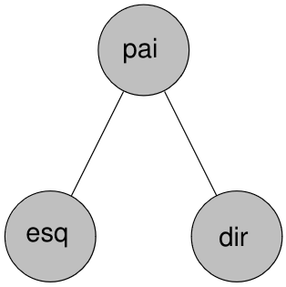{fig-aling='center'}

<br>

Devemos computar a redução da soma dos quadrados dos resíduos em cada nó em que a variável do nó "pai" aparece em todas as árvores obtidas pelo procedimento de *bagging*, em que calculamos a soma dos quadrados no nó "pai" e subtraímos da soma dos quadrados do nó esquerdo e do nó direito.

## Combinando predições - bagging

<br>

Assim, a importância da variável no nó "pai", em uma dada divisão binária em uma dada árvore 🌳 do procedimento de *bagging* é dada por:

<br>

\begin{align*}
\text{Importância local} &= RSS_{pai} - RSS_{esq} - RSS_{dir} = \\
& \sum_{i \in pai} (y_i - \overline{y}_{pai})^2 - \sum_{i \in esq} (y_i - \overline{y}_{esq})^2 - \sum_{i \in dir} (y_i - \overline{y}_{dir})^2.
\end{align*}

<br>

Foi denominado de **"Importância local"**, uma vez que o nó "pai" (variável de interesse) poderá aparecer nas diversas $B$ árvores de regressão do procedimento *bagging*, e mais, poderá aparecer várias vezes em uma mesma árvore. Portanto, em todas as $B$ e em todas as ocorrências da variável "pai" em qualquer ponto de uma árvore a "Importância local" deverá ser calculada. Ao fim, deverá somar todas as importâncias locais para se ter a **importância global** da variável no nó "pai".

## 📚 Exercícios

<br>

Considere a variável aleatória $Y_i \sim \mathcal{N}(\sin(X_i), \sigma^2)$, com
$X_i \in \mathcal{U}(0, 10)\,, \forall i$.

<br>

[Exercício]{.red}: Avalie a estabilidade de uma árvore de regressão usando um validação cruzada repetida. Construa um gráfico com os riscos observados na validação para um $\sigma^2$ fixo.

<br>

[Exercício]{.red}: Avalie a estibilidade usando um procedimento de bootstrap. Construa um gráfico com os riscos observados na validação para um $\sigma^2$ fixo.

<br>

[Exercício]{.red}: Por fim, avalie a estabilidade utilizando avaliando a curva de aprendizado do modelo.

<br>


## 🌲🐞🌳🐝🌲🦋🌳 Random Forest

<br>


::: columns
::: {.column width='50%'}
O *random forest* (floresta aleatória) é um procedimento de *bagging* em que introduz um níveo de aleatoriedade maior no processo de selação das variáveis, visando reduzir ainda mais a correção entre as árvores de regressão. Isso é feito sorteando $m < d$ covariáveis em cada particionamento, i.e., essa randomização é feita em toda divisão de todas as $B$ árvores do procedimento de *bagging*, em que $d$ é o total de covariáveis consideradas.

<br>

O valor de $m$ poderá ser obtido via algum procedimento de *cross-validation*, i.e., é um hiperparâmetro que poderá ser "tunado".
:::
::: {.column width='50%'}
{fig-aling='center'}
:::
:::

## 🌲🐞🌳🐝🌲🦋🌳 Random Forest

<br>

A ideia de construir árvores que sejam menos correlacionadas uma com as outras nos aproxima melhor do critério de não correlação que utilizamos para mostrar que o risco preditivo combinado é menor que o risco preditivo ao considerar uma única árvore, como mostra a @eq-risco-combinado-decom.

<br>

O algoritmo *random forest* consegue produzir um estimador com menor variância que o *bagging*. Além disso, assim como no *bagging*, podemos calcular a importância de cada variável usando o mesmo procedimento apresentado anteriormente.

<br>

Muito embora o *bagging* é um procedimento útil para diminuir a variância de um modelo utilizando predições combinadas, o procedimento de *random forest* para o caso de árvores de regressão ou de classificação nos conduz a um estimador com menor variância.

<br>

Um valor de $m$ frequentemente considerado é o valor inteiro que aproxima $\sqrt{d}$.


## 🌲🐞🌳🐝🌲🦋🌳 Random Forest

<br>

A aplicação abaixo permite que você possa comparar as estratégias de *bagging* com o *random forest*, sendo este um *bagging* de árvores de regressão com o pequeno ajuste mencionado anteriormente, permitindo termos árvores menos correlacionadas. Perceba que o *random forest* consegue diminuir ainda mais a variância das previsões de $Y$. A linha [vermelha]{.red} é a distribuição verdadeira.

<br>

```{=html}
 <iframe id="example1" src="https://pedro-rafael.shinyapps.io/shiny_apps/#section-bagging-vs-random-forest" style="border: none; width: 100%; height: 90%" frameborder="0"></iframe>
```

<br>

Se desejar ver de forma ampliada, acesse a aplicação clicando [aqui](https://pedro-rafael.shinyapps.io/shiny_apps).

## 🚀 Boosting

<br>

Da mesma forma que métodos como *bagging*  e *random forest*, os métodos de *boosting* também tem como objetivo agregar diferentes estimadores da função de regreção $r({\bf x})$. A ideia desses métodos que combinam diferentes estimadores da função de regressão é melhora a precisão e a performance preditiva dos modelos de máquina, convertendo vários aprendizes fracos em um único modelo de aprendizado forte.


<br>

O *boosting* 🚀 funciona construindo os modelos de forma sequencial, dando mais peso às instâncias que foram classificadas incorretamente nos modelos anteriores. O funcionamento do *boosting* é semelhante ao *bagging* e *random forest*, exceto pelo fato de que a árvore irá crescendo sequencialmente: cada árvore é "cultivada" 🌱🚿🌳 usando informações de árvores crescidas. *Boosting* não envolve amostragem *bootstrap*; em vez de cada árvore é ajustada em uma versão modificada do conjunto de dados original.

<br>


## 🚀 Boosting

<br>

Existem diversas variações e implementações de *boosting* com diversas implementações distintas em diferentes *frameworks* de aprendizagem de máquina. Aqui, será descrito o conceito geral, sendo este a forma mais usual do *boosting*.

<br>

No *boosting*, como mencionado anteriormente, o estimador $\widehat{g}({\bf x})$ é consturído incrementalmente, i.e., de forma sequencial, melhorando a cada passo. Inicialmente considera-se $\widehat{g}({\bf x}) \equiv 0$. Fazer $\widehat{g}({\bf x}) \equiv 0$ estamos iniciando um estimador com alto viés, porém, com variância muito baixa, a saber, variância zero.

<br>

A cada passo do algoritmo, procuramos obter uma árvore menos viesada, porém, como mencionado em anteriormente, quadando falamos sobre o *trade off* entre viés e variância, obtemos uma árvore atualizada com uma variância um pouco maior. Por isso é importante partir de uma árvore inicial com variância muito baixa.

<br>


## 🚀 Boosting

<br>

A ideia é construir um estimador para $r_i$, em que na primeira iteração, considera-se $r_i = y_i$. A cada passo subsequente, atualizamos $r_i$ para $r_i =  y_i - \widehat{g}({\bf x}_i)$, em que $r_i$ denominados de resíduo. Portanto, a ideia do *boosting* é prever o resíduo que inicia-se no rótulo/*label* $y_i$.

<br>

Uma observação importante é que as árvores tenham **profundida pequena** de modo a evitar *overfitting*.

<br>

Além disso, considera-se uma taxa de aprendizagem (*learning rate*) que denotaremos por $\lambda \in [0, 1]$ que tem como objetivo controlar o super-ajuste. Trata-se de um hiperparâmetro que deverá ser obtido via algum procedimento de *cross-validation*. Portanto, deveremos "tunar" 🎛 o valor de $\lambda$ de modo a encontrar um valor adequado que maximize nosso risco observado, i.e., que maximize a previsão de $R(g)$.

## 🚀 Boosting

<br>

Os passos para conseguir boas estimativas de usando o *boosting* são:

<br>

1. Definimos $\widehat{g}({\bf x}) \equiv 0$ e $r_i = y_i, \, \forall i = 1, \cdots, n$;
2. Para cada $b = 1, \cdots, B$, fazemos:
  + Ajustamos uma árvore com $p$ folhas para $({\bf x}_1, r_1), \cdots, ({\bf x}_n, r_n)$, em que denotamos essa função de predição por $\widehat{g}^b({\bf x})$. Lembre-se que estamos estimando $r_i$ com base em ${\bf x}_i$;
  + Atualizamos $g$ e os resíduos: $\widehat{g}({\bf x}) \leftarrow \widehat{g}({\bf x}) + \lambda \widehat{g}^b({\bf x})$ e $r_i \leftarrow Y_i - \widehat{g}({\bf x})$.
3. Retorna-se o modelo final $\widehat{g}({\bf x})$.

No *boosting*, os valores de $\lambda$, $p$ e $B$ são hiperparâmetros e devem ser obtidos por meio de algum
procedimento de validação cruzada, i.e., você deverá "tunar" 🎛. É comum que $\lambda$ seja pequeno, por exemplo, $0,01$ ou $0,001$, $B \approx 1000$ e $p$ de ordem próxima à $2$ ou $4$.

## 🚀 Boosting

<br>

Considere a variável aleatória
$Y_i \sim \mathcal{N}(\sin(X_i), \sigma^2)$, com
$X_i \in \mathcal{U}(0, 10)\,, \forall i.$ Experimente na aplicação web que segue
o método *boosting*. Observe o comportamento do estimador variando os parâmetros do
algoritmo *boosting*. Perceba que para $\lambda = 0$ não há aprendizado algum! Se desejar
visualizar a aplicação abaixo de forma ampliada, clique [aqui](https://pedro-rafael.shinyapps.io/shiny_apps/#section-boosting).

<br>

```{=html}
 <iframe id="example1" src="https://pedro-rafael.shinyapps.io/shiny_apps/#section-boosting" style="border: none; width: 100%; height: 90%" frameborder="0"></iframe>
```

## 🚀 Boosting

<br>

Em geral, as abordagens de aprendizagem estatística que aprendem lentamente tendem a
executar bem. Observe que no *boosting*, ao contrário do ensacamento, a construção de
cada árvore depende fortemente das árvores que já foram "cultivadas" 🌱🚿🌳. Portanto,
diferentemente do *bagging* que é um algoritmo em que as árvores em cada iteração são
mutuamente independentes e, portanto, facilmente paralelizável, no *boosting* as árvores
são dependentes umas das outras.

<br>

Na literatura de *machine learning* há diversos algoritmos que implementam o *boosting*.  Uma
implementação bastante popular, por conta de seu desempenho, é denominada **XGBoost**, proposto em CHEN, Tianqi; GUESTRIN, Carlos. [**Xgboost: A scalable tree boosting system**](https://arxiv.org/pdf/1603.02754.pdf). In: *Proceedings of the 22nd acm sigkdd international conference on knowledge discovery and data mining*. 2016. p. 785-794.

<br>

No R, o algoritmo está implementado na biblioteca [xgboost](https://github.com/dmlc/xgboost). Caso deseje utilizar a biblioteca [tidymodels](https://www.tidymodels.org/) em sua modelagem, é possível utilizar o **XGBoost** usando a função `boost_tree` da biblioteca [parsnip](https://parsnip.tidymodels.org/reference/boost_tree.html) que faz parte do [tidymodels](https://www.tidymodels.org/). Por padrão, essa função já utiliza o algoritmo **XGBoost**.

## 🚀 Boosting

<br>

Uma outra forma de obter um valor adequado de $B$ é parar de adicionar iterações quando o risco observado começa a aumentar. Lembre-se que há um *trade off* entre viés e variância, em que as iterações começam por um estimador $\widehat{g}$ com variância nula e na medida que as iterações progridem, $\widehat{g}$ aumenta sua variância em troca da diminuição do viés. Para algum valor de $B$ o estimador poderá perder um pouco de performance. A ideia é escolher um valor de $B$ antes de atingir uma piora de $\widehat{R}(g)$ (risco observado). Essa estratégia é denominada de *early stopping* ⌛.

<br>

**Muito embora aqui apresentamos o algoritmo *boostring* em um contexto de árvores de regressão, esse algoritmo é genérico e poderá ser utilizado como estatégia para combinar modelos que são individualmente fracos**.

<br>


## 📚 Exercícios

<br>

[Exercício]{.red}: Considere a variável aleatória
$Y_i \sim \mathcal{N}(\sin(X_i), \sigma^2)$, com
$X_i \in \mathcal{U}(0, 10)\,, \forall i.$ Implemente uma função em R que construi o
gráfico da aplicação anterior. Essa função deverá ter os argumentos do algoritmo *boosting*, além
de outros argumentos para controle do tamanho da amostra e da variância $\sigma^2$.

<br>

[Exercício]{.red}: Construa um gráfico com a avaliação do risco observado do método de *boosting* para diferentes valores de $B$. Considere $B = 1, \cdots, 10000$. Comente o resultado.

<br>

[Exercício]{.red}: Utilizando um procedimento de validação cruzada, e o [tidymodels](https://www.tidymodels.org/), obtenha uma estimativa para os hiperparâmetros da função
[`boost_tree()`](https://parsnip.tidymodels.org/reference/boost_tree.html), a saber, os argumentos `trees` (número de árvores),  `tree_depth` (profundidade da árvore) e `learn_rate` (taxa de aprendizado). Avalie o risco preditivo do modelo, i.e., estime $\widehat{R}(g)$.

<br>

[Exercício]{.red}: Compare o *bagging* de árvores de regressão, com o método *random forest* e o *boosting* de árvores de regressão. Qual o risco preditivo de cada um deles para prever $Y_i$? Construa um gráfico com as previsões, no conjunto de teste, de cada um dos modelos.

## 📚 Exercícios

<br>

[Exercício]{.red}:  Considere o problema em que o objetivo é prever a
**pontuação** (*score*) / (item 2) do aluno com base em algumas
variáveis. São elas:

<br>

1.  **Horas estudadas**: o número total de horas gastas estudando por
    cada aluno;
2.  **Pontuação**: As notas obtidas pelos alunos em testes anteriores;
3.  **Atividades extracurriculares**: Se o aluno participa de atividades
    extracurriculares (Sim ou Não);
4.  **Horas de sono**: o número médio de horas de sono que o aluno teve
    por dia;
5.  **Amostras de perguntas praticadas**: O número de amostras de
    perguntas que o aluno praticou.

<br>

Você poderá baixar e ter uma descrição maior da base de dados clicando
[aqui](https://www.kaggle.com/datasets/nikhil7280/student-performance-multiple-linear-regression). Avalie o poder preditivo do *random forest* comparando com o *boosting* e $k$NN. Construa uma análise usando um notebook de [quarto](https://quarto.org/), comentando os passos.

<br>

[Exercício]{.red}: Refaça o exercício anterior usando os dados de vermelho 🍇🍷,
disponíveis
[aqui](https://www.kaggle.com/datasets/uciml/red-wine-quality-cortez-et-al-2009).

## 📚 Exercícios

<br>

[Exercício]{.red}: Considere os dados reais de imóveis anunciados para venda na cidade de [João Pessoa - PB](dados/joao_pessoa.csv). São mais de 27 mil observações obtidas via *web scraping* de sites de anúncios imobiliários e referem-se à anúncios do primeiro semestre de 2023. O interesse consiste em prever o **valor** de um novo imóvel com base nas *features*. Clique [aqui](dados/joao_pessoa.csv) 🗃️ para acessar a base. Nessa base encontra-se diversas o *label* (valor dos imóveis) e *features* numéricas como área, número de quartos, número de banheiros, coordenadas geográficas (latitude e longitude), quantidade de vagas de estacionamento, além de diversas outras *features* em forma de variáveis *dummy* com valores `TRUE`e `FALSE`, como por exemplo, `elevador` (se tem  `TRUE` ou não `FALSE`), `piscina` (se tem `TRUE` ou não `FALSE`), `salao_de_festa` (se tem `TRUE` ou não `FALSE`), entre outras. Crie um notebook em [quarto](https://quarto.org/) comparando todos os modelos de regressão apresentados até aqui. Realize uma análise exploratória dos dados e comente todos os resultados intermediários de sua análise. Conclua sua análise realizando um *rank* da performance preditiva de cada modelo apresentando o risco preditivo $R(g)$ estimado. Algumas sugestões:

1. Note que a *feature* `tipo` apresenta os tipos de imóveis. Foque em `casas`, `apartamentos` e `terrenos`. Por exemplo, o tipo `terrenos_lotes_condominio` considere apenas como `terrenos` e o tipo `casas_de_condominio` considere como sendo `casas`. Você poderá utilizar um **one hot encoding** para tornar essa variável numérica;

2. Você não irá precisar das *features* `endereco` e `bairro`, já que essas informações está contida nas coordenadas geográficas;

3. Desconsidere as colunas `iptu` e `condomínio`, já que são bastante incipientes;

4. Impute observações faltantes (as que contém `NA`) pelo método $k$NN. Veja como fazer isso usando a função [`step_impute_knn`](https://recipes.tidymodels.org/reference/step_impute_knn.html) da biblioteca [recipes](https://recipes.tidymodels.org/).


Você também estará livre para realizar outras receitas na base de dados antes dos treinamentos dos modelos.

## 📚 Exercícios

<br>

[Exercício]{.red}: Refaça o exercício anterior para outras cidades. Acesse os dados clicando nos nomes das cidades abaixo:

<br>

1. [Recife](dados/recife.csv) 🗃️
2. [Natal](dados/natal.csv) 🗃️
3. [Maceió](dados/maceio.csv) 🗃️
4. [Brasília](dados/brasilia.csv) 🗃️

<br>


## 🧠 Redes neurais artificiais

<br>

Redes neurais artificiais - RNAs geralmente são apresentadas como sistemas de "neurônios interconectados, que podem computar/receber valores de entradas", simulando o comportamento de redes neurais biológicas 🧠.

<br>

::: columns
::: {.column width="50%"}

:::
::: {.column width="50%"}
O primeiro modelo artificial de um neurônio biológico foi fruto do trabalho de Warren McCulloch e Walter Pitts, em 1943. MacCulloch, psicólogo e neurofisiologista, dedicou sua carreira à tentativa de representar e modelar eventos do sistema nervoso. Pitts, um matemático recém-graduado, juntou-se a ele em 1942. No trabalho que publicaram em 1943 intitulado *A Logical Calculus of the Ideas Immanent in Nervous Activity*, eles apresentam uma discussão sofisticada de redes lógicas de neurônios artificiais que denominaram de neurônio MCP, devido a **M**c**C**ulloch e **P**itts.
:::
:::

## 🧠 Redes neurais artificiais

<br>

::: columns
::: {.column width="40%"}
<br>
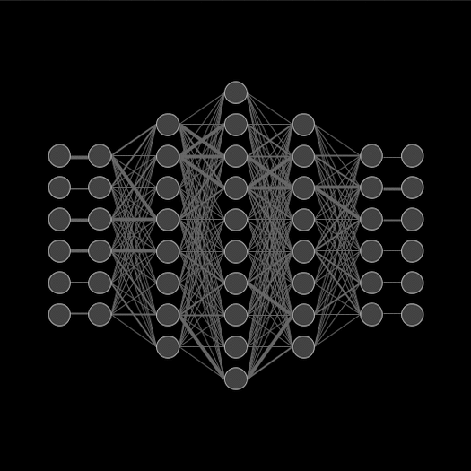
:::
::: {.column width="60%"}
O aprendizado de redes artificiais veio a ser objeto de estudo somente alguns anos depois do trabalho de McCulloch e Pitts. O primeiro trabalho foi proposto por Donald Hebb em 1949, em que ele propôs uma teoria para explicar o aprendizado em neurônios biológicos baseada no reforço das ligações sinápticas entre neurônios excitados. A **regra de Hebb**, como é conhecida a sua teoria na comunidade de RNAs, foi interpretada do ponto de vista matemático, e é hoje utilizada em vários algoritmos de aprendizado.

<br>

Em 1958, Rank Rosenblatt demonstrou, com seu novo modelo, o *perceptron*, que se fossem acescidas de sinapes ajustáveis as RNAs com neurônios MCP poderiam ser treinadas para classificar certos tipos de padrões. Rosenblatt descreveu uma topologia de RNA, estruturas de ligação entre os neurônios e, o mais importante, porpôs uma algoritmo para treinar a rede.
:::
:::

## 🧠 Redes neurais artificiais

<br>

Do ponto de vista matemático, no contexto de regressão, uma RNA trata-se de um estimador não linear de $r({\bf x}) = \mathbb{E}(Y|{\bf X})$ que pode ser representado por uma estrutura, que denominaremos de **arquitetura** da rede, como a da Figura que segue:

<br>

::: columns
::: {.column width="50%"}
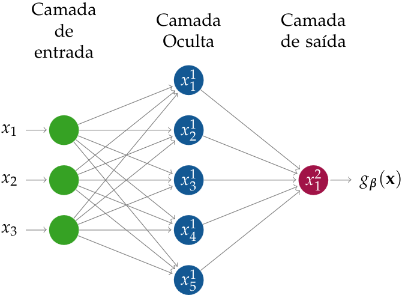{#fig-neural01}
:::
::: {.column width="50%"}
A @fig-neural01 ao lado é um exemplo representativo de uma RNA com apenas uma camada oculta. As "bolinhas" representam os neurônios, em que os [verdes]{.green} são denominados de "camada de entrada". No exemplo, ${\bf x} = (x_1, x_2, x_3)$ representam covariáveis de nossa base de dados 💾.  Cada flecha (arresta) representa uma conexão e possui um peso que denotaremos por $\beta$, sendo estes os parâmetros de nossa rede neural que desejamos otimizar. A camada de saída representa a nossa estimativa de $r({\bf x})$, i.e., $\widehat{r}({\bf x})$.
:::
:::

## 🧠 Redes neurais artificiais

<br>

Cada nó (neurônio) de uma camada posterior, em uma rede *feedforward*, i.e., redes com topologias cujo os sinais são propragados para frente, são transformações dos sinais dos neurônios das camadas anteriores.

<br>

É importante deixar claro que existem diversas topologias de redes neurais, em que o número de camadas ocultas e o número de neurônios que irá compor cada uma das camadas é decidido por quem faz a análise. São hiperparâmetros que poderão ser investigados de modo a reduzir o risco preditivo $R(g)$.

<br>

Você poderá visualizar a representação de diversas topologias/arquiteturas de RNAs clicando [aqui](imgs/arquiteturas_redes.png). Esses são apenas exemplos de topologias de redes e você poderá em uma pesquisa rápida na internet encontrar diversas outras representações. Muitas delas já encontram-se implementadas em diversos *frameworks* de aprendizagem de máquina.

<br>


## 🧠 Redes neurais artificiais

<br>

Diversas arquiteturas de redes neurais já foram experimentadas. Por exemplo, algumas são úteis para problemas de classificação de imagens, outras possuem uma performance melhor para classificação de áudios, outras com boa performance em problemas de regressão, e assim por diante. Por exemplo, as RNAs *feedforwards* (redes de propagação direta), em suas diferentes topologias/arquiteturas, possuem boa performance em problemas de regressão, classificação, reconhecimento de padrões, entre outros. Sendo assim, é possível tratar uma gama muito ampla de problemas com redes neurais *feedforwards*. 🎉

<br>

Uma rede *feedforward* normalmente terá limitações quando se trata de capturar dependências temporais. Porém, em muitos problemas em que não há uma dependência temporal nos dados, as redes *feedforwards* poderá ser uma escolha conveniente.

<br>


## 🧠 Redes neurais artificiais

<br>

Abaixo, uma animação de uma rede neural com propagação direta - *feedforward*, em que os sinais percorrem em um único sentido. O fluxo do sinal, destacado em branco representa os neurônios excitados nas respectivas camadas, de acordo dado um vetor de entrada ${\bf x}$. Aqui, a camada de saída possui vários neurônios, sendo esta a representação de um problema de classificação. Se a camada de saída houversse apenas um neurônio, como na rede da @fig-neural01, este seria um problema de regressão.

<br>


## 🧠 Redes neurais artificiais

<br>

Considerando a rede apresentada na @fig-neural01, para uma dado vetor de entrada ${\bf x} = (x_1, x_2, x_3)$, o sinal em um dado neurônio $j$ da camada oculta é calculado como

$$\overbrace{x_j^1}^{\text{Neurônio j da camada 1}} := f\left(\beta_{0,j}^0 + \sum_{i = 1}^3 \beta_{i,j}^0 x_{i}^0\right),$$
em que $x_i^0 = x_i$, para $i = 1, 2, 3$ e $f$ é uma função definida pelo usuário, que denominaremos [**função de ativação**](https://en.wikipedia.org/wiki/Activation_function). A **função de ativação** desempenha um papel crucial em um neurônio de uma RNA. Ela é responsável por introduzir não-linearidade nos cálculos realizados pelo neurônio, permitindo que a RNA seja capaz de aprender e representar relações complexas nos dados.

<br>


## 🧠 Redes neurais artificiais

<br>

Devido a possibilidade de adicionar diversas camadas ocultas, variar o número de neurônios em cada uma das camadas, e o mais importante, devido a introdução de funções de ativações diferentes em cada camada, que normalmente são funções não lineares, uma RNA consegue representar uma quantidade muito grande de funções não lineares. Além disso, a função de ativação desempenham um papel de controle no sinal de um neurônio. Algumas dessas funções podem ajudar na regularização da RNA, i.e., ajudam a reduzir a probabilidade de *overfitting*.

<br>

Ainda considerando a rede representada pela @fig-neural01, calculado os sinais dos neurônios $x_j^1$, para todo $j = 1, \cdots, 5$, pode-se calcular o sinal do neurônio da camada de saída. Temos então que

<br>

$$\overbrace{x_1^2}^{\text{Neurônio j da camada 2}} := f\left(\beta_{0,1}^1 + \sum_{i = 1}^5 \beta_{i,1}^1 x_{i}^1\right) =: g_\beta({\bf x}).$$

## 🧠 Redes neurais artificiais

<br>

A Figura abaixo representa o procedimento de atualização e passagem de sinal de um neurônio.

<br>

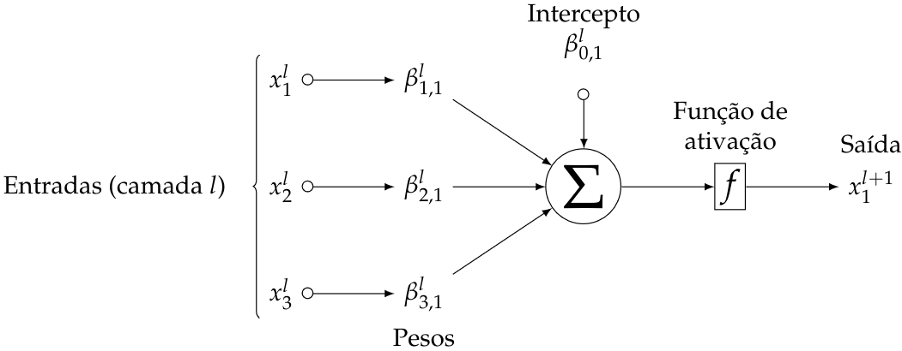{fig-aling='center'}

Multiplica-se as entradas $x_i$ da camada $l$ com os respectivos pesos $\beta_i^l, \, i = 1, 2, 3$, realiza-se a soma que é passada para a função de ativação que retornará a saída. O sinal $x_1^{l +1}$ será transmitido para o neurônio $1$ da camada $l + 1$ (camada seguinte). A saída $x_1^{l + 1}$ é dada por $f(\beta_{0,1}^l + \sum_{i=1}^3 \beta_{i,1}^lx_{i}^l)$.

## 🧠 Redes neurais artificiais

<br>

As escolhas comuns para **função de ativação** são:

<br>

1. Identidade: $f(x) = x$;
2. Lógica: $f(x) = \frac{1}{1 - \mathrm{e}^{-x}}$;
3. Tangente hiperbólica: $f(x) = \frac{\mathrm{e}^x - \mathrm{e}^{-x}}{\mathrm{e}^x + \mathrm{e}^{-x}}$;
4. ReLu (*rectified linear*): $f(x) = \max\{0, x\}$;
5. Leaky ReLu: $f(x) = \begin{cases}
x, & \text{se}\ x > 0 \\
\alpha x, & \text{caso contrário}
\end{cases}$

<br>

Na função [Leaky ReLu](https://en.wikipedia.org/wiki/Rectifier_(neural_networks)), o valor de $\alpha > 0$, normalmente pequeno que costuma ser $0,01$. Todas as funções acima possue domínio em $(-\infty, +\infty)$.

## 🧠 Redes neurais artificiais

<br>

De um modo geral, uma RNA poderá possuir mais de uma camada oculta, conforme representado Figura que segue:

<br>

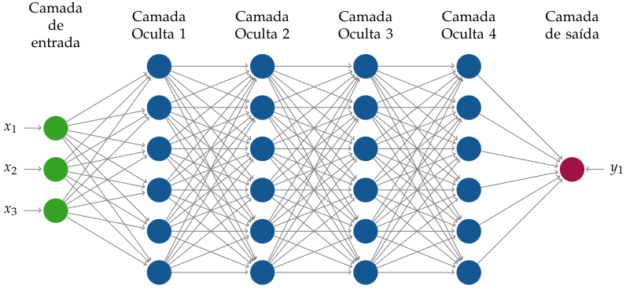{fig-aling='center'}
<br>

Com o avanço da capacidade computacional dos computadores atuais, é possível trabalhar com RNAs com diversas camadas ocultas, uma vez que os algoritmos de aprendizagem como é o caso do *backpropagation* que será discutido adiante pode ser executado com mais eficiência.

## 🧠 Redes neurais artificiais

<br>

Os parâmetros $\beta_{0,j}^l$, nas equações do sinal que será transmitido, que está **em todos** os neurônios de uma camada oculta é denominado de viés, ou, *bias* no inglês.  O viés nos neurônios de uma RNA é crucial para permitir que a rede aprenda relações complexas e não-lineares nos dados, além de se **adaptar a diferentes deslocamentos** e tendências presentes nos dados do mundo real. Ele faz parte dos parâmetros treináveis da rede, que são ajustados durante o processo de treinamento para otimizar a capacidade da rede de fazer previsões ou classificações precisas. **Sua função é aumentar ou diminuir a entrada líquida, de forma a transladar a função de ativação no eixo**.

<br>

A propagação das observações das covariáveis por uma RNA é feita sequencialmente nessas camadas.

<br>


## 🧠 Redes neurais artificiais

<br>

Considere uma RNA *feedforward* com $H$ camadas ocultas, com $h = 1, \cdots, H$, em que cada camada possui
$d_h$ neurônios. Seja ainda $\beta_{i,j}^l$ o peso atribuído à conexão entre a $i$-ésima entrada na camada $l$ e a $j$-ésima saída na camada $l + 1$, com $l = 0, \cdots, H$. Perceba que a camada de entrada é denotada por $h = 0$, já a camada de saída, denota-se por $H + 1$. O estimador de uma RNA para a função de regressão $r({\bf x})$ é dado por:

<br>

$$g_\beta({\bf x}) = \overbrace{x_1^{H + 1}}^{\text{So há um neurônio como saída}} = f\left(\beta_{0,1}^H + \sum_{i = 1}^{d_H}\beta_{i,1}^Hx_i^H\right),$${#eq-rna-estimativa}
em que, para todo $l = 1, \cdots, H$ e $j = 1, \cdots, d_{l + 1}$,

$$x_{j}^{l + 1} = f\left(\beta_{0,j}^{l} + \sum_{i=1}^{d_l}\beta_{i,j}^{l}x_{i}^l\right).$$

## 🧠 Redes neurais artificiais

<br>

Se a RNA possui como função de ativação a função identidade $f(x) = x$ e nenhuma camada oculta, a @eq-rna-estimativa se reduz à uma regressão linear que estudamos anteriormente. 🎉

<br>


<br>

Nas RNAs, como já mencionado anteriormente, topologias mais complexas são admitidas, podendo retroalimentação, em que o sinal de uma camada posterior poderá para retroalimentar camadas anteriores. Mais detalhes aprofundados da teoria de RNAs podem ser obtidos Goodfellow, I., Bengio, Y. and Courville, A. **Deep Learning**. The MIT Press Cambridge, Massachusetts London, England. (2017). Clique [aqui](https://github.com/janishar/mit-deep-learning-book-pdf/blob/0d90eb57bc81aacba1c56cb57ca3d28c99807385/complete-book-pdf/Ian%20Goodfellow%2C%20Yoshua%20Bengio%2C%20Aaron%20Courville%20-%20Deep%20Learning%20(2017%2C%20MIT).pdf).

## 🧠 Redes neurais artificiais

<br>

Para estimar os coeficientes $\beta_{i,j}^l$ da @eq-rna-estimativa, i.e., para estimarmos o peso da saída $i$ da camada $l$ que entra na entrada $j$ da camada $l + 1$, é necessário que haja uma função objetivo para ser otimizada. Como aprendemos, em um problema de regressão, essa função objetivo é o EQM. Portanto, desejamos minimizar

<br>

$$\underbrace{EQM(g_\beta) = \frac{1}{n}\sum_{k = 1}^n (g_\beta(x_k) - y_k)^2}_{\text{Precisamos de uma combinação de pesos que minimize essa Equação.}}.$${#eq-risco-rna}

<br>

Como também já sabemos, para termos uma estimativa consistente de $R(g_\beta)$, devemos avaliar a @eq-risco-rna no conjunto de teste. Encontrar os pesos $\beta$'s que minimize a @eq-risco-rna são tem solução analítica.

## 🧠 Redes neurais artificiais

<br>

Para minimizar a @eq-risco-rna, podemos fazer uso de métodos numéricos. O método que mais conhecido para essa tarefa é o *backpropagation*, que nada mais é do que um método de gradiente descendente executado em uma determinada ordem específica. Nesse método, o gradiente descendente é calculado de trás para frente, i.e., primeiro atualizam-se os coeficientes da última camada, depois se atualizam os coeficientes da camada anterior, e assim por diante. Por isso o o termo *back* é utilizado no algoritmo.

<br>

A busca por uma solução global ou mínima global em uma função de perda não é garantida pelo *backpropagation*. O algoritmo pode convergir para mínimos locais, em que a função de perda é relativamente baixa dentro de uma região, mas esses mínimos locais podem não ser os melhores em termos de desempenho geral da rede neural. Portanto, o algoritmo de *backpropagation* em si não é uma técnica de otimização global.

<br>


## 🧠 Redes neurais artificiais

<br>

De forma mais específica, em cada passo do algoritmo *backpropagation* o peso $\beta_{i,j}^l$ é atualizado por

<br>

$$\beta_{i,j}^l \leftarrow \beta_{i,j}^l - \eta \frac{\partial EQM(g_\beta)}{\partial\beta_{i,j}^l},$${#eq-backpropagation}
com $j = 1, \cdots, d_{l + 1}$ e $i = 0, \cdots, d_l$, em que $l = H, \cdots, 0$. Lembre-se que o gradiente de uma função aponta para a direção de maior crescimento de uma função. Portanto, o gradiente com sinal trocado irá apontar para a região de descida mais rápida, e é por isso que a atualização do peso é feita subtraindo do gradiente, conforme a @eq-backpropagation.

<br>

O valor $\eta > 0$ é denominado de **taxa de aprendizado**, e controla o tamanho do passo que o algoritmo de otimização dá em direção ao mínimo da função de perda. Valores altos para $\eta$ pode levar a oscilações e a dificuldades para convergir, enquanto uma taxa de aprendizado muito baixa pode resultar em convergência lenta.

## 🧠 Redes neurais artificiais

<br>

Muitas variações do algoritmo *backpropagation* surgiram, como é o caso do gradiente descendente estocástico, que nada mais é que o algoritmo *backpropagation* em apenas uma parte do conjunto de treinamento, denominados de lotes ou *mini-batches* 📦. Esses lotes são sorteados aleatoriamente e de tamanhos aproximadamente iguais. É utilizado apenas um desses lotes por vez, durante o processo de atualização dos pesos da RNA. Esse de atualização aumenta a eficiência computacional, reduz o uso de memória, introduz estocasticidade que pode evitar mínimos locais indesejados permitindo, assim, uma exploração mais ampla do espaço de parâmetros.

<br>

Com o gradiente descendente estocástico, o problema de *overffiting* é menor. Essa metodologia realiza uma espécie de regularização da rede e possui boas propriedades que ainda não são muito bem entendidas.

<br>


## 🧠 Redes neurais artificiais

<br>

No conceito de gradiente descendente estocástico, a atualização dos pesos é realizada em cada um dos lotes 📦. Dizemos, portanto, que o treinamento ocorreu em uma **época**. O conceito de época (*epoch*) 🕒 é comum em RNA e consiste em realizar o treinamento com todos os *batches*. Normalmente, escolhemos treinar nossa rede usando várias épocas, i.e., em cada época novos lotes são sorteados, permitindo que a rede não aprenda padrões dependentes da ordem dos dados de treinamento, ajudando expor a rede a uma diversidade de exemplos, tornando o aprendizado mais robusto.

<br>

Uma forma muito comum de tentar regularizar uma RNA e diminuir o *overfitting* é realizar *dropout*, que consiste em sortear neurônios que não irão ser atualizados. Em palavras, consistem em "fingir" que não existem alguns neurônios no processo de atualização dos pesos. Também podemos introduzir uma penalização, assim como na regressão lasso.

<br>


## 🧠 Redes neurais artificiais

<br>

Experimente treinar uma rede neural em um problema de regressão, utilizando a aplicação abaixo. Clique [aqui](https://playground.tensorflow.org) para visualizar a aplicação ampliada. 🎁

<br>

```{=html}
 <iframe id="example1" src="https://playground.tensorflow.org" style="border: none; width: 100%; height: 90%" frameborder="0"></iframe>
```