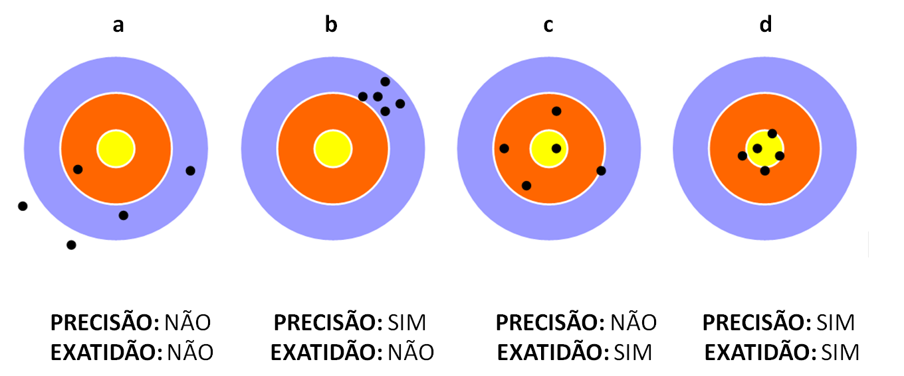
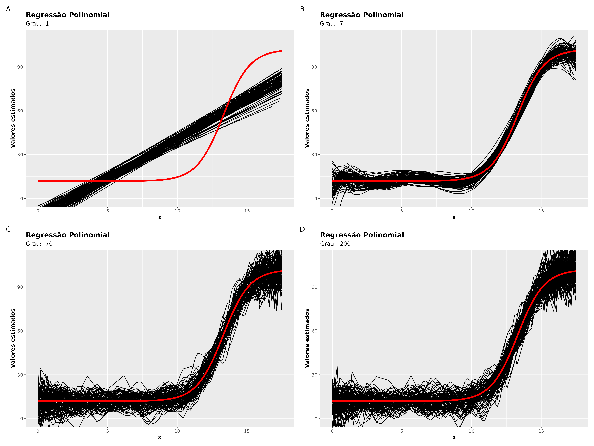
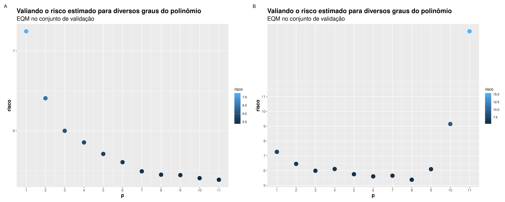

<!-- ```{r} -->

<!-- #| echo: false -->

<!-- #| warning: false -->

<!-- #| eval: true -->

<!-- if(fs::dir_exists("index_files/")) -->

<!--   fs::dir_delete("index_files/") -->

<!-- ``` -->

::: r-fit-text
Aprendizagem de Máquina

[Bacharelado em Estatística]{.flow}

UFPB
:::

#  {.title}

::: r-fit-text
[Apresentação]{.flow}
:::

##  {background-image="https://raw.githubusercontent.com/prdm0/imagens/main/eu.jpg" background-size="contain" background-position="left"}

::: columns
::: {.column width="60%"}
:::

::: {.column width="40%"}
## Sobre mim {.r-fit-text}

<br> <br>

-   Me chamo [Prof. Dr. Pedro Rafael D.
    Marinho](https://prdm.netlify.app/about_pt_br.html){preview-link="true"}.
    Meu currículo Lattes poderá ser acessado clicando
    [aqui](http://lattes.cnpq.br/7185368598935272){preview-link="true"}.

-   Sou docente do Departamento de Estatística da UFPB. 👨‍🏫

-   Toda minha formação acadêmica é na área de estatística (bacharelado
    ao doutorado).

-   Tenho entusiasmo por programação, ciência de dados e aprendizagem de
    máquina 💻📈.

-   `r fontawesome::fa("github", "black")` Me acompanhe no GitHub:
    <https://github.com/prdm0>.

-   `r fontawesome::fa("linkedin", "black")` Me acompanhe no Linkedin:
    <https://www.linkedin.com/in/prdm0/>.
:::
:::

# O Departamento {.title}

## Meu segundo lar {.r-fit-text background-color="black" background-image="https://raw.githubusercontent.com/prdm0/imagens/main/foto_aerea_ufpb.jpeg" background-size="1600px" background-repeat="repeat" background-opacity="0.35"}

```{r width = 100, height = 100, echo = FALSE, fig.cap="Departamento de Estatística da UFPB."}
library(leaflet)
leaflet() |>
  addMarkers(-34.846199, -7.140400) |>
  leaflet::addTiles() |>
  setView(
    -34.846199,
    -7.140400,
    zoom = 37,
    options = popupOptions(
      minWidth = 1600,
      maxWidth = 1500
    )
  )
```

# Projetos relacionados à linguagem R

<br>

:::: {.columns}
::: {.column width = "50%"}
 junto com programadores bastante conhecidos da comunidade R.](imgs/bookdown.jpg){fig-aling="center" height="700px"}
:::

:::{ .column width = "50%"}
 que implementa o método da aceitação e rejeição para geração de números pseudo-aleatórios.](imgs/accept_reject.png){fig-aling="center"  height="700px"}
:::
::::

# Projetos relacionados à linguagem R

<br>

:::: {.columns}
::: {.column width = "50%"}
 para avaliar a adequação de ajuste de modelos probabilíscos e implementação de mataheurística para otimização de função de verossmilhança.](imgs/adequacy_model.png){fig-aling="center" height="700px"}
:::

:::{ .column width = "50%"}
 para acelerar operações de álgebra linear em sistemas Unix e Linux.](imgs/ropenblas.png){fig-aling="center"  height="700px"}
:::
::::

# Projetos relacionados à linguagem R

<br>

:::: {.columns}
::: {.column width = "33%"}
, publicado em 2025. O artigo divulga estatégias para estimação intervalar em modelos lineares com heteroscedasticidade de forma desconhecida.](imgs/hcci_2.jpg){fig-aling="center" height="700px"}
:::

::: {.column width = "33%"}
.](imgs/book_01.jpg){fig-aling="center" height="700px"}
:::

:::{ .column width = "33%"}
.](imgs/book_2.png){fig-aling="center"  height="700px"}
:::
::::

#  {.title background-image="imgs/o_que_esperar.png" background-size="100% 100%"}


# O que esperar do tutorial?

<br>

::: columns
::: {.column width="40%"}
+ Darei uma introdução resumida de alguns conceitos como: **conjunto de treino**, **conjunto de validação** e **conjunto de teste**;

+ Comentarei muito brevemente a respeito dos modelos de aprendizagem que iremos utilizar. Muitos dos comentários virão durante a implementação de alguns exemplos. **Não é um tutorial sobre modelos e sim sobre a ferramenta tidymodels!**;

+ Terei como foco a demonstração do uso do framework [**tidymodels**](https://www.tidymodels.org/) para que você consiga treinar, avaliar e gerar uma API do workflow da modelagem.
:::

::: {.column width="60%"}
{fig-aling="rigth" width="400px"}
:::
:::

#  {.title background-image="imgs/tidymodels_tunagem.png" background-size="100% 100%"}


#  {.title background-image="imgs/rawpixel/freight.jpg"}

::: r-fit-text
[Algumas explicações necessárias]{.flow}
:::

#  {.title background-image="imgs/what_is_ml.png" background-size="100% 100%"}

## O que é Machine Learning - ML?

<br>

É um ramo da inteligência artificial que estuda algoritmos e modelos computacionais capazes de **aprender padrões a partir de dados e fazer previsões ou tomar decisões sem serem explicitamente programados para isso.**
Em essência, o modelo é ajustado com base em um conjunto de dados de entrada (dados de treino) para que ele generalize e funcione bem em dados novos.

{width="900" height="550" fig-align="left"}

## O que é Aprender (no contexto de ML)?

<br>

**Aprender é o processo pelo qual um algoritmo de ML ajusta seus parâmetros internos com base em exemplos observados, de modo a minimizar um erro (função de perda) e melhorar sua capacidade de prever ou classificar dados futuros.**

Formalmente, é encontrar uma função $g:X \rightarrow Y$ que generalize bem de um conjunto de treinamento para dados não vistos.

<br>


## O que é treinar?

<br>

Treinar é o ato de executar um algoritmo de aprendizado sobre um conjunto de dados rotulado (supervisionado) ou não rotulado (não supervisionado), ajustando os parâmetros do modelo para que ele represente o melhor possível a estrutura dos dados.
Envolve geralmente:

<br>

:::: {.columns}
::: {.column width=60%}
::: {.nonincremental}
+ Definir um modelo;

+ Otimizar seus parâmetros e hiperparâmetros;

+ Avaliar o desempenho do modelo treinado em um conjunto de dados independente (conjunto de teste).
:::
:::
::: {.column width=40%}

:::
::::


## `r fontawesome::fa("robot", "black")` Tipos de Aprendizado

<br>

Muito embora nesse tutorial focaremos na abordagem de aprendizagem
**supervisionada**, os tipos de aprendizagem,
em geral, podem ser mais amplos:

<br>

::: {.nonincremental}
1.  **Aprendizagem supervisionada**;
2.  Aprendizagem não-supervisionada;
3.  Aprendizagem semi-supervisionada;
4.  Aprendizagem por reforço.
:::

## Aprendizagem supervisionada

<br>

Nesse tipo de aprendizagem, o algoritmo irá receber um conjunto de dados
em que conhecemos rótulos para a variável de interesse. É como se você
soubesse onde um bom modelo deve chegar, para assim ser reconhecido como
um bom modelo. Por exemplo,

<br>

::: {.nonincremental}
1.  [Classificação]{.red}: precisamos determinar a classe de uma
    instância de dados, o seu atributo, i.e.,
    $\hat{y} = \mathop{\arg\max}_{y} P(Y = y \mid X = \mathbf{x})$, em que
    y é um atributo que desejamos prever (cahorro, gato, sapo), e
    $\bf{x}$ é um vetor de características (peso, altura, comprimento,
    se tem rabo, etc).

<br>

2.  [Regressão]{.red}: precisamos estimar uma quantidade numérica, i.e.,
    o valor da variável alvo por meio de uma **instância de dados**, ou
    seja, precisamos estimar $Y = \mathbb{E}(Y|X = \bf{x})$, i.e.,
    devemos encontrar meios de obter $\widehat{Y}$.
:::

## Aprendizagem supervisionada

<br>

::: columns
::: {.column width="60%"}

:::

::: {.column width="40%"}
<br> Poderíamos estar interessados em classificar o tamanho de morangos:

<br>

::: {.nonincremental}
1.  S (**S**low): pequeno;

2.  M (**M**edium): médio;

3.  L (**L**arge): grande.
:::
:::
:::

## Aprendizagem supervisionada

<br>

Um outro exemplo seria a classificação de imagem/vídeo, utilizando um
algoritmo de rede neural, por exemplo, usando uma **C**onvolutional
**N**eural **N**etwork -
[CNN](https://en.wikipedia.org/wiki/Convolutional_neural_network). Foram
utilizados diversas imagens de pessoas "com" e "sem" máscara. Em que
"com" representa detecção da máscara na face da pessoa e "sem" a não
detecção.

<br>



## Aprendizagem não-supervisionada

<br>

Nesse tipo de aprendizagem, os algoritmos trabalham sobre dados não
rotulados, por exemplo, em uma trarefa de agrupamento.

<br>

Os algoritmos verificam se as instâncias observadas poderão ser
arranjadas de alguma maneira, por exemplo, usando alguma métrica de
distância, formando grupos (*clusters*).

<br>

A ideia é maximizar a distância entre os clusters e minimizar a
distância entre os elementos no interior do grupo. Em outras palavras, o
que se quer é tornar os grupos mais diferentes possíveis e tornar os
elementos dos grupos o mais parecido possível.

<br>

Aqui, por não haver rótulos, um problema comum é determinar a quantidade
de grupos ideal que muitas vezes são obtidos de forma subjetiva ou por
heurísticas. A quantidade de grupos é um dilema!


## Aprendizagem não-supervisionada

<br>

{fig-align="center" width="900"}

Após a detecção dos grupos, é preciso analisar o resultado de modo a
tentar extrair informações coerentes de modo a saber o que cada grupo
representa no problema em questão.

## Aprendizagem semi-supervisionada

<br>

A aprendizagem semi-supervisionada é uma abordagem na área de
aprendizagem de máquina, em que um algoritmo utiliza tanto dados
rotulados quanto não rotulados para treinamento. Por exemplo, algoritmos
que propagam rótulos, como o *Label Propagation*, em que rótulos
conhecidos são propagados para dados não rotulados com base em sua sua
proximidade no espaço de características.

<br>

Uma outra abordagem seria misturar modelos (*Model Blending*), em que
diferentes modelos são treinados em diferentes partes do conjunto de
dados, por exemplo, um modelo para a parte roturada e um para a parte
não rotulada.

<br>

{width="50%"}

## Aprendizagem por reforço

<br>

Nesse tipo de aprendizagem, não **há uma fonte externa de exemplos**. O
agente (modelo) aprende aprende com sua própria experiência, por
tentativas e erros, em que você deverá definir uma medida de sucesso, e
eventualmente recompensar os acertos. No vídeo abaixo, veja um joguinho
que criei em R, em que o carrinho aprendeu a desviar de obstáculos
aleatórios que aparecem em sua frente. Utilizou-se uma rede neural cuja
a saída poderia ser ("parado", "para cima" ou "para baixo"). Veja o
código clicando
[**aqui**](https://github.com/prdm0/desviando_obstaculos).

<br>




# {.title background-image="imgs/ml_illustration.jpg" background-size="100% 100%"}


# Focaremos em aprendizagem supervisionada {.title background-image="imgs/Clouds2.jpg"}

# Modelos de Regressão {.title background-image="imgs/Clouds.jpg"}


## Regressão

<br>

De forma geral, temos que o objetivo de um modelo de regressão é
determinar a relação entre uma variável aleatória (label)
$Y \in \mathbb{R}$ e um vetor de covariáveis (features)
$\mathbf{x} = (x_1, \cdots, x_d) \in \mathbb{R}^d$. Mais
especificamente, busaca-se estimar

$$r(\bf{x}) := \mathbb{E}(Y|\bf{X} = \bf{x}),$$

sendo esta chamada de [função de regressão]{.red}. Temos que:

<br>

::: {.nonincremental}
1.  Se $Y$ é uma variável quantitativa, então estamos sob um problema de
    [regressão]{.red};
2.  Se $Y$ é uma variável qualitativa, então teremos um problema de
    [classificação]{.red}.
:::

Em aprendizagem de máquina, assumimos que não temos meios de calcular
$r({\bf{x}})$, i.e., não conhecemos a distribuição condicional de
${\bf{Y}\,|\,X}$. Portanto, não temos meios de calcular

$$\mathbb{E}({\bf X}|Y = y) = \int x\,\mathrm{d}F_{\bf X}({\bf x} | Y = y).$$

## Regressão

Nossa ideia é construir uma boa estimativa $g$ da função de regressão
$r(\bf{x}) := \mathbb{E}(Y\,|\,\bf{X} = \bf{x})$, para novas
observações, i.e., queremos obter uma função $g$, tal que:

$$g: \mathbb{R}^d \rightarrow \mathbb{R},$$

de tal forma que $g$ possua um bom poder preditivo. Em aprendizagem de
máquina, só estaremos interessados em obter uma função $g$ que estime
bem um número real (em problemas de regressão), ou que classifique bem
(em um problema de classificação), utilizando as $d$ covariáveis. Ou
seja, para $m$ novas observações, desejamos obter $g$, que

$$g({\bf{x}}_{n + 1}) \approx y_{n + 1}, \cdots, g({\bf{x}}_{n + m}) \approx y_{n + m}.$$

## Função de risco

<br>

Para que possamos construir boas funções de predição, é preciso que
tenhamos um critério para medir o desempenho de uma dada função
$g:\mathbb{R}^d \rightarrow \mathbb{R}$. Em contexto de regressão,
usaremos o risco quadrático, muito embora esta não é a única opção.
Denotaremos a função de risco quadrático por:

$$R_{pred}(g) = \mathbb{E}\left[({\bf Y} - g({\bf X}))^2\right],$$ em
que $(\bf X, Y)$ são observações novas que não foram utilizadas para
treinar/estimar $g$. Lê-se $R_{pred}(g)$ como "risco preditivo de $g$".
Note que, como $\bf X$ são observações conhecidas e $g(\cdot)$ é um
modelo preditivo, portanto, $g$ é conhecido, então,
$\widehat{\bf Y} = g(\bf X)$ é um estimador dos *labels*, i.e., de
$\bf Y$.

<br>

Diremos que $L(g({\bf X}); {\bf Y}) = ({\bf Y} - g({\bf X}))^2$ é a
[função de perda quadrática]{.red}, as vezes chamado de perda $L_2$.
Outra funções como a [função de perda absoluta]{.red} denotada por
$L(g({\bf X}); {\bf Y}) = |{\bf Y} - g({\bf X})|$, as vezes chamada de
perda $L_1$ poderiam ser consideradas.

## Função de risco

<br>

Normalmente considera-se a perda $L_2$, uma vez que em modelos de
regressão, minimizar $R_{pred}(g)$, em $g$, equivale a encontrar
$r({\bf x}) = \mathbb{E}({\bf X}|{\bf Y})$, i.e., equivale a estimar a
função de regressão.

<br>

[Teorema]{.red}: Suponha que definimos o risco de uma função de predição
$g: \mathbb{R}^d \rightarrow \mathbb{R}$ via função perda quadrática,
i.e, $R_{pred}(g) = \mathbb{E}\left[({\bf Y} - g({\bf X}))^2\right]$, em
que $\bf (X, Y)$ são novas observações que não foram utilizadas para
estimar $g$. Suponha também que estimamos o risco de um estimador de
regressão $r({\bf X})$ via função perda quadrática
$R_{reg}(g) = \mathbb{E}\left[(r({\bf X}) - g({\bf X}))^2\right]$.
Então,

$$R_{pred}(g) = R_{reg}(g) + \mathbb{E}\left[\mathbb{V}[{\bf Y} | {\bf X}]\right],$$

em que $\mathbb{E}\left[\mathbb{V}[{\bf Y} | {\bf X}]\right]$ é a
variância média do modelo que não depende de $g$. Portanto, estimar bem
$r({\bf x})$ é de fundamental importância para criar uma boa função de
predição. Em especial, sob a ótica do risco quadrático, a melhor função
de predição para $\bf Y$ é a função de regressão $r({\bf x})$, de tal
modo que:

$$\argmin_g R_{pred}(g) = \argmin_g R_{reg}(g) = r({\bf x}).$$

## Função de risco

<br>

**Lembre-se**: $r({\bf x}) = \mathbb{E}(Y | \bf{X} = \bf{x})$ é a nossa
[função de regressão]{.red}.

<br>

A definição de risco preditivo $R_{pred}$, que também denotaremos
simplesmente por $R$, tem um apelo frequentista. Dessa forma, para um
novo conjunto com $m$ novas observaçõs,
$({\bf X}_{n+1}, Y_{n+1}), \cdots, ({\bf X}_{n+m}, Y_{n+m})$, temos que
essa nova amostra é i.i.d. à amostra observada (utilizada no treinamento
do modelo/na estimação). Então, pela Lei dos Grandes Números, temos que
um bom estimador para a função para o risco preditivo é dado por:

$$\frac{1}{m}\sum_{i = 1}^m (Y_{n + i} - g(X_{n + i}))^2 \approx R(g) := \mathbb{E}\left[(Y - g({\bf X}))^2\right].$$ {#eq-risco-correto}

Chamaremos a quantidade acima de [Erro Quadrático Médio -
EQM](https://pt.wikipedia.org/wiki/Erro_quadr%C3%A1tico_m%C3%A9dio). Em
aprendizagem de máquina, normalmente estaremos no contexto em que temos
muitas observações, e que portanto, poderemos fazer esse apelo
frequentista.

<br>

Desejamos encontrar $g$ (encontrar métodos) que minimize de forma
satisfatória $R$, i.e., métodos que nos conduzam à um risco baixo.

## Função de risco

<br>

Sendo assim, se $R(g)$ possui um valor baixo, então, temos que

$$g({\bf x}_{n+1}) \approx y_{n+1}, \cdots, g({\bf x}_{n+m}) \approx y_{n+m}.$$
<br> {width="25%"}

## Erro quadrático médio

<br>

Como exposto anteriormente, para avaliar o poder preditivo de uma
modelo, i.e., a aprendizagem de um modelo, devemos avaliar a função de
risco, i.e., devemos avaliar
$R(g) := \mathbb{E}\left[L(g({\bf X}); Y)\right]$. Em particular,
considere $L = L_2$ (função perda quadrática). Então, poderíamos ser
levados a acreditar que o melhor estimador de $R(g)$, utilizando a Lei
dos Grandes Números seria:

$$\frac{1}{n}\sum_{i = 1}^n(Y_{i} - g({\bf X_{i}}))^2 \approx R(g) := \mathbb{E}\left[L_2(g({\bf X}); Y)\right].$$

<br>

Essa quantidade é chamada, de **E**rro **Q**uadrático **M**édio -
**EQM**. Desejamos escolher o melhor mode, entre os modelos testados,
que minimiza o EQM.

<br>

O apelo frequentista em utilizar a Lei dos Grandes Números na forma
acima não é correto, uma vez que usamos as $n$ observações para
treinar/ajustar o modelo $g$.

## Erro quadrático médio

<br>

Por exemplo, no problema de PIB per Capita versus expectativa de vida,
em que consideramos uma aproximação linear, não poderíamos utilizar o
EQM da forma acima, com as $n$ observações utilizadas para treinar o
modelo. É um detalhe sutil, mas que muitas pessoas cometem esse erro.

<br>

Não podemos utilizar as $n$ observações para estimar o risco $R(g)$
através do EQM, uma vez que estamos utilizando o mesmo conjunto de dados
para ajustar e avaliar $g$.

<br>

**Qual o problema?**

<br>

::: {.nonincremental}
1.  Não vale a Lei dos Grandes Números;
2.  Usamos os mesmos valores de ${\bf x}$ e $y$ para treinar e avaliar o
    modelo.
:::

## Erro quadrático médio

<br>

O que diz a Lei dos Grandes Números, em particular, a Lei Forte de
Kolmogorov?

<br>

[Teorema]{.red} (**Lei Forte de Kolmogorov**): Sejam $X_1, \cdots, X_n$
uma sequência de veriáveis aleatórias - v.a. i.i.d. e integráveis, i.e.,
com valor esperado limitado, tal que
$\mathbb{E}(X) = \mu\,\, \forall i$. Então,

$$\frac{X_1 + X_2 + \cdots + X_n}{n} \rightarrow \mu,$$

quase certamente, i.e., com probabilidade 1.

<br>

Note que se desejamos comparar diversos modelos,
$g_1({\bf x}), g_2({\bf x}), \cdots,$ e se utilizarmos as mesmas $n$
obervações para calularmos $R(g_1({\bf x})), R(g_2({\bf x})), \cdots$,
os termos de cada uma das somas **não são independentes**. Lembre-se que
desejamos obter $\argmin_g R_{pred}(g)$.

## Erro quadrático médio

<br>

Portanto, nunca utilize as mesmas observações utilizadas para treinar o
modelo, como aquelas que serão utilizadas para se estimar $R(g)$. [**Nunca!
Isso é um pecado mortal! Ok?!**]{.red}

<br>

{width="20%"}

# {background-image="imgs/principais_pacotes_tidyverse.png" background-size="contain" background-position="left"}

:::: {.columns}
::: {.column width="60%"}
:::
::: {.column width="40%"}
# Tidyverse {.r-fit-text}
<br>
<br>
<br>
É bom conhecer alguns pacotes para tarefas diversas na linguagem R. Alguns pacotes que podem facilitar sua vida são os pacotes do [**tidyverse**](https://www.tidyverse.org/):
<br>
<br>
```{r}
#| eval: false
install.packages(
  "tidyverse"
)
```
:::
::::

#  {.title background-image="imgs/dirigivel_tidymodels.png"}

# {background-image="imgs/principais_pacotes_tidymodels.png" background-size="contain" background-position="left"}

:::: {.columns}
::: {.column width="60%"}
:::
::: {.column width="40%"}
# Tidymodels {.r-fit-text}

::: {.nonincremental}
+ Tidymodels é um framework organizado e moderno para modelagem de dados em R, seguindo os princípios do tidyverse.
+ Ele fornece uma abordagem unificada para a construção, avaliação e comparação de modelos de aprendizado de máquina.
+ O framework é composto por vários pacotes, cada um focado em uma parte específica do processo de modelagem.
:::
<br>
```{r}
#| eval: false
install.packages(
  "tidymodels"
)
```
:::
::::

# {.title background-image="imgs/workflow_tidymodels.png" background-size="100% 100%"}

## Tidymodels 

<br>

::: columns
::: {.column width="60%"}
Uma das primeiras ideias mais conhecidas de unificação de sintaxe do
*workflow* de machine learning, na linguagem R, foi idealizada pelo
estatístico [Max Khun](https://www.linkedin.com/in/max-kuhn-864a9110/).

<br>

Ele criou a biblioteca
[caret](https://cran.r-project.org/web/packages/caret/index.html) -
**C**lassification **A**nd **RE**gression **T**raining de R que é muito
bem desenvolvida e abrangente. Você poderá estudar o
[caret](https://cran.r-project.org/web/packages/caret/index.html)
clicando [aqui](https://topepo.github.io/caret/).

<br>

Não foi um trabalho simples, veja uma tabela com a quantidade de modelos
que o [caret](https://cran.r-project.org/web/packages/caret/index.html)
suporta, clicando
[aqui](https://topepo.github.io/caret/available-models.html). Então,
"por baixo dos panos", a ideia era unificar a entrada e saída. A
biblioteca **caret** continua sendo mantida, apesar da existência do
[tidymodels](https://www.tidymodels.org/).
:::

::: {.column width="40%"}
{fig-aling="right" width="660px"}
:::
:::

## Instalando e configurações inicias 

::: columns
::: {.column width="40%"}
::: {.nonincremental}
+ A biblioteca [**future**](https://future.futureverse.org/) é útil para paraleizar partes do processo de modelagem que são matematicamente independêntes. Instale `install.packages("future")` e carregue-a com `library(future)`.
+ O paralelismo é muito útil no processo de tunagem dos hiperparâmetros, pois o tempo de execução pode ser reduzido significativamente.
+ O código `tidymodels::tidymodels_prefer()` é útil para  resolver problemas de conflitos entre pacotes.
:::
:::
::: {.column width="60%"}
```{r}
#| eval: false
#| code-summary: Instalação do pacote tidymodels
#| code-line-numbers: 1-2|5|7,12|
# Instale o pacote future para habilitar o paralelismo
# install.packages("future")
library(tidymodels)
library(future)
tidymodels::tidymodels_prefer()

future::plan(multisession)

# Aqui fica sua modelagem no
# tidymodels: validacao cruzada e tunagem de hiperparâmetros

future::plan(sequential) # Tornando o código sequencial novamente

```
:::
:::

## Paralelizando

::: columns
::: {.column width="50%"}
<br>
<br>

[{fig-alt="Ilustração de um processador multicores com 4 núleos (na cor azul) e 8 threads (na cor vemelho)." width="50%" height="auto"}](https://pt.wikipedia.org/wiki/Processador_multin%C3%BAcleo)
:::

::: {.column width="50%"}

::: {.nonincremental}
+ O pacote future permite programar tarefas em paralelo de forma simples e intuitiva em R.

+ O objetivo do pacote future é fornecer uma maneira muito simples e uniforme de avaliar expressões R de forma assíncrona.

+ Em programação, um future é uma abstração para um valor que pode estar disponível em algum momento no futuro.
:::
[{fig-alt="Logo do pacoture **future** que permite paralelismo em R em diferentes sistemas POSIX." width="30%" height="auto"}](https://future.futureverse.org/)
:::
:::

## Paralelizando 

::: columns
::: {.column width="50%"}

`future::plan(multicore)`

[{fig-alt="No sistema operacional Linux. Esse é o Tux, mascote do sistema operacional linux." width="60%" height="auto"}](https://www.tidymodels.org/)
:::

::: {.column width="50%"}
`future::plan(multisession)`

[{fig-alt="Em todos os sistemas operacionais (Linux, Unix e Windows)."  width="60%" height="auto"}](https://www.tidymodels.org/)
:::
:::

## Biblioteca future 

Com a biblioteca [**future**](https://future.futureverse.org/) você pode utilizar paralelismo nos seus códigos, criar funcionais paralelos, loops paralelos e não se limita ao uso com o tidymodels. Na verdade é o [**tidymodels**](https://www.tidymodels.org/) (pacote [**tune**](https://tune.tidymodels.org/)) que faz uso do pacote future.

<br>

::: {.iframe-container}
<iframe src="https://future.futureverse.org/" width="100%" height="700px" frameborder="0"></iframe>
:::

## rsample 

::: columns
::: {.column width="50%"}
<br>
<br>
O pacote [**rsample**](https://rsample.tidymodels.org/) é um dos pacotes do
*framework* [**tidymodels**](https://www.tidymodels.org/). Ele é responsável por
realizar a divisão dos dados em conjuntos de treinamento e teste.

<br>
Utilizamos o rsample para criar as amostras para a validação cruzada, úteis na faze de
tunagem de hiperparâmetros.
:::
::: {.column width="50%"}
[![Imagem no estilo aquarela fazendo alusão ao uso do pacote [**rsample**]{.red}.](imgs/rsample_aquarela.png){fig-alt="Litografia vitoriana fazendo alusão ao uso do pacote rsample." width="70%" height="auto"}](https://rsample.tidymodels.org/)
:::
:::

## rsample 

<br>

**Anumero as funções do rsample que você irá mais utilizar:**

<br>

::: {.nonincremental}
1. `initial_split()`: divide o conjunto de dados em conjuntos de
    treinamento e teste.

2. `vfold_cv()`: cria amostras para validação cruzada, úteis na faze de tunagem de hiperparâmetros. Falaremos em breve sobre isso.

3. `loo_cv()`: cria amostras para validação cruzada via *leave-one-out*.

4. `bootstraps()`: cria amostras para validação cruzada via *bootstrap*.
:::

## rsample 

O site do pacote [**rsample**](https://rsample.tidymodels.org/) é muito bom e
possui diversos exemplos de como utilizar as funções do pacote.

<br>

::: {.iframe-container}
<iframe src="https://rsample.tidymodels.org/reference/index.html" width="100%" height="700px" frameborder="0"></iframe>
:::

## Data Splitting / Hold-Out 

<br>

Corrigir o problema de dependência que há ao estimar o risco preditivo por meio do EQM usando toda a base é fácil. Uma abordagem muito utilizada é utilizar [*data
splitting*]{.red}, também chamado de método [*hold-out*]{.red}. Algo
como a segunda linha da imagem abaixo:

::: columns
::: {.column width="55%"}
{fig-aling="center" width="50%"}
:::

::: {.column width="45%"}
{fig-aling="center" width="50%"}
:::
:::

##  Data Splitting / Hold-Out 

<br>

::: columns
::: {.column width="50%"}
O termo [validação]{.red} refere-se à parcela do conjunto de treinamento
incial que dividimos em validação e treinamento, dentro de uma validação
cruzada.

<br>

O conjunto [*Testing*]{.red} na segunda hierarquia da árvore ao lado, só
usamos no final para avaliar o desempenho do modelo nesse conjunto. Isto
é, usamos o [*Testing*]{.red} para o cálculo do **risco observado**.

<br>

Perceba que o conjunto de treinamento ([*Not Testing*]{.red}) é
particionado em treinamento e validação. Poderíamos fazer uma única
partição, mas o procedimento comumente utilizado é particionar entre
[*Training*]{.red} e [*Validation*]{.red} uzando algum procedimento de
validação cruzada.
:::

::: {.column width="50%"}
{fig-aling="center" width="64%"}
:::
:::

## Data Splitting 

<br>

O percentual de divisão dos dados normalmente é empírico. Usa-se
normalmente a proporção de $70\%$ para treinamento e $30\%$ para teste
$(70\%, 30\%)$. Outros esquemas de divisões são bastante utilizados, por
exemplo, $(80\%, 20\%)$, $(99\%, 1\%)$, a depender da quantidade de
observações (tamanho do conjunto de dados).

<br>

Portanto, utilizar o EQM sob o conjunto de dados de teste para avaliar
$g_1({\bf x}), g_2({\bf x}), \cdots$, é uma boa estratégia, uma vez que
agora não teremos mais uma dependência no numerador do cálculo do EQM.
Em notação matemática, poderíamos escrever como já apresentado
anteriormente, em @eq-risco-correto, i.e.,

$$\frac{1}{m}\sum_{i = 1}^m (Y_{n + i} - g(X_{n + i}))^2 \approx R(g) := \mathbb{E}\left[(Y - g({\bf X}))^2\right].$$

<br>

Esse resultado valeria para qualquer outra função de perda.

## Data Splitting 

Reescrevendo, suponha que o conjunto de dados total possua $n$
observações e que separamos aleatoriamente $s < n$ observações para o
conjunto de treinamento. Assim, temos, algo como:

<br>

$$\overbrace{(X_1, Y_1), (X_2, Y_2), \cdots, (X_s, Y_s)}^{70\%}, \,\,\, \overbrace{(X_{s + 1}, Y_{s + 1}), (X_{s + 2}, Y_{s + 2}), \cdots, (X_n, Y_n)}^{30\%}.$$

<br>

Então, temos que uma boa estimativa de $R(g)$ é dada pelo EQM calculado
sobre o conjunto de dados de teste, que nesse caso considerei o conjunto
com $30\%$, mas esse percentual poderia ser outro. Então, temos que um
bom estimador é:

$$\frac{1}{n - s}\sum_{i = s + 1}^n (Y_{i} - g(X_{i}))^2 \approx R(g) := \mathbb{E}\left[(Y - g({\bf X}))^2\right].$$

## Data Splitting 

<br>

**Agora você entende por que dividimos os dados em treinamento e
teste?**

<br>

{width="25%"}

<br>

Dividimos para obermos um bom estimador do risco utilizando o
[EQM](https://en.wikipedia.org/wiki/Mean_squared_error). 🎁

## rsample

<br>

::: columns
::: {.column width="40%"}
[{fig-alt="Litografia vitoriana fazendo alusão ao uso do pacote rsample." width="70%" height="auto"}](https://rsample.tidymodels.org/)
:::

::: {.column width="60%"}
```{r}
#| eval: false
#| code-summary: Carregando o pacote rsample
#| code-line-numbers: 1-2|5|6-12|9|12|13
library(tidymodels)

tidymodels::tidymodels_prefer()

set.seed(123)
dados_split <- rsample::initial_split(
  dados,
  prop = 0.7,
  strata = "Resposta"
)

treino <- rsample::training(dados_split)
teste <- rsample::testing(dados_split)
```
:::
:::

📌 **Atenção**:
<br>
<br>
É possível estratificar a variável resposta, para que o conjunto de
treinamento e teste possuam a mesma proporção de classes.

## rsample

<br>

::: columns
::: {.column width="40%"}
[{fig-alt="Litografia vitoriana fazendo alusão ao uso do pacote rsample." width="70%" height="auto"}](https://rsample.tidymodels.org/)
:::

::: {.column width="60%"}

<br>


**Como a estratificação funciona❓**

<br>
1. **Variável resposta numérica**: A estratificação selecionará uma amostra aleatória dentro de cada **quartil da variável resposta** para compor o conjunto de teste.

2. **Variável resposta categórica**: A amostra aleatória será feita de forma que a **proporção de classes** no conjunto de teste seja a mesma do conjunto de treinamento.


:::
:::

## Leave-one-out cross-validation 

<br>

Observe a animação abaixo que ilustra o procedimento de
**l**eave-**o**ne-**o**ut **c**ross-**v**alidation - LOOCV, em uma
amostra de tamanho $n = 8$. Ao fim, teremos $n$ modelos ajustados, em
que calculamos as suas respectivas performances, i.e., com o risco
observado, estimamos o risco de $R(g)$.

<br>


## Leave-one-out cross-validation 
<br>

Vejo muitas pessoas que usam uma validação cruzada, por exemplo,
*leave-one-out cross-validation* - LOOCV comparando com o método
Jackknife e algumas inclusive dizendo ser a mesma coisa. Não, não são!

<br>

O algoritmo Jackknife é um procedimento de estimação, e que, por sua
vez, deve estar dentro do conjunto de treinamento. Para haver algum
Jackknife, a estimativa com $n-1$ observações deve estar dentro do
conjunto de treinamento e seria nesse conjunto onde se teria a remoção de
uma observação por vez. **Consegue perceber a diferença sutil?**

<br>

{width="16%"}

## Leave-one-out cross-validation 

<br>

O método LOOCV foi proposto por Stones (1974), no artigo intitulado
Cross-Validatory Choice and Assessment of Statistical Predictions, no
Royal Statistical Society, Série B. Clique
[aqui](https://www.jstor.org/stable/pdf/2984809.pdf?refreqid=excelsior%3A3071b86b3588905b095d44668025b005&ab_segments=&origin=&initiator=&acceptTC=1)
se tiver curiosidade em ler o artigo.

<br>

Escrevendo o estimador do risco em um procedimento de LOOCV, temos que:

$$\widehat{R}(g) = \frac{1}{n}\sum_{i = 1}^n (Y_i - g_{-i}({\bf X}_i))^2,$$
em que $g_{-i}(\bf{X}_i)$, representa o ajuste do modelo no conjunto de
dados sem a $i$-ésima observação.

<br>

Não é difícil perceber que a depender do valor de $n$, o método LOOCV é
**computacionalmente intensivo**. O método requer que ajustemos $n$
modelos. Em algumas situações isso não é um grande problema, porém, em
diversas outras pode ser impeditivo utilizar o LOOCV. 🤯

## Leave-one-out cross-validation 

<br>

Essa relação entre o LOOCV e o *Akaike Information Criterion* - AIC foi
provada no paper Stone (1977) intitulado **An Asymptotic Equivalence of
Choice of Model by Cross-Validation and Akaike's Criterion** e publicado
no *Journal of the Royal Statistical Society, Series B*. Clique
[aqui](https://iri.columbia.edu/~tippett/cv_papers/Stone1977.pdf), se
quiser ler o artigo.

<br>

::: columns
::: {.column width="50%"}
{width="35%"}
:::

::: {.column width="50%"}
<br> <br> {width="25%"}
:::
:::

## $k$-fold cross-validation 

<br>

Uma alternativa ao LOOCV é utilizar o método $k$-*fold
cross-validation*. Nessa abordagem, dividimos o conjunto de dados em
$k$-*folds* (lotes) disjuntos e com aproximadamente o mesmo tamanho.
Dessa forma, temos $L_1, \cdots, L_k \subset \{1, \cdots, n\}$ são, cada
um, um conjunto de índices aleatórios associados a cada um dos lotes. A
ideia aqui é construir $k$ estimadores da função de regressão, denotados
por $\widehat{g}_{-1}, \cdots, \widehat{g}_{-k}$, em que
$\widehat{g}_{-j}$ é criado usando todas as observações do banco de
dados, com exceção daquelas do lote $L_j$, utilizado para **validação**.
O estimador do risco é dado por:

$$\widehat{R}(g) = \frac{1}{n}\sum_{j=1}^k \sum_{i \in L_j}(Y_i - g_{-j}({\bf X}_i))^2.$$
Perceba que, que o LOOCV é um caso particular do $k$-*fold
cross-validation*, quando fazemos $k = n$. Em outras palavras,
$L_1, \cdots, L_k \subset \{1, \cdots, n\}$ representam os índices
aleatórios do conjunto de treinamento nos $k$ lotes.


## $k$-fold cross-validation 

A animação abaixo, ilustra o procedimento de $3$-*fold cross-validation*
($k = 3$), para uma amostra de tamanho $n = 12$ observações. Note que os
valores que pertencem a cada um dos lotes são aleatórios. Portanto, o
procedimento LOOCV é deterministico, já o procedimento de $k$-*fold
cross-validation* é randomizado.

<br>


Perceba que teremos agora apenas $3$ modelos. Para cada um desses lotes,
calulamos o EQM com o conjunto de teste (parte [azul]{.trueblue}) e
treinamos o modelo com o conjunto de treinamento (parte
[vermelha]{.truered}).

## $k$-fold cross-validation 

A imagem abaixo ilustra o procedimento $k$-*fold cross-validation*, em
que uma $5$-*fold cross-validation* é realizada dentro do conjunto de
treinamento. Em cada *split*, o conjunto verde de observações (fold
[verde]{.green}) são utilizados para treinar/ajustar o modelo e o
conjunto [azul]{.trueblue}, em cada um dos *splits* é utilizado para
avaliar o risco preditivo $R(g)$ (através, por exemplo do EQM).

::: columns
::: {.column width="60%"}
{width="800"}
:::

::: {.column width="40%"}
{fig-aling="right"}
:::
:::

## rsample (validação cruzada)

<br>

::: columns
::: {.column width="40%"}
[{fig-alt="Litografia vitoriana fazendo alusão ao uso do pacote rsample." width="70%" height="auto"}](https://rsample.tidymodels.org/)
:::

::: {.column width="60%"}
```{r}
#| eval: false
#| code-summary: Carregando o pacote rsample
#| code-line-numbers: 1-3|5|6-10|12|13|17-21|19|20
#| class-source: smallcode
library(tidymodels)

tidymodels::tidymodels_prefer()

set.seed(123)
dados_split <- rsample::initial_split(
  dados,
  prop = 0.7,
  strata = "Resposta"
)

treino <- rsample::training(dados_split)
teste <- rsample::testing(dados_split)

# Criando as amostras para realizar a validação cruzada
# com o pacote tune (5-fold cross-validation)
cv <- rsample::vfold_cv(
  treino,
  v = 5,
  strata = "Resposta"
)
```
:::

📌 **Atenção**:

<br>

Também é possível estratificar a variável resposta, para que o
conjunto de treinamento e ~~teste~~ validação possuam a mesma proporção de classes.
:::


## Resumindo: data splitting, validação cruzada e conjunto de validação 

<br>

A validação cruzada $k$-*fold* é particularmente útil quando o conjunto
de dados é limitado, pois aproveita ao máximo os dados disponíveis. Além
disso, **ela permite verificar se o modelo é estável e se seu desempenho
varia significativamente com diferentes divisões dos dados**. É importante
ressaltar que a validação cruzada $k$-*fold* pode ser computacionalmente
mais cara do que a abordagem do conjunto de validação, uma vez que
envolve treinar e avaliar o modelo várias vezes.

<br>

{width="20%"}

## Resumindo: data splitting, validação cruzada e conjunto de validação

<br>

No [tidymodels](https://www.tidymodels.org/), utilizamos a biblioteca [rsample](https://rsample.tidymodels.org/) para realizar procedimentos de validação
cruzada:

<br>

1. `initial_split()`: útil para uma divisão inicial dos dados, i.e., para aplicação do
*hold-out*;

2. `loo_cv()`: se desejar realizar um procedimento de *leave-one-out cross-validation*;

2. `vfold_cv()`: para um procedimento de $k$-*folds cross-validation*. Podemos inclusive
realizar várias repetições de validação cruzada o que poderá remelhorar ainda mais a seleção
da melhor combinação de hiperparâmetros. O número de repetições de validação cruzada poderá
ser especificado no argumento `repeats` que por padrão é `1L`;

3. `bootstraps()`: se for desejado utilizar um procedimento de *bootstrap* não-paramétrico
ao invés de uma validação cruzada. O papel do *bootstrap* é o mesmo da validação cruzada, porém,
a seleção das amostras de treinamento é de mesmo tamanho da amostra de treinamento original e o procedimento é feito com reposição, i.e., os mesmos dados podem aparecer nas amostras. O conjunto de avaliação é definido como as linhas dos dados originais que não foram incluídos na amostra bootstrap. Isso geralmente é chamado de amostra [*out-of-bag*]{.red} - OOB. Podemos alterar o número de amostras *bootstrap* modificando o argumento `times` que por padrão é `25L`.

<br>

📌 **Lembre-se que qualquer procedimento de validação cruzada que você escolher deve ser realizado no conjunto
de treinamento**!

## recipes 


::: {.columns}
::: {.column width="50%"}
[{fig-alt="Imagem em aquarela fazendo alusão ao uso do pacote recipes." width="70%" height="auto"}](https://recipes.tidymodels.org/)
:::
::: {.column width="50%"}
Antes de ajustar o modelo, precisamos preparar os dados. O pacote
[**recipes**](https://recipes.tidymodels.org/) é o responsável por
realizar o pré-processamento dos dados.

<br>
1. Permite encadear etapas de transformação (como normalização, imputação, codificação, etc.) de forma organizada e reutilizável.

2. Automatiza tarefas como criação de dummies, spline bases, PCA, interação entre variáveis e muito mais.

3. Possui mais de 100 funções `step_*()` para aplicar transformações específicas e customizáveis em variáveis contínuas, categóricas e textuais.
:::
:::

## recipes 

::: {.columns}
::: {.column width="50%"}
[{fig-alt="Litografia vitoriana fazendo alusão ao uso do pacote recipes." width="70%" height="auto"}](https://recipes.tidymodels.org/)
:::
::: {.column width="50%"}

**Definindo uma receita (fase de pré-processamento)**:

```{r}
#| eval: false
#| code-line-numbers: 3-6|7-10
# Definindo uma receita (fase de pré-processamento)
receita <-
  recipes::recipe(
    y ~ x1 + x3:x4 + x5
    data = dados_treino
  ) |>
  step_*() |>
  step_*() |>
  ...      |>
  step_*()
```

{fig-aling="right" width="25%"}

:::
:::

## recipes: a Fórmula é o Coração da Receita 

A função `recipe()` inicia a criação de uma receita e seu primeiro argumento é uma **fórmula**.

`recipe(formula, data, ...)`

<br>

**Estrutura da Fórmula:**

<br>

`variavel_resposta ~ preditor1 + preditor2 + ... + preditorN`

<br>

* **Lado Esquerdo (`variavel_resposta ~ ...`):** Especifica a(s) variável(is) resultado/alvo.
    * Pode ser uma única variável.
    * Múltiplas variáveis respostas podem ser especificadas com `cbind(resp1, resp2) ~ ...` (menos comum para a maioria dos modelos).
* **Lado Direito (`... ~ preditor1 + preditor2`):** Especifica as variáveis preditoras.
* **Til (`~`):** Separa a variável resposta dos preditores.
* **Sinal de Mais (`+`):** Usado para adicionar preditores.


## Interações Entre Variáveis: `*` e `:` 

<br>


Fórmulas no R permitem especificar termos de interação diretamente.

**1. O Asterisco (`*`): Efeitos Principais + Interação**

`preditorA * preditorB` expande para `preditorA + preditorB + preditorA:preditorB`.
Inclui os efeitos principais de cada variável E o termo de interação entre elas. Não é
possível usar `*` ou `:` diretamente no `recipe()`. Para isso você deve usar o `step_interact()`.

```r
# Prever 'mpg' usando 'wt', 'hp' e a interação entre 'wt' e 'hp'
receita_interacao_asterisco <- recipe(mpg ~ wt * hp + qsec, data = mtcars_tbl)

# summary(receita_interacao_asterisco)
# Note os termos: wt, hp, qsec, wt_x_hp (ou similar)
```
*Esta é a forma mais comum e geralmente recomendada para incluir interações, seguindo o princípio da hierarquia.*

## Interações Entre Variáveis: `*` e `:` (Cont.) 

<br>

**2. Os Dois Pontos (`:`): Apenas a Interação**

<br>

`preditorA:preditorB` especifica **apenas o termo de interação** entre `preditorA` e `preditorB`.
Não inclui os efeitos principais automaticamente.

```r
# Prever 'mpg' usando 'wt', 'hp' e APENAS a interação wt:hp
# (geralmente, você adicionaria os efeitos principais manualmente se usar ':')
receita <-
  recipe(
    mpg ~ wt + hp + wt:hp + qsec,
    data = mtcars_tbl
  )

# summary(receita_interacao_doispontos)
# É semanticamente igual ao exemplo com '*' se os termos principais estiverem presentes.

# Apenas a interação (menos comum isoladamente):
# receita_so_interacao <- recipe(mpg ~ wt:hp, data = mtcars_tbl)
# summary(receita_so_interacao) # Resultaria apenas no termo wt_x_hp
```
<br>

📌 *Use `:` com cautela e geralmente certifique-se de que os efeitos principais também estão no modelo.*

## Papéis das Variáveis e Seletores `step_*` 

A fórmula no `recipe()` define os **papéis iniciais** das variáveis: `outcome` (resposta) e `predictor` (preditora).

<br>

```{r}
#| eval: false
receita <- recipe(mpg ~ ., data = mtcars_tbl)
# summary(receita) # Mostra os papéis iniciais
```

<br>

Muitas funções `step_*` usam seletores para escolher em quais variáveis atuar, baseando-se nesses papéis ou em suas propriedades:

<br>
🎉 **Seletores ajudam a selecionar mais facilmente**:

* `all_numeric_predictors()`: Todos os preditores numéricos.
* `all_nominal_predictors()`: Todos os preditores categóricos (fatores, caracteres).
* `all_predictors()`: Todos os preditores.
* `all_outcomes()`: Todas as variáveis resposta.
* `starts_with("prefix_")`, `ends_with("_suffix")`, `contains("substring")`

## Papéis das Variáveis e Seletores `step_*` 

<br>

**Exemplo de uso de seletores**:

<br>

```{r}
#| eval: false
#| code-line-numbers: 5-6|7-8|9-10
receita_com_passos <-
  recipe(mpg ~ ., data = mtcars_tbl) |>
  # Remove a variável 'car_name'
  step_rm(car_name) |>
  # Centraliza apenas preditores numéricos
  step_center(all_numeric_predictors()) |>
  # Escala apenas preditores numéricos
  step_scale(all_numeric_predictors()) |>
  # Cria dummies para preditores nominais
  step_dummy(all_nominal_predictors(), one_hot = TRUE)
```

{fig-aling="right" width="10%"}


## recipes 

| Alugumas funções `step_*()`              | Descrição                                                                 |
|---------------------|---------------------------------------------------------------------------|
| `step_center()`     | Centraliza variáveis numéricas subtraindo a média.                        |
| `step_scale()`      | Padroniza variáveis numéricas dividindo pelo desvio padrão.              |
| `step_normalize()`  | Realiza centralização e padronização em um único passo.                  |
| `step_knnimpute()`  | Imputa valores faltantes usando o método dos k-vizinhos mais próximos.   |
| `step_dummy()`      | Converte variáveis categóricas em variáveis indicadoras (dummies).       |
| `step_nzv()`        | Remove variáveis com variância próxima de zero.                          |
| `step_corr()`       | Remove variáveis altamente correlacionadas entre si.                     |
| `step_pca()`        | Aplica análise de componentes principais (PCA) para redução de dimensão. |
| `step_poly()`       | Gera termos polinomiais de variáveis numéricas.                          |
| `step_log()`        | Aplica transformação logarítmica em variáveis numéricas.                 |
| `step_other()`      | Agrupa categorias menos frequentes em uma nova categoria "outras".       |

## recipes 

Você poderá encontrar uma lista completa das funções `step_*()` em:

<br>

::: {.iframe-container}
<iframe src="https://www.tidymodels.org/find/recipes/" width="100%" height="700px" frameborder="0"></iframe>
:::

## recipes 

<br>

Consulte a documentação do pacote [**recipes**](https://recipes.tidymodels.org/) para
saber mais sobre as funções `step_*()` e como utilizá-las.

<br>

::: {.iframe-container}
<iframe src="https://recipes.tidymodels.org/reference/index.html" width="100%" height="700px" frameborder="0"></iframe>
:::

## recipes 


::: columns
::: {.column width="50%"}

<br>
<br>

{fig-aling="right" width="80%"}
:::
::: {.column width="50%"}

<br>

[📌 **A ordem das etapas de pré-processamento é importante**]{.red}.

+ Por exemplo, se você aplicar a transformação logarítmica em uma variável antes de centralizá-la,
o resultado será diferente do que se você centralizá-la antes de aplicar a
transformação logarítmica.

+ Portanto, a ordem das etapas de pré-processamento é importante e deve ser cuidadosamente planejada.

+ Veja outros detalhes em [https://recipes.tidymodels.org/articles/Ordering.html](https://recipes.tidymodels.org/articles/Ordering.html).
:::
:::

## recipes 

<br>

::: columns
::: {.column width="50%"}

**Tirar o logaritmo e normalizar (melhor):**

```{r}
#| eval: false
#| code-line-numbers: 3|6-11
receita <-
  recipes::recipe(
    y ~ .,
    data = dados_treino
  ) |>
  step_log(
    all_numeric_predictors()
  ) |>
  step_normalize(
    all_numeric_predictors()
  )
```
:::
::: {.column width="50%"}

**Normalizar e tomar o logaritmo:**

<br>

```{r}
#| eval: false
#| code-line-numbers: 3|6-11
receita <-
  recipes::recipe(
    y ~ .,
    data = dados_treino
  ) |>
  step_normalize(
    all_numeric_predictors()
  ) |>
  step_log(
    all_numeric_predictors()
  ) |>
```
:::
:::

📌 **Observação**: `y ~ .` significa que `y` é a variável de interesse e todas as outas serão preditoras (*features*).


## recipes: preparando e aplicando a receita 

Após definir os passos da receita, você pode prepará-la e aplicá-la aos dados usando os comandos `prep()` e `bake()`, respectivamente.

<br>

::: columns
::: {.column width="50%"}
```{r}
#| eval: false
#| class-source: smallcode
#| code-line-numbers: 5-16|19-28|64-75
library(AmesHousing)
library(recipes)
library(dplyr)

# Carregar e preparar dados
ames_data <- make_ames() |>
  as_tibble() |>
  select(
    Sale_Price,
    Lot_Area,
    Neighborhood,
    Gr_Liv_Area,
    Overall_Qual,
    Bldg_Type,
    Year_Built
  ) # Selecionar apenas as colunas relevantes

# Receita otimizada
ames_recipe <- recipe(
  Sale_Price ~
  Lot_Area +
  Neighborhood +
  Gr_Liv_Area +
  Overall_Qual +
  Bldg_Type +
  Year_Built,
  data = ames_data
) |>
  # Transformação na variável resposta
  step_log(Sale_Price, base = 10) |>

  # Criar variável derivada
  step_mutate(
    House_Age = 2025 - Year_Built,
    Decade_Built = floor(Year_Built / 10) * 10
  ) |>

  # Remover variável original
  step_rm(Year_Built) |>

  # Lidar com novos níveis em dados futuros
  step_novel(all_nominal_predictors()) |>

  # Agrupar níveis raros (8% threshold)
  step_other(Neighborhood, threshold = 0.08) |>
  step_other(Bldg_Type, threshold = 0.05) |>

  # Criar variáveis dummy
  step_dummy(all_nominal_predictors(), one_hot = FALSE) |>

  # Interações APÓS criação de dummies
  step_interact(~ starts_with("Neighborhood"):starts_with("Bldg_Type")) |>

  # Remover variáveis com zero variance (após interações)
  step_zv(all_predictors()) |>

  # Normalização (remove automaticamente colunas problemáticas)
  step_normalize(all_numeric_predictors()) |>

  # Passo adicional: seleção de variáveis por importância
  step_corr(all_numeric_predictors(), threshold = 0.9)

# Preparar a receita
prep_recipe <-
  prep(
    ames_recipe,
    verbose = TRUE
  )

# Aplicar a receita
ames_processed <-
  bake(
    prep_recipe,
    new_data = NULL
  )

# Verificar resultado
glimpse(ames_processed)
```
:::
::: {.column width="50%"}
{fig-aling="right" width="45%"}
:::
:::

## recipes: preparando e aplicando a receita 

<br>

**Preparando a receita com `prep()` e aplicando com `bake()`**:

<br>

```{r}
#| eval: true
#| class-source: smallcode
#| code-line-numbers: 1-5|7-9|11-14|15-17
library(tidymodels)
library(modeldata)
library(DT)  # Pacote para tabelas interativas

tidymodels::tidymodels_prefer()

dados <- rsample::initial_split(ames, prop = 0.7, strata = "Sale_Price")
treino <- training(dados)
teste <- testing(dados)

receita <-
  recipe(Sale_Price ~ Neighborhood + Gr_Liv_Area + Year_Built + Bldg_Type, data = treino) |>
  step_log(Gr_Liv_Area, base = 10) |>
  step_dummy(all_nominal_predictors(),  one_hot = TRUE)

dados_preparado <- prep(receita, training = treino)
receita_aplicada <- bake(dados_preparado, new_data = treino)
```

## recipes: preparando e aplicando a receita 

<br>

::: {.columns}
::: {.column width="50%"}
**Dados de treino original (`treino`):**
```{r}
#| eval: true
#| echo: false
# Resumo da receita em tabela
library(dplyr)
treino <- treino |>
  select(Sale_Price, Neighborhood, Gr_Liv_Area, Year_Built, Bldg_Type)
treino |>
  datatable(
    options = list(
      scrollX = TRUE,
      pageLength = 5,
      dom = 'tip'
    ),
    caption = "Dados de treino original."
  )
```
:::

::: {.column width="50%"}
**Dados Pós-Transformação (`receita_aplicada`):**
```{r}
#| eval: true
#| echo: false
receita_aplicada |>
  dplyr::mutate(
    across(
      where(is.numeric),
      ~ round(., 2)
    )
  ) |>
  datatable(
    options = list(
      scrollX = TRUE,
      pageLength = 5,
      dom = 'tip'
    ),
    caption = "Dados Aplicados (Head)"
  )
```
:::
:::

# {.title background-image="imgs/motor_parsnip.png" background-size="100% 100%"}

## parsnip 

::: columns
::: {.column width="50%"}
[{fig-alt="Litografia vitoriana fazendo alusão ao uso do pacote parsnip." width="70%" height="auto"}](https://parsnip.tidymodels.org/)
:::

::: {.column width="50%"}
::: {.nonincremental}
+ Com o pacote [**parsnip**](https://parsnip.tidymodels.org/) você pode
  utilizar diversos modelos de aprendizagem de máquina, com uma sintaxe
  unificada.

+ Há diversos pacotes no CRAN que implementam modelos de
  aprendizagem de máquina, mas cada um com sua sintaxe. O pacote
  [**parsnip**](https://parsnip.tidymodels.org/) unifica a sintaxe.

+ Você poderá experimentar diversas implementações de um determinado modelo utilizando
  a mesma sintaxe com o [**parsnip**](https://parsnip.tidymodels.org/).

{fig-aling="right" width="30%"}
:::
:::
:::

## parsnip 

::: {.iframe-container}
<iframe src="https://www.tidymodels.org/find/parsnip/" width="100%" height="800px" frameborder="0"></iframe>
:::

## parsnip 

<br>

Diversas bibliotecas na linguagem R são preparadas para trabalharem na
área de aprendizagem de máquina. Várias dessas bibliotecas vem sendo
desenvolvidas há anos. Por exemplo,as bibliotecas
[glmnet](https://cran.r-project.org/web/packages/glmnet/index.html),
[ranger](https://cran.r-project.org/web/packages/ranger/index.html),
[kknn](https://cran.r-project.org/web/packages/kknn/index.html),
[xgboost](https://cran.r-project.org/web/packages/xgboost/index.html),
[keras](https://cran.r-project.org/web/packages/keras/index.html),
[rpart](https://cran.r-project.org/web/packages/rpart/index.html),
[randomForest](https://cran.r-project.org/web/packages/randomForest/index.html),
entre diversos outros.

<br>

```{r}
#| code-fold: true
#| eval: true
#| code-summary: O número de pacotes abaixo é o mais recente. Obtido automaticamente por webscraping.
library(xml2)
library(httr)
library(stringr)
library("downlit")

numero_pacotes_r <- httr::GET(
  "https://cloud.r-project.org/web/packages/index.html"
) |>
  xml2::read_html() |>
  xml2::xml_find_all("//p[1]") |>
  xml2::xml_text() |>
  stringr::str_extract(pattern = "[0-9]+")
```

<br>

Atualmente, a linguagem R possui [`r numero_pacotes_r`]{.red}, em que
muitos deles são preparados para para trabalharem em tarefas de
aprendizagem de máquina, porém, cada com sua sintaxe específica. Muitos
implementam o mesmo modelo, uns com algumas variações, porém, o uso é
totalmente diferente, nomes de parâmetros distintos, saídas distintas,
etc.


## parsnip 

<br>

::: columns
::: {.column width = "50%"}

**Utilizando o pacote** [**randomForest**]{.red}:

<br>

```{r}
#| eval: false
#| fig-cap: "Minha legenda para o gráfico"
#| code-line-numbers: 1|7,9|1-17
library(randomForest)

# Modelo básico
modelo <- randomForest(
  Species ~ .,
  data = iris,
  ntree = 500,
  mtry = 2,
  importance = TRUE
)
```
:::

::: {.column width = "50%"}

**Utilizando o pacote** [**ranger**]{.red}:

<br>

```{r}
#| eval: false
#| code-line-numbers: 1|6,8|1-15
library(ranger)

modelo <- ranger(
  Species ~ .,
  data = iris,
  num.trees = 500,
  mtry = 2,
  importance = "impurity"
)
```
:::
:::

## parsnip 

<br>

**Utilizando o pacote** [**ranger**]{.red} em um problema de classificação:

<br>

::: columns
::: {.column width="50%"}
```{r}
#| eval: false
#| code-line-numbers: 3-6|7-8
# Definir o modelo com parsnip
modelo_parsnip <-
  rand_forest(
    trees = 500,       # Equivalente a num.trees
    mtry = 2           # Mesmo valor que no ranger
  ) |>
  set_engine("ranger", importance = "impurity") |>
  set_mode("classification") |>
  fit(Species ~ ., data = iris)
```
:::
::: {.column width="50%"}

[{fig-alt="Imagem em aquarela de um cientista de dados apaixonado pelas coisas certas." width="35%" height="auto"}](https://parsnip.tidymodels.org/)
:::
:::

## parsnip 

<br>

**Utilizando o pacote** [**randomForest**]{.red} em um problema de regressão:

<br>

::: columns
::: {.column width="50%"}
```{r}
#| eval: false
#| code-line-numbers: 3-6|7-8
# Definir o modelo com parsnip
modelo_parsnip <-
  rand_forest(
    trees = 500,       # Equivalente a num.trees
    mtry = 2           # Mesmo valor que no ranger
  ) |>
  set_engine("randomForest", importance = "impurity") |>
  set_mode("regression") |>
  fit(Species ~ ., data = iris)
```
:::
::: {.column width="50%"}

[{fig-alt="Imagem em aquarela de um cientista de dados apaixonado pelas coisas certas." width="35%" height="auto"}](https://parsnip.tidymodels.org/)
:::
:::

# {.title background-image="imgs/workflows_montanha_russa.png" background-size="100% 100%"}

## workflows 

::: columns
::: {.column width="50%"}
[{fig-alt="O pacote workflows age como um maestro e conecta a pré-processamento (**recipes**) com o modelo parsnip." width="70%" height="auto"}](https://workflows.tidymodels.org/)
:::

::: {.column width="50%"}
+ O pacote [**workflows**](https://workflows.tidymodels.org/) conecta o pré-processamento
  (faze realizada com o pacote [**recipes**](https://recipes.tidymodels.org/)) com o modelo (definido com o pacote
  [**parsnip**](https://parsnip.tidymodels.org/)).


**Uso geral**:

```{r}
#| eval: false
#| code-line-numbers: 1|2|3
wf <- workflows::workflow() |>
  workflows::add_recipe(receita) |>
  workflows::add_model(modelo)
```

<br>

ou

<br>

```{r}
#| eval: false
wf <-
workflows::workflow(
  receita,
  modelo
)
```
:::
:::

## workflows 

<br>
<br>
<br>

{fig-aling="right" width="75%"}

## workflows 

<br>
<br>
<br>

{fig-aling="right" width="75%"}

{fig-aling="right" width="15%"}

## tune 

::: columns
::: {.column width="50%"}
[{fig-alt="Imagem em aquarela fazendo alusão ao uso do pacote tune." width="70%" height="auto"}](https://tune.tidymodels.org/)
:::
::: {.column width="50%"}
- Muitos algoritmos de Machine Learning possuem **hiperparâmetros**.
- Estes não são aprendidos diretamente dos dados durante o treinamento.
- **Exemplos**: número de vizinhos em KNN, profundidade de uma árvore de decisão, número de arvores em um random forest, taxa de aprendizado em redes neurais, penalidade em regularização como em modelos LASSO, Ridge ou Elastic Net.
- A escolha dos hiperparâmetros pode impactar significativamente a performance do modelo.
- **Objetivo:** Encontrar a combinação de hiperparâmetros que resulta no melhor desempenho preditivo em dados não vistos dado uma métrica de desenpenho, por exemplo, Erro Quadrático Médio (EQM) ou Acurácia.
:::
:::

## tune: Por que Otimizar Hiperparâmetros? 

<br>

* **Hiperparâmetros:** São parâmetros do modelo que não são aprendidos diretamente dos dados.
* **Impacto no Desempenho:** A escolha dos hiperparâmetros pode ter um impacto significativo na performance do modelo.
* **Busca pelo Melhor:** [Tunar]{.red} significa buscar encontrar a combinação de hiperparâmetros que resulta no melhor desempenho do modelo em dados não vistos, com base em uma métrica escolhida.

{fig-aling="right" width="25f%"}

## tune: Tunando o hiperparâmetro do modelo Lasso 

<br>

::: columns
::: {.column width="50%"}
O lasso foi desenvolvido pelo Robert Tibshirani, em um artigo publicado
no artigo [Regression Shrinkage and Selection via the
Lasso](https://www.jstor.org/stable/2346178).


:::

::: {.column width="50%"}
{width="60%"}
:::
:::

## tune: Tunando o hiperparâmetro do modelo Lasso 

<br>

No lasso, ao invés de reduzir a variância do estimador de mínimos
quadrados usando a complexidade
($L_0 = \sum_{i = 1}^d\mathbb{I}(\beta_i) \neq 0$) em
@eq-risco-penalizacao, usa-se a penalização
$L_1 = \sum_{i = 1}^d|\beta_i|$. No lasso, buscamos:

$$\widehat{\beta}_{L_1,\lambda} = \argmin_{\beta_0 \in \mathbb{R}, \beta \in \mathbb{R}^d}\sum_{k = 1}^n\overbrace{\left(y_k - \beta_0 - \sum_{i = 1}^d \beta_i x_{x,i}\right)^2}^{n \times EQM} + \overbrace{\lambda \,\,\underbrace{\sum_{j = 1}^d|\beta_j|}_{\text{Penalização}}}^{\text{A magnitude do coeficiente importa!}},$$
em que $\lambda$ é um *tuning parameter* 🎛. Perceba que quando
$\lambda = 0$, caímos no caso do modelo de regressão por mínimos
quadrados sem penalização. Já, quando $\lambda \rightarrow \infty$,
temos um modelo em que todas as variáveis são removidas, uma vez que a
primeira parte do modelo torna-se insignificante.

## tune: Tunando o hiperparâmetro do modelo Lasso 

<br> <br>

Quando $\lambda$ é grande, temos que

$$\sum_{k = 1}^n \left(y_k - \beta_0 - \sum_{j = 1}^d \beta_j x_{k,j}\right)^2 + \lambda \sum_{j = 1}^d |\beta_j| \approx \lambda \sum_{j = 1}^d |\beta_j|,$$
e portanto, $\widehat{\beta}_1 = 0, \cdots, \widehat{\beta}_d = 0$.

<br>

A escolha de $\lambda$, em geral, é feita utilizado algum método de
validação/validação cruzada. 🔍

<br>


## tune: Tunando o hiperparâmetro do modelo Lasso 

[Exemplo]{.red}: Considere uma base de dados simulada, com $n = 500$
observações, de tal forma que

$$Y = 3X_{1} - 2X_2 + X_3 - 3X_4 + X_5 + \sum_{i = 6}^{20}0X_i + \varepsilon,$$
em que $\varepsilon \sim \text{Normal}(0, 0.5^2)$ e
$X_i \sim \text{Normal}(0, 1)$, independentes, com $i = 1, \cdots, 20$.
Desejamos ajustar quatro modelos de regressão. Para o caso do Estimador
de Mínimos Quadrados - EMQ e do modelo Ridge, que não tem seleção
automática de variáveis, usaremos **todas** as variáveis. Desejamos
avaliar o risco estimado de cada uma das regressões.

{width="21%"}

## tune: Tunando o hiperparâmetro do modelo Lasso 

::: columns
::: {.column width="50%"}
{fig-alt="Imagem em aquarela que faz alusão à geração de dados sintéticos." width="70%" height="auto"}
:::
::: {.column width="50%"}
```{r}
#| eval: false
#| class-source: smallcode
library(tibble)

gerar_dados <- function(n = 500, semente = 123) {
  set.seed(semente)

  # Gerar matriz X (500 x 20) com variáveis normais independentes
  x <- matrix(rnorm(n * 20, mean = 0, sd = 1), nrow = n, ncol = 20)
  colnames(X) <- paste0("x", 1:20)

  # Coeficientes verdadeiros (beta)
  beta <- c(3, -2, 1, -3, 1, rep(0, 15))  # X6 a X20 têm efeito zero

  # Gerar erro aleatório (epsilon)
  epsilon <- rnorm(n, mean = 0, sd = 0.5)

  # Calcular Y conforme o modelo
  y <- as.vector(x %*% beta + epsilon)
  dados <- tibble(y = y, as_tibble(x))

  return(dados)
}

# Exemplo de uso:
dados <- gerar_dados(n = 500)
head(dados)  # Y agora é a primeira coluna!
```
:::
:::

## tune: Tunando o hiperparâmetro do modelo Lasso 

<br>

```{r}
#| echo: false
#| warning: false
#| message: false
library(tidyverse)
library(DT)

# Função para gerar dados (mesma do exemplo anterior)
gerar_dados <- function(n = 500, semente = 123) {
  set.seed(semente)
  x <- matrix(rnorm(n * 20, mean = 0, sd = 1), nrow = n, ncol = 20)
  colnames(x) <- paste0("x", 1:20)
  beta <- c(3, -2, 1, -3, 1, rep(0, 15))
  epsilon <- rnorm(n, mean = 0, sd = 0.5)
  y <- as.vector(x %*% beta + epsilon)
  tibble(y = y, as_tibble(x))
}

# Gerar dados e selecionar 10 linhas
dados <- gerar_dados() |> slice(1:10)

# Tabela interativa com DT
datatable(
  dados,
  rownames = FALSE,
  extensions = 'Buttons',
  options = list(
    dom = 'Bfrtip',
    buttons = c('copy', 'csv', 'excel'),
    pageLength = 8,
    scrollX = TRUE
  )
) |> formatRound(columns = 1:21, digits = 3)
```


## 💻 Tidymodels

<br>

. Todos os pacotes
(rsample, recipes, parsnip, tune, dails, yardstick) são gerenciados pelo
pacote [tidymodels](https://www.tidymodels.org/). Cada um desses pacotes
fornece um conjunto de funções úteis em tarefas específicas no workflow
de machine learning.](imgs/workflow_tidymodels.png){fig-aling="center"
width="70%"}

## 💻 Tidymodels

<br>

 de R. Basicamente
gostaríamos de ter uma automação da faze do tratamento das *features*
realizada com o [recipes](https://recipes.tidymodels.org/) com a
modelagem.](imgs/MachineLearning_tidymodels.png){fig-aling="center"}

## 🕹️ O jogo inteiro

<br>
<br>

```{r diagram-model-n, echo = FALSE}
#| fig-align: "center"

knitr::include_graphics("imgs/whole-game-model-n.jpg")
```

## 🕹️ O jogo inteiro

<br>
<br>

```{r diagram-resamples, echo = FALSE}
#| fig-align: "center"

knitr::include_graphics("imgs/whole-game-resamples.jpg")
```

## 🕹️ O jogo inteiro

<br>
<br>

```{r diagram-select, echo = FALSE}
#| fig-align: "center"

knitr::include_graphics("imgs/whole-game-select.jpg")
```

## 🕹️ O jogo inteiro

<br>
<br>

```{r diagram-final-fit, echo = FALSE}
#| fig-align: "center"

knitr::include_graphics("imgs/whole-game-final-fit.jpg")
```

## 🕹️ O jogo inteiro

<br>
<br>

```{r diagram-final-performance, echo = FALSE}
#| fig-align: "center"

knitr::include_graphics("imgs/whole-game-final-performance.jpg")
```

## ⚖️ Balanço viés e variância

<br>

A ideia de precisão e exatidão estão ligadas ao viés e variância do
modelo $g$, em que precisão está ligado a ideia de variância pequena e
exatidão está ligada a ideia de baixo viés. A ideia é termos um
estimador próximo o que ilustra o item [d]{.red}. Muitas vezes temos um
estimador nas situações [b]{.red} e [c]{.red}. O ideal é o balanço de
viés e variância, que seria o estimador ilustrado pelo item [d]{.red}.

{fig-align="center" width="55%"}

## ⚖️ Balanço viés e variância

<br>

Um grande apelo para o uso do risco quadrático, i.e., risco que utiliza
a função de perda $L_2$ é sua interpretabilidade. Temos que o risco
quadrático $R(g)$ condicional a um novo ${\bf x}$ poderá ser decomposto
por:

$$\mathbb{E}\left[(Y - \widehat{g}({\bf X}))^2| {\bf X} = {\bf x}\right] = \underbrace{\mathbb{V}[Y | {\bf X = x}]}_{\mathrm{i - Variância\,\, intrínseca}} + \overbrace{(r({\bf x}) - \mathbb{E}[\widehat{g}({\bf x})])^2}^{\mathrm{ii - Viés\, ao\, quadrado\, do\, modelo}} + \underbrace{\mathbb{V}[\widehat{g}({\bf x})]}_{\mathrm{iii - Variância\, do\, modelo}}.$$ {#eq-decomposicao-risco-l2}
**Temos que**:

<br>

i - É a variância intrínseca da vairável resposta (*label*), que não
depende da função $\widehat{g}$ escolhida e, assim, não poderá ser
reduzida. Na verdade, poderemos reduzir $i$, se incluirmos mais
*features* (covariáveis/variáveis explicativas) ao nosso modelo;

ii - É o viés ao quadrado do estimador $\widehat{g}$ (viés ao quadrado
do modelo);

iii - É a variância do estimador $\widehat{g}$.

## ⚖️ Balanço viés e variância

<br>

Assim, lembre-se que uma escolha adequada de $\widehat{g}$ nos garante
que conseguiremos reduzir o risco preditivo $R(g)$, pois a escolha
apropriada implica em escolhermos um estimador de $\widehat{g}$ com
balanço entre víes e variância.

<br>

Modelos com muitos parâmetros possuem viés relativamente baixo, porém,
tendem a ter variância muito alta, em geral, uma vez que precisamos
estimar muitos parâmetros. Já modelos com poucos parâmetros, normalmente
tendem a ter variância baixa, acompanhados normalmente de um alto viés.

<br>

Geralmente, modelos com muitos parâmetros nos levam a termos
[*overffiting*]{.red} (super-ajuste), o que não é bom pois são
acompanhados de alta variância. Já modelos muito simplistas nos conduzem
à um ajuste muito ruim ([*underffiting*]{.red} ou sub-ajuste).
Entendeu!?


## ⚖️ Balanço viés e variância

<br>

```{r}
#| code-fold: true
#| code-summary: "Estude o código"
#| eval: false
library(ggplot2)
library(tibble)
library(ggplot2)
library(patchwork)

# Função de regressão verdadeira. Na prática é desconhecida.
regressao_verdadeira <- function(x)
  45 * tanh(x/1.9 - 7) + 57

observacoes_regressao_real <- function(n, desvio_padrao = 0.2) {
  # Permitindo que o mesmo x possa ter dois pontos de y, como ocorre na
  # pratica
  seq_x <- sample(seq(0, 17.5, length.out = n), size = n, replace = TRUE)

  step <- function(x)
    regressao_verdadeira(x) + rnorm(n = 1L, mean = 0, sd = desvio_padrao)

  tibble::tibble(y = purrr::map_vec(.x = seq_x, .f = step), x = seq_x)
}

# Usaremos uma regressão polinomial para tentar ajustar à regressão -------
regressao_polinomial <- function(n = 30L, desvio_padrao = 4, grau = 1L) {

  dados <- observacoes_regressao_real(n = n, desvio_padrao = desvio_padrao)

  iteracoes <- function(tibble_data, grau) {
      x <- tibble_data$x
      iteracoes <- lapply(X = 2L:grau, FUN = function(i) x^i)

      result <- cbind(tibble_data, do.call(cbind, iteracoes))
      colnames(result)[(ncol(tibble_data) + 1):ncol(result)] <- paste0("x", 2L:grau)

      as_tibble(result)
  }

  if(grau >= 2L)
    dados <- iteracoes(dados, grau = grau)

  ajuste <- lm(formula = y ~ ., data = dados)
  dados$y_chapeu <- predict(ajuste, new.data = dados)

  dados |>
    dplyr::relocate(y_chapeu, .before = x)
}

plotando <- function(dados){
  dados |>
    ggplot(aes(x = x, y = y_chapeu)) +
    geom_point()
}

mc_ajustes <- function(mc = 100L, n = 50L, desvio_padrao = 5, grau = 1L){

  p <-
    ggplot(data = NULL) +
      coord_cartesian(xlim = c(0, 17.5), ylim = c(0, 110)) +
      ylab("Valores estimados")

  df <- NULL
  for(i in 1L:mc){
    df <- regressao_polinomial(n = n, desvio_padrao = desvio_padrao, grau = grau)
    p <- p + geom_line(data = df, aes(x = x, y = y_chapeu))
  }
  p +
    stat_function(fun = regressao_verdadeira, col = "red", size= 1.4) +
    labs(
      title = "Regressão Polinomial",
      subtitle = paste("Grau: ", grau)
    ) +
    theme(
      plot.title = element_text(face = "bold"),
      axis.title = element_text(face = "bold")
    )
}

# Fixando uma semente
set.seed(0)

p1 <- mc_ajustes(grau = 1, n = 100, desvio_padrao = 10)
p2 <- mc_ajustes(grau = 7, n = 100, desvio_padrao = 10)
p3 <- mc_ajustes(grau = 70, n = 100, desvio_padrao = 10)
p4 <- mc_ajustes(grau = 200, n = 100, desvio_padrao = 10)

p <- ((p1 | p2) / (p3 | p4)) + plot_annotation(tag_levels = "A")

ggsave(p, file = "imgs/vies_variancia.png", device = "png", width = 40, height = 30, units = "cm")
```

{fig-align="center" width="60%"}

## ⚖️ Balanço viés e variância

<br>

Experimente de forma interativa altera a complefixade do modelo.

<br>

```{=html}
 <iframe id="example1" src="https://pedro-rafael.shinyapps.io/shiny_apps/" style="border: none; width: 100%; height: 90%" frameborder="0"></iframe>
```

<br>

Para ampliar a aplicação, clique [aqui](https://pedro-rafael.shinyapps.io/shiny_apps/).

## 🎛 Tuning Parameters

<br>

No exemplo anterior, note que os parâmetros dos modelos são os
coeficientes $\beta$'s que indexam a regressão polinomial. Porém,
perceba que á um **parâmetro de sintonização** ([*tuning
parameter*]{.red}) que é o valor de $p$, isto é, qual o grau do
polinômio que iremos utilizar.

<br>

Normalmente a escolha é feita realizando um [*grid search*]{.red} por
meio de um [*cross-validation*]{.red}.

<br>

No exemplo anterior, fizemos uma simulação e observamos que ao
considerar graus nem muito grandes nem muito pequenos, aparentemente
teremos escolhas razoáveis.

<br>


## 🎛 Tuning Parameters

<br>

[Exemplo]{.red}: Consedere os dados de expectativa de vida versus PIB
per Capita, disponíveis
[aqui](https://github.com/prdm0/dados/raw/main/dados_expectativa_renda.RData).
Selecione o melhor estimador $g$ da classe $\mathbb{G}$, em que

$$\mathbb{G} = \left\{g(x)\,\,:\,\, \beta_0 + \sum_{i = 1}^p \beta_i x^i\,\, \text{para } p \in \{1, 2, \cdots,11\} \right\}.$$
Note que selecionar o melhor polinômio é uma busca em $p$. Devemos
utilizar o erro quadrático médio - EQM sob o conjunto de validação, uma
vez que sabemos que apenas em um conjunto de validação ou em novas
observações o estimador do risco pelo EQM é consistente, pela Lei dos
Grandes Números.

<br>

Vamos utilizar a biblioteca
[rsample](https://rsample.tidymodels.org/index.html) para a tarefa de
validação cruzada. Leia a documentação da biblioteca, em especial, a da
função `vfold_cv`, responsável por construir a validação cruzada. Na
verdade ela faz a divisão da base de dados em $v$ *splits* de tamanho
aproximadamente iguais. Por padrão, $v = 10$. Esse é o procedimento de
$k$-*fold cross-validation* que apresentamos aqui, em que $v = k$.

## 🎛 Tuning Parameters

<br>

Algumas observações gerais a respetio da biblioteca
[rsample](https://rsample.tidymodels.org/index.html), que são úteis para
resolver esse problema:

{fig-align="center"}

1.  Para realizar uma **primeira divisão** do conjunto de dados (*data
    splitting/hold-out*), utiliza-se a função `initial_split`;
2.  Para acessar o conjunto de **treinamento** dos dados, usamos a
    função `training`;
3.  Para acessar o conjunto de **teste**, usamos a função `testing`;
4.  Para constuir todas as divisões da validação cruzada, entre
    treinamento e validação, no conjunto de treinamento inicial, usamos
    a função `vfold_cv` já mencionada;
5.  Para acessar o conjunto de **treinamento** de um *split* da
    validação cruzada, usamos a função `analysis`;
6.  Para acessar o conjunto de **validação**, utilizamos a função
    `assessment`.

## 🎛 Tuning Parameters

{fig-align="center" width="5%"}

<br> Note que realizar uma validação cruzada é importante para podemos
selecionar o melhor polinômio, i.e., o melhor valor de $p$. Caso
venhamos negligenciar esse aspecto da análise, iremos cair na falácia de
acreditarmos que quanto maior o grau do polinômio, maior será o poder
preditivo do modelo. Isso não é verdade e você deverá selecionar o
melhor modelo dentro de um esquema de validação cruzada.

<br>

No mundo de aprendizagem de máquina, muitos chamam o processo de
encontrar o melhor hiperparâmetro de ["tunagem"]{.red}. Em vários
modelos, podemos ter mais de um.

## 🎛 Tuning Parameters

<br>

As Figuras abaixo, mostram a avaliação dos polinômios da classe
$\mathbb{G}$, usando o risco estimado $\widehat{R}(g)$ pelo erro
quadrático médio - EQM. Porém, a Figura [A]{.red} aprenseta a avaliação
dos modelos, usando simplesmente o conjunto de treinamento e a Figura
[B]{.red} aprensenta a avaliação do grau do polinômio considerando uma
validação cruzada dentro do conjunto de treinamento.

<br> {fig-align="center"}

<br>

A mensagem equivocada passada pela Figura [A]{.red} é que supostamente
aumentar a complexidade do modelo seria uma uma boa alternativa e nos
conduziríamos à bons modelos preditivos. Mas sempre se lembre do
equilíbrio que temos que ter entre viés e variância. A Figura [B]{.red}
mostra que um polinômio com grau próximo à $p = 8$ é a melhor
alternativa.

## 🎛 Tuning Parameters

<br>

Observe o *dashboard* interativo! Sabemos que para que tenhamos uma boa
estimativa do risco preditivo, devemos utilizar novas observações. No
*dashboard*, é possível observar que a forma errada (usando o conjunto
de treinamento para avaliar o risco), sugere que sempre será bom
adicionar mais parâmetros ao modelo, levando a *overfitting*. Perceba
que usando a forma correta (usando validação cruzada), o EQM (risco
estimado) sugere que não podemos aumentar muito a quantidade de
parâmetros.

<br>

```{=html}
 <iframe id="example1" src="https://pedro-rafael.shinyapps.io/shiny_apps/#section-avalia%C3%A7%C3%A3o-do-risco-preditivo" style="border: none; width: 100%; height: 90%" frameborder="0"></iframe>
```
## 🎛 Tuning Parameters

<br>

Abaixo você poderá acessar o código que soluciona o problema. O
parâmetro `errado = FALSE` da função validação no código que segue,
conduz a solução correta (usando a validação cruzada), que sempre você
deverá considerar na prática.

<br>

```{r}
#| code-fold: true
#| code-summary: "Estude o código da solução de exemplo"
#| eval: false

library(rsample)
library(yardstick)
library(tibble)
library(purrr)
library(ggplot2)
library(patchwork)

# Lendo dados
url <- "https://github.com/prdm0/dados/raw/main/dados_expectativa_renda.RData"
arquivo_temp <- tempfile()
download.file(url = url, destfile = arquivo_temp)
load(arquivo_temp)

dados <-
  dados_expectativa_renda |>
  dplyr::select(-CountryName) |>
  dplyr::rename(y = LifeExpectancy, x = GDPercapita)

iteracoes <- function(tibble_data, grau) {
  x <- tibble_data$x
  iteracoes <- lapply(X = 2L:grau, FUN = function(i) x^i)

  result <- cbind(tibble_data, do.call(cbind, iteracoes))
  colnames(result)[(ncol(tibble_data) + 1):ncol(result)] <- paste0("x", 2L:grau)

  as_tibble(result)
}

regressao_polinomial <- function(dados, grau = 1L) {
  if(grau >= 2L)
    dados <- iteracoes(dados, grau = grau)

  lm(formula = y ~ ., data = dados)
}

# Divisão dos dados
divisao_inicial <- rsample::initial_split(dados)
treinamento <- rsample::training(divisao_inicial)
teste <- rsample::testing(divisao_inicial) # Teste final

# v-folds cross-validation
validacao <- function(dados, grau = 1L, errado = FALSE, ...){

  # Todas as divisões da validacao cruzada
  cv <- rsample::vfold_cv(dados, ...)

  hiper <- function(i){
    treino <- rsample::analysis(cv$splits[[i]]) # Treinamento
    validacao <- rsample::assessment(cv$splits[[i]]) # Validacação
    ajuste <- regressao_polinomial(dados = treino, grau = grau)

    if(errado){
      df_treino <- iteracoes(treino, grau = grau)
      df_treino <- df_treino |> dplyr::mutate(y_chapeu = predict(ajuste, newdata = df_treino))
      yardstick::rmse(data = df_treino, truth = y, estimate = y_chapeu)$.estimate
    } else {
      df_validacao <- iteracoes(validacao, grau = grau)
      df_validacao <- df_validacao |> dplyr::mutate(y_chapeu = predict(ajuste, newdata = df_validacao))
      yardstick::rmse(data = df_validacao, truth = y, estimate = y_chapeu)$.estimate
    }
  }
  purrr::map_dbl(.x = seq_along(cv$splits), .f = hiper) |>
    mean()
}

plot_avaliacao <- function(dados, errado = FALSE){
  # Testando iterativamente, vários valores de p:
  p <- seq(1L:11L)
  risco <- purrr::map_dbl(.x = p, .f = \(p) validacao(dados = dados, grau = p, errado = errado))
  df_risco <- tibble::tibble(p = p, risco = risco)

  # Plotando
  df_risco |>
    ggplot(aes(x = p, y = risco, color = risco)) +
    geom_point(size = 5) +
    scale_x_continuous(breaks = p) +
    scale_y_continuous(breaks = p) +
    labs(
      title = "Valiando o risco estimado para diversos graus do polinômio",
      subtitle = "EQM no conjunto de validação"
    ) +
    theme(
      plot.title = element_text(size = 18, face = "bold"),
      plot.subtitle = element_text(size = 16),
      axis.text = element_text(size = 10),
      axis.title = element_text(size = 14, face = "bold")
    )
}

# Avaliacão errada versus correta
set.seed(0)
grafico <-
  plot_avaliacao(dados, errado = TRUE) +
  plot_avaliacao(dados, errado = FALSE) +
  plot_annotation(tag_levels = c("A", "B"))

ggsave(grafico, file = "imgs/avaliacao_risco.png", device = "png", width = 50, height = 20, units = "cm", limitsize = F)

plot_bar <- function(grau){
  ruim <- validacao(dados, errado = TRUE, grau = grau)
  bom <- validacao(dados, errado = FALSE, grau = grau)
  df <- tibble::tibble(x = c("Errado", "Certo"), y = c(log(ruim), log(bom)))

  df |>
    ggplot(aes(x = x, y = y)) +
    geom_bar(stat = "identity") +
    geom_text(aes(label = y), vjust = 0)
}
```


## 📚 Exercícios

<br>

[Exercício]{.red}: Explique resumidamente o que é aprendizagem
supervisionada e não-supervisionada. Cite um problema de aprendizagem
supervisionada e um outro de aprendizagem não-supervisionada.

<br>

[Exercício]{.red}: Considere o conjunto de dados de Expectativa de vida
versus PIB per Capita, disponível
[aqui](https://github.com/prdm0/dados/raw/main/dados_expectativa_renda.RData).
Considere a função $g$, da seguinte forma:

$$g(x) = \beta_0 + \sum_{i = 1}^p \beta_i x^i,$$ com
$p \in \{1, 2, ..., 50\}$. Utilizando o erro quadrático médio observado,
sem fazer nenhuma estratégia de divisão dos dados, implemente um código
em R para checar qual o melhor modelo.

<br>

[Exercício]{.red}: Explique qual o motivo que faz com que o Erro
Quadrático Médio - EQM para avaliar o desempenho de um modelo é ruim
quando não adotamos nenhuma estratégia de divisão do conjunto de dados
em treinamento e teste.

## 📚 Exercícios

<br>

[Exercício]{.red}: Com suas palavras, explique o dilema de balanço entre
víes e variância.

<br>

[Exercício]{.red}: Refaça o exercício do polinômio, utilizando a
estratégia de [*data splitting*]{.red}, em que divide-se o conjunto de
dados em treinamento e teste. Utilize o conjunto de teste para calcular
a estimativa do risco, usando o EQM.

<br>

[Exercício]{.red}: Ainda considerando o exercício do polinômio,
implemente uma estratégia de [*leave-one-out cross-validation*]{.red} e
selecione o melhor modelo minimizando a função de risco.

<br>

[Exercício]{.red}: Por fim, considerando o exercício do polinômio,
rafaça-o utilizando um procedimento de [$k$-fold
cross-validation]{.red}. Considere $k = 5$. **Dica**: considere utiliza
a biblioteca [rsample](https://rsample.tidymodels.org/).


## Melhor subconjunto de covariáveis

<br>

O estimador de mínimos quadrados - EMQ, na presença de muitas *features*
(covariáveis), i.e., quando temos $d$ grande, possui um baixo poder
preditivo devido a possibilidade de *overfitting* (super-ajuste). Isso, porquê haverá
muitos parâmetros a serem estimados, e portanto, a função de regressão
estimada $\widehat{r}({\bf x})$ terá baixo poder preditivo.

<br>

Isso se deve ao fato do balanço de viés e variância. Havendo muitos
parâmetros, como já tinhamos visto, a variância do modelo poderá ser muito
alta.

<br>

**Portanto, deveremos buscar meios de encontrar o melhor (ao menos um
bom) conjunto de covariáveis. Queremos diminuir a variância do Estimador de Mínimos Quadrados!**

<br>

{width="20%"}

## Melhor subconjunto de covariáveis

<br>

A ideia para resolver esse problema é retirar algumas covariáveis do
modelo de regressão, com o objetivo de diminuir a variância de
$\widehat{g}$.

<br>

Você poderá entender que estamos em busca de um estimador $\widehat{g}$
de $g$ um **pouco** mais viesado. Trata-se de uma troca em que desejamos
reduzir substancialmente a variabilidade do estimador do modelo em troca
de um pouco mais de viés.

<br>


## Melhor subconjunto de covariáveis

<br>

Matematicamente, uma maneira de fazer isso, é buscar a estimativa para

$$\widehat{\beta}_{L_0} = \argmin_{\beta_0 \in \mathbb{R}, \beta \in \mathbb{R}^d}\sum_{k = 1}^n\overbrace{\left(y_k - \beta_0 - \sum_{i = 1}^d \beta_i x_{k,i}\right)^2}^{n \times EQM} + \lambda \,\,\underbrace{\sum_{i = 1}^d \mathbb{I}(\beta_i \neq 0)}_{\text{Penalização}}.$$ {#eq-risco-penalizacao}

Note que a penalização $\sum_{i = 1}^d \mathbb{I}(\beta_i \neq 0)$ nos
conduz na direção de modelos com poucas covariáveis, quando $\lambda$ é
um valor alto. Em particualr, quando $\lambda \to \infty$, forçamos a
retirada de todas as covariáveis $\beta_i$'s, i.e., a solução para o
problema seria $\widehat{\beta}_{L_0} \equiv (\overline{y}, {\bf 0})$.
Note que não há penalização para o intercepto $\beta_0$.

<br> No outro extremo, para $\lambda = 0$, temos o estimador de mínimos
quadrados, em que nenhuma penalização será considerada.

<br> [Não há uma forma fácil de minimizar
$\widehat{\beta}_{L_0}$.]{.red} 🤯

## Melhor subconjunto de covariáveis

<br>

Poderíamos, ingenuamente, pensar em ajustar todas as combinações
possíveis de parâmetros e utilizar algum critério, por exemplo, o EQM em
novas observações para escolher o melhor modelo entre todas as combinações
possíveis. Isto é, escolher o melhor modelo entre todas as $2^d$
combinações possíveis de modelos em $\mathbb{G}$.

<br>

Se $\widehat{\lambda} = \frac{2}{n}\widehat{\sigma}^2$, estimar
$\widehat{\beta}_{L_0}$ equivale uma busca entre $2^d$ modelos da classe
$\mathbb{G}$:

<br>

```{=tex}
\begin{align*}
\mathbb{G} = \{
&g({\bf x}) = \widehat{\beta}_0, \\
&g({\bf x}) = \widehat{\beta}_0 + \widehat{\beta}_1x_1,\\
&g({\bf x}) = \widehat{\beta}_0 + \widehat{\beta}_2x_2,\\
&\cdots\\
&g({\bf x}) = \widehat{\beta}_0 + \widehat{\beta}_dx_d,\\
&g({\bf x}) = \widehat{\beta}_0 + \widehat{\beta}_1x_1 + \widehat{\beta}_2x_2,\\
&g({\bf x}) = \widehat{\beta}_0 + \widehat{\beta}_1x_1 + \widehat{\beta}_3x_3,\\
&\cdots\\
&g({\bf x}) = \widehat{\beta}_0 + \widehat{\beta}_1x_1 + \widehat{\beta}_dx_d,\\
&g({\bf x}) = \widehat{\beta}_0 + \widehat{\beta}_1x_1 + \widehat{\beta}_2x_2 + \widehat{\beta}_3x_3,\\
&g({\bf x}) = \widehat{\beta}_0 + \widehat{\beta}_1x_1 + \widehat{\beta}_2x_2 + \widehat{\beta}_dx_d,\\
&\cdots\\
&g({\bf x}) = \widehat{\beta}_0 + \widehat{\beta}_1x_1 + \widehat{\beta}_2x_2 + \widehat{\beta}_3x_3 + \cdots + &\widehat{\beta}_dx_d
\}.
\end{align*}
```
## Melhor subconjunto de covariáveis

<br>

Utilizar $\lambda = \frac{2}{n}\widehat{\sigma}^2$ é o mesmo que
utilizar o critério AIC para determinar o melhor modelo, em que dado

$$\widehat{R}(g) = \frac{1}{m}\sum_{k = 1}^m \underbrace{(\widetilde{Y}_k - g({\bf \widetilde{X}}_k))^2}_{W_k},$$
em que
$(\widetilde{{\bf X}}_1, \widetilde{Y}_1), \cdots, (\widetilde{{\bf X}}_m, \widetilde{Y}_m)$,
representa o conjunto de teste, i.e., calculado com base em $m$
observações em um conjundo de dados não utilizados para treinar o
modelo, independentemente da estratégia de divisão utilizada, em que

$$\widehat{\sigma}^2 = \frac{1}{m}\sum_{k = 1}^m (W_k - \overline{W})^2,$$
com $\overline{W} = \frac{1}{m}\sum_{k=1}^m W_k$.

## Melhor subconjunto de covariáveis

<br>

Temos que $\widehat{R}(g)$, calculado em novas observações (observações
não utilizadas no treinamento), pode se valer do Teorema Central do
Limite, uma vez que $\widehat{R}(g)$ é calculado em uma sequência de
variáveis aleatórias i.i.d.'s. Então:

$$\widehat{R}(g) \sim \text{Normal}\left(R(g), \frac{1}{m}\mathbb{V}[W_1]\right).$$

Portanto, um intervalo aleatório de aproximadamente $95\%$ de confiança
para o erro preditivo $R(g)$ poderá ser calculado como:

$$\widehat{R}(g) \pm 1,645 \sqrt{\frac{1}{m}\widehat{\sigma}^2}.$$

O cálculo de um intervalo de confiança poderá ser útil para entendermos
como está variando o risco preditivo do nosso modelo. Gostamos de ter
modelos com intervalo de amplitude pequena. O intervalo poderá ser
utilizado para fornecer *insight* de como escolher a divisão de
treinamento e teste. **Por exemplo, pode-se escolher o menor valor de $m$
de modo que a amplitude seja a menor possível**. 💭💡

## Melhor subconjunto de covariáveis

<br>

Por que essa seria uma escolha ingênua? Pense na situação em que temos
$d = 30$, i.e., trinta covariáveis. Teríamos portanto $2^{30}$ modelos
para ajustar, ou seja, um bilhão e setenta e três milhões, setecentos e
quarenta e um mil, oitocentos e vinte e quatro modelos para ajustar. É
um a quantidade absurda de modelos para serem estimados!

<br>

Se $d = 100$, teríamos que estimar uma quantidade de modelos que a
quantidade estimada de estrelas no universo. A depender do número de covariáveis,
esqueça a ideia de estimar $2^d$ modelos! Não permita se frustrar facilmente. 😏

<br>


## Regressão *Stepwise*

<br> Devido a impossibilidade de experimentar uma grande quantidade de
modelos ($2^d$), existe uma série de algoritmos (heurísticas), que visam
reduzir a quantidade de modelos avaliados. Um dos mais conhecidos é o
[forward stepwise]{.red}. Trata-se de um algoritmo sequencial, que em
cada passo, apenas uma variável é adicionada:

<br>

1 - Para $j = 1, \cdots, d$, ajuste a regressão de $Y$ na $j$-ésima
variável $X_j$. Seja $\widehat{R}(g_j)$ o risco estimado desta função.
Então,

$$\widehat{j} = \argmin_j \widehat{R}(g_j)\,\,\,\,\,\, \text{e}\,\,\,\,\,\, S = \{\widehat{j}\}.$$
2 - Para cada $j \in S^c$, ajuste a regressão
$Y = \beta_jX_j + \sum_{s \in S}\beta_sX_S$, em que $\widehat{R}(g_j)$ é
o risco estimado desta função. Defina

$$\widehat{j} = \argmin_{j \in S^c} \widehat{R}(g_j)\,\,\,\,\,\, \text{e atualize}\,\,\,\,\,\, S \leftarrow \{S \cup \widehat{j}\}.$$

3 - Repita os passos anteriores até que todas as variáveis estejam em
$S$ ou até quando não seja mais possível ajustar o modelo de regressão.

4 - Selecione o modelo com menor risco estimado.

## Regressão *Stepwise*

<br>

Utilizar o algoritmo de seleção de variáveis [*foward stepwise*]{.red},
ao invés de buscarmos o melhor ajuste entre $2^d$ possíveis modelos, que
muitas vezes é impossível, precisaremos investigar apenas
$1 + d(d + 1)/2$ modelos. Reduzimos a complexidade da seleção que antes
era um problema exponencial. Melhor, não?!

<br>


## Penalização

<br>

Quando temos modelos que envolve $d$ parâmetros e que temos controle
sobre eles (conhecemos muito bem cada um deles), acrescentar algum tipo
de penalização à função objetivo poderá ser útil. A penalização é uma
[medida de complexidade]{.red}, em que é útil para equilibrar o modelo,
de modo a tentar buscar um equilibrio entre viés e variância, discutidos
anteriormente. Assim, sob novas observações, desejamos estimar o risco
$R(g)$, por

<br>

$$R(g) \approx EQM(g) + \mathcal{P}(g).$$

<br>

Desejamos minimiar $R(g)$, mas não a custa de muitos parâmetros, pois
assim teríamos [*overfitting*]{.red}. Portanto, para muitos parâmetros
temos que ter EQM baixo, porém, $\mathcal{P}(g)$ deve ser alto. Já em
modelos viesados, quando temos poucos parâmetros, o EQM normalmente é
alto, mas a complexidade $\mathcal{P}(g)$ deve ser baixo, pois temos um
modelo mais simplista.

## AIC e BIC

<br>

Existem diversas penalizações, em que o AIC (**A**kaike **I**nformation
**C**riterion) e BIC (**B**ayesian **I**nformation **C**riterion) são as
mais conhecidas. Com base nesses critérios, temos que

<br>

::: {columns}
::: {.column width="30%"}
1.  [AIC]{.red}: $$EQM + \frac{2}{n\,d\, \widehat{\sigma}^2}.$$
2.  [BIC]{.red}: $$EQM + \frac{\log(n)}{n\, d\, \widehat{\sigma}^2}.$$
:::

::: {.column width="70%"}
$$\widehat{\sigma}^2 = \frac{1}{m}\sum_{k = 1}^m (W_k - \overline{W})^2.$$
:::
:::

<br>

Aqui, $d$ é a quantidade de parâmetros no modelo e $\widehat{\sigma}^2$
é uma estimativa da variância do erro, que para um conjunto de teste
suficientemente grande, poderá ser considerado o estimador de
$\widehat{\sigma}^2$ conforme descrito anteriormente. Segundo [James,
Gareth, et al. An introduction to statistical learning. Ed. 2, p.
233](https://hastie.su.domains/ISLR2/ISLRv2_corrected_June_2023.pdf),
assume-se o modelo com todos os preditores para o cálculo de
$\widehat{\sigma}^2$.

## Lasso

<br>

::: columns
::: {.column width="50%"}
O lasso foi desenvolvido pelo Robert Tibshirani, em um artigo publicado
no artigo [Regression Shrinkage and Selection via the
Lasso](https://www.jstor.org/stable/2346178).


:::

::: {.column width="50%"}
{width="60%"}
:::
:::

## Lasso

<br>

O lasso tem como objetivo encontrar um estimador de uma regressão linear
que possui risco menor que o de mínimos quadrados, possuindo duas
grandes vantagens, em relação ao *stepwise*:

<br>

1.  Sua solução é mais rápida, ainda que *stepwise* seja
    consideravalmente mais rápido do que avaliar $2^d$ modelos;
2.  O lasso é capaz de selecionar automaticamente as variáveis mais
    relevantes para o modelo, reduzindo a dimensionalidade dos dados.

<br>

A segunda vantagem ocorre, uma vez que ele realiza uma penalização que
leva à estimativas de alguns coeficientes $\beta_i$ igual a zero,
eliminando as variáveis menos importantes. Normalmente o vetor $\beta$ é esparso!

<br>


## Lasso

<br>

No lasso, ao invés de reduzir a variância do estimador de mínimos
quadrados usando a complexidade
($L_0 = \sum_{i = 1}^d\mathbb{I}(\beta_i) \neq 0$) em
@eq-risco-penalizacao, usa-se a penalização
$L_1 = \sum_{i = 1}^d|\beta_i|$. No lasso, buscamos:

$$\widehat{\beta}_{L_1,\lambda} = \argmin_{\beta_0 \in \mathbb{R}, \beta \in \mathbb{R}^d}\sum_{k = 1}^n\overbrace{\left(y_k - \beta_0 - \sum_{i = 1}^d \beta_i x_{x,i}\right)^2}^{n \times EQM} + \overbrace{\lambda \,\,\underbrace{\sum_{j = 1}^d|\beta_j|}_{\text{Penalização}}}^{\text{A magnitude do coeficiente importa!}},$$
em que $\lambda$ é um *tuning parameter* 🎛. Perceba que quando
$\lambda = 0$, caímos no caso do modelo de regressão por mínimos
quadrados sem penalização. Já, quando $\lambda \rightarrow \infty$,
temos um modelo em que todas as variáveis são removidas, uma vez que a
primeira parte do modelo torna-se insignificante.

## Lasso

<br> <br>

Quando $\lambda$ é grande, temos que

$$\sum_{k = 1}^n \left(y_k - \beta_0 - \sum_{j = 1}^d \beta_j x_{k,j}\right)^2 + \lambda \sum_{j = 1}^d |\beta_j| \approx \lambda \sum_{j = 1}^d |\beta_j|,$$
e portanto, $\widehat{\beta}_1 = 0, \cdots, \widehat{\beta}_d = 0$.

<br>

A escolha de $\lambda$, em geral, é feita utilizado algum método de
validação cruzada. 🔍

<br>


## Lasso

<br>

O lasso é extremamente rápido, e nos últimos anos, diversos algoritmos
foram construídos para fazer essa taréfa de forma eficiente. O LARS foi
um dos primeiros algoritmos desenvolvidos em 2010. Para detalhes, ler
[Friedman, J. H. (2001). Greedy function approximation: a gradient
boosting machine. Annals of statistics,
1189--1232](https://www.jstor.org/stable/2699986).

<br>

No R, a regressão lasso poderá ser feita usando a biblioteca
[glmnet](https://cran.r-project.org/web/packages/glmnet/index.html),
assim:

<br>

```{r}
#| eval: false
library(glmnet)
ajuste <- cv.glmnet(x, y, alpha = 1)
```

<br>

{width="21%"}

## Ridge

<br>

Uma alternativa que surgiu antes do lasso é a [regressão ridge]{.red}.
Ela foi proposta no artigo [Hoerl, A. E. & Kennard, R. W. (1970). Ridge
regression: Biased estimation for nonorthogonal problems. Technometrics,
12(1), 55--67](https://www.jstor.org/stable/1267351). Aqui, utiliza-se
como medida de complexidade a norma $L_2$, em que, o estimador é dado
por:

$$\widehat{\beta}_{L_2,\lambda} = \argmin_{\beta_0 \in \mathbb{R}, \beta \in \mathbb{R}^d}\sum_{k = 1}^n\overbrace{\left(y_k - \beta_0 - \sum_{i = 1}^d \beta_i x_{x,i}\right)^2}^{n \times EQM} + \lambda \,\,\underbrace{\sum_{j = 1}^d\beta_j^2}_{\text{Penalização}}.$$
Diferentemente do lasso, a regressão ridge possui solução analítica,
dada por:

$$\widehat{\beta}_{L_2,\lambda} = ({\bf X}^{T}{\bf X} + \lambda\mathbb{\bf I}_0)^{-1}{\bf X}^{T}Y,$$
em que $\mathbb{\bf I}_0$ é a matriz identidade $(d + 1) \times (d + 1)$
com $\mathbb{\bf I}_0(1,1) = 0$.

<br>

## Ridge

<br>

A regressão ridge poderá ter uma variância menor que a regressão lasso,
porém seu viés poderá ser maior. Outra característica da regressão ridge
é que ela possue uma única solução, enquanto a regressão lasso poderá
ter multiplas soluções. Os autores também demonstram que a regressão
ridge lida melhor com multicolinearidade.

<br>

No R, também poderemos utilizar a biblioteca
[glmnet](https://cran.r-project.org/web/packages/glmnet/index.html):

<br>

```{r}
#| eval: false
library(glmnet)
ajuste <- cv.glmnet(x, y, alpha = 0)
```

<br>

{width="21%"}

## Elastic Net

<br>

Na documentação da função [`glmnet`](https://www.rdocumentation.org/packages/glmnet/versions/4.1-7/topics/glmnet), note que a função realiza o lasso mais o ridge, i.e.,

<br>

$$(1 - \alpha)/2 ||\beta_j||^2_2 + \alpha||\beta_j||_2.$$

<br>

Note que para $\alpha = 1$, temos uma regressão do tipo lasso, já para $\alpha = 0$ recaímos para uma penalização do tipo ridge. Para $\alpha$ diferente de zero e um, temos uma *elastic net*, ok?!

<br>


## Elastic Net

<br>

Nesse tipo de modelo de regressão, combina-se as penalizações da regressão
ridge com a utilizada na regressão lasso, herdando os benefícios do uso
de cada um dos métodos isoladamente, melhorando a estabilidade das
estimativas do lasso, em situações de multicolinearidade entre as
variáveis e também permitindo a seleção automática de variáveis.

$$(1-\alpha)\widehat{\beta}_{L_2,\lambda} + \alpha\widehat{\beta}_{L_1,\lambda},$$
em que $0 \leq \alpha \leq1$. Em R, basta especificar para a função
[`glmnet`](https://www.rdocumentation.org/packages/glmnet/versions/4.1-7/topics/glmnet) um valor de $\alpha$ diferente de 0 e 1. Esse valor normalmente é escolhido por um procedimento de validação cruzada.

<br>

{width="21%"}

## Exemplo: EMQ, Ridge, Lasso e Elastic Net

<br>

[Exemplo]{.red}: Considere uma base de dados simulada, com $n = 500$
observações, de tal forma que

$$Y = 3X_{1} - 2X_2 + X_3 + -3X_4 + X_5 + \sum_{i = 6}^{20}0X_i + \varepsilon,$$
em que $\varepsilon \sim \text{Normal}(0, 0.5^2)$ e
$X_i \sim \text{Normal}(0, 1)$, independentes, com $i = 1, \cdots, 20$.
Desejamos ajustar quatro modelos de regressão. Para o caso do Estimador
de Mínimos Quadrados - EMQ e do modelo Ridge, que não tem seleção
automática de variáveis, usaremos **todas** as variáveis. Desejamos
avaliar o risco estimado de cada uma das regressões.

{width="21%"}

## Exemplo: EMQ, Ridge, Lasso e Elastic Net

<br>

```{r}
#| code-fold: true
#| code-summary: "Solução utilizando o tidymodels"
#| eval: false
library(tidymodels)
library(tibble)
library(purrr)
library(ggplot2)
library(patchwork)

# Removendo possíveis conflitos de pacotes --------------------------------
tidymodels::tidymodels_prefer()

# Função para gerar os dados ----------------------------------------------
gerando_dados <- function(n = 300L){
  regressao <- function(i){
    x <- rnorm(n = 5L)
    y <- 3*x[1L] - 2*x[2L] + x[3L] - 3*x[4L] + x[5L] + rnorm(1L, 0, 0.5)
    tibble(
      y = y,
      x1 = x[1L],
      x2 = x[2L],
      x3 = x[3L],
      x4 = x[4L],
      x5 = x[5L]
    )
  }
  dados <- purrr::map(.x = 1L:n, .f = regressao) |>
    purrr::list_rbind()

  parte_esparsa <- matrix(0, n, 15)

  dados <- cbind(dados, parte_esparsa)
  colnames(dados) <- c("y", paste0("x", 2L:ncol(dados)))
  as_tibble(dados)
}

dados <- gerando_dados(n = 500)

# Divisão inicial da base -------------------------------------------------
hod_out <- initial_split(dados, prop = 0.7)
treinamento <- training(hod_out)
teste <- testing(hod_out)

# Setando o modelo (set engine) -------------------------------------------
modelo_eqm <-
  linear_reg(penalty = 0, mixture = 0) |>
  set_mode("regression") |>
  set_engine("glmnet")

modelo_ridge <-
  linear_reg(penalty = tune::tune(), mixture = 0) |>
  set_mode("regression") |>
  set_engine("glmnet")

modelo_lasso <-
  parsnip::linear_reg(penalty = tune::tune(), mixture = 1) |>
  set_mode("regression") |>
  parsnip::set_engine("glmnet")

modelo_elastic <-
  parsnip::linear_reg(penalty = tune::tune(), mixture = tune::tune()) |>
  set_mode("regression") |>
  parsnip::set_engine("glmnet")

# Criando workflows -------------------------------------------------------
all_wf <-
  workflow_set(
    preproc = list(y ~ . ),
    models = list(eqm = modelo_eqm, ridge = modelo_ridge, lasso = modelo_lasso, elastic = modelo_elastic),
    cross = TRUE
  )

# Validação cruzada -------------------------------------------------------
set.seed(0)
cv <- rsample::vfold_cv(treinamento, v = 5L)

# Setando a métrica -------------------------------------------------------
metrica <- yardstick::metric_set(rmse)

# Tunagem dos hiperparâmetros ---------------------------------------------
# A semente (seed = 0) faz com que dentro da validação cruzada para cada modelo
# a semente seja sempre a mesma.
tunagem <-
  all_wf |>
  workflow_map(
    seed = 0,
    verbose = TRUE,
    resamples = cv,
    grid = 50,
    metrics = metrica
  )

# Rank dos melhores modelos -----------------------------------------------
modelos_rank <- tunagem |> rank_results()

melhor_eqm <-
  tunagem |>
  extract_workflow_set_result("formula_eqm") |>
  select_best("rmse")

melhor_ridge <-
  tunagem |>
  extract_workflow_set_result("formula_ridge") |>
  select_best("rmse")

melhor_lasso <-
  tunagem |>
  extract_workflow_set_result("formula_lasso") |>
  select_best("rmse")

melhor_elastic <-
  tunagem |>
  extract_workflow_set_result("formula_elastic") |>
  select_best("rmse")

finalizando_eqm <-
  tunagem |>
  extract_workflow("formula_eqm") |>
  finalize_workflow(melhor_eqm) |>
  last_fit(split = hod_out)

finalizando_ridge <-
  tunagem |>
  extract_workflow("formula_ridge") |>
  finalize_workflow(melhor_ridge) |>
  last_fit(split = hod_out)

finalizando_lasso <-
  tunagem |>
  extract_workflow("formula_lasso") |>
  finalize_workflow(melhor_lasso) |>
  last_fit(split = hod_out)

finalizando_elastic <-
  tunagem |>
  extract_workflow("formula_elastic") |>
  finalize_workflow(melhor_elastic) |>
  last_fit(split = hod_out)

# Visualizando as métricas
finalizando_eqm |> collect_metrics()
finalizando_ridge |> collect_metrics()
finalizando_lasso |> collect_metrics()
finalizando_elastic |> collect_metrics()

# Visualizando predições:
finalizando_eqm |> collect_predictions()
finalizando_ridge |> collect_predictions()
finalizando_lasso |> collect_predictions()
finalizando_elastic |> collect_predictions()
```

## 📚 Exercícios

<br> [Exercício]{.red}: Utilizando os dados de vinho vermelho🍷,
disponíveis
[aqui](https://www.kaggle.com/datasets/uciml/red-wine-quality-cortez-et-al-2009),
faça uma pequena análise exploratória dos dados. No
[link](https://www.kaggle.com/datasets/uciml/red-wine-quality-cortez-et-al-2009)
do Kaggle você consegue uma explicação sobre o que significa cada uma
das variáveis.

{width="211"}

## 📚 Exercícios

<br>

[Exercício]{.red}: Utilizando os dados de vinho vermelho🍷, disponíveis
[aqui](https://www.kaggle.com/datasets/uciml/red-wine-quality-cortez-et-al-2009),
obtenha o melhor modelo de regressão linear para modelar a qualidade do
vinho, considerando:

<br>

1.  $g_1$ - Método dos mínimos quadrados;
2.  $g_2$ - Regressão ridge;
3.  $g_3$ - Regressao lasso;
4.  $g_4$ - Elastic Net.

<br>

Você deverá selecionar o melhor modelo de cada uma das classes de
modelos de regressão e construir uma tabela com o risco estimado
$\widehat{R}(g_i),\,\, i = 1, \cdots, 4$, em que aqui, $g_i$ representa o
modelo geral não estimado. Ao fim, construa quatro gráficos mostrando o
ajuste de cada um dos modelos.

<br>

[Exercício]{.red}: Se você utilizou o
[tidymodels](https://www.tidymodels.org/) para resolver o exercício
anterior, rafaça usando a biblioteca
[glmnet](https://cran.r-project.org/web/packages/glmnet/index.html).
Caso contrário, resolva-o utilizando o
[tidymodels](https://www.tidymodels.org/).

## 📚 Exercícios

<br>

[Exercício]{.red}: Considere agora o conjunto de dados de despesas
médicas, disponível
[aqui](https://www.kaggle.com/datasets/mirichoi0218/insurance). Refaça o
mesmo exercício dos dados de vinho vermelho, em que aqui, o objetivo é
prever a variável `charges`. Perceba que algumas variáveis são
qualitativas, e portanto, você deverá transformá-las em [*dummy*]{.red}.
Indique os melhores cenários dos quatro modelos e informe qual modelo
você utilizaria. Explique! **Dica**: usando a função `step_dummy()` da
biblioteca [recipes](https://recipes.tidymodels.org/), você poderá facilmente
transformar variáveis qualitativas em numéricas.

<br>


