<!-- ```{r} -->

<!-- #| echo: false -->

<!-- #| warning: false -->

<!-- #| eval: true -->

<!-- if(fs::dir_exists("index_files/")) -->

<!--   fs::dir_delete("index_files/") -->

<!-- ``` -->

::: r-fit-text
Aprendizagem de Máquina

[Bacharelado em Estatística]{.flow}

UFPB
:::

#  {.title}

::: r-fit-text
[Apresentação]{.flow}
:::

##  {background-image="imgs/eu_2.jpg" background-size="contain" background-position="left"}

::: columns
::: {.column width="60%"}
:::

::: {.column width="40%"}
## Sobre mim {.r-fit-text}

<br> <br>

-   Chamo-me [Prof. Dr. Pedro Rafael D.
    Marinho](https://prdm.netlify.app/about_pt_br.html){preview-link="true"}.
    Meu currículo Lattes pode ser acessado clicando
    [aqui](http://lattes.cnpq.br/7185368598935272){preview-link="true"}.

-   Sou docente do Departamento de Estatística da UFPB. 👨‍🏫

-   Toda minha formação acadêmica é na área de estatística (bacharelado
    ao doutorado).

-   Tenho entusiasmo por programação, ciência de dados e aprendizagem de
    máquina 💻📈.

-   `r fontawesome::fa("github", "black")` Visite meu GitHub:
    <https://github.com/prdm0>.

-   `r fontawesome::fa("linkedin", "black")` Conecte-se comigo no LinkedIn:
    <https://www.linkedin.com/in/prdm0/>.
:::
:::

# O Departamento {.title}

## Meu segundo lar {.r-fit-text background-color="black" background-image="https://raw.githubusercontent.com/prdm0/imagens/main/foto_aerea_ufpb.jpeg" background-size="1600px" background-repeat="repeat" background-opacity="0.35"}

```{r width = 100, height = 100, echo = FALSE, fig.cap="Departamento de Estatística da UFPB."}
library(leaflet)
leaflet() |>
  addMarkers(-34.846199, -7.140400) |>
  leaflet::addTiles() |>
  setView(
    -34.846199,
    -7.140400,
    zoom = 37,
    options = popupOptions(
      minWidth = 1600,
      maxWidth = 1500
    )
  )
```

# Projetos relacionados à linguagem R

<br>

:::: {.columns}
::: {.column width = "50%"}
 junto com programadores bastante conhecidos da comunidade R.](imgs/bookdown.jpg){fig-aling="center" height="700px"}
:::

:::{ .column width = "50%"}
 que implementa o método da aceitação e rejeição para geração de números pseudo-aleatórios.](imgs/accept_reject.png){fig-aling="center"  height="700px"}
:::
::::

# Projetos relacionados à linguagem R

<br>

:::: {.columns}
::: {.column width = "50%"}
 para avaliar a adequação de ajuste de modelos probabilíscos e implementação de mataheurística para otimização de função de verossmilhança.](imgs/adequacy_model.png){fig-aling="center" height="700px"}
:::

:::{ .column width = "50%"}
 para acelerar operações de álgebra linear em sistemas Unix e Linux.](imgs/ropenblas.png){fig-aling="center"  height="700px"}
:::
::::

# Projetos relacionados à linguagem R

<br>

:::: {.columns}
::: {.column width = "33%"}
, publicado em 2025. O artigo divulga estratégias para estimação intervalar em modelos lineares com heteroscedasticidade de forma desconhecida.](imgs/hcci_2.jpg){fig-aling="center" height="700px"}
:::

::: {.column width = "33%"}
.](imgs/book_01.jpg){fig-aling="center" height="700px"}
:::

:::{ .column width = "33%"}
.](imgs/book_2.png){fig-aling="center"  height="700px"}
:::
::::

#  {.title background-image="imgs/o_que_esperar.png" background-size="100% 100%"}


# O que esperar do tutorial?

<br>

::: columns
::: {.column width="40%"}
+ Darei uma introdução resumida de alguns conceitos como: **conjunto de treino**, **conjunto de validação** e **conjunto de teste**;

+ Comentarei muito brevemente a respeito dos modelos de aprendizagem que iremos utilizar. Muitos dos comentários virão durante a implementação de alguns exemplos. **Não é um tutorial sobre modelos e sim sobre a ferramenta tidymodels!**;

+ Terei como foco a demonstração do uso do framework [**tidymodels**](https://www.tidymodels.org/) para que você consiga treinar, avaliar e gerar uma API do workflow da modelagem.
:::

::: {.column width="60%"}
{fig-aling="rigth" width="400px"}
:::
:::

#  {.title background-image="imgs/tidymodels_tunagem.png" background-size="100% 100%"}


#  {.title background-image="imgs/rawpixel/freight.jpg"}

::: r-fit-text
[Algumas explicações necessárias]{.flow}
:::

#  {.title background-image="imgs/what_is_ml.png" background-size="100% 100%"}

## O que é Machine Learning - ML?

<br>

É um ramo da inteligência artificial que estuda algoritmos e modelos computacionais capazes de **aprender padrões a partir de dados e fazer previsões ou tomar decisões sem serem explicitamente programados para isso.**
Em essência, o modelo é ajustado com base em um conjunto de dados de entrada (dados de treino) para que ele generalize e funcione bem em dados novos.

{width="900" height="550" fig-align="left"}

## O que é Aprender (no contexto de ML)?

<br>

**Aprender é o processo pelo qual um algoritmo de ML ajusta seus parâmetros internos com base em exemplos observados, de modo a minimizar um erro (função de perda) e melhorar sua capacidade de prever ou classificar dados futuros.**

Formalmente, é encontrar uma função $g:X \rightarrow Y$ que generalize bem de um conjunto de treinamento para dados não vistos.

<br>


## O que é treinar?

<br>

Treinar é o ato de executar um algoritmo de aprendizado sobre um conjunto de dados rotulado (supervisionado) ou não rotulado (não supervisionado), ajustando os parâmetros do modelo para que ele represente o melhor possível a estrutura dos dados.
Envolve geralmente:

<br>

:::: {.columns}
::: {.column width=60%}
::: {.nonincremental}
+ Definir um modelo;

+ Otimizar seus parâmetros e hiperparâmetros;

+ Avaliar o desempenho do modelo treinado em um conjunto de dados independente (conjunto de teste).
:::
:::
::: {.column width=40%}

:::
::::


## `r fontawesome::fa("robot", "black")` Tipos de Aprendizado

<br>

Muito embora nesse tutorial focaremos na abordagem de aprendizagem
**supervisionada**, os tipos de aprendizagem,
em geral, podem ser mais amplos:

<br>

::: {.nonincremental}
1.  **Aprendizagem supervisionada**;
2.  Aprendizagem não-supervisionada;
3.  Aprendizagem semi-supervisionada;
4.  Aprendizagem por reforço.
:::

## Aprendizagem supervisionada

<br>

Nesse tipo de aprendizagem, o algoritmo irá receber um conjunto de dados
em que conhecemos rótulos para a variável de interesse. É como se você
soubesse onde um bom modelo deve chegar, para assim ser reconhecido como
um bom modelo. Por exemplo,

<br>

::: {.nonincremental}
1.  [Classificação]{.red}: precisamos determinar a classe de uma
    instância de dados, o seu atributo, i.e.,
    $\hat{y} = \mathop{\arg\max}_{y} P(Y = y \mid X = \mathbf{x})$, em que
    y é um atributo que desejamos prever (cahorro, gato, sapo), e
    $\bf{x}$ é um vetor de características (peso, altura, comprimento,
    se tem rabo, etc).

<br>

2.  [Regressão]{.red}: precisamos estimar uma quantidade numérica, i.e.,
    o valor da variável alvo por meio de uma **instância de dados**, ou
    seja, precisamos estimar $Y = \mathbb{E}(Y|X = \bf{x})$, i.e.,
    devemos encontrar meios de obter $\widehat{Y}$.
:::

## Aprendizagem supervisionada

<br>

::: columns
::: {.column width="60%"}

:::

::: {.column width="40%"}
<br> Poderíamos estar interessados em classificar o tamanho de morangos:

<br>

::: {.nonincremental}
1.  S (**S**low): pequeno;

2.  M (**M**edium): médio;

3.  L (**L**arge): grande.
:::
:::
:::

## Aprendizagem supervisionada

<br>

Um outro exemplo seria a classificação de imagem/vídeo, utilizando um
algoritmo de rede neural, por exemplo, usando uma **C**onvolutional
**N**eural **N**etwork -
[CNN](https://en.wikipedia.org/wiki/Convolutional_neural_network). Foram
utilizados diversas imagens de pessoas "com" e "sem" máscara. Em que
"com" representa detecção da máscara na face da pessoa e "sem" a não
detecção.

<br>



## Aprendizagem não-supervisionada

<br>

Nesse tipo de aprendizagem, os algoritmos trabalham sobre dados não
rotulados, por exemplo, em uma tarefa de agrupamento.

<br>

Os algoritmos verificam se as instâncias observadas poderão ser
arranjadas de alguma maneira, por exemplo, usando alguma métrica de
distância, formando grupos (*clusters*).

<br>

A ideia é maximizar a distância entre os clusters e minimizar a
distância entre os elementos no interior do grupo. Em outras palavras, o
que se quer é tornar os grupos mais diferentes possíveis e tornar os
elementos dos grupos o mais parecido possível.

<br>

Aqui, por não haver rótulos, um problema comum é determinar a quantidade
de grupos ideal que muitas vezes são obtidos de forma subjetiva ou por
heurísticas. A quantidade de grupos é um dilema!


## Aprendizagem não-supervisionada

<br>

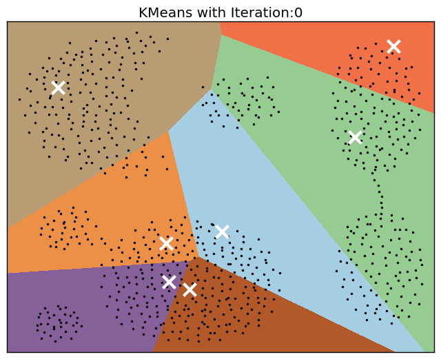{fig-align="center" width="900"}

Após a detecção dos grupos, é preciso analisar o resultado de modo a
tentar extrair informações coerentes de modo a saber o que cada grupo
representa no problema em questão.

<!-- ## Aprendizagem semi-supervisionada

<br>

A aprendizagem semi-supervisionada é uma abordagem na área de
aprendizagem de máquina, em que um algoritmo utiliza tanto dados
rotulados quanto não rotulados para treinamento. Por exemplo, algoritmos
que propagam rótulos, como o *Label Propagation*, em que rótulos
conhecidos são propagados para dados não rotulados com base em sua sua
proximidade no espaço de características.

<br>

Uma outra abordagem seria misturar modelos (*Model Blending*), em que
diferentes modelos são treinados em diferentes partes do conjunto de
dados, por exemplo, um modelo para a parte roturada e um para a parte
não rotulada.

<br>

{width="50%"}

## Aprendizagem por reforço

<br>

Nesse tipo de aprendizagem, não **há uma fonte externa de exemplos**. O
agente (modelo) aprende aprende com sua própria experiência, por
tentativas e erros, em que você deverá definir uma medida de sucesso, e
eventualmente recompensar os acertos. No vídeo abaixo, veja um joguinho
que criei em R, em que o carrinho aprendeu a desviar de obstáculos
aleatórios que aparecem em sua frente. Utilizou-se uma rede neural cuja
a saída poderia ser ("parado", "para cima" ou "para baixo"). Veja o
código clicando
[**aqui**](https://github.com/prdm0/desviando_obstaculos).

<br>

 -->


# {.title background-image="imgs/ml_illustration.jpg" background-size="100% 100%"}


# Focaremos em aprendizagem supervisionada {.title background-image="imgs/Clouds2.jpg"}

# Modelos de Regressão {.title background-image="imgs/Clouds.jpg"}


## Regressão

<br>

De forma geral, temos que o objetivo de um modelo de regressão é
determinar a relação entre uma variável aleatória (label)
$Y \in \mathbb{R}$ e um vetor de covariáveis (features)
$\mathbf{x} = (x_1, \cdots, x_d) \in \mathbb{R}^d$. Mais
especificamente, busaca-se estimar

$$r({\bf x}) := \mathbb{E}(Y|X = {\bf x}),$$

sendo esta chamada de [função de regressão]{.red}. Temos que:

<br>

::: {.nonincremental}
1.  Se $Y$ é uma variável quantitativa, então estamos sob um problema de
    [regressão]{.red};
2.  Se $Y$ é uma variável qualitativa, então teremos um problema de
    [classificação]{.red}.
:::

Em aprendizagem de máquina, assumimos que não temos meios de calcular
$r({\bf{x}})$, i.e., não conhecemos a distribuição condicional de
${Y\,|\,X}$. Portanto, não temos meios de calcular

$$\mathbb{E}(Y|X = {\bf x}) = \int y\,\mathrm{d}F_{Y}(y | X = {\bf x}).$$

## Regressão

Nossa ideia é construir uma boa estimativa $g$ da função de regressão
$r(\bf{x}) := \mathbb{E}(Y\,|\,\bf{X} = \bf{x})$, para novas
observações, i.e., queremos obter uma função $g$, tal que:

$$g: \mathbb{R}^d \rightarrow \mathbb{R},$$

de tal forma que $g$ possua um bom poder preditivo. Em aprendizagem de
máquina, só estaremos interessados em obter uma função $g$ que estime
bem um número real (em problemas de regressão), ou que classifique bem
(em um problema de classificação), utilizando as $d$ covariáveis. Ou
seja, para $m$ novas observações, desejamos obter $g$, que

$$g({\bf{x}}_{n + 1}) \approx y_{n + 1}, \cdots, g({\bf{x}}_{n + m}) \approx y_{n + m}.$$

## Função de risco

<br>

Para que possamos construir boas funções de predição, é preciso que
tenhamos um critério para medir o desempenho de uma dada função
$g:\mathbb{R}^d \rightarrow \mathbb{R}$. Em contexto de regressão,
usaremos o risco quadrático, muito embora esta não é a única opção.
Denotaremos a função de risco quadrático por:

$$R_{pred}(g) = \mathbb{E}\left[({\bf Y} - g({\bf X}))^2\right],$$ em
que $(\bf X, Y)$ são observações novas que não foram utilizadas para
treinar/estimar $g$. Lê-se $R_{pred}(g)$ como "risco preditivo de $g$".
Note que, como $\bf X$ são observações conhecidas e $g(\cdot)$ é um
modelo preditivo, portanto, $g$ é conhecido, então,
$\widehat{\bf Y} = g(\bf X)$ é um estimador dos *labels*, i.e., de
$\bf Y$.

<br>

Diremos que $L(g({\bf X}); {\bf Y}) = ({\bf Y} - g({\bf X}))^2$ é a
[função de perda quadrática]{.red}, as vezes chamado de perda $L_2$.
Outra funções como a [função de perda absoluta]{.red} denotada por
$L(g({\bf X}); {\bf Y}) = |{\bf Y} - g({\bf X})|$, as vezes chamada de
perda $L_1$ poderiam ser consideradas.

## Função de risco

<br>

Normalmente considera-se a perda $L_2$, uma vez que em modelos de
regressão, minimizar $R_{pred}(g)$, em $g$, equivale a encontrar
$r({\bf x}) = \mathbb{E}({\bf X}|{\bf Y})$, i.e., equivale a estimar a
função de regressão.

<br>

[Teorema]{.red}: Suponha que definimos o risco de uma função de predição
$g: \mathbb{R}^d \rightarrow \mathbb{R}$ via função perda quadrática,
i.e, $R_{pred}(g) = \mathbb{E}\left[({\bf Y} - g({\bf X}))^2\right]$, em
que $\bf (X, Y)$ são novas observações que não foram utilizadas para
estimar $g$. Suponha também que estimamos o risco de um estimador de
regressão $r({\bf X})$ via função perda quadrática
$R_{reg}(g) = \mathbb{E}\left[(r({\bf X}) - g({\bf X}))^2\right]$.
Então,

$$R_{pred}(g) = R_{reg}(g) + \mathbb{E}\left[\mathbb{V}[{\bf Y} | {\bf X}]\right],$$

em que $\mathbb{E}\left[\mathbb{V}[{\bf Y} | {\bf X}]\right]$ é a
variância média do modelo que não depende de $g$. Portanto, estimar bem
$r({\bf x})$ é de fundamental importância para criar uma boa função de
predição. Em especial, sob a ótica do risco quadrático, a melhor função
de predição para $\bf Y$ é a função de regressão $r({\bf x})$, de tal
modo que:

$$\argmin_g R_{pred}(g) = \argmin_g R_{reg}(g) = r({\bf x}).$$

## Função de risco

<br>

**Lembre-se**: $r({\bf x}) = \mathbb{E}(Y | \bf{X} = \bf{x})$ é a nossa
[função de regressão]{.red}.

<br>

A definição de risco preditivo $R_{pred}$, que também denotaremos
simplesmente por $R$, tem um apelo frequentista. Dessa forma, para um
novo conjunto com $m$ novas observações,
$({\bf X}_{n+1}, Y_{n+1}), \cdots, ({\bf X}_{n+m}, Y_{n+m})$, temos que
essa nova amostra é i.i.d. à amostra observada (utilizada no treinamento
do modelo/na estimação). Então, pela Lei dos Grandes Números, temos que
um bom estimador para a função para o risco preditivo é dado por:

$$\frac{1}{m}\sum_{i = 1}^m (Y_{n + i} - g(X_{n + i}))^2 \approx R(g) := \mathbb{E}\left[(Y - g({\bf X}))^2\right].$$ {#eq-risco-correto}

Chamaremos a quantidade acima de [Erro Quadrático Médio -
EQM](https://pt.wikipedia.org/wiki/Erro_quadr%C3%A1tico_m%C3%A9dio). Em
aprendizagem de máquina, normalmente estaremos no contexto em que temos
muitas observações, e que portanto, poderemos fazer esse apelo
frequentista.

<br>

Desejamos encontrar $g$ (encontrar métodos) que minimize de forma
satisfatória $R$, i.e., métodos que nos conduzam à um risco baixo.

## Função de risco

<br>

Sendo assim, se $R(g)$ possui um valor baixo, então, temos que

$$g({\bf x}_{n+1}) \approx y_{n+1}, \cdots, g({\bf x}_{n+m}) \approx y_{n+m}.$$
<br> {width="25%"}

## Erro quadrático médio

<br>

Como exposto anteriormente, para avaliar o poder preditivo de uma
modelo, i.e., a aprendizagem de um modelo, devemos avaliar a função de
risco, i.e., devemos avaliar
$R(g) := \mathbb{E}\left[L(g({\bf X}); Y)\right]$. Em particular,
considere $L = L_2$ (função perda quadrática). Então, poderíamos ser
levados a acreditar que o melhor estimador de $R(g)$, utilizando a Lei
dos Grandes Números seria:

$$\frac{1}{n}\sum_{i = 1}^n(Y_{i} - g({\bf X_{i}}))^2 \approx R(g) := \mathbb{E}\left[L_2(g({\bf X}); Y)\right].$$

<br>

Essa quantidade é chamada, de **E**rro **Q**uadrático **M**édio -
**EQM**. Desejamos escolher o melhor mode, entre os modelos testados,
que minimiza o EQM.

<br>

O apelo frequentista em utilizar a Lei dos Grandes Números na forma
acima não é correto, uma vez que usamos as $n$ observações para
treinar/ajustar o modelo $g$.

## Erro quadrático médio

<br>

Por exemplo, no problema de PIB per Capita versus expectativa de vida,
em que consideramos uma aproximação linear, não poderíamos utilizar o
EQM da forma acima, com as $n$ observações utilizadas para treinar o
modelo. É um detalhe sutil, mas que muitas pessoas cometem esse erro.

<br>

Não podemos utilizar as $n$ observações para estimar o risco $R(g)$
através do EQM, uma vez que estamos utilizando o mesmo conjunto de dados
para ajustar e avaliar $g$.

<br>

**Qual o problema?**

<br>

::: {.nonincremental}
1.  Não vale a Lei dos Grandes Números;
2.  Usamos os mesmos valores de ${\bf x}$ e $y$ para treinar e avaliar o
    modelo.
:::

## Erro quadrático médio

<br>

O que diz a Lei dos Grandes Números, em particular, a Lei Forte de
Kolmogorov?

<br>

[Teorema]{.red} (**Lei Forte de Kolmogorov**): Sejam $X_1, \cdots, X_n$
uma sequência de variáveis aleatórias - v.a. i.i.d. e integráveis, i.e.,
com valor esperado limitado, tal que
$\mathbb{E}(X) = \mu\,\, \forall i$. Então,

$$\frac{X_1 + X_2 + \cdots + X_n}{n} \rightarrow \mu,$$

quase certamente, i.e., com probabilidade 1.

<br>

Note que se desejamos comparar diversos modelos,
$g_1({\bf x}), g_2({\bf x}), \cdots,$ e se utilizarmos as mesmas $n$
obervações para calularmos $R(g_1({\bf x})), R(g_2({\bf x})), \cdots$,
os termos de cada uma das somas **não são independentes**. Lembre-se que
desejamos obter $\argmin_g R_{pred}(g)$.

## Erro quadrático médio

<br>

Portanto, nunca utilize as mesmas observações utilizadas para treinar o
modelo, como aquelas que serão utilizadas para se estimar $R(g)$. [**Nunca!
Isso é um pecado mortal! Ok?!**]{.red}

<br>

{width="20%"}

# {background-image="imgs/principais_pacotes_tidyverse.png" background-size="contain" background-position="left"}

:::: {.columns}
::: {.column width="60%"}
:::
::: {.column width="40%"}
# Tidyverse {.r-fit-text}
<br>
<br>
<br>
É bom conhecer alguns pacotes para tarefas diversas na linguagem R. Alguns pacotes que podem facilitar sua vida são os pacotes do [**tidyverse**](https://www.tidyverse.org/):
<br>
<br>
```{r}
#| eval: false
install.packages(
  "tidyverse"
)
```
:::
::::

#  {.title background-image="imgs/dirigivel_tidymodels.png"}

# {background-image="imgs/principais_pacotes_tidymodels.png" background-size="contain" background-position="left"}

:::: {.columns}
::: {.column width="60%"}
:::
::: {.column width="40%"}
# Tidymodels {.r-fit-text}

::: {.nonincremental}
+ Tidymodels é um framework organizado e moderno para modelagem de dados em R, seguindo os princípios do tidyverse.
+ Ele fornece uma abordagem unificada para a construção, avaliação e comparação de modelos de aprendizado de máquina.
+ O framework é composto por vários pacotes, cada um focado em uma parte específica do processo de modelagem.
:::
<br>
```{r}
#| eval: false
install.packages(
  "tidymodels"
)
```
:::
::::

# {.title background-image="imgs/workflow_tidymodels.png" background-size="100% 100%"}

## Tidymodels 

<br>

::: columns
::: {.column width="60%"}
Uma das primeiras ideias mais conhecidas de unificação de sintaxe do
*workflow* de machine learning, na linguagem R, foi idealizada pelo
estatístico [Max Khun](https://www.linkedin.com/in/max-kuhn-864a9110/).

<br>

Ele criou a biblioteca
[caret](https://cran.r-project.org/web/packages/caret/index.html) -
**C**lassification **A**nd **RE**gression **T**raining de R que é muito
bem desenvolvida e abrangente. Você poderá estudar o
[caret](https://cran.r-project.org/web/packages/caret/index.html)
clicando [aqui](https://topepo.github.io/caret/).

<br>

Não foi um trabalho simples, veja uma tabela com a quantidade de modelos
que o [caret](https://cran.r-project.org/web/packages/caret/index.html)
suporta, clicando
[aqui](https://topepo.github.io/caret/available-models.html). Então,
"por baixo dos panos", a ideia era unificar a entrada e saída. A
biblioteca **caret** continua sendo mantida, apesar da existência do
[tidymodels](https://www.tidymodels.org/).
:::

::: {.column width="40%"}
{fig-aling="right" width="660px"}
:::
:::

## Instalando e configurações inicias 

::: columns
::: {.column width="40%"}
::: {.nonincremental}
+ A biblioteca [**future**](https://future.futureverse.org/) é útil para paraleizar partes do processo de modelagem que são matematicamente independêntes. Instale `install.packages("future")` e carregue-a com `library(future)`.
+ O paralelismo é muito útil no processo de tunagem dos hiperparâmetros, pois o tempo de execução pode ser reduzido significativamente.
+ O código `tidymodels::tidymodels_prefer()` é útil para  resolver problemas de conflitos entre pacotes.
:::
:::
::: {.column width="60%"}
```{r}
#| eval: false
#| code-summary: Instalação do pacote tidymodels
#| code-line-numbers: 1-2|5|7,12|
# Instale o pacote future para habilitar o paralelismo
# install.packages("future")
library(tidymodels)
library(future)
tidymodels::tidymodels_prefer()

future::plan(multisession)

# Aqui fica sua modelagem no
# tidymodels: validacao cruzada e tunagem de hiperparâmetros

future::plan(sequential) # Tornando o código sequencial novamente

```
:::
:::

## Paralelizando

::: columns
::: {.column width="50%"}
<br>
<br>

[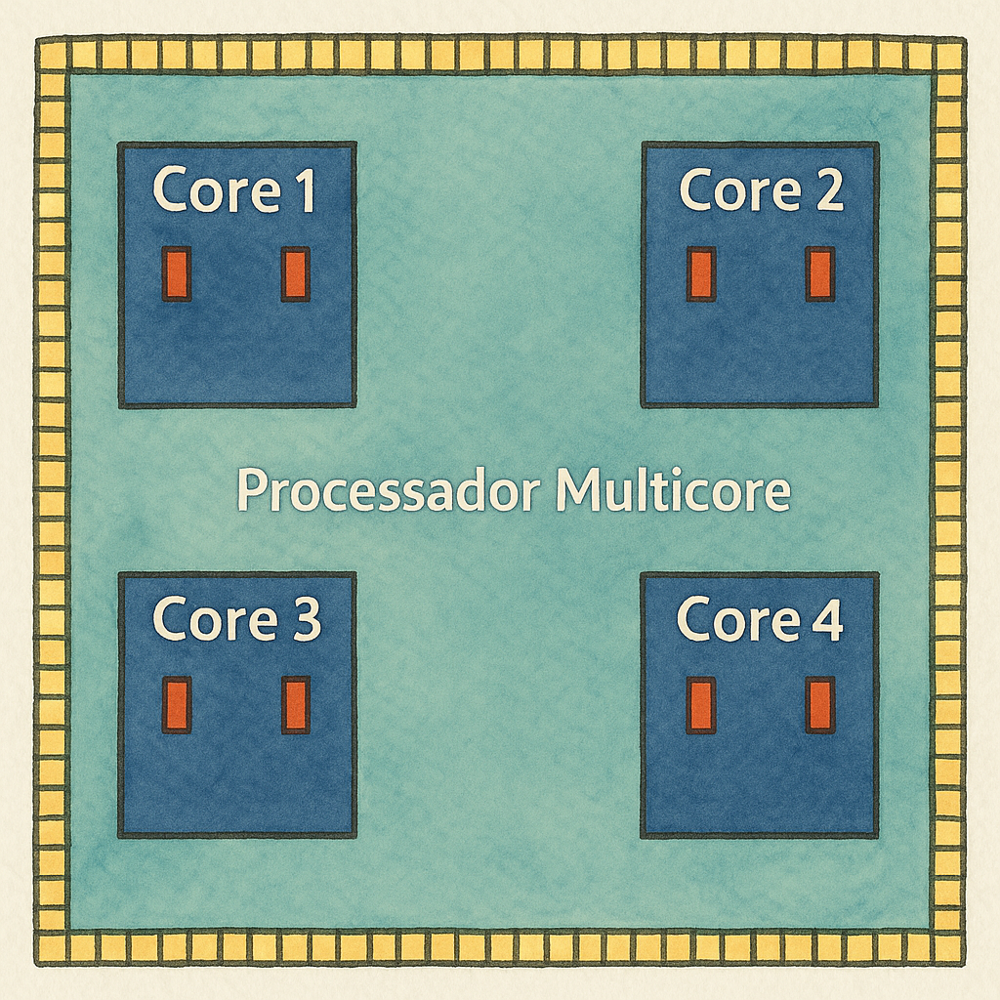{fig-alt="Ilustração de um processador multicores com 4 núleos (na cor azul) e 8 threads (na cor vemelho)." width="50%" height="auto"}](https://pt.wikipedia.org/wiki/Processador_multin%C3%BAcleo)
:::

::: {.column width="50%"}

::: {.nonincremental}
+ O pacote [**future**](https://future.futureverse.org/) permite programar tarefas em paralelo de forma simples e intuitiva em R.

+ O objetivo do pacote [**future**](https://future.futureverse.org/) é fornecer uma maneira muito simples e uniforme de avaliar expressões R de forma assíncrona.

+ Em programação, um future é uma abstração para um valor que pode estar disponível em algum momento no futuro.
:::
[{fig-alt="Logo do pacoture **future** que permite paralelismo em R em diferentes sistemas POSIX." width="30%" height="auto"}](https://future.futureverse.org/)
:::
:::

## Paralelizando 

::: columns
::: {.column width="50%"}
<br>
<br>

[{fig-alt="Ilustração de um processador multicores com 4 núleos (na cor azul) e 8 threads (na cor vemelho)." width="50%" height="auto"}](https://pt.wikipedia.org/wiki/Processador_multin%C3%BAcleo)
:::

::: {.column width="50%"}
Exemplo de paralelismo com o pacote [**future**](https://future.futureverse.org/):
```{r}
#| eval: false
#| class-source: smallcode
#| code-line-numbers: 1-9|11-19|24-33
library(future)
library(tictoc)

future::plan(future::multisession)

f <- function(){
  Sys.sleep(10)
  runif(1)
}

# Execução em serial
tic()
set.seed(0)
v <- lapply(
  X = 1L:10L,
  FUN = \(i) f()
)
print(v)
toc()

# Execução em paralelo
tic()
set.seed(0)
v <- lapply(
  X = 1L:10L,
  FUN = \(i) future::future(
    f(),
    seed = TRUE
  )
)
v <- value(v)
print(v)
toc()
```
:::
:::

## Paralelizando 

::: columns
::: {.column width="50%"}

`future::plan(multicore)`

[{fig-alt="No sistema operacional Linux. Esse é o Tux, mascote do sistema operacional linux." width="60%" height="auto"}](https://pt.wikipedia.org/wiki/Linux)
:::

::: {.column width="50%"}
`future::plan(multisession)`

[{fig-alt="Em todos os sistemas operacionais (Linux, Unix e Windows)."  width="60%" height="auto"}](https://www.microsoft.com/pt-br/download/windows)
:::
:::

## Biblioteca future 

Com a biblioteca [**future**](https://future.futureverse.org/) você pode utilizar paralelismo nos seus códigos, criar funcionais paralelos, loops paralelos e não se limita ao uso com o tidymodels. Na verdade é o [**tidymodels**](https://www.tidymodels.org/) (pacote [**tune**](https://tune.tidymodels.org/)) que faz uso do pacote future.

<br>

::: {.iframe-container}
<iframe src="https://future.futureverse.org/" width="100%" height="700px" frameborder="0"></iframe>
:::

## rsample 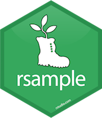

::: columns
::: {.column width="50%"}
<br>
<br>
O pacote [**rsample**](https://rsample.tidymodels.org/) é um dos pacotes do
*framework* [**tidymodels**](https://www.tidymodels.org/). Ele é responsável por
realizar a divisão dos dados em conjuntos de treinamento e teste.

<br>
Utilizamos o rsample para criar as amostras para a validação cruzada, úteis na faze de
tunagem de hiperparâmetros.
:::
::: {.column width="50%"}
[![Imagem no estilo aquarela fazendo alusão ao uso do pacote [**rsample**]{.red}.](imgs/rsample_aquarela.png){fig-alt="Litografia vitoriana fazendo alusão ao uso do pacote rsample." width="70%" height="auto"}](https://rsample.tidymodels.org/)
:::
:::

## rsample 

<br>

**Anumero as funções do rsample que você irá mais utilizar:**

<br>

::: {.nonincremental}
1. `initial_split()`: divide o conjunto de dados em conjuntos de
    treinamento e teste.

2. `vfold_cv()`: cria amostras para validação cruzada, úteis na faze de tunagem de hiperparâmetros. Falaremos em breve sobre isso.

3. `loo_cv()`: cria amostras para validação cruzada via *leave-one-out*.

4. `bootstraps()`: cria amostras para validação cruzada via *bootstrap*.
:::

## rsample 

O site do pacote [**rsample**](https://rsample.tidymodels.org/) é muito bom e
possui diversos exemplos de como utilizar as funções do pacote.

<br>

::: {.iframe-container}
<iframe src="https://rsample.tidymodels.org/reference/index.html" width="100%" height="700px" frameborder="0"></iframe>
:::

## Data Splitting / Hold-Out 

<br>

Corrigir o problema de dependência que há ao estimar o risco preditivo por meio do EQM usando toda a base é fácil. Uma abordagem muito utilizada é utilizar [*data
splitting*]{.red}, também chamado de método [*hold-out*]{.red}. Algo
como a segunda linha da imagem abaixo:

::: columns
::: {.column width="55%"}
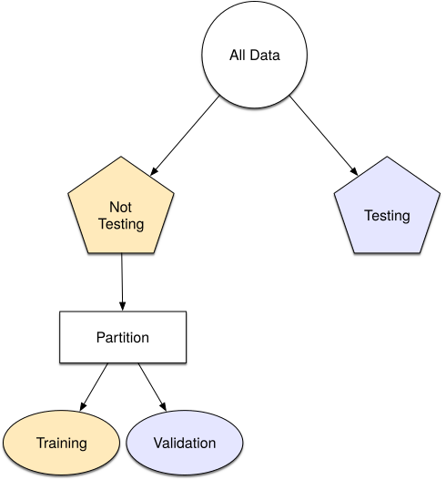{fig-aling="center" width="50%"}
:::

::: {.column width="45%"}
{fig-aling="center" width="50%"}
:::
:::

##  Data Splitting / Hold-Out 

<br>

::: columns
::: {.column width="50%"}
O termo [validação]{.red} refere-se à parcela do conjunto de treinamento
incial que dividimos em validação e treinamento, dentro de uma validação
cruzada.

<br>

O conjunto [*Testing*]{.red} na segunda hierarquia da árvore ao lado, só
usamos no final para avaliar o desempenho do modelo nesse conjunto. Isto
é, usamos o [*Testing*]{.red} para o cálculo do **risco observado**.

<br>

Perceba que o conjunto de treinamento ([*Not Testing*]{.red}) é
particionado em treinamento e validação. Poderíamos fazer uma única
partição, mas o procedimento comumente utilizado é particionar entre
[*Training*]{.red} e [*Validation*]{.red} usando algum procedimento de
validação cruzada.
:::

::: {.column width="50%"}
{fig-aling="center" width="64%"}
:::
:::

## Data Splitting 

<br>

O percentual de divisão dos dados normalmente é empírico. Usa-se
normalmente a proporção de $70\%$ para treinamento e $30\%$ para teste
$(70\%, 30\%)$. Outros esquemas de divisões são bastante utilizados, por
exemplo, $(80\%, 20\%)$, $(99\%, 1\%)$, a depender da quantidade de
observações (tamanho do conjunto de dados).

<br>

Portanto, utilizar o EQM sob o conjunto de dados de teste para avaliar
$g_1({\bf x}), g_2({\bf x}), \cdots$, é uma boa estratégia, uma vez que
agora não teremos mais uma dependência no numerador do cálculo do EQM.
Em notação matemática, poderíamos escrever como já apresentado
anteriormente, em @eq-risco-correto, i.e.,

$$\frac{1}{m}\sum_{i = 1}^m (Y_{n + i} - g(X_{n + i}))^2 \approx R(g) := \mathbb{E}\left[(Y - g({\bf X}))^2\right].$$

<br>

Esse resultado valeria para qualquer outra função de perda.

## Data Splitting 

Reescrevendo, suponha que o conjunto de dados total possua $n$
observações e que separamos aleatoriamente $s < n$ observações para o
conjunto de treinamento. Assim, temos, algo como:

<br>

$$\overbrace{(X_1, Y_1), (X_2, Y_2), \cdots, (X_s, Y_s)}^{70\%}, \,\,\, \overbrace{(X_{s + 1}, Y_{s + 1}), (X_{s + 2}, Y_{s + 2}), \cdots, (X_n, Y_n)}^{30\%}.$$

<br>

Então, temos que uma boa estimativa de $R(g)$ é dada pelo EQM calculado
sobre o conjunto de dados de teste, que nesse caso considerei o conjunto
com $30\%$, mas esse percentual poderia ser outro. Então, temos que um
bom estimador é:

$$\frac{1}{n - s}\sum_{i = s + 1}^n (Y_{i} - g(X_{i}))^2 \approx R(g) := \mathbb{E}\left[(Y - g({\bf X}))^2\right].$$

## Data Splitting 

<br>

**Agora você entende por que dividimos os dados em treinamento e
teste?**

<br>

{width="25%"}

<br>

Dividimos para obtermos um bom estimador do risco utilizando o
[EQM](https://en.wikipedia.org/wiki/Mean_squared_error). 🎁

## rsample

<br>

::: columns
::: {.column width="40%"}
[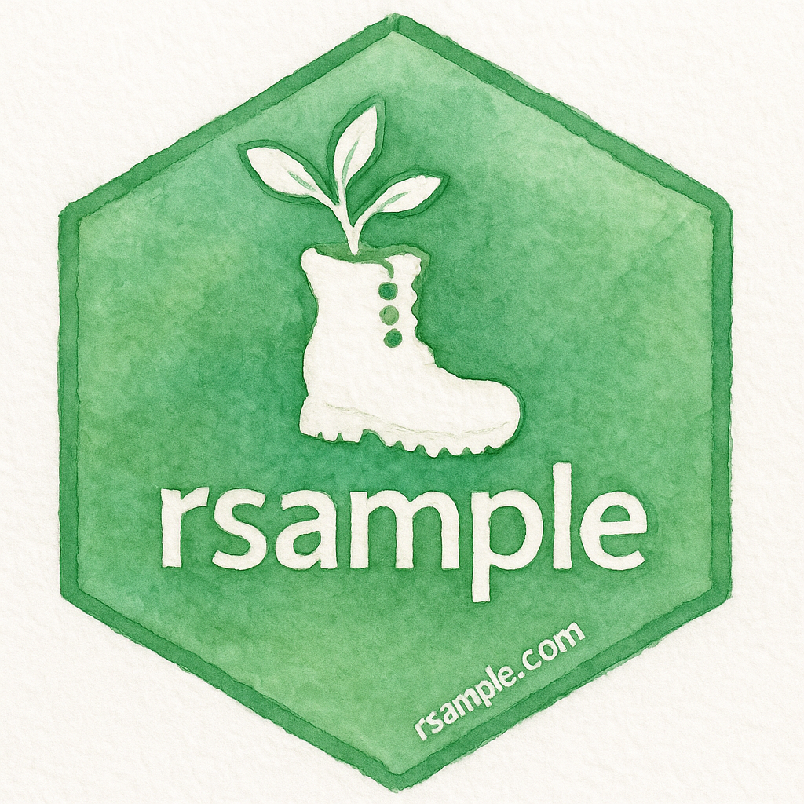{fig-alt="Litografia vitoriana fazendo alusão ao uso do pacote rsample." width="70%" height="auto"}](https://rsample.tidymodels.org/)
:::

::: {.column width="60%"}
```{r}
#| eval: false
#| code-summary: Carregando o pacote rsample
#| code-line-numbers: 1-2|5|6-12|9|12|13
library(tidymodels)

tidymodels::tidymodels_prefer()

set.seed(123)
dados_split <- rsample::initial_split(
  dados,
  prop = 0.7,
  strata = "Resposta"
)

treino <- rsample::training(dados_split)
teste <- rsample::testing(dados_split)
```
:::
:::

::: {.callout-note collapse="true" appearance="simple"}
📌 **Atenção**:
<br>
<br>
É possível estratificar a variável resposta, para que o conjunto de
treinamento e teste possuam a mesma proporção de classes.
:::

## rsample

<br>

::: columns
::: {.column width="40%"}
[{fig-alt="Litografia vitoriana fazendo alusão ao uso do pacote rsample." width="70%" height="auto"}](https://rsample.tidymodels.org/)
:::

::: {.column width="60%"}

<br>


**Como a estratificação funciona❓**

<br>
1. **Variável resposta numérica**: A estratificação selecionará uma amostra aleatória dentro de cada **quartil da variável resposta** para compor o conjunto de teste.

2. **Variável resposta categórica**: A amostra aleatória será feita de forma que a **proporção de classes** no conjunto de teste seja a mesma do conjunto de treinamento.


:::
:::

## Leave-one-out cross-validation 

<br>

Observe a animação abaixo que ilustra o procedimento de
**l**eave-**o**ne-**o**ut **c**ross-**v**alidation - LOOCV, em uma
amostra de tamanho $n = 8$. Ao fim, teremos $n$ modelos ajustados, em
que calculamos as suas respectivas performances, i.e., com o risco
observado, estimamos o risco de $R(g)$.

<br>

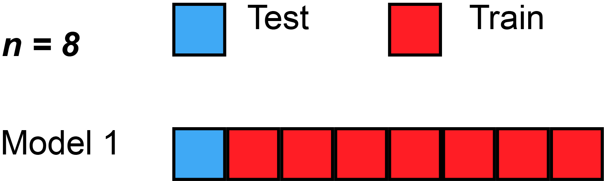

## Leave-one-out cross-validation 
<br>

Vejo muitas pessoas que usam uma validação cruzada, por exemplo,
*leave-one-out cross-validation* - LOOCV comparando com o método
Jackknife e algumas inclusive dizendo ser a mesma coisa. Não, não são!

<br>

O algoritmo Jackknife é um procedimento de estimação, e que, por sua
vez, deve estar dentro do conjunto de treinamento. Para haver algum
Jackknife, a estimativa com $n-1$ observações deve estar dentro do
conjunto de treinamento e seria nesse conjunto onde se teria a remoção de
uma observação por vez. **Consegue perceber a diferença sutil?**

<br>

{width="16%"}

## Leave-one-out cross-validation 

<br>

O método LOOCV foi proposto por Stones (1974), no artigo intitulado
Cross-Validatory Choice and Assessment of Statistical Predictions, no
Royal Statistical Society, Série B. Clique
[aqui](https://www.jstor.org/stable/pdf/2984809.pdf?refreqid=excelsior%3A3071b86b3588905b095d44668025b005&ab_segments=&origin=&initiator=&acceptTC=1)
se tiver curiosidade em ler o artigo.

<br>

Escrevendo o estimador do risco em um procedimento de LOOCV, temos que:

$$\widehat{R}(g) = \frac{1}{n}\sum_{i = 1}^n (Y_i - g_{-i}({\bf X}_i))^2,$$
em que $g_{-i}(\bf{X}_i)$, representa o ajuste do modelo no conjunto de
dados sem a $i$-ésima observação.

<br>

Não é difícil perceber que a depender do valor de $n$, o método LOOCV é
**computacionalmente intensivo**. O método requer que ajustemos $n$
modelos. Em algumas situações isso não é um grande problema, porém, em
diversas outras pode ser impeditivo utilizar o LOOCV. 🤯

## Leave-one-out cross-validation 

<br>

Essa relação entre o LOOCV e o *Akaike Information Criterion* - AIC foi
provada no paper Stone (1977) intitulado **An Asymptotic Equivalence of
Choice of Model by Cross-Validation and Akaike's Criterion** e publicado
no *Journal of the Royal Statistical Society, Series B*. Clique
[aqui](https://iri.columbia.edu/~tippett/cv_papers/Stone1977.pdf), se
quiser ler o artigo.

<br>

::: columns
::: {.column width="50%"}
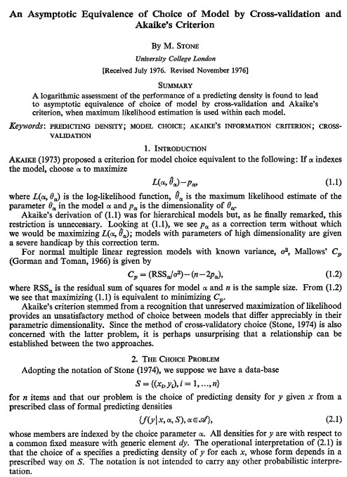{width="35%"}
:::

::: {.column width="50%"}
<br> <br> {width="25%"}
:::
:::

## $k$-fold cross-validation 

<br>

Uma alternativa ao LOOCV é utilizar o método $k$-*fold
cross-validation*. Nessa abordagem, dividimos o conjunto de dados em
$k$-*folds* (lotes) disjuntos e com aproximadamente o mesmo tamanho.
Dessa forma, temos $L_1, \cdots, L_k \subset \{1, \cdots, n\}$ são, cada
um, um conjunto de índices aleatórios associados a cada um dos lotes. A
ideia aqui é construir $k$ estimadores da função de regressão, denotados
por $\widehat{g}_{-1}, \cdots, \widehat{g}_{-k}$, em que
$\widehat{g}_{-j}$ é criado usando todas as observações do banco de
dados, com exceção daquelas do lote $L_j$, utilizado para **validação**.
O estimador do risco é dado por:

$$\widehat{R}(g) = \frac{1}{n}\sum_{j=1}^k \sum_{i \in L_j}(Y_i - g_{-j}({\bf X}_i))^2.$$
Perceba que, que o LOOCV é um caso particular do $k$-*fold
cross-validation*, quando fazemos $k = n$. Em outras palavras,
$L_1, \cdots, L_k \subset \{1, \cdots, n\}$ representam os índices
aleatórios do conjunto de treinamento nos $k$ lotes.


## $k$-fold cross-validation 

A animação abaixo, ilustra o procedimento de $3$-*fold cross-validation*
($k = 3$), para uma amostra de tamanho $n = 12$ observações. Note que os
valores que pertencem a cada um dos lotes são aleatórios. Portanto, o
procedimento LOOCV é deterministico, já o procedimento de $k$-*fold
cross-validation* é randomizado.

<br>

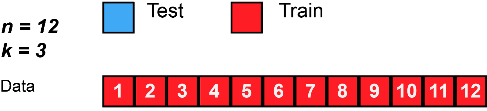

Perceba que teremos agora apenas $3$ modelos. Para cada um desses lotes,
calulamos o EQM com o conjunto de teste (parte [azul]{.trueblue}) e
treinamos o modelo com o conjunto de treinamento (parte
[vermelha]{.truered}).

## $k$-fold cross-validation 

A imagem abaixo ilustra o procedimento $k$-*fold cross-validation*, em
que uma $5$-*fold cross-validation* é realizada dentro do conjunto de
treinamento. Em cada *split*, o conjunto verde de observações (fold
[verde]{.green}) são utilizados para treinar/ajustar o modelo e o
conjunto [azul]{.trueblue}, em cada um dos *splits* é utilizado para
avaliar o risco preditivo $R(g)$ (através, por exemplo do EQM).

::: columns
::: {.column width="60%"}
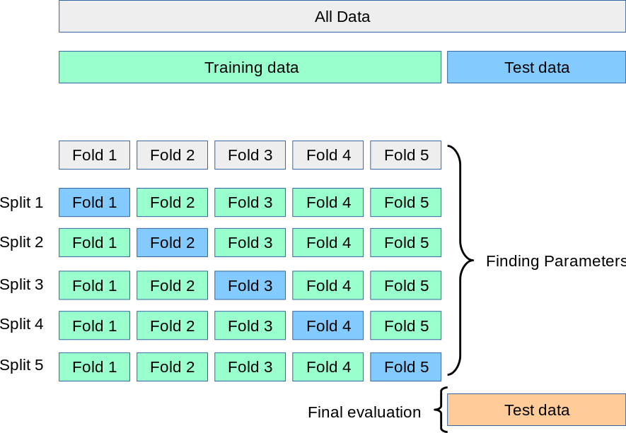{width="800"}
:::

::: {.column width="40%"}
{fig-aling="right"}
:::
:::

## rsample (validação cruzada)

<br>

::: columns
::: {.column width="40%"}
[{fig-alt="Litografia vitoriana fazendo alusão ao uso do pacote rsample." width="70%" height="auto"}](https://rsample.tidymodels.org/)
:::

::: {.column width="60%"}
```{r}
#| eval: false
#| code-summary: Carregando o pacote rsample
#| code-line-numbers: 1-3|5|6-10|12|13|17-21|19|20
#| class-source: smallcode
library(tidymodels)

tidymodels::tidymodels_prefer()

set.seed(123)
dados_split <- rsample::initial_split(
  dados,
  prop = 0.7,
  strata = "Resposta"
)

treino <- rsample::training(dados_split)
teste <- rsample::testing(dados_split)

# Criando as amostras para realizar a validação cruzada
# com o pacote tune (5-fold cross-validation)
cv <- rsample::vfold_cv(
  treino,
  v = 5,
  strata = "Resposta"
)
```
:::

::: {.callout-note collapse="true" appearance="simple"}
📌 **Atenção**:

<br>

Também é possível estratificar a variável resposta, para que o
conjunto de treinamento e ~~teste~~ validação possuam a mesma proporção de classes.
:::
:::


## Resumindo: data splitting, validação cruzada e conjunto de validação 

<br>

A validação cruzada $k$-*fold* é particularmente útil quando o conjunto
de dados é limitado, pois aproveita ao máximo os dados disponíveis. Além
disso, **ela permite verificar se o modelo é estável e se seu desempenho
varia significativamente com diferentes divisões dos dados**. É importante
ressaltar que a validação cruzada $k$-*fold* pode ser computacionalmente
mais cara do que a abordagem do conjunto de validação, uma vez que
envolve treinar e avaliar o modelo várias vezes.

<br>

{width="20%"}

## Resumindo: data splitting, validação cruzada e conjunto de validação

<br>

No [tidymodels](https://www.tidymodels.org/), utilizamos a biblioteca [rsample](https://rsample.tidymodels.org/) para realizar procedimentos de validação
cruzada:

<br>

1. `initial_split()`: útil para uma divisão inicial dos dados, i.e., para aplicação do
*hold-out*;

2. `loo_cv()`: se desejar realizar um procedimento de *leave-one-out cross-validation*;

2. `vfold_cv()`: para um procedimento de $k$-*folds cross-validation*. Podemos inclusive
realizar várias repetições de validação cruzada o que poderá melhorar ainda mais a seleção
da melhor combinação de hiperparâmetros. O número de repetições de validação cruzada poderá
ser especificado no argumento `repeats` que por padrão é `1L`;

3. `bootstraps()`: se for desejado utilizar um procedimento de *bootstrap* não-paramétrico
ao invés de uma validação cruzada. O papel do *bootstrap* é o mesmo da validação cruzada, porém,
a seleção das amostras de treinamento é de mesmo tamanho da amostra de treinamento original e o procedimento é feito com reposição, i.e., os mesmos dados podem aparecer nas amostras. O conjunto de avaliação é definido como as linhas dos dados originais que não foram incluídos na amostra bootstrap. Isso geralmente é chamado de amostra [*out-of-bag*]{.red} - OOB. Podemos alterar o número de amostras *bootstrap* modificando o argumento `times` que por padrão é `25L`.

<br>

::: {.callout-note collapse="true" appearance="simple"}
📌 **Lembre-se que qualquer procedimento de validação cruzada que você escolher deve ser realizado no conjunto
de treinamento**!
:::

## recipes 


::: {.columns}
::: {.column width="50%"}
[{fig-alt="Imagem em aquarela fazendo alusão ao uso do pacote recipes." width="70%" height="auto"}](https://recipes.tidymodels.org/)
:::
::: {.column width="50%"}
Antes de ajustar o modelo, precisamos preparar os dados. O pacote
[**recipes**](https://recipes.tidymodels.org/) é o responsável por
realizar o pré-processamento dos dados.

<br>
1. Permite encadear etapas de transformação (como normalização, imputação, codificação, etc.) de forma organizada e reutilizável.

2. Automatiza tarefas como criação de dummies, spline bases, PCA, interação entre variáveis e muito mais.

3. Possui mais de 100 funções `step_*()` para aplicar transformações específicas e customizáveis em variáveis contínuas, categóricas e textuais.
:::
:::

## recipes 

::: {.columns}
::: {.column width="50%"}
[{fig-alt="Litografia vitoriana fazendo alusão ao uso do pacote recipes." width="70%" height="auto"}](https://recipes.tidymodels.org/)
:::
::: {.column width="50%"}

**Definindo uma receita (fase de pré-processamento)**:

```{r}
#| eval: false
#| code-line-numbers: 3-6|7-10
# Definindo uma receita (fase de pré-processamento)
receita <-
  recipes::recipe(
    y ~ x1 + x3:x4 + x5
    data = dados_treino
  ) |>
  step_*() |>
  step_*() |>
  ...      |>
  step_*()
```

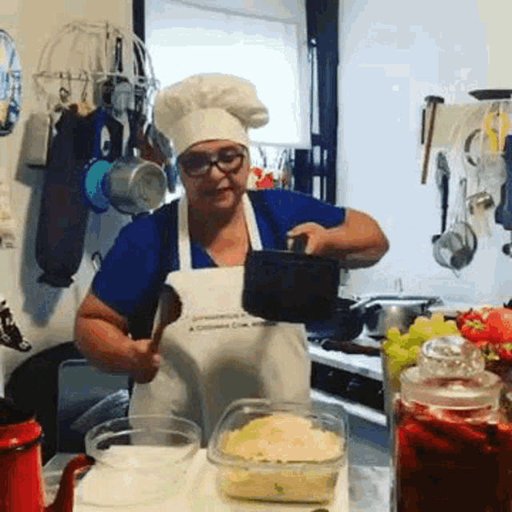{fig-aling="right" width="25%"}

:::
:::

## recipes: a fórmula é o coração da receita 

A função `recipe()` inicia a criação de uma receita e seu primeiro argumento é uma **fórmula**.

`recipe(formula, data, ...)`

<br>

**Estrutura da Fórmula:**

<br>

`variavel_resposta ~ preditor1 + preditor2 + ... + preditorN`

<br>

* **Lado Esquerdo (`variavel_resposta ~ ...`):** Especifica a(s) variável(is) resultado/alvo.
    * Pode ser uma única variável.
    * Múltiplas variáveis respostas podem ser especificadas com `cbind(resp1, resp2) ~ ...` (menos comum para a maioria dos modelos).
* **Lado Direito (`... ~ preditor1 + preditor2`):** Especifica as variáveis preditoras.
* **Til (`~`):** Separa a variável resposta dos preditores.
* **Sinal de Mais (`+`):** Usado para adicionar preditores.


## Interações entre variáveis: utilizando o operador "`:`" 

<br>

As fórmulas do R permitem especificar termos de interação diretamente. Para isso você deve usar o `step_interact()` e o operador "`:`". Por exemplo, para prever `mpg` usando `wt`, `hp` e a interação entre `wt` e `hp` ($wt * hp$), você pode fazer o seguinte:

<br>

```{r}
#| eval: false
# Prever 'mpg' usando 'wt', 'hp' e a interação entre 'wt' e 'hp'
receita <- recipe(
  mpg ~ wt + hp + qsec,
  data = mtcars_tbl
) |>
  step_interact(
    ~ wt : hp
  )
```

<br>

::: {.callout-note collapse="true" appearance="simple"}
📌 Utilize o operador "`:`" com cautela. Certifique-se de que os efeitos principais também estão no modelo.
:::

## Papéis das Variáveis e Seletores `step_*` 

A fórmula no `recipe()` define os **papéis iniciais** das variáveis: `outcome` (resposta) e `predictor` (preditora).

<br>

```{r}
#| eval: false
receita <- recipe(mpg ~ ., data = mtcars_tbl)
# summary(receita) # Mostra os papéis iniciais
```

<br>

Muitas funções `step_*` usam seletores para escolher em quais variáveis atuar, baseando-se nesses papéis ou em suas propriedades:

<br>
🎉 **Seletores ajudam a selecionar mais facilmente**:

* `all_numeric_predictors()`: Todos os preditores numéricos.
* `all_nominal_predictors()`: Todos os preditores categóricos (fatores, caracteres).
* `all_predictors()`: Todos os preditores.
* `all_outcomes()`: Todas as variáveis resposta.
* `starts_with("prefix_")`, `ends_with("_suffix")`, `contains("substring")`

## Papéis das variáveis e seletores `step_*` 

<br>

**Exemplo de uso de seletores**:

<br>

```{r}
#| eval: false
#| code-line-numbers: 5-6|7-8|9-10
receita_com_passos <-
  recipe(mpg ~ ., data = mtcars_tbl) |>
  # Remove a variável 'car_name'
  step_rm(car_name) |>
  # Centraliza apenas preditores numéricos
  step_center(all_numeric_predictors()) |>
  # Escala apenas preditores numéricos
  step_scale(all_numeric_predictors()) |>
  # Cria dummies para preditores nominais
  step_dummy(all_nominal_predictors(), one_hot = TRUE)
```

{fig-aling="right" width="10%"}


## recipes 

| Alugumas funções `step_*()`              | Descrição                                                                 |
|---------------------|---------------------------------------------------------------------------|
| `step_center()`     | Centraliza variáveis numéricas subtraindo a média.                        |
| `step_scale()`      | Padroniza variáveis numéricas dividindo pelo desvio padrão.              |
| `step_normalize()`  | Realiza centralização e padronização em um único passo.                  |
| `step_knnimpute()`  | Imputa valores faltantes usando o método dos k-vizinhos mais próximos.   |
| `step_dummy()`      | Converte variáveis categóricas em variáveis indicadoras (dummies).       |
| `step_nzv()`        | Remove variáveis com variância próxima de zero.                          |
| `step_corr()`       | Remove variáveis altamente correlacionadas entre si.                     |
| `step_pca()`        | Aplica análise de componentes principais (PCA) para redução de dimensão. |
| `step_poly()`       | Gera termos polinomiais de variáveis numéricas.                          |
| `step_log()`        | Aplica transformação logarítmica em variáveis numéricas.                 |
| `step_other()`      | Agrupa categorias menos frequentes em uma nova categoria "outras".       |

## recipes 

Você poderá encontrar uma lista completa das funções `step_*()` em:

<br>

::: {.iframe-container}
<iframe src="https://www.tidymodels.org/find/recipes/" width="100%" height="700px" frameborder="0"></iframe>
:::

## recipes 

<br>

Consulte a documentação do pacote [**recipes**](https://recipes.tidymodels.org/) para
saber mais sobre as funções `step_*()` e como utilizá-las.

<br>

::: {.iframe-container}
<iframe src="https://recipes.tidymodels.org/reference/index.html" width="100%" height="700px" frameborder="0"></iframe>
:::

## recipes 


::: columns
::: {.column width="50%"}

<br>
<br>

{fig-aling="right" width="80%"}
:::
::: {.column width="50%"}

<br>

[📌 **A ordem das etapas de pré-processamento é importante**]{.red}.

+ Por exemplo, se você aplicar a transformação logarítmica em uma variável antes de centralizá-la,
o resultado será diferente do que se você centralizá-la antes de aplicar a
transformação logarítmica.

+ Portanto, a ordem das etapas de pré-processamento é importante e deve ser cuidadosamente planejada.

+ Veja outros detalhes em [https://recipes.tidymodels.org/articles/Ordering.html](https://recipes.tidymodels.org/articles/Ordering.html).
:::
:::

## recipes 

<br>

::: columns
::: {.column width="50%"}

**Tirar o logaritmo e normalizar (🥳 [melhor]{.underline}):**

```{r}
#| eval: false
#| code-line-numbers: 3|6-11
receita <-
  recipes::recipe(
    y ~ .,
    data = dados_treino
  ) |>
  step_log(
    all_numeric_predictors()
  ) |>
  step_normalize(
    all_numeric_predictors()
  )
```
:::
::: {.column width="50%"}

**Normalizar e tomar o logaritmo (😔 [ruim]{.underline}):**

```{r}
#| eval: false
#| code-line-numbers: 3|6-11
receita <-
  recipes::recipe(
    y ~ .,
    data = dados_treino
  ) |>
  step_normalize(
    all_numeric_predictors()
  ) |>
  step_log(
    all_numeric_predictors()
  ) |>
```
:::
:::

::: {.callout-note collapse="true" appearance="simple"}
📌 `y ~ .` significa que `y` é a variável de interesse e todas as outas serão preditoras (*features*).
:::

## recipes: preparando e aplicando a receita 

Após definir os passos da receita, você pode prepará-la e aplicá-la aos dados usando os comandos `prep()` e `bake()`, respectivamente.

<br>

::: columns
::: {.column width="50%"}
```{r}
#| eval: false
#| class-source: smallcode
#| code-line-numbers: 5-16|19-28|64-75
library(AmesHousing)
library(recipes)
library(dplyr)

# Carregar e preparar dados
ames_data <- make_ames() |>
  as_tibble() |>
  select(
    Sale_Price,
    Lot_Area,
    Neighborhood,
    Gr_Liv_Area,
    Overall_Qual,
    Bldg_Type,
    Year_Built
  ) # Selecionar apenas as colunas relevantes

# Receita otimizada
ames_recipe <- recipe(
  Sale_Price ~
  Lot_Area +
  Neighborhood +
  Gr_Liv_Area +
  Overall_Qual +
  Bldg_Type +
  Year_Built,
  data = ames_data
) |>
  # Transformação na variável resposta
  step_log(Sale_Price, base = 10) |>

  # Criar variável derivada
  step_mutate(
    House_Age = 2025 - Year_Built,
    Decade_Built = floor(Year_Built / 10) * 10
  ) |>

  # Remover variável original
  step_rm(Year_Built) |>

  # Lidar com novos níveis em dados futuros
  step_novel(all_nominal_predictors()) |>

  # Agrupar níveis raros (8% threshold)
  step_other(Neighborhood, threshold = 0.08) |>
  step_other(Bldg_Type, threshold = 0.05) |>

  # Criar variáveis dummy
  step_dummy(all_nominal_predictors(), one_hot = FALSE) |>

  # Interações APÓS criação de dummies
  step_interact(~ starts_with("Neighborhood"):starts_with("Bldg_Type")) |>

  # Remover variáveis com zero variance (após interações)
  step_zv(all_predictors()) |>

  # Normalização (remove automaticamente colunas problemáticas)
  step_normalize(all_numeric_predictors()) |>

  # Passo adicional: seleção de variáveis por importância
  step_corr(all_numeric_predictors(), threshold = 0.9)

# Preparar a receita
prep_recipe <-
  prep(
    ames_recipe,
    verbose = TRUE
  )

# Aplicar a receita
ames_processed <-
  bake(
    prep_recipe,
    new_data = NULL
  )

# Verificar resultado
glimpse(ames_processed)
```
:::
::: {.column width="50%"}
{fig-aling="right" width="45%"}
:::
:::

## recipes: preparando e aplicando a receita 

<br>

**Preparando a receita com `prep()` e aplicando com `bake()`**:

<br>

```{r}
#| eval: true
#| class-source: smallcode
#| code-line-numbers: 1-5|7-9|11-14|15-17
library(tidymodels)
library(modeldata)
library(DT)  # Pacote para tabelas interativas

tidymodels::tidymodels_prefer()

dados <- rsample::initial_split(ames, prop = 0.7, strata = "Sale_Price")
treino <- training(dados)
teste <- testing(dados)

receita <-
  recipe(Sale_Price ~ Neighborhood + Gr_Liv_Area + Year_Built + Bldg_Type, data = treino) |>
  step_log(Gr_Liv_Area, base = 10) |>
  step_dummy(all_nominal_predictors(),  one_hot = TRUE)

dados_preparado <- prep(receita, training = treino)
receita_aplicada <- bake(dados_preparado, new_data = treino)
```

## recipes: preparando e aplicando a receita 

<br>

::: {.columns}
::: {.column width="50%"}
**Dados de treino original (`treino`):**
```{r}
#| eval: true
#| echo: false
# Resumo da receita em tabela
library(dplyr)
treino <- treino |>
  select(Sale_Price, Neighborhood, Gr_Liv_Area, Year_Built, Bldg_Type)
treino |>
  datatable(
    options = list(
      scrollX = TRUE,
      pageLength = 5,
      dom = 'tip'
    ),
    caption = "Dados de treino original."
  )
```
:::

::: {.column width="50%"}
**Dados Pós-Transformação (`receita_aplicada`):**
```{r}
#| eval: true
#| echo: false
receita_aplicada |>
  dplyr::mutate(
    across(
      where(is.numeric),
      ~ round(., 2)
    )
  ) |>
  datatable(
    options = list(
      scrollX = TRUE,
      pageLength = 5,
      dom = 'tip'
    ),
    caption = "Dados Aplicados (Head)"
  )
```
:::
:::

# {.title background-image="imgs/motor_parsnip.png" background-size="100% 100%"}

## parsnip 

::: columns
::: {.column width="50%"}
[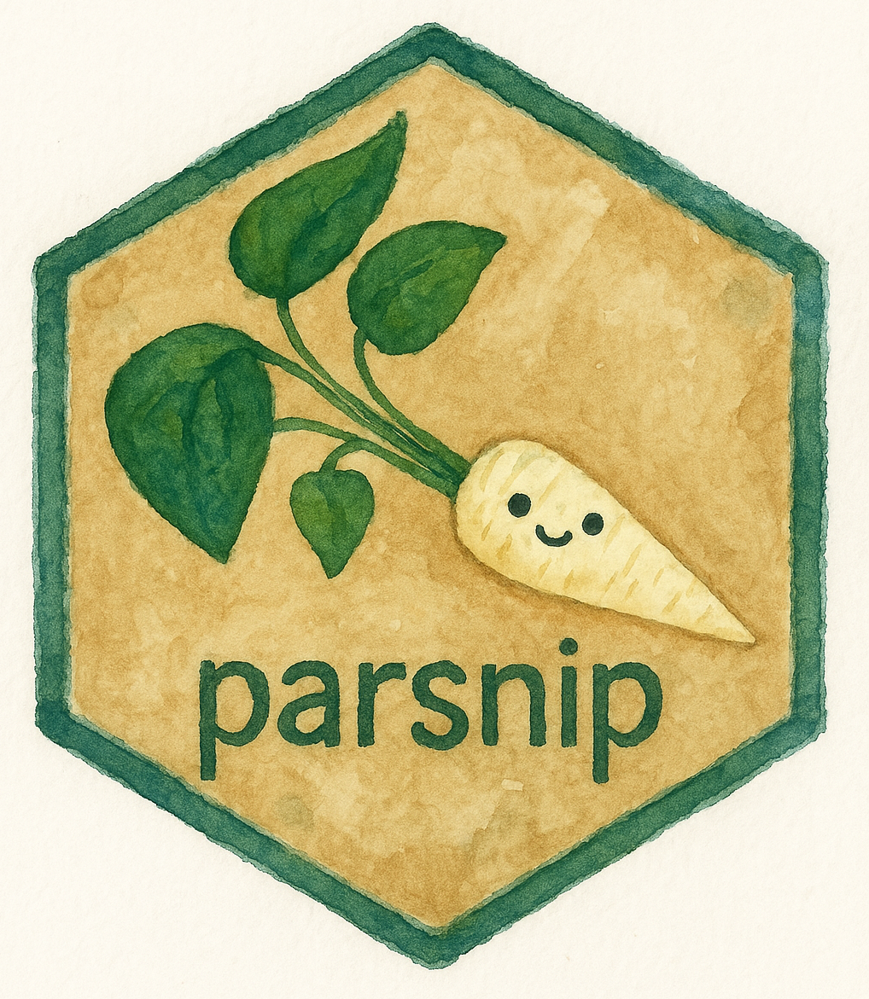{fig-alt="Litografia vitoriana fazendo alusão ao uso do pacote parsnip." width="70%" height="auto"}](https://parsnip.tidymodels.org/)
:::

::: {.column width="50%"}
::: {.nonincremental}
+ Com o pacote [**parsnip**](https://parsnip.tidymodels.org/) você pode
  utilizar diversos modelos de aprendizagem de máquina, com uma sintaxe
  unificada.

+ Há diversos pacotes no CRAN que implementam modelos de
  aprendizagem de máquina, mas cada um com sua sintaxe. O pacote
  [**parsnip**](https://parsnip.tidymodels.org/) unifica a sintaxe.

+ Você poderá experimentar diversas implementações de um determinado modelo utilizando
  a mesma sintaxe com o [**parsnip**](https://parsnip.tidymodels.org/).

{fig-aling="right" width="30%"}
:::
:::
:::

## parsnip 

::: {.iframe-container}
<iframe src="https://www.tidymodels.org/find/parsnip/" width="100%" height="800px" frameborder="0"></iframe>
:::

## parsnip 

<br>

Diversas bibliotecas na linguagem R são preparadas para trabalharem na
área de aprendizagem de máquina. Várias dessas bibliotecas vem sendo
desenvolvidas há anos. Por exemplo,as bibliotecas
[glmnet](https://cran.r-project.org/web/packages/glmnet/index.html),
[ranger](https://cran.r-project.org/web/packages/ranger/index.html),
[kknn](https://cran.r-project.org/web/packages/kknn/index.html),
[xgboost](https://cran.r-project.org/web/packages/xgboost/index.html),
[keras](https://cran.r-project.org/web/packages/keras/index.html),
[rpart](https://cran.r-project.org/web/packages/rpart/index.html),
[randomForest](https://cran.r-project.org/web/packages/randomForest/index.html),
entre diversos outros.

<br>

```{r}
#| code-fold: true
#| eval: true
#| code-summary: O número de pacotes abaixo é o mais recente. Obtido automaticamente por webscraping.
library(xml2)
library(httr)
library(stringr)
library("downlit")

numero_pacotes_r <- httr::GET(
  "https://cloud.r-project.org/web/packages/index.html"
) |>
  xml2::read_html() |>
  xml2::xml_find_all("//p[1]") |>
  xml2::xml_text() |>
  stringr::str_extract(pattern = "[0-9]+")
```

<br>

Atualmente, a linguagem R possui [`r numero_pacotes_r`]{.red}, em que
muitos deles são preparados para para trabalharem em tarefas de
aprendizagem de máquina, porém, cada com sua sintaxe específica. Muitos
implementam o mesmo modelo, uns com algumas variações, porém, o uso é
totalmente diferente, nomes de parâmetros distintos, saídas distintas,
etc.


## parsnip 

<br>

::: columns
::: {.column width = "50%"}

**Utilizando o pacote** [**randomForest**]{.red}:

<br>

```{r}
#| eval: false
#| fig-cap: "Minha legenda para o gráfico"
#| code-line-numbers: 1|7,9|1-17
library(randomForest)

# Modelo básico
modelo <- randomForest(
  Species ~ .,
  data = iris,
  ntree = 500,
  mtry = 2,
  importance = TRUE
)
```
:::

::: {.column width = "50%"}

**Utilizando o pacote** [**ranger**]{.red}:

<br>

```{r}
#| eval: false
#| code-line-numbers: 1|6,8|1-15
library(ranger)

modelo <- ranger(
  Species ~ .,
  data = iris,
  num.trees = 500,
  mtry = 2,
  importance = "impurity"
)
```
:::
:::

## parsnip 

<br>

**Utilizando o pacote** [**ranger**]{.red} em um problema de classificação:

<br>

::: columns
::: {.column width="50%"}
```{r}
#| eval: false
#| code-line-numbers: 3-6|7-8
# Definir o modelo com parsnip
modelo_parsnip <-
  rand_forest(
    trees = 500,       # Equivalente a num.trees
    mtry = 2           # Mesmo valor que no ranger
  ) |>
  set_engine("ranger", importance = "impurity") |>
  set_mode("classification") |>
  fit(Species ~ ., data = iris)
```
:::
::: {.column width="50%"}

[{fig-alt="Imagem em aquarela de um cientista de dados apaixonado pelas coisas certas." width="35%" height="auto"}](https://parsnip.tidymodels.org/)
:::
:::

## parsnip 

<br>

**Utilizando o pacote** [**randomForest**]{.red} em um problema de regressão:

<br>

::: columns
::: {.column width="50%"}
```{r}
#| eval: false
#| code-line-numbers: 3-6|7-8
# Definir o modelo com parsnip
modelo_parsnip <-
  rand_forest(
    trees = 500,       # Equivalente a num.trees
    mtry = 2           # Mesmo valor que no ranger
  ) |>
  set_engine("randomForest", importance = "impurity") |>
  set_mode("regression") |>
  fit(Species ~ ., data = iris)
```
:::
::: {.column width="50%"}

[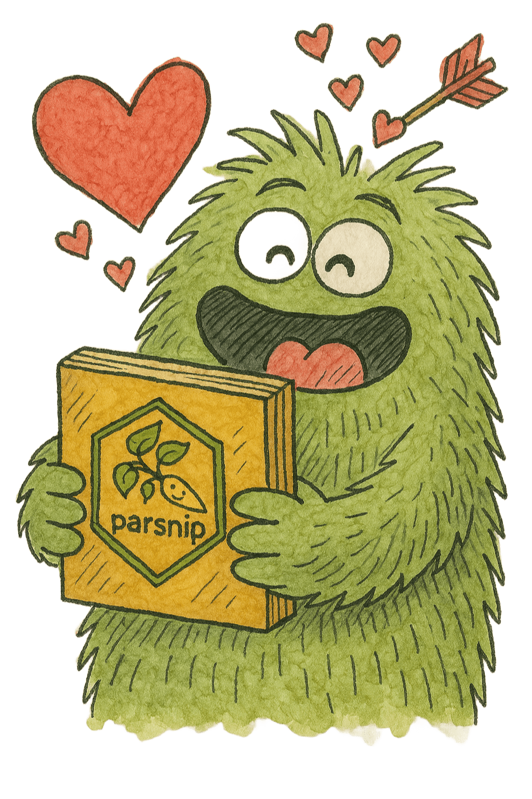{fig-alt="Imagem em aquarela de um cientista de dados apaixonado pelas coisas certas." width="35%" height="auto"}](https://parsnip.tidymodels.org/)
:::
:::

# {.title background-image="imgs/workflows_montanha_russa.png" background-size="100% 100%"}


## workflows 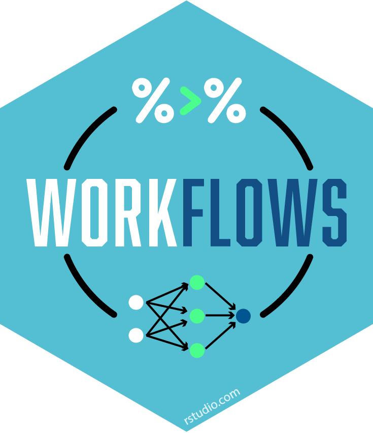

*   O pacote [**`workflows`**](https://workflows.tidymodels.org/index.html) é um dos principais pacotes do *framework* [[**tidymodels**]{.red}](https://www.tidymodels.org/).
*   Seu papel fundamental é **gerenciar e combinar** o **pré-processamento de dados** (definido com [[**recipes**]{.red}](https://recipes.tidymodels.org/)) com a **especificação do modelo** (definida com [[**parsnip**]{.red}](https://parsnip.tidymodels.org/)).

<br>

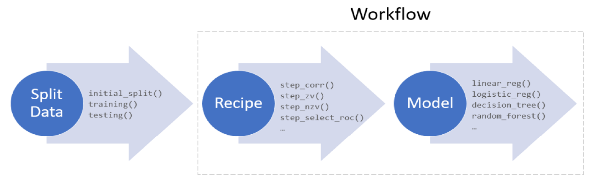{fig-aling="right" width="100%"}


## workflows: o "varal" 🧦 da modelagem 

::: columns
::: {.column width="50%"}
*   Pense em um objeto da classe `workflow` como um "**varal**" ou um "**container**".
*   É um **objeto único** onde você **"pendura"** a **receita** (construída com o pacote [**recipe**]{.red}) e a especificação do modelo (especificado com o pacote [**parsnip**]{.red}).
*   Este objeto encapsula o **processo completo** de preparar os dados e depois aplicar o modelo.

**Vantagem Chave:** **Organização**. Centraliza a lógica, evitando gerenciar receita e modelo separadamente em cada etapa do fluxo.
:::

::: {.column width="50%"}
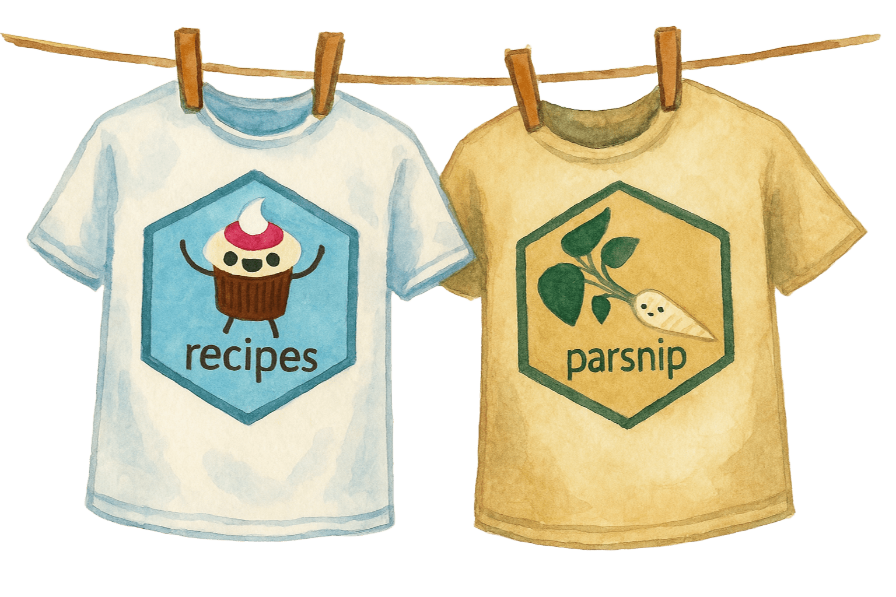{fig-aling="right" width="70%"}
:::
{fig-aling="right" width="20%"}
:::

## workflows 

<br>

Você cria um objeto da classe `workflow` usando a função `workflow()` do pacote [**worflows**]{.red} e adiciona a especificação do modelo e a receita a ele. Um exemplo simples:

<br>

::: columns
::: {.column width="50%"}
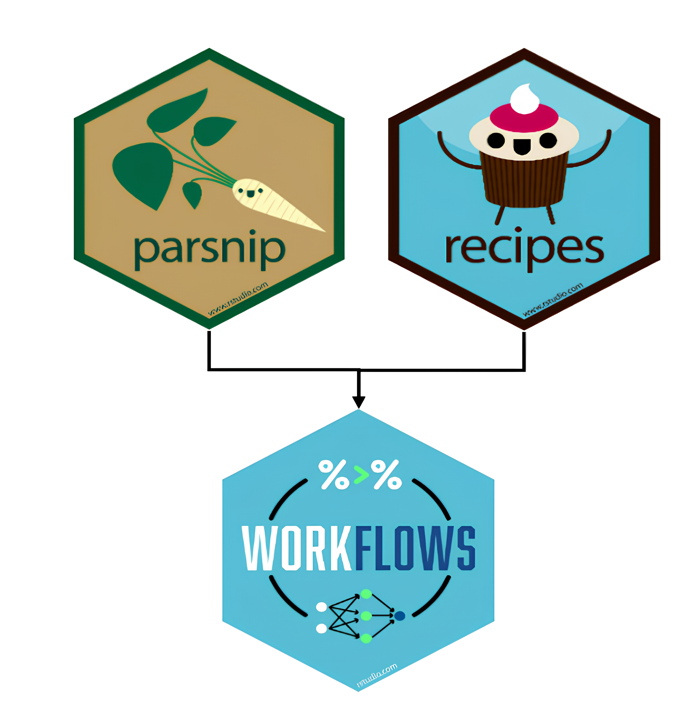{fig-aling="right" width="50%"}
:::
::: {.column width="50%"}
```{r}
#| eval: false
#| code-line-numbers: 1-7|17-20|22-26
#| class-source: smallcode
library(tidymodels) # Carrega o meta-pacote

# 1. Definir a Especificação do Modelo (pacote parsnip)
#    Ex: Regressão Linear
especificacao_modelo <- linear_reg() |>
  set_engine("lm") |>
  set_mode("regression")

# 2. Definir a Receita de Pré-processamento (pacote recipes)
#    Ex: Normalizar preditores numéricos e criar dummies
dados_exemplo <- tibble(
  x = 1:10,
  y = x * 2 + rnorm(10),
  cat = factor(rep(letters[1:2], 5))
)

receita_exemplo <- recipe(y ~ x + cat, data = dados_exemplo) |>
  step_normalize(x) |>
  step_dummy(cat)

# 3. Combinar usando workflow()
meu_workflow <- workflow() |>
  add_recipe(receita_exemplo) |> # Adiciona a receita
  add_model(especificacao_modelo) # Adiciona o modelo

meu_workflow # Visão geral do workflow
```
:::
:::

## workflows 

::: columns
::: {.column width="50%"}
[{fig-alt="O pacote workflows age como um maestro e conecta a pré-processamento (**recipes**) com o modelo parsnip." width="70%" height="auto"}](https://workflows.tidymodels.org/)
:::

::: {.column width="50%"}
+ O pacote [**workflows**](https://workflows.tidymodels.org/) conecta o pré-processamento
  (faze realizada com o pacote [**recipes**](https://recipes.tidymodels.org/)) com o modelo (definido com o pacote
  [**parsnip**](https://parsnip.tidymodels.org/)).

**Uso geral**:

```{r}
#| eval: false
#| code-line-numbers: 1|2|3
wf <- workflows::workflow() |>
  workflows::add_recipe(receita) |>
  workflows::add_model(modelo)
```

ou

```{r}
#| eval: false
wf <-
workflows::workflow(
  receita,
  modelo
)
```
:::
:::

## workflows 

<br>
<br>
<br>

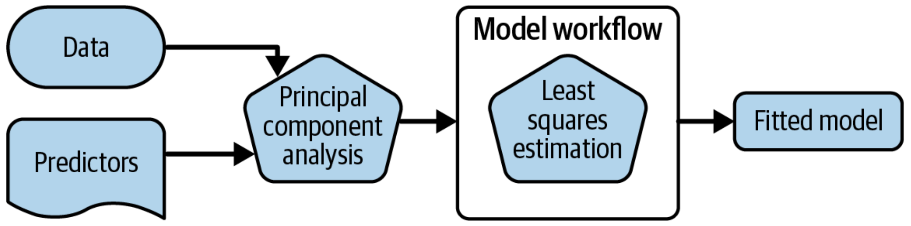{fig-aling="right" width="75%"}

## workflows 

<br>
<br>
<br>

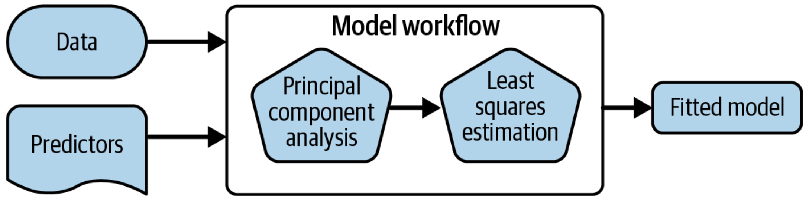{fig-aling="right" width="75%"}

{fig-aling="right" width="15%"}

## workflows 

Em resumo,

<br>

$parsnip + recipes + workflows$:

<br>

```{r}
#| eval: false
#| class-source: smallcode
#| code-line-numbers: 1-7|9-15|17-20
# Definindo uma receita e a fórmula
receita <- recipe(
  Species ~ .,
  data = iris
) |>
  step_log(all_numeric_predictors()) |>
  step_dummy(all_nominal_predictors(), one_hot = TRUE)

# Definindo o modelo
modelo <- rand_forest(
  trees = 500,
  mtry = 2
) |>
  set_engine("ranger", importance = "impurity") |>
  set_mode("classification")

# receita + modelo = workflow
wf <- workflows::workflow() |>
  workflows::add_recipe(receita) |>
  workflows::add_model(modelo)
```

## workflows 

<br>

::: {.iframe-container}
<iframe src="https://workflows.tidymodels.org/reference/index.html" width="100%" height="800px" frameborder="0"></iframe>
:::

## workflows: criando múltiplos fluxos 

Quando precisamos comparar diferentes combinações de receitas de pré-processamento e especificações de modelos, a abordagem recomendada é utilizar `workflow_set()`. Adiante, discutiremos detalhadamente essa função e seu complemento `workflow_map()`, especialmente útil para processos de tuning de hiperparâmetros.

<br>

::: {.callout-note collapse="true" appearance="simple"}
📌 As funções [`workflow_set()`]{.mark} e [`workflow_map()`]{.mark} fazem parte do pacote [**workflowsets**](https://workflowsets.tidymodels.org/) que complementa o pacote [**workflows**](https://workflows.tidymodels.org/reference/workflows-package.html).
:::

::: columns
::: {.column width="50%"}
<br>
{fig-aling="right" width="30%"}
:::

::: {.column width="50%"}
```{r}
#| eval: false
#| class-source: smallcode
#| code-line-numbers: 1-7|9-14|16-18|20-22|24-29|31-32

# É algo assim parecido com:
receita_1 <- recipes(
    y ~ .,
    data = treino
  ) |>
  step_*()
  step_*()

receita_2 <- recipes(
    y ~ .,
    data = treino
  ) |>
  step_*()
  step_*()

modelo_1 <- rand_forest() |>
  set_engine("ranger") |>
  set_mode("regression")

modelo_2 <- rand_forest() |>
  set_engine("rpart") |>
  set_mode("regression")

wf_set <- workflow_set(
  # Passando os modelos
  # (modelo_1, modelo_2)
  # Passando as receitas
  # (receita_1, receita_2)
)

# Tunando os hiperparâmetros # <1>
workflow_map(wf_set)
```
:::
:::


## 🎛 tune: o problema dos hiperparâmetros 

<br>

- Modelos de Machine Learning (ML) frequentemente possuem **hiperparâmetros**.
- Hiperparâmetros são **valores de configuração** que não são aprendidos a partir dos dados durante o treino do modelo. Eles precisam ser definidos *antes* do processo de ajuste.
- **Exemplos**: penalidade (`penalty`) e mistura (`mixture`) em modelos lineares regularizados (como no pacote [**glmnet**](https://cran.r-project.org/web/packages/glmnet/index.html)), número de árvores (`trees`), `mtry` ou `min_n` no pacote [**randomForest**](https://cran.r-project.org/web/packages/randomForest/index.html)/[**ranger**](https://cran.r-project.org/web/packages/ranger/index.html), profundidade de árvores de decisão (`tree_depth`), grau de liberdade (`deg_free`) em splines.
- A **escolha** dos valores para esses hiperparâmetros afeta diretamente o desempenho e a generalização do modelo.
- Como encontrar a **melhor combinação** de hiperparâmetros para o seu problema e dados específicos? Isso é o que chamamos de [**tunagem**]{.mark} ou [*tuning*]{.mark}.


## 🎛 tune: por que otimizar hiperparâmetros? 

<br>

::: columns
::: {.column width="50%"}
[{fig-alt="Imagem em aquarela fazendo alusão ao uso do pacote tune." width="70%" height="auto"}](https://tune.tidymodels.org/)
:::
::: {.column width="50%"}
* **Hiperparâmetros:** são parâmetros do modelo que não são aprendidos diretamente dos dados.
* **Impacto no desempenho:** a escolha dos hiperparâmetros pode ter um impacto significativo na performance do modelo.
* **Busca pelo melhor:** ["tunar"]{.mark} significa buscar encontrar a combinação de hiperparâmetros que resulta no melhor desempenho do modelo em dados não vistos, com base em uma métrica escolhida.

{fig-aling="right" width="25f%"}
:::
:::

## 🎛 tune: preparando o terreno para a tunagem 

O processo geralmente envolve:

1.  **Marcar parâmetros tunáveis**:
    -   Dentro da especificação do modelo (`parsnip`) ou de um step de receita (`recipe`), use a função `tune()` para indicar quais parâmetros devem ser tunados.
    -   Exemplo: `linear_reg() |> set_engine("glmnet") |> set_args(penalty = tune(), mixture = tune())`. Todas estas funções são do pacote [**parsnip**](https://parsnip.tidymodels.org/).

2.  **Definir a estratégia de reamostragem**:
    -   É essencial usar reamostragem (como cross-validation) para obter uma avaliação robusta do desempenho de cada combinação de hiperparâmetros e evitar overfitting nos dados de treino.
    -   O pacote **rsample** fornece funções para isso, sendo `vfold_cv()` para $k$-fold cross-validation a mais comum.

3.  **Criar o workflow**:
    -   Combine sua receita (se houver) e a especificação do modelo em um objeto `workflow()`. Este workflow conterá as indicações dos parâmetros a serem tunados.

## 🎛 tune: tunando parâmetros da receita 

::: columns
::: {.column width="50%"}
- A tunagem não se limita aos hiperparâmetros do modelo!
- Parâmetros em **etapas de pré-processamento** também podem precisar de otimização.
- Assim como nos modelos, marque os parâmetros desejados com `tune()` dentro da função do *step*.
- Exemplo: `step_pca(all_predictors(), num_comp = tune())` ou `step_spline(longitude, latitude, deg_free = tune())`.
- Ao incluir uma receita com parâmetros `tune()` em um `workflow()`, o processo de tunagem com `tune_grid()` avaliará **simultaneamente** as combinações de hiperparâmetros do modelo e da receita.
:::
::: {.column width="50%"}

<br>

{fig-aling="right" width="35%"}
:::
:::

## 🎛 tune: estude a documentação do pacote tune 

<br>

::: {.iframe-container}
<iframe src="https://tune.tidymodels.org/reference/index.html" width="100%" height="800px" frameborder="0"></iframe>
:::

## 🎛 tune: tunando o hiperparâmetro do modelo lasso 

::: columns
::: {.column width="50%"}
O lasso foi desenvolvido pelo Robert Tibshirani, em um artigo publicado
no artigo [Regression Shrinkage and Selection via the
Lasso](https://www.jstor.org/stable/2346178).

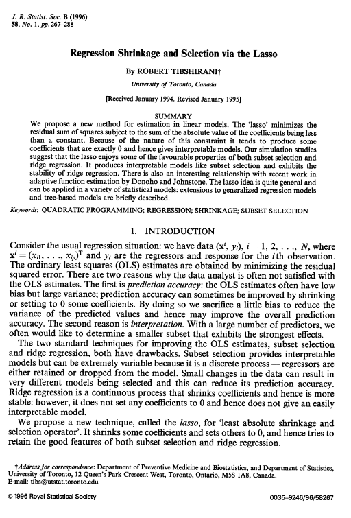{fig-aling="right" width="45%"}
:::

::: {.column width="50%"}
[{fig-alt="Robert Tibshirani, professor no Departamentos de Estatística e Ciência de Dados Biomédicos da Universidade de Stanford." width="50%" height="auto"}](https://en.wikipedia.org/wiki/Robert_Tibshirani)
:::
:::

## 🎛 tune: tunando o hiperparâmetro do modelo lasso 

<br>

O lasso é um modelo de regressão linear múltipla usual, porém, usa-se a penalização
$L_1 = \sum_{i = 1}^d|\beta_i|$. No lasso, buscamos:

$$\widehat{\beta}_{L_1,\lambda} = \argmin_{\beta_0 \in \mathbb{R}, \beta \in \mathbb{R}^d}\sum_{k = 1}^n\overbrace{\left(y_k - \beta_0 - \sum_{i = 1}^d \beta_i x_{x,i}\right)^2}^{n \times EQM} + \overbrace{\lambda \,\,\underbrace{\sum_{j = 1}^d|\beta_j|}_{\text{Penalização}}}^{\text{A magnitude do coeficiente importa!}},$$
em que $\lambda$ é um *tuning parameter* 🎛. Perceba que quando
$\lambda = 0$, caímos no caso do modelo de regressão por mínimos
quadrados sem penalização. Já, quando $\lambda \rightarrow \infty$,
temos um modelo em que todas as variáveis são removidas, uma vez que a
primeira parte do modelo torna-se insignificante.

## 🎛 tune: tunando o hiperparâmetro do modelo lasso 

<br> <br>

Quando $\lambda$ é grande, temos que

$$\sum_{k = 1}^n \left(y_k - \beta_0 - \sum_{j = 1}^d \beta_j x_{k,j}\right)^2 + \lambda \sum_{j = 1}^d |\beta_j| \approx \lambda \sum_{j = 1}^d |\beta_j|,$$
e portanto, $\widehat{\beta}_1 = 0, \cdots, \widehat{\beta}_d = 0$.

<br>

A escolha de $\lambda$, em geral, é feita utilizado algum método de
validação/validação cruzada. 🔍

<br>


## 🎛 tune: tunando o hiperparâmetro do modelo lasso 

[Exemplo]{.red}: Considere uma base de dados simulada, com $n = 500$
observações, de tal forma que

$$Y = 3X_{1} - 2X_2 + X_3 - 3X_4 + X_5 + \sum_{i = 6}^{20}0X_i + \varepsilon,$$
em que $\varepsilon \sim \text{Normal}(0, 0.5^2)$ e
$X_i \sim \text{Normal}(0, 1)$, independentes, com $i = 1, \cdots, 20$.
Desejamos ajustar quatro modelos de regressão. Para o caso do Estimador
de Mínimos Quadrados - EMQ e do modelo Ridge, que não tem seleção
automática de variáveis, usaremos **todas** as variáveis. Desejamos
avaliar o risco estimado de cada uma das regressões.

{width="21%"}

## 🎛 tune: tunando o hiperparâmetro do modelo lasso 

::: columns
::: {.column width="50%"}
{fig-alt="Imagem em aquarela que faz alusão à geração de dados sintéticos." width="70%" height="auto"}
:::
::: {.column width="50%"}
```{r}
#| eval: false
#| class-source: smallcode
library(tibble)

gerar_dados <- function(n = 500, semente = 123) {
  set.seed(semente)

  # Gerar matriz X (500 x 20) com variáveis normais independentes
  x <- matrix(rnorm(n * 20, mean = 0, sd = 1), nrow = n, ncol = 20)
  colnames(X) <- paste0("x", 1:20)

  # Coeficientes verdadeiros (beta)
  beta <- c(3, -2, 1, -3, 1, rep(0, 15))  # X6 a X20 têm efeito zero

  # Gerar erro aleatório (epsilon)
  epsilon <- rnorm(n, mean = 0, sd = 0.5)

  # Calcular Y conforme o modelo
  y <- as.vector(x %*% beta + epsilon)
  dados <- tibble(y = y, as_tibble(x))

  return(dados)
}

# Exemplo de uso:
dados <- gerar_dados(n = 500)
head(dados)  # Y agora é a primeira coluna!
```
:::
:::

## 🎛 tune: tunando o hiperparâmetro do modelo lasso 

<br>

```{r}
#| echo: false
#| warning: false
#| message: false
library(tidyverse)
library(DT)

# Função para gerar dados (mesma do exemplo anterior)
gerar_dados <- function(n = 500, semente = 123) {
  set.seed(semente)
  x <- matrix(rnorm(n * 20, mean = 0, sd = 1), nrow = n, ncol = 20)
  colnames(x) <- paste0("x", 1:20)
  beta <- c(3, -2, 1, -3, 1, rep(0, 15))
  epsilon <- rnorm(n, mean = 0, sd = 0.5)
  y <- as.vector(x %*% beta + epsilon)
  tibble(y = y, as_tibble(x))
}

# Gerar dados e selecionar 10 linhas
dados <- gerar_dados() |> slice(1:10)

# Tabela interativa com DT
datatable(
  dados,
  rownames = FALSE,
  extensions = 'Buttons',
  options = list(
    dom = 'Bfrtip',
    buttons = c('copy', 'csv', 'excel'),
    pageLength = 8,
    scrollX = TRUE
  )
) |> formatRound(columns = 1:21, digits = 3)
```

## Ridge

<br>

Uma alternativa que surgiu antes do lasso é a [regressão ridge]{.red}.
Ela foi proposta no artigo [Hoerl, A. E. & Kennard, R. W. (1970). Ridge
regression: Biased estimation for nonorthogonal problems. Technometrics,
12(1), 55--67](https://www.jstor.org/stable/1267351). Aqui, utiliza-se
como medida de complexidade a norma $L_2$, em que, o estimador é dado
por:

$$\widehat{\beta}_{L_2,\lambda} = \argmin_{\beta_0 \in \mathbb{R}, \beta \in \mathbb{R}^d}\sum_{k = 1}^n\overbrace{\left(y_k - \beta_0 - \sum_{i = 1}^d \beta_i x_{x,i}\right)^2}^{n \times EQM} + \lambda \,\,\underbrace{\sum_{j = 1}^d\beta_j^2}_{\text{Penalização}}.$$
Diferentemente do lasso, a regressão ridge possui solução analítica,
dada por:

$$\widehat{\beta}_{L_2,\lambda} = ({\bf X}^{T}{\bf X} + \lambda\mathbb{\bf I}_0)^{-1}{\bf X}^{T}Y,$$
em que $\mathbb{\bf I}_0$ é a matriz identidade $(d + 1) \times (d + 1)$
com $\mathbb{\bf I}_0(1,1) = 0$.

<br>

## Ridge

<br>

A regressão ridge poderá ter uma variância menor que a regressão lasso,
porém seu viés poderá ser maior. Outra característica da regressão ridge
é que ela possue uma única solução, enquanto a regressão lasso poderá
ter múltiplas soluções. Os autores também demonstram que a regressão
ridge lida melhor com multicolinearidade.

<br>

No R, também poderemos utilizar a biblioteca
[glmnet](https://cran.r-project.org/web/packages/glmnet/index.html):

<br>

```{r}
#| eval: false
library(glmnet)
ajuste <- cv.glmnet(x, y, alpha = 0)
```

<br>

{width="21%"}

## Elastic net

<br>

Na documentação da função [`glmnet`](https://www.rdocumentation.org/packages/glmnet/versions/4.1-7/topics/glmnet), note que a função realiza o lasso mais o ridge, i.e.,

<br>

$$\lambda[(1 - \alpha)/2 ||\beta_j||^2_2 + \alpha||\beta_j||_1],$$

<br>

com $\lambda > 0$ e  $\alpha \in [0, 1]$. Note que para $\alpha = 1$, temos uma regressão do tipo lasso, já para $\alpha = 0$ recaímos para uma penalização do tipo ridge. Para $\alpha$ diferente de zero e um, temos uma *elastic net*, ok?!

<br>


## Elastic Net

<br>

Nesse tipo de modelo de regressão, combina-se as penalizações da regressão
ridge com a utilizada na regressão lasso, herdando os benefícios do uso
de cada um dos métodos isoladamente, melhorando a estabilidade das
estimativas do lasso, em situações de multicolinearidade entre as
variáveis e também permitindo a seleção automática de variáveis.

$$\lambda[(1-\alpha)\widehat{\beta}_{L_2,\lambda} + \alpha\widehat{\beta}_{L_1,\lambda}],$$
em que $0 \leq \alpha \leq1$ e $\lambda \geq 0$. Em R, basta especificar para a função
[`glmnet`](https://www.rdocumentation.org/packages/glmnet/versions/4.1-7/topics/glmnet) um valor de $\alpha$ diferente de 0 e 1. Esse valor normalmente é escolhido por um procedimento de validação cruzada.

<br>

{width="21%"}

## Exemplo: lm, ridge, lasso e elastic net

<br>

[Exemplo]{.red}: Considere uma base de dados simulada, com $n = 500$
observações, de tal forma que

$$Y = 3X_{1} - 2X_2 + X_3 -3X_4 + X_5 + \sum_{i = 6}^{20}0X_i + \varepsilon,$$
em que $\varepsilon \sim \text{Normal}(0, 0.5^2)$ e
$X_i \sim \text{Normal}(0, 1)$, independentes, com $i = 1, \cdots, 20$.
Desejamos ajustar quatro modelos de regressão. Para o caso do Estimador
de Mínimos Quadrados - EMQ e do modelo Ridge, que não tem seleção
automática de variáveis, usaremos **todas** as variáveis. Desejamos
avaliar o risco estimado de cada uma das regressões.

{width="21%"}

## Exemplo: lm, ridge, lasso e elastic net

<br>

```{r}
#| code-fold: false
#| code-summary: "Solução utilizando o tidymodels"
#| eval: true
#| warning: false
#| message: false
#| cache: true
#| class-output: "no-page-break"
#| code-line-numbers: 1-7|12|14-15|39-40|42-45|48-51|53-61|63-69|71-82|84-85|87-102|114-128|130-144|146-153|155-159|164-167|184-195
library(tidymodels)
library(tibble)
library(purrr)
library(ggplot2)
library(patchwork)
library(future)
library(iml)

rm(list = ls())

# Removendo possíveis conflitos de pacotes --------------------------------
tidymodels::tidymodels_prefer()

# Paralelizando o código em Linux, Unix e Windows ----------------------
future::plan(future::multisession)

# Função para gerar os dados ----------------------------------------------
gerar_dados <- function(n = 500, semente = 123) {
  set.seed(semente)

  # Gerar matriz X (500 x 20) com variáveis normais independentes
  x <- matrix(rnorm(n * 20, mean = 0, sd = 1), nrow = n, ncol = 20)
  colnames(x) <- paste0("x", 1:20)

  # Coeficientes verdadeiros (beta)
  beta <- c(3, -2, 1, -3, 1, rep(0, 15)) # X6 a X20 têm efeito zero

  # Gerar erro aleatório (epsilon)
  epsilon <- rnorm(n, mean = 0, sd = 0.5)

  # Calcular Y conforme o modelo
  y <- as.vector(x %*% beta + epsilon)
  dados <- tibble(y = y, as_tibble(x))

  return(dados)
}

# Fixando a semente para reprodutibilidade -----------------------------
set.seed(123)
dados <- gerar_dados(n = 1500L)

# Divisão inicial da base -------------------------------------------------
dados_hold_out <- initial_split(dados, prop = 0.7, strata = y)
treino <- training(dados_hold_out)
teste <- testing(dados_hold_out)

# Setando o modelo (set engine) -------------------------------------------
modelo_lm <-
  linear_reg(penalty = 0, mixture = 0) |>
  set_mode("regression") |>
  set_engine("glmnet")

modelo_ridge <-
  linear_reg(penalty = tune::tune("lambda"), mixture = 0) |>
  set_mode("regression") |>
  set_engine("glmnet")

modelo_lasso <-
  parsnip::linear_reg(penalty = tune::tune("lambda"), mixture = 1) |>
  set_mode("regression") |>
  parsnip::set_engine("glmnet")

modelo_elastic <-
  parsnip::linear_reg(
    penalty = tune::tune("lambda"),
    mixture = tune::tune("alpha")
  ) |>
  set_mode("regression") |>
  parsnip::set_engine("glmnet")

# Criando workflows -------------------------------------------------------
all_wf <-
  workflow_set(
    preproc = list(y ~ .), # Não estou colocando receita
    models = list(
      lm = modelo_lm,
      ridge = modelo_ridge,
      lasso = modelo_lasso,
      elastic = modelo_elastic
    ),
    cross = FALSE
  )

# Validação cruzada -------------------------------------------------------
cv <- rsample::vfold_cv(treino, v = 5L)

# Tunagem dos hiperparâmetros ---------------------------------------------
# A semente (seed = 0) faz com que dentro da validação cruzada para cada modelo
# a semente seja sempre a mesma.
tunagem <-
  all_wf |>
  workflow_map(
    seed = 0, # Garantindo as mesmas amostras para cada modelo
    verbose = TRUE,
    resamples = cv,
    grid = 50,
    metrics = yardstick::metric_set(
      rmse,
      rsq,
      mae
    )
  )

# Rank dos melhores modelos -----------------------------------------------
modelos_rank <- tunagem |>
  workflowsets::rank_results()

# Visualizando os resultados na tunagem -----------------------------------
# utilizando a EQM. Não é a avaliação final
# do modelo.
p1 <- autoplot(tunagem, metric = "rmse") +
        aes(color = wflow_id)

# Extrair melhores configurações de hiperparâmetros ----------------------
melhores_configs <- list(
  lm = tunagem |>
    extract_workflow_set_result("formula_lm") |>
    select_best(metric = "rmse"),
  ridge = tunagem |>
    extract_workflow_set_result("formula_ridge") |>
    select_best(metric = "rmse"),
  lasso = tunagem |>
    extract_workflow_set_result("formula_lasso") |>
    select_best(metric = "rmse"),
  elastic = tunagem |>
    extract_workflow_set_result("formula_elastic") |>
    select_best(metric = "rmse")
)

# Extraindo os melhores workflows e finalizando os modelos ------------
melhores_workflows <- list(
  lm = tunagem |>
    extract_workflow("formula_lm") |>
    finalize_workflow(melhores_configs$lm),
  ridge = tunagem |>
    extract_workflow("formula_ridge") |>
    finalize_workflow(melhores_configs$ridge),
  lasso = tunagem |>
    extract_workflow("formula_lasso") |>
    finalize_workflow(melhores_configs$lasso),
  elastic = tunagem |>
    extract_workflow("formula_elastic") |>
    finalize_workflow(melhores_configs$elastic)
)

# Último ajuste e avaliação final ------------------------------------------
resultados_teste <- map(
  melhores_workflows,
  ~ last_fit(.x, split = dados_hold_out) |>
    collect_metrics() |>
    filter(.metric == "rmse") |>
    pluck(3)
)

# Gerando tabela comparativa -----------------------------------------------
risco_preditivo <- tibble::tibble(
  modelo = names(resultados_teste),
  EQM = unlist(resultados_teste)
)

#  Visualizando o risco preditivo dos modelos avaliados
# print(risco_preditivo)

# Modelo final -------------------------------------------------------------
modelo_final <-
  melhores_workflows$lasso |>
  fit(data = treino)

# Previsões com o modelo final ---------------------------------------------
previsoes <- augment(modelo_final, new_data = teste)

# Visualizando as previsões ------------------------------------------------
p2 <-
  previsoes |>
  ggplot(aes(x = y, y = .pred)) +
  geom_point() +
  geom_smooth(formula = y ~ x, method = "lm", se = FALSE) +
  labs(
    title = "Previsões do modelo Lasso",
    x = "y",
    y =  expression(hat(y))
  )

# Gráfico PDP + ICE --------------------------------
# Criar o predictor (objeto que o iml usa para interpretar o modelo)
# Usando iml --------------------------------------------------------------
preditor <- iml::Predictor$new(
  extract_fit_parsnip(modelo_final),
  data = treino[-1L], # (data frame com covariáveis) removendo a variável resposta
  y = treino$y
)
efeitos <- iml::FeatureEffects$new(preditor, method = "pdp+ice")
imp <- iml::FeatureImp$new(preditor, loss = "rmse")
p3 <- efeitos$plot()
p4 <- imp$plot()
```

## Exemplo: lm, ridge, lasso e elastic net

<br>

*Partial Dependence Plot* - PDP e *Individual Conditional Expectation* - ICE:

```{r}
#| eval: true
#| echo: false
p3
```

## Exemplo: lm, ridge, lasso e elastic net

<br>

```{r}
#| eval: true
#| echo: false

p1 <- p1 +
  labs(
    title = "Desempenho dos modelos na validação cruzada",
    subtitle = "Lasso, Ridge e Elastic Net",
    y = "Raíz do Erro Quadrático Médio (RMSE)",
  ) +
  theme(
    axis.text.x = element_text(angle = 45, hjust = 1)
  )

p2 <- p2 +
  labs(
    title = "Previsões do modelo escolhido - Lasso",
    subtitle = "Avaliando as previsões do conjunto de teste",
    x = "y",
    y =  expression(hat(y))
  ) +
  theme(
    axis.text.x = element_text(angle = 45, hjust = 1)
  )
p1 | p2
```

## Exemplo: lm, ridge, lasso e elastic net

<br>

*Variable Importante Plot* - VIP:

```{r}
#| eval: true
#| echo: false
p4
```

## Importância das variáveis 

<br>

O gráficos VIP, ICE e PDP são gráficos que nos ajudam a entender o modelo
escolhido. Eles foram produziros utilizando o pacote [**iml**](https://cran.r-project.org/web/packages/iml/index.html). Alguns pacotes que podem ser utilizados para interpretação de modelos são:

<br>

::: columns
::: {.column width="50%"}
1. [**iml**](https://cran.r-project.org/web/packages/iml/index.html);
2. [**DALEX**](https://modeloriented.github.io/DALEX/);
3. [**flashlight**](https://mayer79.github.io/flashlight/);
4. [**vip**](https://koalaverse.github.io/vip/);
5. [**lime**](https://cran.r-project.org/web/packages/lime/index.html).
:::
::: {.column width="50%"}
[{fig-alt="Imagem em aquarela fazendo alusão ao uso do pacote iml." width="40%" height="auto"}](https://cran.r-project.org/web/packages/iml/index.html)
:::
:::

## 💻 Visão geral: tidymodels

<br>

. Todos os pacotes
(rsample, recipes, parsnip, tune, dails, yardstick) são gerenciados pelo
pacote [tidymodels](https://www.tidymodels.org/). Cada um desses pacotes
fornece um conjunto de funções úteis em tarefas específicas no workflow
de machine learning.](imgs/workflow_tidymodels.png){fig-aling="center"
width="70%"}

## 💻 Visão geral: tidymodels

<br>

 de R. Basicamente
gostaríamos de ter uma automação da faze do tratamento das *features*
realizada com o [recipes](https://recipes.tidymodels.org/) com a
modelagem.](imgs/MachineLearning_tidymodels.png){fig-aling="center"}

## 🕹️ O jogo inteiro

<br>
<br>

```{r diagram-model-n, echo = FALSE}
#| fig-align: "center"

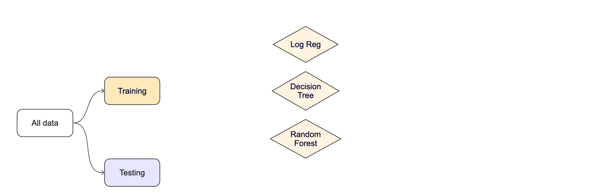
```

## 🕹️ O jogo inteiro

<br>
<br>

```{r diagram-resamples, echo = FALSE}
#| fig-align: "center"

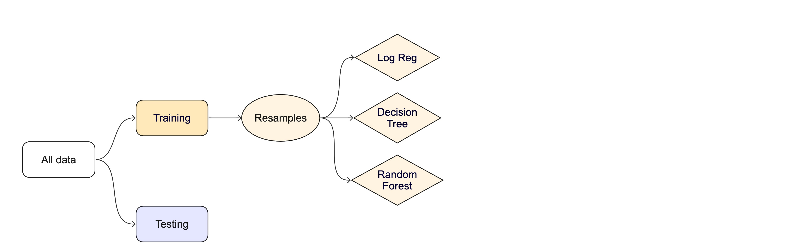
```

## 🕹️ O jogo inteiro

<br>
<br>

```{r diagram-select, echo = FALSE}
#| fig-align: "center"

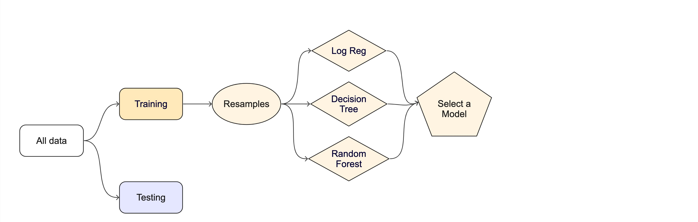
```

## 🕹️ O jogo inteiro

<br>
<br>

```{r diagram-final-fit, echo = FALSE}
#| fig-align: "center"

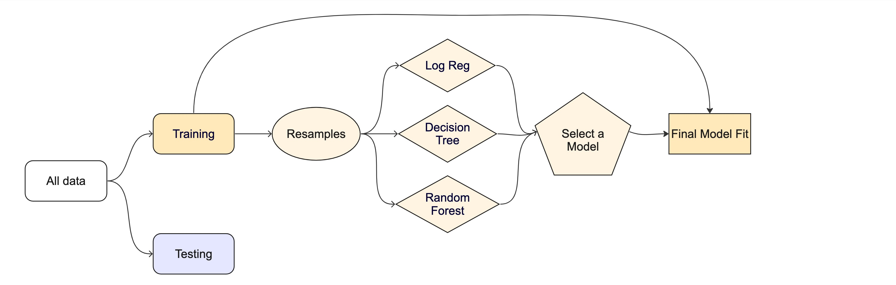
```

## 🕹️ O jogo inteiro

<br>
<br>

```{r diagram-final-performance, echo = FALSE}
#| fig-align: "center"

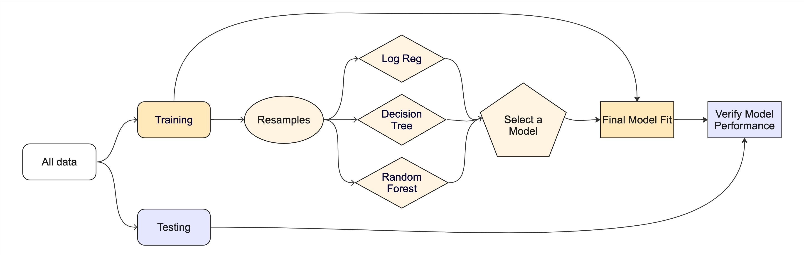
```

## 🔌 API - Application Programming Interface

<br>

*   Criamos modelos poderosos em R, muitas vezes usando um framework como o [**tidymodels**](https://www.tidymodels.org/packages/).
*   O objetivo final é usar esses modelos na "produção", ou seja, aplicá-los em novos dados para fazer previsões ou classificações.
*   Mas como outros sistemas (escritos em Python, Ruby, Rust, Go, Java, etc.) ou usuários sem conhecimento de R podem usar esses modelos?

::: columns
::: {.column width="60%"}
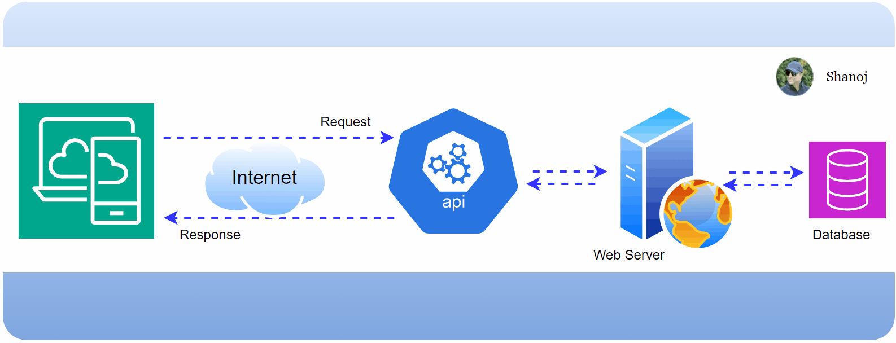{width="100%"}
:::
::: {.column width="40%"}
{width="40%"}
:::
:::

## 🔌 API - Application Programming Interface

::: columns
::: {.column width="40%"}

<br>

- Uma **API** - *Application Programming Interface* permite que diferentes sistemas de software interajam entre si.

- Ao ["servir"]{.mark} seu modelo R via uma API, você o torna um **serviço** que outros sistemas podem **chamar** para obter previsões.

- Isso significa que a lógica do modelo (criada no R) pode ser utilizada por aplicações escritas em **qualquer outra linguagem** ou plataforma.
:::
::: {.column width="60%"}
[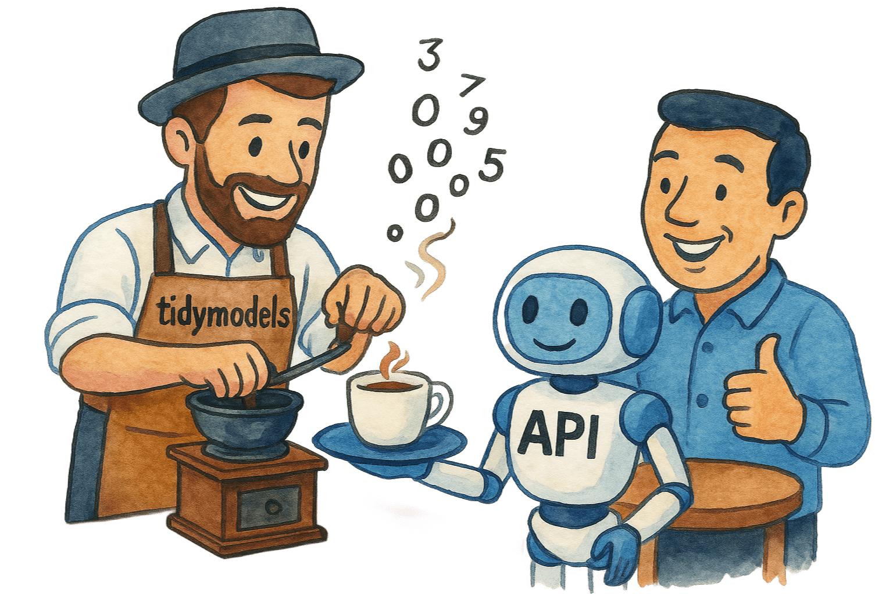{fig-alt="O tidymodels preparando um modelo e a API servindo o usuário." width="100%" height="auto"}](https://vetiver.posit.co/)
:::
:::

#  {.title background-image="imgs/aquarela_api_fundo.png" background-size="100% 100%"}


## 🔌 vetiver: construindo API para modelos R 

::: columns

::: {.column width="50%"}
*   Após treinar seu modelo (ex: com [**tidymodels**](https://www.tidymodels.org/packages/)), você obtém um **objeto final** (um `workflow` é ideal, combinando pré-processamento e modelo).
*   Este objeto pode ser **salvo** (formato `.rds` ou `.rda` - um arquivo serial contendo o workflow da modelagem).
*   [**vetiver**](https://vetiver.posit.co/) pega este objeto salvo via `pins` e automaticamente cria uma API via [**plumber**](https://www.rplumber.io/) para [**servir previsões**]{.mark}.
*   Ele funciona com diversos tipos de objetos de modelo R, incluindo os de tidymodels (`parsnip`, `workflows`), `caret`, etc.
:::
::: {.column width="50%"}
[{fig-alt="Imagem em aquarela fazendo alusão ao uso do pacote vetiver." width="70%" height="auto"}](https://vetiver.tidymodels.org/)
:::
:::

#  {.title background-image="imgs/ml_ops_cycle.png" background-size="100% 100%"}

## 🔌 vetiver: construindo API para modelos R 


<br>
<br>

::: {.columns"}
::: {.column width="50%"}
[![**Workflow completo** 🌐 do papel do [**vetiver**]{.underline} 🌿 na construção de uma API para o modelo.](imgs/ml_ops_cycle.svg){fig-alt="Workflow completo do papel do vetiver." width="100%" style="margin-top:10px;"}](https://vetiver.posit.co/)
:::
::: {.column width="50%"}
[![**Chrysopogon zizanioides (L.) Roberty** - planta [**vetiver**]{.underline} 🌿, cujo óleo é usado na perfumaria 🧴 para fixação da fragrância.](imgs/aquadrela_planta_vetiver.png){fig-alt="Planta vetiver" width="50%" style="margin-top:10px;"}](https://pt.wikipedia.org/wiki/Vetiver)
:::
:::

## 🔌 vetiver: um exemplo de uso 

```{r}
#| eval: false
#| code-line-numbers: 1-3|5-6|8-12|14-15|17-18|20-21|23-24|31-37|43-48|50-55|58-61|63-64
#| class-source: smallcode
library(vetiver)
library(pins)
library(callr) # Executar funções em segundo plano

# Dados e modelo bem simples (sem tuning, só para exemplo)
modelo_lm <- lm(mpg ~ hp + wt, data = mtcars)

# Criar um objeto "vetiver" (nome do modelo: "modelo_lm")
v <- vetiver_model(
  model = modelo_lm,
  model_name = "modelo_lm_v1"
)

# Criar um board local (pasta) com modelos em .rds
board <- board_folder("modelos", versioned = TRUE)

# Pinar o modelo no board
vetiver_pin_write(board = board, vetiver_model = v)

# Verificar o que está no board
pin_list(board) # Deve mostrar "modelo_lm"

# Verificando detalhes das versões
pin_versions(board, "modelo_lm_v1")

# modelo <- vetiver_pin_read(
#   board,
#   "modelo_lm_v1"
# )

# Gerar o arquivo da API
vetiver_write_plumber(
  board,
  "modelo_lm_v1",
  file = "api_modelo.R",
  version = NULL # NULL = última versão
)

# Iniciar a API localmente (rodará na porta 8080)
# lsof -i :8080 (verificando se a porta 8080 está livre em Linux e Mac)
# Matando um processo: kill -9 <PID> (Linux e Mac)
# A API roda em segundo plano, permitindo que o prompt do R não fique travado
callr::r_bg(
  function() {
    pr <- plumber::plumb("api_modelo.R")
    pr$run(port = 8080)
  }
)

# Espera um tempo até o servidor plumber estar ativo para receber
# requisições. O tempo pode variar dependendo do computador.
Sys.sleep(5)

# Criando um endpoint para fazer previsões
endpoint <- vetiver_endpoint("http://127.0.0.1:8080/predict")
# Verificando o protótipo do endpoint
# vetiver_ptype(modelo_lm, TRUE)
previsao <- predict(
  endpoint,
  new_data = data.frame(hp = c(100, 150), wt = c(2.5, 3.0))
)

# Verificando o resultado
print(previsao)
```

<br>

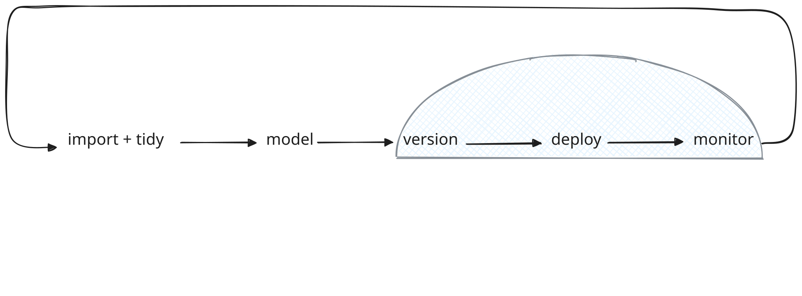{width="40%"}


## 📦 vetiver: criando uma imagem docker da API 

::: columns
::: {.column width="50%"}
[{fig-alt="Imagem em aquarela da logo do docker." width="60%" height="auto"}](https://cran.r-project.org/web/packages/iml/index.html)
:::
::: {.column width="50%"}

<br>

+ Se você não tem o docker instalado, faça o download [aqui](https://www.docker.com/products/docker-desktop/).
+ O docker é uma plataforma que permite criar, implantar e executar aplicativos em contêineres.
+ Um contêiner é uma unidade leve e portátil de software que inclui tudo o que um aplicativo precisa para ser executado.
+ O vetiver pode criar uma imagem docker para o seu modelo, facilitando a implantação em qualquer lugar ([suporte nativo ao docker]{.underline .mark}).
:::
:::

## 📦 vetiver: por que dockerizar a API? 

- Aplicar as vantagens do Docker especificamente ao deploy da API criada com `vetiver`:
- Garantir que a API rode em um **ambiente consistente e isolado**.
- Assegurar que as **versões corretas de R e pacotes** (`vetiver`, `plumber`, pacotes do modelo, etc.) estejam presentes.
- **Evitar problemas de dependência** que poderiam quebrar a API em diferentes servidores.
- **Simplificar a movimentação** da API entre ambientes (desenvolvimento, teste, produção).

{width="20%"}


## 📦 vetiver: exemplo 

Para criar uma imagem docker da API do nosso modelo que construímos via o **vetiver**, devemos criar o arquivo `Dockerfile`.

<br>

```{r}
#| eval: false
#| class-source: smallcode
#| code-line-numbers: 1-7|9-13|15-19|26-31
library(vetiver)
library(pins)

rm(list = ls())

# Dados e modelo bem simples (sem tuning, só para exemplo)
modelo_lm <- lm(mpg ~ hp + wt, data = mtcars)

# Criar um objeto "vetiver" (nome do modelo: "modelo_lm")
v <- vetiver_model(
  model = modelo_lm,
  model_name = "modelo_lm_v1"
)

# Criar um board local (pasta) com modelos em .rds
board <- board_folder("modelos", versioned = TRUE)

# Pinar o modelo no board
vetiver_pin_write(board = board, vetiver_model = v)

# modelo <- vetiver_pin_read(
#   board,
#   "modelo_lm_v1"
# )

# Criando Dockerfile
vetiver_prepare_docker(
  board,
  "modelo_lm_v1",
  docker_args = list(port = 8080)
)
```

## 📦 vetiver: `Dockerfile` criado 

O função `vetiver_prepare_docker()` irá criar o arquivo da receita da imagem docker, o arquivo [Dockerfile](https://docs.docker.com/reference/dockerfile/). Você precisa apenas adicionar a linha `COPY modelos /opt/ml/modelos` que irá copiar o diretório com o quadro dos modelos para a imagem.

<br>

```{r}
#| eval: false
#| code-line-numbers: 19|1-21
# Generated by the vetiver package; edit with care
FROM rocker/r-ver:4.5.0
ENV RENV_CONFIG_REPOS_OVERRIDE https://packagemanager.rstudio.com/cran/latest

RUN apt-get update -qq && apt-get install -y --no-install-recommends \
  libcurl4-openssl-dev \
  libicu-dev \
  libsodium-dev \
  libssl-dev \
  libx11-dev \
  make \
  zlib1g-dev \
  && apt-get clean

COPY vetiver_renv.lock renv.lock
RUN Rscript -e "install.packages('renv')"
RUN Rscript -e "renv::restore()"
COPY plumber.R /opt/ml/plumber.R
COPY modelos /opt/ml/modelos # <1>
EXPOSE 8080
ENTRYPOINT ["R", "-e", "pr <- plumber::plumb('/opt/ml/plumber.R'); pr$run(host = '0.0.0.0', port = 8080)"]
```
1. Linha que deverá ser adicionada para copiar os modelos que são arquivos `.rds` para a imagem docker. As demais linhas são criadas automaticamente pelo comando `vetiver_prepare_docker()`.

## 📦 vetiver: gerando imagem e executando um container 

Você poderá, se quiser, enviar a imagem da API para o [**dockerhub**](https://hub.docker.com/) em que sua API ficará disponível para qualquer um que tenha acesso a internet. Por exemplo, você poderá em uma máquina diferente, mesmo que não tenha o **R** e o **tidymodels** instalados, fazer previsões com o seu modelo. Depois de fazer uma conta no [**dockerhub**](https://hub.docker.com/), você poderá empurrar a imagem para o seu repositório com o seguinte comando:


```{bash}
#| eval: false

# Login no dockerhub
sudo docker login

# Construindo a imagem docker
sudo docker build --no-cache -t nome-da-imagem .

# Ou: na construção da imagem você também poderá adicionar a tag
sudo docker build --no-cache -t nome-da-imagem:tag .

# Se não colocou a tag na construção (no build) ou precisa
# enviar para o dockerhub, poderá fazer algo como:
sudo docker tag modelo:latest prdm0/modelo:latest

# Enviando a imagem para o dockerhub
sudo docker push prdm0/modelo:latest
```

## 📦 vetiver: gerando imagem e executando um container 

Com a nossa API, podemos gerar uma imagem docker da API e executar um contêiner 🚢📦 a partir da imagem. No diretório o `Dockerfile` 🐳, execute o seguinte comando:

<br>

```{bash}
#| eval: false
# Se a imagem estiver no dockerhub, você pode fazer o download dela:
sudo docker pull prdm0/modelo:latest
# Executando o container
sudo docker run -d -p 8080:8080 nome-da-imagem
```

<br>

Visualize a API sendo executada pelo container no seu navegador em `http://localhost:8080/__docs__/`. Suas predições devem ser feitas em `http://localhost:8080/predict`. O comando `sudo docker pull prdm0/modelo:latest` você deve rodar em uma nova máquina com o docker instalado que não tenha a imagem da API do modelo. Se a imagem já estiver na máquina, não é necessário executar o comando `docker pull`.

{width="20%"}

## 🐳📦 Docker: principais comandos 

<br>

#### 🔍 Informação do Sistema
| Comando | Descrição |
|---------|-----------|
| `docker version` | Exibe versão do Docker 🏷️ |
| `docker info` | Mostra informações do sistema ℹ️ |
| `docker stats` | Monitora recursos em tempo real 📊 |

#### 🏗️ Gerenciamento de Imagens
| Comando | Descrição |
|---------|-----------|
| `docker images` | Lista imagens locais 📋 |
| `docker pull <imagem>` | Baixa imagem do registry ⬇️ |
| `docker build -t <tag> .` | Constrói imagem do Dockerfile 🛠️ |
| `docker image prune` | Remove imagens não utilizadas 🗑️ |

#### 🚢 Controle de Containers
| Comando | Descrição |
|---------|-----------|
| `docker run -d -p <porta_pc:porta_container> <imagem>` | Executa container em background 🏃 |
| `docker ps` | Lista containers ativos ✅ |
| `docker ps -a` | Mostra todos containers, incluindo os parados 📜 |
| `docker start/stop <container>` | Inicia/para container ⏯️ |
| `docker exec -it <container> sh` | Acessa terminal do container 💻 |
| `docker logs <container>` | Exibe logs do container 📝 |

#### 🧹 Limpeza
| Comando | Descrição |
|---------|-----------|
| `docker container prune` | Remove containers parados 🧽 |
| `docker system prune` | Limpeza geral (containers, redes, cache) ♻️ |
| `docker system prune -a` | Limpeza agressiva removendo tudo que não está em uso 💥 |

#### 🛠️ Ferramentas Avançadas
| Comando | Descrição |
|---------|-----------|
| `docker-compose up` | Inicia serviços do compose 🚀 |
| `docker network ls` | Lista redes disponíveis 🌐 |
| `docker volume ls` | Lista volumes de dados 💾 |

#### ☁️ Docker Hub
| Comando | Descrição |
|---------|-----------|
| `docker login` | Autentica no registry 🔐 |
| `docker push <user>/<imagem>` | Publica imagem no Hub 📤 |
| `docker tag imagem:latest usuario/imagem:latest` | Cria nova tag para push no Docker Hub 🏷️|

<br>

📌 **Dica:** Use `--help` após qualquer comando para ver opções detalhadas!

## 📦 vetiver: comandos úteis em sistemas linux/unix 

<br>

Portas de rede 🌐 são pontos virtuais de comonicação em um computador utilizado para organizar o trágego de rede 🖧 entre diferentes aplicativos. Cada porta é identificada por um número, e cada aplicativo ["escuta"]{.underline} 🎧 em uma porta 🚪📶 específica para receber dados. Os comandos `lsof` e `ss` são úteis:

<br>

```{bash}
#| eval: false

# Verificando quais portas já estão em uso
sudo ss -tulpn

# Verificando se a porta 8080 está livre.
# Se estiver livre, o comando não retorna nada.
sudo lsof -i :8080

# Matando um processo que está utilizando a porta 8080
sudo kill -9 <PID>
```

Para uso geral de desenvolvimento, poderá considerar portas de `8000` a `8999`. Recomenda-se que para *web servers*, em desenvolvimento as portas no intervalo `8080` a `8099`. Mas você poderá usar qualquer porta. As portas livres sem necessidade de ser administrador do sistema estão definidas no intervalo `1024` a `65535`.


#  {.title background-image="imgs/api_vetiver.png" background-size="100% 100%"}

## 📦 vetiver: gerando imagem e executando um container 

Como visto anteriormente, as previsões, por exemplo, em R, são feitas fazendo:

<br>

```{r}
#| eval: false
# Criando um endpoint para fazer previsões
endpoint <- vetiver_endpoint("http://127.0.0.1:8080/predict")
previsao <- predict(
  endpoint,
  new_data = data.frame(hp = c(100, 150), wt = c(2.5, 3.0))
)
```

<br>

Acima é uma forma de usar o R para acessar a API e poder fazer previsões a partir do modelo. Porém, outra pessoa que não programa em **R**, pode fazer previsões com o modelo. Para isso, basta fazer uma requisição HTTP para a API. Para fazer as previsões e consumir os resultados do modelo não é necessário ter o **R** instalado. Você pode fazer isso em qualquer linguagem de programação, como **Python**, **Java**, **Ruby**, etc.

## 🌐 vetiver: exportar a API da sua máquina 

Outras pessoas podem usar a [API]{.underline} 🎉 do seu modelo e acessar em outra rede 🌐 ou máquina 💻. Para isso, você pode usar o [[**ngrok**](https://ngrok.com/)]{.underline} ou o [**serveo**](https://serveo.net/). O [**ngrok**](https://ngrok.com/) é um serviço que permite expor um servidor local para a internet. No terminal, execute o seguinte comando:

<br>

```{bash}
#| eval: false
# Substitua por sua chave de autenticação
ngrok authtoken SEU_TOKEN_AUTH
# Uma vez que sua API roda em um container na porta 8080
ngrok http 8080
```

<br>

Ao criar uma conta no [**ngrok**](https://ngrok.com/) você poderá ter acesso ao `SEU_TOKEN_AUTH`. Ele devolverá um link em que qualquer pessoa 🧙‍♂️ poderá acessar a API do seu modelo. A máquina que irá acessar e consumir os resultados não precisa ter o **R** instalado.

{width="20f%"}


## 🌐 vetiver: exportar a API da sua máquina 

<br>

A aplicação [**shiny**](https://shiny.posit.co/) abaixo [**não está rodando nessa máquina**]{.underline}. Vamos informar, na aplicação, o link da API para o modelo lasso. Ao expor a porta `8080` (`ngrok http 8080`) da API via [**ngrok**](https://ngrok.com/), a aplicação poderá consumir as previsões do modelo lasso.

<br>

📌 **Atenção**: Apenas irá funcionar se você, em sua máquina, criar uma API do modelo lasso e a exportar via **ngrok** 🧙‍♂️. De preferência, crie uma imagem e rode o container **docker** 🐳📦 da API, como ensinado anteriormente.

<br>

Para visualizar 🔭 melhor a aplicação, clique [**AQUI** 🧑‍💻](https://pedro-rafael.shinyapps.io/app_api/).

<br>

::: {.iframe-container}
<iframe src="https://pedro-rafael.shinyapps.io/app_api/" width="100%" height="500px" frameborder="4"></iframe>
:::

## 🌐 vetiver: serviços nas nuvens ☁️ 

<br>

Se você não tem uma máquina para ser o servidor da API, você poderá fazer o deploy da API docker 📦 em um servidor na nuvem ☁️. Alguns serviços de nuvem que você pode usar para fazer o deploy da sua API são:

| Serviço | Descrição |
|---------|-----------|
| [**Fly.io**](https://fly.io) | Plataforma global para containers com baixa latência e scaling automático |
| [**Koyeb**](https://www.koyeb.com) | Serverless para containers com deploy via Git e Docker Hub |
| [**AWS ECS**](https://aws.amazon.com/ecs) | Orquestração de containers integrada ao ecossistema AWS |
| [**Cloud Run**](https://cloud.google.com/run) | Serverless para containers com scaling até zero |
| [**Azure Containers**](https://azure.microsoft.com) | Containers sem gerenciamento de servidores na Microsoft |
| [**DigitalOcean**](https://www.digitalocean.com) | Plataforma simplificada com deploy contínuo | Custo previsível e UI intuitiva |


{width="30%"}

## 🏠🏢 Previsão imobiliária de imóveis de Teresina usando tidymodels

<br>
<br>

::: columns
::: {.column width="50%"}
[{width="80%" height="auto"}](https://www.zapimoveis.com.br/)
:::
::: {.column width="50%"}
Vamos considerar dados de anúncios imobiliários 🏠🏢 do [**zap imóveis**](https://www.zapimoveis.com.br/) de imóveis (casas 🏠 e apartamentos 🏢) anunciados para a cidade de [Teresina]{.underline}. O objetivo é prever o preço 💰🪙💵 venal (preço de mercado) de venda de um imóvel em função de suas características.

<br>

{width="30%"}
:::
:::

## 🏠🏢 Previsão imobiliária de imóveis de Teresina usando tidymodels

<br>

A base de dados dos imóveis anunciados na cidade de Teresina poderá ser baixada 💾 clicando [**AQUI**](dados/teresina.csv).

<br>

```{r}
#| code-fold: true
library(DT)
library(readr)
library(visdat)

# Carregar os dados (ajuste o caminho se necessário)
dados <- read_csv("dados/teresina.csv")
dplyr::glimpse(dados)
visdat::vis_dat(dados)
```

## 🏠🏢 Previsão imobiliária de imóveis de Teresina usando tidymodels

<br>

Para acessar a análise, clique [AQUI](assets/modelo_teresina.html)

<br>

<iframe src="assets/modelo_teresina.html" width="100%" height="600px" frameborder="0"></iframe>


## 📚 Indicação de leitura

<br>

::: columns
::: {.column width="50%"}

[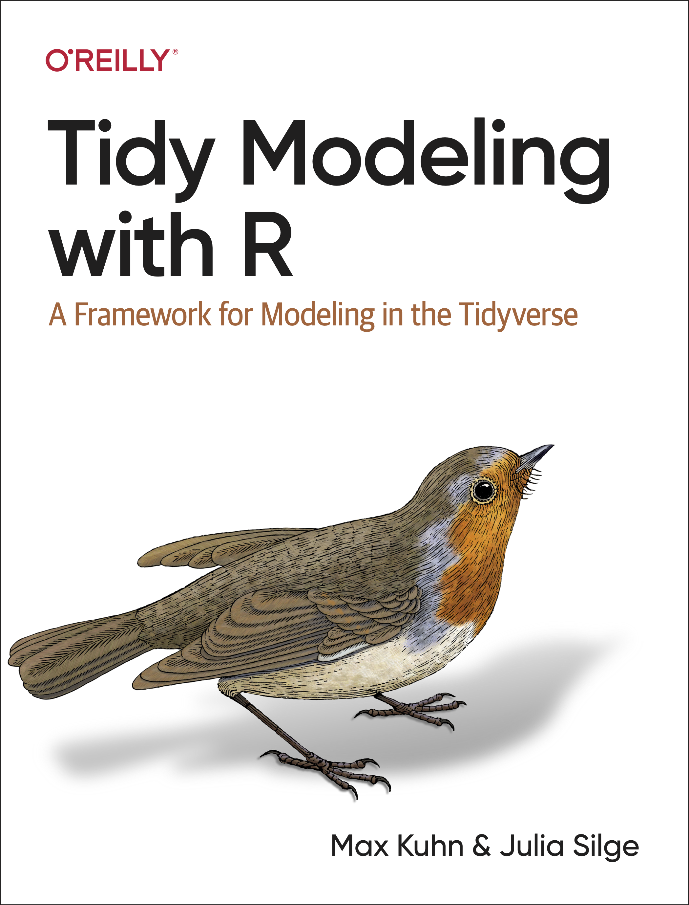{width="50%" height="auto"}](https://www.tmwr.org/)
:::
::: {.column width="50%"}
[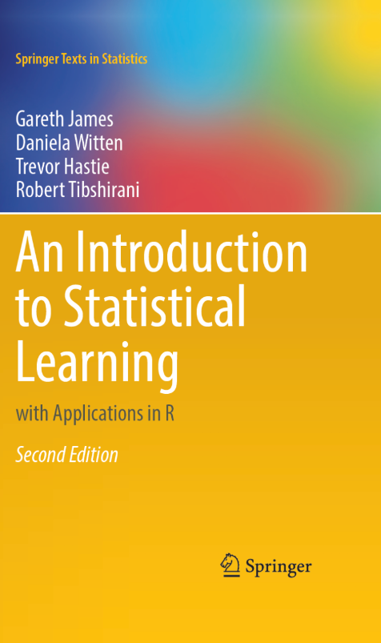{width="45%" height="auto"}](https://www.statlearning.com/)
:::
:::

## 📚 Referências

<br>

### [Ecossistema Tidymodels]{.underline}
1. **Kuhn, M., & Silge, J.** (2022). *Tidy modeling with R: A framework for modeling in the tidyverse*. O'Reilly Media. ISBN: 978-1-492-07924-4
2. **Kuhn, M., Wickham, H., & others** (2020). *Tidymodels: A collection of packages for modeling and machine learning using tidyverse principles*. https://www.tidymodels.org
3. **Kuhn, M., & Johnson, K.** (2023). *Tidymodels computing supplement to applied machine learning for tabular data*. https://tidymodels.aml4td.org Acesso em: 21 maio 2025
4. **Silge, J.** (2023). *vetiver: Version, share, deploy, and monitor models* (Version 0.2.5) [R package]. https://CRAN.R-project.org/package=vetiver. DOI: [10.32614/CRAN.package.vetiver](https://doi.org/10.32614/CRAN.package.vetiver)

### [Infraestrutura e Deploy]{.underline}
1. **Docker, Inc.** (2023). *Docker documentation*. https://docs.docker.com
2. **ngrok, Inc.** (2023). *ngrok documentation*. https://ngrok.com/docs
3. **Schloerke, B., & Allen, J.** (2025). *plumber: An API generator for R* (Version 1.3.0) [R package]. https://CRAN.R-project.org/package=plumber. DOI: [10.32614/CRAN.package.plumber](https://doi.org/10.32614/CRAN.package.plumber)

### [Pacotes R Essenciais]{.underline}
1. **Csárdi, G., & Chang, W.** (2024). *callr: Call R from R* (Version 3.7.6) [R package]. https://CRAN.R-project.org/package=callr. DOI: [10.32614/CRAN.package.callr](https://doi.org/10.32614/CRAN.package.callr)
2. **Wickham, H.** (2017). *tidyverse: Easily install and load the 'tidyverse'* [R package]. https://CRAN.R-project.org/package=tidyverse
3. **Molnar, C., Bischl, B., & Casalicchio, G.** (2018). *iml: An R package for interpretable machine learning*. Journal of Open Source Software, 3(26), 786. DOI: [10.21105/joss.00786](https://doi.org/10.21105/joss.00786)
4. **Bengtsson, H.** (2021). *A unifying framework for parallel and distributed processing in R using futures*. The R Journal, 13(2), 208-227. DOI: [10.32614/RJ-2021-048](https://doi.org/10.32614/RJ-2021-048)

### [Livros Fundamentais]{.underline}
1. **James, G., Witten, D., Hastie, T., & Tibshirani, R.** (2013). *An introduction to statistical learning*. Springer. ISBN: 978-1-4614-7138-7

#  {.title background-image="gifs/aplausos.gif" background-size="100% 100%"}


# Obrigado! 🙏
